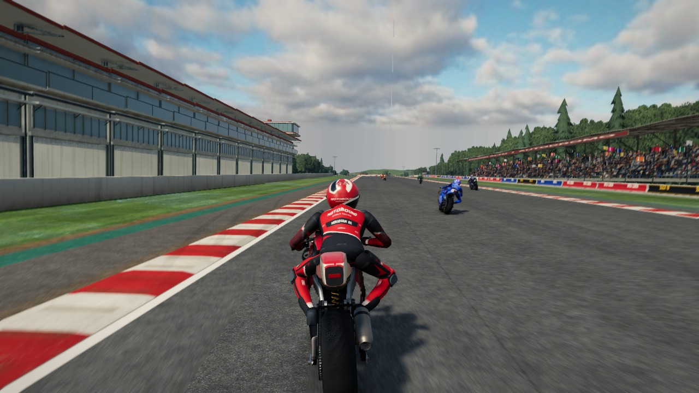
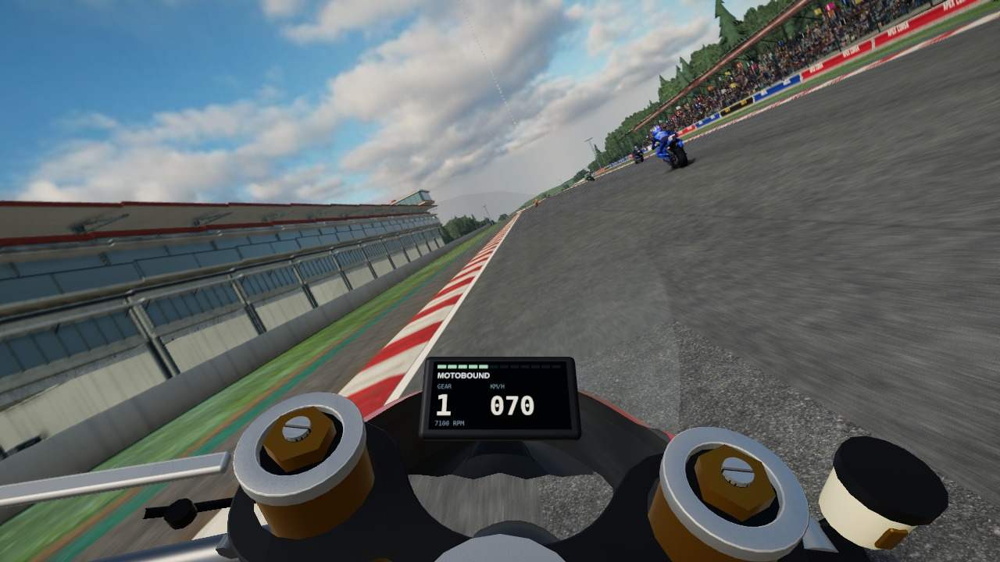
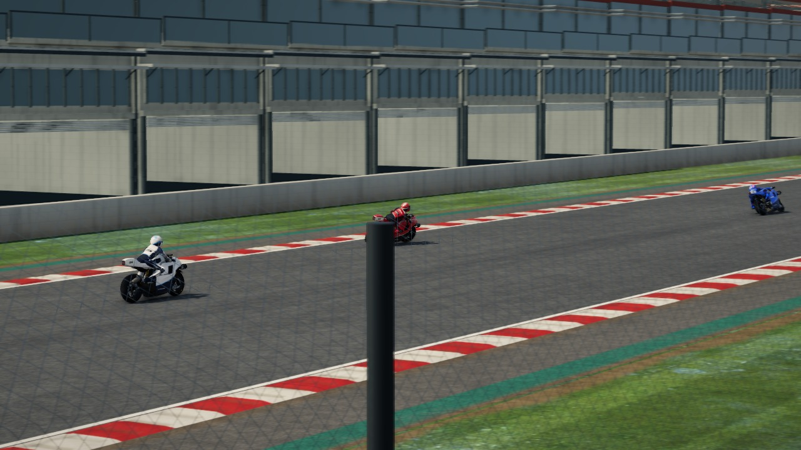

# MotoGP hyperrealism programme

This document records a coordinated attempt to take the MotoGP section (GP-R1 and GP-R2 prototypes, the `gp-motorcycle` ruleset and the four motorcycle-GP venues) from "amateurish and cartoony" towards the hyperrealism of the supplied MotoGP 26 PS5 reference pack. A project manager (PM) session planned the work, built the review tooling, wrote briefs and ran five specialist agents in parallel. It also integrated their branches. The user then asked for the remaining work to continue with a **single agent**. This record is the hand-off: what each agent did, where it stopped, and what is left.

**Status:** in progress. Every agent's work is merged into `claude/elegant-hopper-xdwdz9` and pushed. It has not yet been reviewed, captured end-to-end or documented as a delivery; see [Remaining work](#remaining-work).

## Goal and references

- **Target.** The 100-image reference pack (`reference/MotoGP26/MotoGP26_PS5_100_Reference_Images.zip`; the user re-supplied the same numbered images re-encoded under 30 MB). The pack includes five contact sheets and `MANIFEST.csv`.
- **Rights.** Principles are re-created; no real team, sponsor, rider or brand marks are copied. All names on bikes, riders and boards stay fictional.
- **Diagnosis.** The PM reviewed the contact sheets, key full-size images, R6 evidence and fresh baseline captures. Together these named six reasons the section read as cartoony:

| # | Area | Observation (baseline) | Key references |
| --- | --- | --- | --- |
| 1 | Light | Flat, high-ambient image; weak key-light shadowing; no photographic contrast, haze or lens character | REF_001–003, 006, 019, 027, 046 |
| 2 | Bike | Slab-sided toy shell; paint reads as plastic; no mechanical depth; plain tyres and wheels | REF_018, 028, 047, 056, 060 |
| 3 | Rider | Doll-like: round ball helmet, tube limbs, bolt upright at speed; no tuck, hang-off or feet down | REF_003, 004, 014, 018, 030, 052, 056 |
| 4 | Onboard | Giant gold fork caps and a white reservoir fill the lower third; no fairing, screen or dash composition | REF_017, 050, 074, 088 |
| 5 | Track | Tiled grey asphalt, flat uniform grass, cardboard trees, plain run-off | REF_003, 004, 030, 031, 044, 045 |
| 6 | Feel | Motion did not convey ~157 kg, ~290 hp, ~1.5 g braking and ~60° lean | REF_066 ("Master the new physics") |

Baseline frames from the base commit (Medium preset, Poggio Alto, live race, AI riding the player bike, 26 s into the session):

| Chase | Onboard | Trackside |
| --- | --- | --- |
|  |  |  |

## Organisation

The PM split the work into five workstreams with **disjoint file ownership**, so parallel branches would merge cleanly. Each ran in its own git worktree. The briefs are preserved verbatim in [`production/motogp-hyperreal/briefs/`](production/motogp-hyperreal/briefs/). They mention session-local scratchpad paths that no longer exist outside that session; the references are in the committed zip and the baseline is in `production/motogp-hyperreal/baseline/`.

| Worker | Brief | Owned area |
| --- | --- | --- |
| W1 light | [W1_LIGHT_CAMERA.md](production/motogp-hyperreal/briefs/W1_LIGHT_CAMERA.md) | GP-gated light balance, grade, haze, DOF, motion blur, chase/trackside cameras |
| W2 bike | [W2_BIKE.md](production/motogp-hyperreal/briefs/W2_BIKE.md) | Bodywork form, materials, tyres/wheels, livery, onboard cockpit and socket |
| W3 rider | [W3_RIDER.md](production/motogp-hyperreal/briefs/W3_RIDER.md) | Rider anatomy, helmet, leathers, posture and body dynamics |
| W4 physics | [W4_PHYSICS.md](production/motogp-hyperreal/briefs/W4_PHYSICS.md) | GP handling physics, calibration, AI, the 25 pre-existing failures |
| W5 track | [W5_TRACK.md](production/motogp-hyperreal/briefs/W5_TRACK.md) | GP-venue asphalt, kerbs, run-off, gravel, grass, trees, barriers |

Common rules ([BRIEF_COMMON.md](production/motogp-hyperreal/briefs/BRIEF_COMMON.md)) applied to every worker:

- MotoGP only: every change to shared code is gated to GP machines, sessions or venues.
- Procedural only: Blender is unavailable in the environment.
- No new dependencies.
- Budgets: GP bike high LOD ≤ 110,000 triangles and ≤ 220 draw calls.
- Deterministic simulation and snapshot-driven rendering.
- Validate with typecheck, lint and tests; compare captures against the named references.

### Tooling built by the PM

- `e2e/fixtures/motogp-hyperreal-capture.ts` and `tools/motogp/review/hyperreal-capture.mjs` drive the production `Simulation` and `RacingRenderer` through a live GP race and capture chase, onboard and trackside frames at chosen lap moments. They replace the older race fixture, which returned black frames because it read the canvas after presentation. On a CPU rasteriser the review build uses a 30-minute GPU stall limit instead of the shipped 120 s; the shipped deadlines are unchanged. Each frame is written as soon as it is captured.
- On this container (4 CPUs, Mesa llvmpipe), with five agents running, Medium scene preparation took 3–9 minutes and each view 5–15 minutes. Capture is the bottleneck for visual iteration.

```sh
xvfb-run -a -s "-screen 0 1280x800x24" node tools/motogp/review/hyperreal-capture.mjs <outDir> \
  --preset medium --moments 26 --views chase,cockpit,trackside [--circuit poggio-alto] [--size 960x540]
```

## What each agent did

The merged commits are in `git log 261ebe8..559a838`. Commits labelled `wip(...): uncommitted ... at hand-off` hold edits that were in progress when the agents were stopped. The PM committed them unchanged and they have not been reviewed.

### W1 — light, lens and cameras (branch `w1-light-camera`, 7 commits)

| Commit | Change |
| --- | --- |
| 5242e6b | `gp-photographic-light.ts`: for a followed GP prototype on a live day or golden-hour view, diffuse sky fill is traded for a dominant sun key, aerial haze is increased, and a GP broadcast grade is added (deeper curve, warm key / cool shade, subtle vignette, fine grain). `gp-photographic-camera.ts`: a lower, closer, longer-lens chase rig with bounded load response (pull-back on drive, close-in and pitch on braking), fine high-speed vibration, a slower GP shutter and a trackside lens. |
| 25568ce | Trackside frames a GP bike as a 1.2 m subject on a long lens instead of a car's 3.1 m sphere, which had left the bike at 5–10 % of the frame (REF_027/030–032/038); shared defaults are unchanged. GP day sessions on green venues get a clear photographed sky. The chase gaze is pitched 6.2° to keep the rear contact patch and its shadow in frame. |
| b62e112 | The GP clear sky gets its own skyline, so photographed arid ridges no longer rise above Poggio Alto's tree line. |
| 534f411, 4fd490d | **Rotational wheel blur.** The motion field carries up to six wheel discs, so tread, rims and discs streak at speed (REF_049/059/071) with no extra pass or draw. The gathered turn is capped at 0.6 rad so streaks stay on the arc. |
| 419223a | **By measurement.** On identical live frames, shared-light tarmac lit:shadow was 5.9–8.8:1 against 2.9–3.8:1 in REF_019/006/020; the ACES toe crushed shadows. A bracket of ACES and AgX at several fills settled on **AgX** for GP frames with fill 1.0–1.4 (4.1–3.1:1), a warmer key (lit-tarmac R/B 0.93–0.99 measured against 1.14–1.16 in the references) and slightly hazier beam. The display transform is set per frame, so non-GP frames keep the preset's. |
| 4856555 | Comment and documentation updates. |

Files: `gp-photographic-light.ts`, `gp-photographic-camera.ts`, `renderer.ts` (GP-gated), `broadcast-grade.ts`, `trackside.ts`, `race-composition.ts`, `studio/subject-focus.ts`, `studio/velocity.ts`, `assets/photo-sky.ts`, `assets/sky-catalogue.ts`; tests in `tests/gp-photographic.test.ts` (468 lines).

Where it stopped: it was waiting on High-preset before/after captures and a broad regression run (1,138 tests, 32 failed). That run has no matching base-commit comparison yet. No hand-off report was produced.

### W2 — the motorcycle and the onboard view (5 commits)

| Commit | Change |
| --- | --- |
| 24aa3fc | **Onboard composed like REF_017/074/088.** The socket moves into the hidden helmet at full-tuck eye level, 0.15 m behind the top clamp (0, 0.48, 0.24), at road pitch with a +2° lens: horizon at ~38 %, screen rim above, fork caps on the bottom edge. The 48 mm gold fork-top stack becomes a 12 mm tube stub with a low machined cap, preload hex and gold adjuster. Graphite-anodised outer tubes and TiN stanchions; a smoked amber brake-fluid pot replaces the white cup. A GP race TFT has a shift-light row, status LEDs, a thin rev bar, a small gear digit and TC/AW/EB/MAP. A carbon inner upper fairing frames the dash. The screen has a printed rim and a clear sightline. The rear shock spring no longer shares the per-frame compound-paint material (it had turned white). |
| e71ff8a | Slick sidewalls with original APEX CORSA / SLICK 18 lettering that fades with wheel speed. A scrubbed tread band whose edge follows presented lean, with a hot stripe at the current contact (REF_060/096). Diamond-cut rim lips (REF_003/018/046). Orange-peel normal in the clear coat only, with decals flat beneath it. Visible carbon is lacquered again (REF_056/073) and the inner fairing is satin, so no glare reaches the lens. The inner fairing is added to the steering-clearance test. |
| 81baf95 | A satin-carbon ram-air duct face closes the open nose below the inner fairing, through which the onboard lens had seen the road. Placement was set by the steering-clearance test. |
| 3f1ac8e | **WIP at hand-off:** body-colour wing paint in `gp-race-bodywork.ts`. |

Files: `bike-cockpit.ts`, `bike.ts`, `gp-appearance.ts`, `gp-forged-wheel.ts`, `gp-fork-crown.ts`, `gp-race-bodywork.ts`, `gp-rear-chassis.ts`, `gp-tyre-finish.ts`; tests updated or added (`gp-bike-finish.test.ts` new).

Where it stopped: wing paint (above). Not started or not evidenced: deeper bodywork layering and shadow gaps through the fairing (REF_018 side view), and frame/engine visibility. It produced isolated-studio before/after sets and a live onboard capture but no hand-off report.

### W3 — the rider (4 commits)

| Commit | Change |
| --- | --- |
| 568e749 | **Posture solver** (`gp-rider-posture.ts`): a crouch over the tank at any riding speed, a flat tucked back with the neck forward, a sat-up braking chest, hang-off with inside knee and elbow out and down, weight forward on exit, and both boots on the road at a stop (REF_014/018/052/056/089). Knee and elbow fold about the limb axis so sliders skim but never penetrate the leaned road plane. **GP race helmet** (`gp-rider-helmet.ts`) replaces the ball shell: a long, low shell with chin bar, iridium visor, gasket, spoiler, vents and fictional livery. Other riders, F1 drivers and crew keep the shared helmet. |
| 1137858 | **Spring-damped rider mass** (`gp-rider-dynamics.ts`). The chest sits up with overshoot under braking, lunges and rebounds against braced arms, hips cross the seat leading a flick, and boots plant smoothly. It advances only with simulation time (≤ 1/240 s sub-steps), so render rate, pauses and held frames cannot change it, and it resets on seeks and rewinds. It adds a narrow integration hook in `bike.ts` (W2's file), which was resolved at merge. |
| e70700c | Athletic leathers volume: V-taper shoulders, slimmer waist, deeper chest, taller aero hump, armoured deltoids, tapered forearms, fuller quads and calves (REF_018/056). Topology and triangle count are unchanged. The outside elbow lies low across the tank in a hang-off. |
| 5889fef | Leather sheen over a satin lacquer. New e2e pins: GP-R1 high LOD 95,029 (was 97,137) and GP-R2 94,250 (was 96,358) **for W3's changes alone**. The rider is 2,108 triangles cheaper and draw calls go from 103 to 102. W2's bike additions sit on top of these numbers, so the pins must be re-measured on the merged tree. |

Files: `rider.ts`, `gp-rider-posture.ts`, `gp-rider-dynamics.ts`, `gp-rider-helmet.ts`, `gp-rider-garment.ts`, `gp-rider-spine.ts`, `gp-rider-suit.ts`, a hook in `bike.ts`; tests `gp-rider-posture.test.ts` (new) and updated spine/suit tests and e2e pins.

Where it stopped: after the sheen and pins. It produced studio posture sequences (tuck, brake, apex, exit, stand; onboard gloves) but no hand-off report.

### W4 — physics and feel (8 commits)

| Commit | Change |
| --- | --- |
| fe3780b | **Deterministic calibration harness** (`scripts/gp-calibration.ts`). Scripted runs of the production `BikeVehicle`: standing start (0–100/200/300 km/h, top speed, wheelie pitch), straight stops 330→100 and 100→0 km/h (distance, time, mean and 50 ms peak g, fork travel, rear lift), full-stick steady corners, chicane flicks and an AI flying lap at Poggio Alto. **Baseline finding:** full stick capsized the bike at 100 km/h, and the AI crashed 28–29 times without completing a lap. |
| 4788131 | A recoverable GP lean assist, roll about the combined bike-and-rider CG, and a camber-led slick. |
| dc2bc3c | Front-force inverse steering, yaw damping and a traction-control reserve. |
| 0a00e99 | The AI tracks the course; ABS and TC keep a roll reserve. |
| 4ec97fc | The GP AI plans trail-braking stops, giving clean Poggio Alto laps. |
| 940e9fd | Relaxed tyre force never exceeds the present friction limit. |
| 0c26d27 | GP AI rider hand rates and slide-aware throttle. |
| a21fcf8 | **WIP at hand-off:** GP definition calibration in `bike-definitions.ts` and `bike.ts`. |

Files: `src/simulation/bike.ts`, `motogp-physics.ts`, `bike-ai.ts`, `bike-definitions.ts`, `scripts/gp-calibration.ts`. No other worker touched simulation code.

Where it stopped: calibration WIP (above). There is no calibration table in `docs/motogp-physics-model.md` yet and no hand-off report. Its probe scripts (lean, steer, chassis step, AI traces, crash diagnosis, rear-pedal probe) lived in the session scratchpad.

### W5 — GP venues (6 commits)

Everything below is gated to the four motorcycle-GP venues (`isGpCourse` / `GpEdgeDesign`). Measured on Parco Reale and Aurel in both motorcycle and car presentation, other venues compile **byte-identical** shader programs to the base commit and build identical geometry.

| Commit | Change |
| --- | --- |
| 1faac05 | A permanent layer of curving braking streaks, crossing passes and wide exit arcs (REF_003/030/031). A polished band through braking zones and corners, paler dusty off-line tarmac and a wider edge-dust band. The run-off records which side has a gravel trap. |
| 10955cf | Satin GP kerbs with long rubber smears and dark grooves (REF_025/031/044–047). Full-width painted aprons with a white separator and a second colour field on the escape side, with no chevrons (REF_004/033/044–046). Lighter, warmer river gravel whose traps end in scattered drifts (REF_002/004/044). Less saturated, patchy turf (REF_019/033/046). Large-scale scan blotches that read as tiling are suppressed in favour of aperiodic lap-long lanes. |
| f801f83 | Tests for the streak, asphalt, turf and gravel gating (`gp-venue-surfaces.test.ts`, 229 lines). |
| 161c7ac | The far canopy starts 140–250 m from the circuit instead of 350–470 m, so hills read as forest (REF_003/027/044–046). |
| dc10192 | Partner boards on the pit wall (REF_006), galvanised catch-fence posts (REF_044/045), fewer tar snakes, slightly wider and darker venue streaks. |
| 3843dfa | **WIP at hand-off:** a two-line kerb/run-off finish edit. |

Files: `circuit.ts`, `ground/gp-ground.ts` (new), `ground/scanned-ground.ts`, `studio/kerb-runoff-finish.ts`, `studio/road-detail.ts`, `studio/terrain-finish.ts`, `tyre-marks.ts`, `venue-kit/*` (barriers, context, gp-edge-design, ground, materials, structures); tests as above.

Where it stopped: the WIP edit above. It produced before captures (Poggio Alto, Cape Wrenna, and Parco Reale as the F1-venue control) and studio before/after sets, but no hand-off report.

## Interruptions

The parallel phase was interrupted repeatedly, which is why no worker reached a hand-off report:

- **Account session limits** stopped all five agents five times. Each time they were resumed from saved state.
- **Worker bases.** Two worktrees were first created from an old commit (`c5469f4`, before R6) and one from a commit behind the programme base. The PM reset them to the common base before any work was lost.
- **One container restart.** Worktrees and commits survived. The PM then merged and pushed an integration checkpoint (`650eeda`) so committed work was safe, and later merged all final work (`559a838`).
- **Single agent from here.** After the fifth stop the user asked for the remaining work to continue with a single agent.

## Verification so far

| Check | Result |
| --- | --- |
| `tsc --noEmit` on merged tree `559a838` | Clean |
| `eslint` on all 57 changed `.ts`/`.mjs` files | Clean |
| Prettier | Clean, after a formatting-only commit |
| Unit tests `tests/{bike,gp,motogp,rider}*.test.ts`, base commit | 622 tests, **25 failed** ([unit-tests-baseline.json](production/motogp-hyperreal/baseline/unit-tests-baseline.json)) |
| Same suites, checkpoint `650eeda` (before the last commits) | 656 tests, **13 failed**: 14 base failures fixed, **2 new failures** in `gp-rear-pedal.test.ts` (rear-pedal share in reduced-grip trail braking 0.137 against > 0.15 on both bikes); W4 area ([unit-tests-checkpoint-650eeda.json](production/motogp-hyperreal/baseline/unit-tests-checkpoint-650eeda.json)) |
| Same suites, final merge `559a838` | **Not yet run** |
| Gating | W5: byte-identical programs on non-GP venues, measured. W1: GP-only by `classId === 'gp-bike'`, read in code, with a broad regression run but no baseline comparison. |
| Visual after-captures of the integrated build | **Not yet taken** |

## Remaining work

These are for the single finishing agent, in order:

1. **Tests on the merged tree.** Run `tests/{bike,gp,motogp,rider}*.test.ts` and compare test-by-test with `unit-tests-baseline.json`. Fix the two `gp-rear-pedal` regressions at their cause and triage every remaining failure as a real bug or a stale expectation, with written reasons. Also run the other suites the workers touched (camera, broadcast, daylight, circuit/venue, ground, tyre-marks) and compare them with the base commit.
2. **Review the hand-off WIP** (`a21fcf8` physics calibration, `3f1ac8e` wing paint, `3843dfa` kerb finish): finish, fix or revert.
3. **Review the merged diff** (`git diff 261ebe8..HEAD`) for correctness and GP gating: determinism, disposal, per-frame allocations, shader issues, leaks into F1, motocross or festival; no real trademarks.
4. **Budgets.** Re-measure GP-R1/GP-R2 high-LOD triangles and draw calls with the bike and rider changes combined. Update `e2e/gp-rider-contact.spec.ts` and related pins deliberately. Keep within 110,000 triangles and 220 draw calls.
5. **Physics calibration table.** Run `scripts/gp-calibration.ts` and record target, source, base and current values in `docs/motogp-physics-model.md`, with cited public sources. Confirm AI races complete deterministically.
6. **Integrated captures** at Medium (High if time allows): chase, onboard and trackside at Poggio Alto and one other GP venue, plus an F1-venue control. Compare with the baseline above and the named references, and fix the largest remaining gaps within reach (for example W2's bodywork layering).
7. **Delivery document** with before/after images under `docs/production/motogp-hyperreal/`, and a README link.
8. Commit and push to `claude/elegant-hopper-xdwdz9`.
