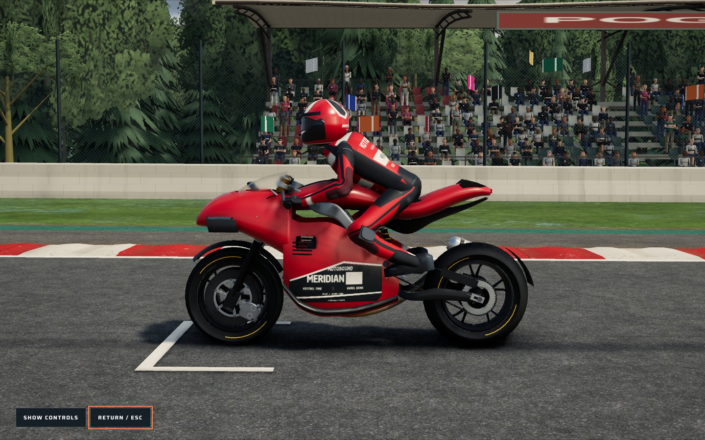
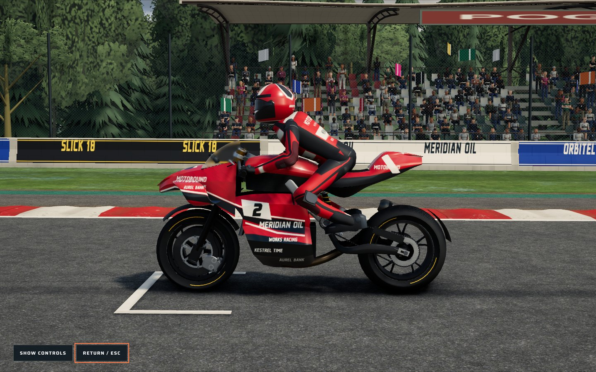
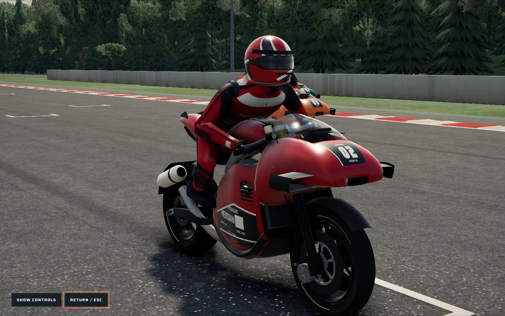
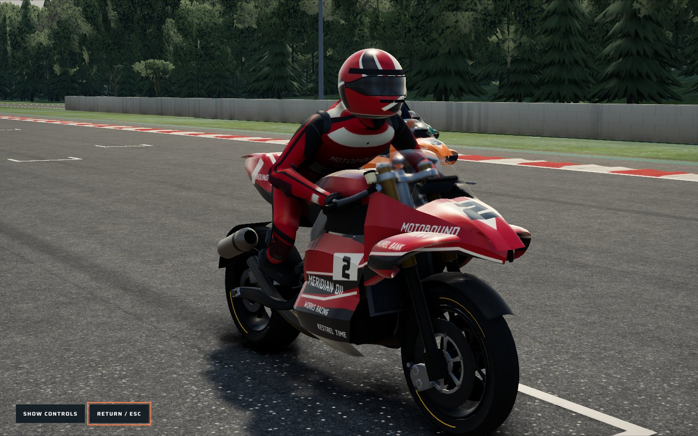
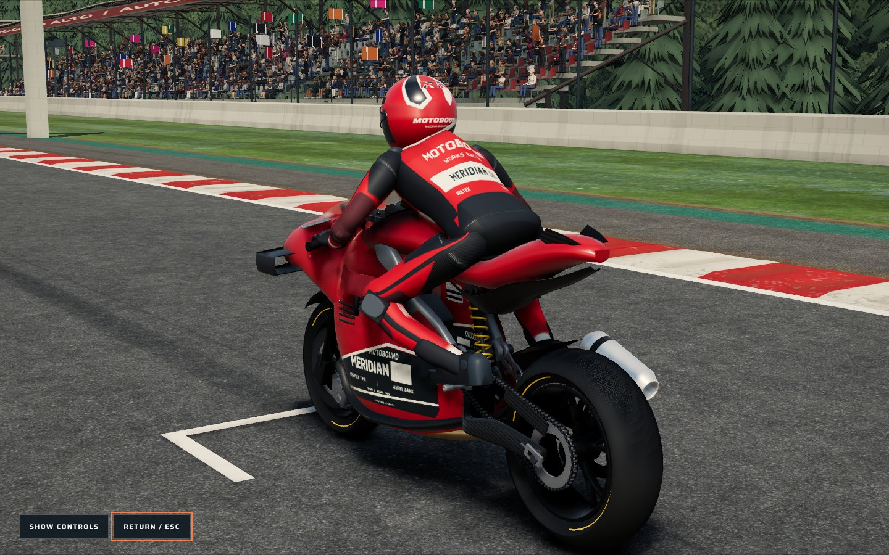
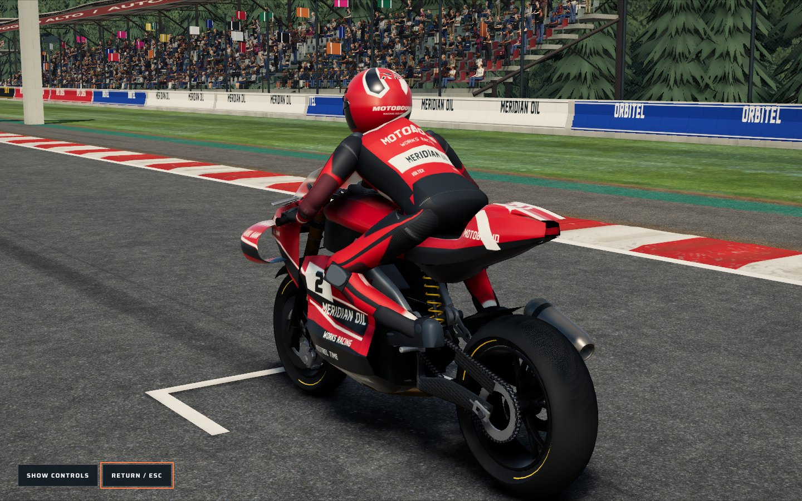
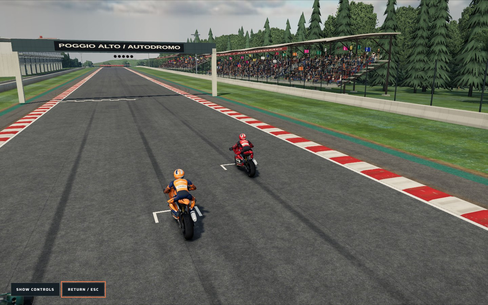
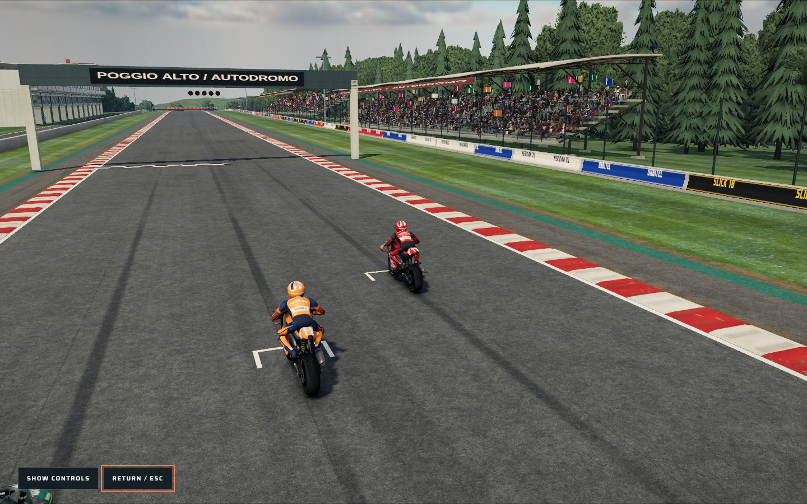
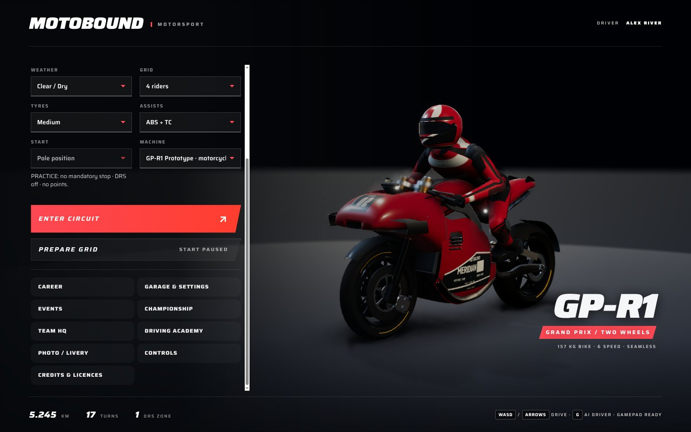
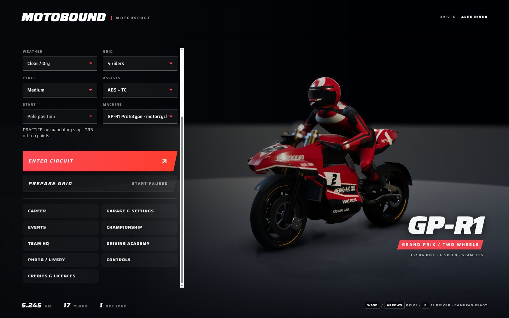

# MotoGP R3: hard-surface bike and track presentation

This revision targets the "cartoony" read of the GP motorcycle section. It replaces the GP-R1 bodywork, repaints it with a full projected livery and adds the printed trackside surfaces that dominate the supplied MotoGP 26 reference pack. It builds on `7acdbe1`.

All artwork is original. The partner names are the project's own fictional brands from `studio/brand-atlas.ts`; no team, sponsor, rider or circuit marks from the references are reproduced.

## What made it look cartoony

Side-by-side review of the in-game Medium preset against the 100 references (REF_001–100, especially REF_018, 028, 049, 056, 060 for the machine and REF_018, 031, 037, 044, 056 for the venue) found:

- **Inflated bodywork.** The legacy GP-R1 shell was a single smooth volume with a bulbous nose and a fat flank. Real fairings are thin panels meeting at crisp feature lines: a tall pointed nose with a recessed intake, box wings, a narrow waist, ground-effect pods low on the flank and a slim tail.
- **Flat paint and sparse graphics.** One flat colour with a single decal plate. The references carry sweeps, pinstripes, numbers and dozens of partner marks under a deep clear coat.
- **Bare venue walls.** The GP circuit walls were plain concrete and the protective padding plain blue/white. In the references, walls and air fences are continuously printed.

## Bike

### GP-R3 shell (`src/rendering/gp-r3-shell.ts`)

The GP-R1 shell is now generated from named feature curves in the existing chassis frame (ground y = −0.62, front axle z = +0.70). Each panel is a strip lofted between those curves and owns its own normals, so every shared curve renders as a real crease.

| Panel | Construction |
| --- | --- |
| Nose | Crowned number face, shoulder crease, two flank planes, a chine folding under to an intake lip and a recessed dark intake mouth. The cheeks carry the windscreen beside the instrument well. |
| Box wings | Swept aerofoil loop (14% section with 6° incidence) joined by an end plate, rooted on the nose flank. |
| Lower fairing | Shoulder crease, waist, a hard ground-effect pod edge, pod foot and belly keel. The leading edge follows the front tyre. |
| Tank, saddle and tail | Crowned tank with a rolled edge and carbon knee flank, textured saddle, tail hump with a creased flank, skirt and dark undertray. |
| Windscreen | A bubble seated on the cheek tops, rising to helmet height; transmissive near, tinted far. |

Visible insides (nose flanks, lower fairing, tail flank) receive a thin dark lining. High/Mid/Far detail levels use the same curves at different densities.

Budgets on the isolated production model (`e2e/fixtures/motogp-reference-review.ts`): **101,736 triangles and 198 draws** at High, versus the previous 106,457 and 201, inside the existing 110,000 / 220 caps. The dashboard remains fully visible from the production onboard lens (9 of 9 samples, facing 0.95).

### Painted livery (`src/rendering/gp-r3-livery.ts`)

One 2048×1024 atlas per entrant is projected onto the shell: the right flank, the left flank (mirrored geometry, unmirrored text) and the plan view. Shapes are authored in chassis metres, so a stripe placed on the nose lands on the nose of both flanks. The scheme provides a dark keel, a secondary sweep from beak to tail, accent pinstripes, flank and nose numbers and the entrant's title and partner marks. The paint is a deep clear coat (roughness 0.28, clear coat 1, clear-coat roughness 0.035).

The atlas spans the whole machine, so it may keep up to four times the preset's generated-canvas limit (`textureBudgetScale`, capped at 4×). At Medium this keeps the full 2048 px; at Low it is 1024 px.

### Materials

- GP paint, secondary and accent: roughness 0.30, clear coat 1.0, clear-coat roughness 0.04 (previously 0.36 / 0.62 / 0.21).
- GP silencer: burnished, heat-darkened titanium instead of a chrome-white tube.

## Track

These changes apply to the four GP venues (`poggio-alto`, `cape-wrenna`, `haarveld`, `montejaral`) unless noted.

- **Printed wall boards** (`venue-kit/gp-wall-print.ts`). Concrete walls carry continuous 8 m partner boards with 0.25 m joints above a plinth. Each board's partner comes from its own station, so held frames and replays are exact. Station coordinates are mirrored per side so every board reads left to right from the circuit.
- **Printed padding** (`venue-kit/gp-safety-padding.ts`). The blue/white protective covers carry printed wordmarks, white on blue and coloured ink on white. A module chooses its partner from its own placement, so the covers remain one instanced draw.
- **Mown verges** (`studio/track-edge-wear.ts`, all paved circuits). Alternating 3.2 m mowing lanes run parallel to the circuit, as a ±13% brightness modulation. They fade in past the worn verge edge and fade out before the distant terrain. Against the photographed turf the effect is subtle: in the wide comparison it changes the verge by a few brightness levels.

## Before and after (actual game, Medium preset)

Both sets were captured from the production build in the circuit Photo Studio, on Poggio Alto with the same orbit camera settings and a paused practice grid. Rendering used Mesa llvmpipe, a software GPU. The images show appearance, not frame rate.

| Before | After |
| --- | --- |
|  |  |
|  |  |
|  |  |
|  |  |
|  |  |

## Validation

- `tests/gp-r3-shell.test.ts` (new) covers the shell at all three detail levels: finite positions, normals and UVs; symmetric halves; the chassis envelope; per-level triangle budgets; and near-zero degenerate triangles. It also checks that one livery material is shared across levels, that each flank and the plan view use their own atlas regions with readable orientation, and that the nose clears the front tyre at full fork travel.
- The updated `tests/gp-appearance.test.ts` checks the new paint calibration.
- The GP, bike, venue, circuit, texture and presentation subsets pass: 114 files, with 12 failures. The same 12 files and the same 27 tests also fail on the untouched base commit `7acdbe1`. They are physics, pit-service and GP-R2 clearance tests, unrelated to this change.
- `npm run lint`, `tsc --noEmit` and `npm run validate:content` pass.

## Limits

- GP-R2 keeps its existing compact cowl and decal identity. The R3 shell and livery apply to GP-R1.
- The rider model, trees and sky are unchanged in this revision.
- The comparison images come from a software renderer. Consumer-GPU frame rate and High/Ultra acceptance were not measured here.
