# MotoGP R6: race shell, liveries and circuit surfaces

This pass addresses the most visible reason the GP section still read as cartoony next to the supplied MotoGP 26 reference pack: the shape of the motorcycles. The previous GP-R1 shell was a rounded, low-nosed body with a short screen and a swollen tail. The GP-R2 was assembled from separate cowl, fairing, tank and tail lofts with a decal livery. Both are replaced by one procedural **R6 race shell**, with the reference bikes' long, low and sharp proportions. Their liveries are painted into the shell's own UVs, and a finish atlas varies clearcoat and roughness.

The circuits receive targeted surface work: kerb wear that follows tyre use instead of uniform "confetti" chips, ribbed kerb tops, rubber smears, and GP rubber paths that read as a band in braking zones. The rider's leathers get layered race-suit artwork.

All geometry and artwork are original. The references inform proportions, materials and composition; no team marks, liveries or scanned models are copied.

## Reference review

The supplied archive (`MotoGP26_PS5_100_Reference_Images_under_30MB.zip`, SHA-256 `9ae7423528ef4c68a3421f495eda1dc1d6afc428f60e3151b5897c8177bbd3ee`) contains the same 100 numbered images as the earlier pack, re-encoded to fit 30 MB. Their bytes therefore differ from the `MANIFEST.csv` hashes, while dimensions and numbering match. All five contact sheets were reviewed, along with the full-resolution images cited below.

| References | What they show | Change in this pass |
| --- | --- | --- |
| 018, 028, 046, 047 (side and three-quarter) | Nose tip ahead of the front axle at about 0.65 m; screen crown about 1.1 m; flank down to a belly pan about 7 cm off the road; tail higher than the seat, squared at the back | Shell proportions, measured in the sprung frame (see table below) |
| 028, 047, 060 (front) | Front view is a tall, narrow arch: a brow fold over the screen base, a centre ridge down the nose, cheeks widening below | Arch-shaped nose sections, centre-line ridge, brow and cheek creases |
| 017, 018, 065 (onboard and pit) | Clip-ons, levers and reservoirs sit *behind* the upper fairing in an open pocket; the clamp is dark anodised | Upper fairing ends ahead of the steering head and the flank edge dives under the bars; dark GP top clamp |
| 003, 022, 056, 060 | Box wings on the nose cheeks, dark ducts beneath the brow, ground-effect scoops low behind the front tyre, exit gills | Swept-aerofoil box wings and scoops, matte duct and gill zones with painted louvre slats |
| 018, 030, 046 | Carbon "spoon" under the swingarm ahead of the rear tyre | Swingarm spoon on the articulated arm |
| 017, 028 | Screen nearly clear through the sightline, reflective at grazing angles | Smoked Fresnel glass; no transmission pass |
| 001, 006, 018, 056 | Dense sponsor scale, matte and satin zones, seams and fasteners on gloss paint | Colour plus finish atlases, with seams, quick-release fasteners, knee pads and partner tags |
| 025, 031, 045 | Kerbs: smooth paint, rubber smears on the track side, fine transverse ribbing; no uniform chipping | Usage-weighted chips and bare concrete, smears and ribbing |
| 030, 031, 038 | Several dark rubber paths spread through braking zones | Wider, more widely spaced GP rubber paths, darker under braking |

## Motorcycle

### R6 race shell

`src/rendering/gp-race-shell.ts` evaluates **control nets**: tensor-product Catmull-Rom surfaces through 3D control points. Every control point lies on the skin, so feature lines stay where they were designed. Crease columns split the surface into separately shaded strips, giving the sharp folds of moulded bodywork rather than an inflated loft. Further options:

- **Centre-line handling:** columns on x = 0 mirror smoothly, or stay a moulded ridge on the nose.
- **End caps:** flat caps close the squared tail and the nose tip.
- **Trimming:** each section is cut at its first point inside an exclusion envelope, then resampled so the grid stays regular.
- **Default UVs:** carbon and seat finishes sample real UVs.

`src/rendering/gp-race-bodywork.ts` holds the designs and assembly:

| Part | Notes |
| --- | --- |
| Nose, upper fairing, flanks, belly | One moulding per side; folds at the brow, mid-flank and belly. Trimmed against the front tyre: inside the fork (\|x\| < 0.165 m) against the fully compressed tyre and fender (125 mm travel); outside it, a tight static gap like the reference side views. |
| Screen | Tall bubble from the fairing's open upper edge to a crown of y = 0.505 (about 1.12 m above the road). |
| Tank | Flat-topped, creased cover under the rider's chest, ending behind the clip-on sweep. |
| Seat and tail | Narrow pad; stepped hump; flat flanks between folds; squared, capped rear face with the rain light. |
| Aero and details | Box wings with an inner slat; ground-effect scoops; ram-air mouth; nose number decal. |

Both prototypes use the same chassis. GP-R2 has a blunter, wider nose, a taller brow, a slightly lower screen, a flatter tail and its own wing loop.

| Measured (GP-R1, sprung frame, road at y = -0.62) | Value |
| --- | --- |
| Nose tip | z = +0.968 (front axle at +0.70) |
| Screen crown | y = +0.505 |
| Belly pan | y = -0.547 (73 mm above the road at static sag) |
| Tail end | z = -0.955; crown y = +0.416 |
| Width | 0.307 m half-span over the wings; 0.259 m over the flanks |

**Clearance.** `tests/gp-race-shell.test.ts` poses the production BikeModel through 0, 50 and 100 % fork travel and ±0.35 rad steering lock. It rasterises the moving steering group (wheel, fender, forks, calipers, hydraulics, bars and levers) against the flank, wing and scoop meshes, and requires less than 4 mm intrusion. The first draft failed this test where the clip-ons and brake reservoir swept through the fairing shoulder. That failure produced the open clip-on pocket seen on the real bikes.

**Budgets.** Shell triangles per LOD:

| | High | Mid | Far |
| --- | --- | --- | --- |
| R6 shell | 10,649 | 3,396 | 832 |
| Former GP-R1 authored shell | 16,684 | 4,050 | — |

Whole high-LOD models now measure 97,137 triangles for GP-R1 and 96,358 for GP-R2, against the existing limit of 110,000 triangles and 220 draw calls.

### Liveries and finish

Each entrant's livery is drawn in metres on the side view (`gpLiveryTextures`). One half of the atlas holds each flank, so text reads front-to-back on both sides. A second, half-resolution **finish atlas** shares the UVs: red is clearcoat and green is roughness. Gloss paint, satin keels and matte black ducts, gills, seams and knee pads are therefore different surfaces, not one uniform gloss.

The artwork includes a satin keel, accent sweep, shoulder stripe and title partner. It also has denser small partner tags, panel seams with quick-release fasteners, belly slots, a tail number bay and a nose number. Ink switches between dark and light by paint luminance, so white and yellow entrants stay legible. Back faces of every painted panel render as dark unpainted composite, so open edges read as moulded skins.

### Glass, metal and carbon

- **GP screen:** library Fresnel glass (premultiplied, `installGlassFresnel`), lightly smoked at 10 % opacity, with no transmission. The former transmissive screen forced three.js to render the opaque scene a second time each frame, and its low-resolution target showed through as a jagged dark patch over the menu's dark backdrop. The onboard optics browser test now proves the former 2 mm volume setting is optically inert.
- **Other parts:** dark anodised GP top clamp, burnished titanium (no white cans), and a carbon swingarm spoon on the articulated arm.

### Removed code

The procedural shell replaces these, so they and their tests were removed:

- the GP-R1 authored shell payload (`gp-bodywork.mesh.json` 1.38 MB → 289 kB; the catalogue instrument cowl remains);
- the GP-R2 cowl, lower fairing, aero, tank and seat modules;
- the cooling louvres and the decal identity;
- `flattenGpR2Tail`.

The `.blend`/`.glb` authoring sources are untouched.

## Circuit surfaces

| Surface | Change |
| --- | --- |
| Kerb wear | Three layers stacked chips across every kerb (circuit finish at 33/m, kerb finish at 9/m, scanned concrete high points), reading as confetti. Chips and bare concrete now appear only on the tyre-used track side and scale with kerb usage. |
| Kerb detail | Rubber smears run along the inner half. A 75 mm transverse ribbing is shaded through the derivative normal and fades out before it aliases. |
| GP rubber paths | Spacing 0.42–1.05 m and width 0.30–0.44 m, so passes read as a band rather than one inked line. Braking polish rises to 1.15; upright traffic is unchanged. |

## Rider

The leathers' torso and limb artwork is redrawn: a secondary sweep edged in accent, a dark rounded title panel instead of a paper-white box, a smaller main wordmark and six patch-scale partner marks. The existing perforation, stitching and stretch-panel shading are unchanged.

## Images

| Before | After |
| --- | --- |
| 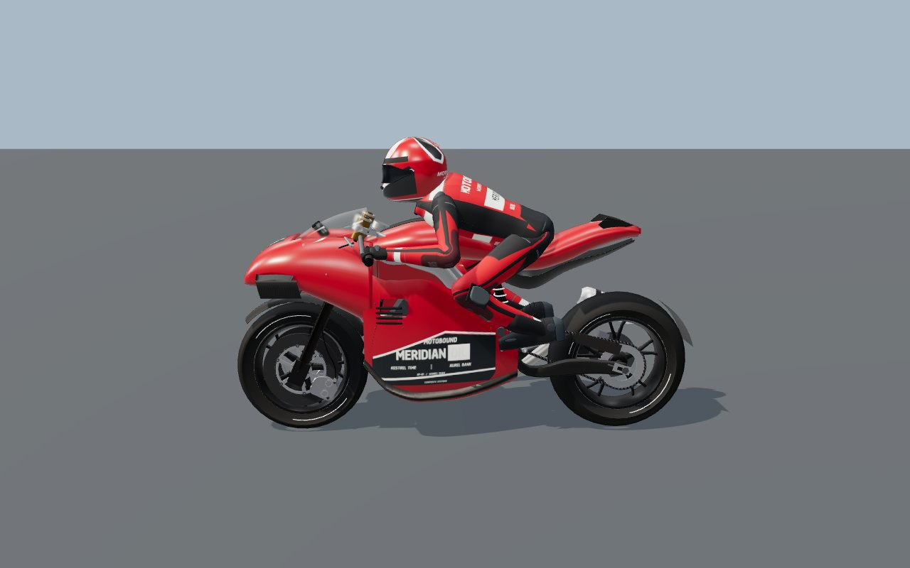 | 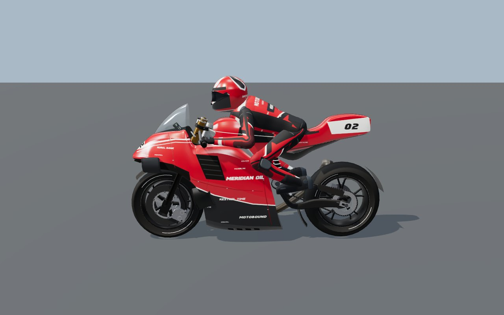 |
| 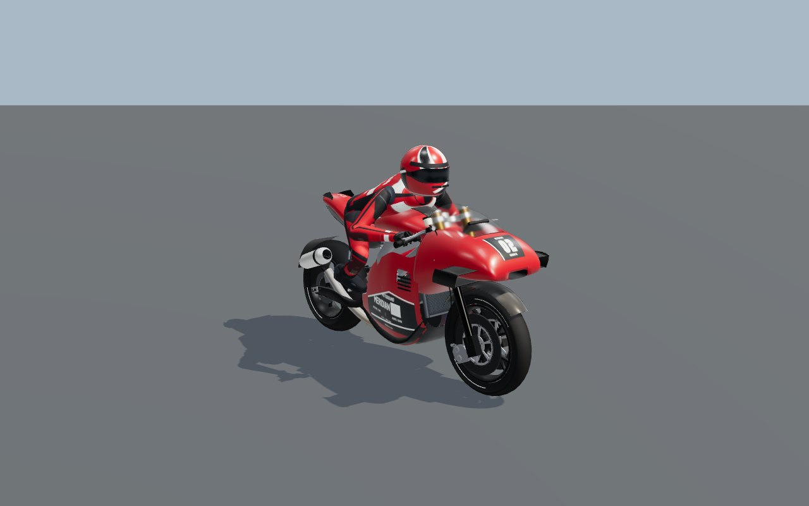 | 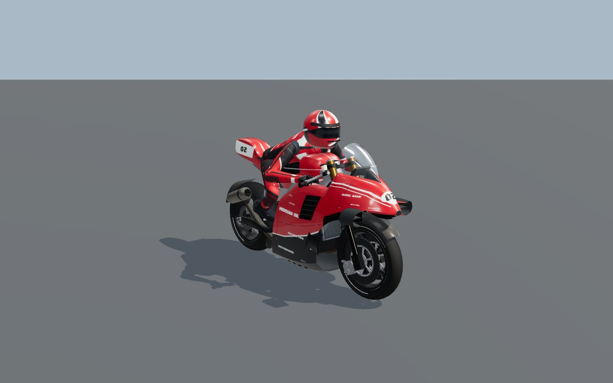 |
| 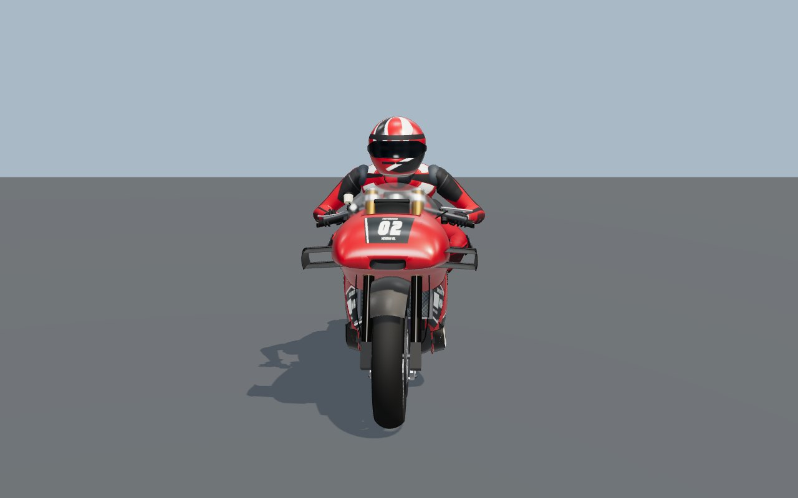 | 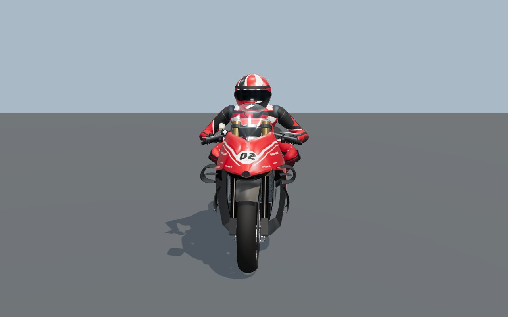 |
| 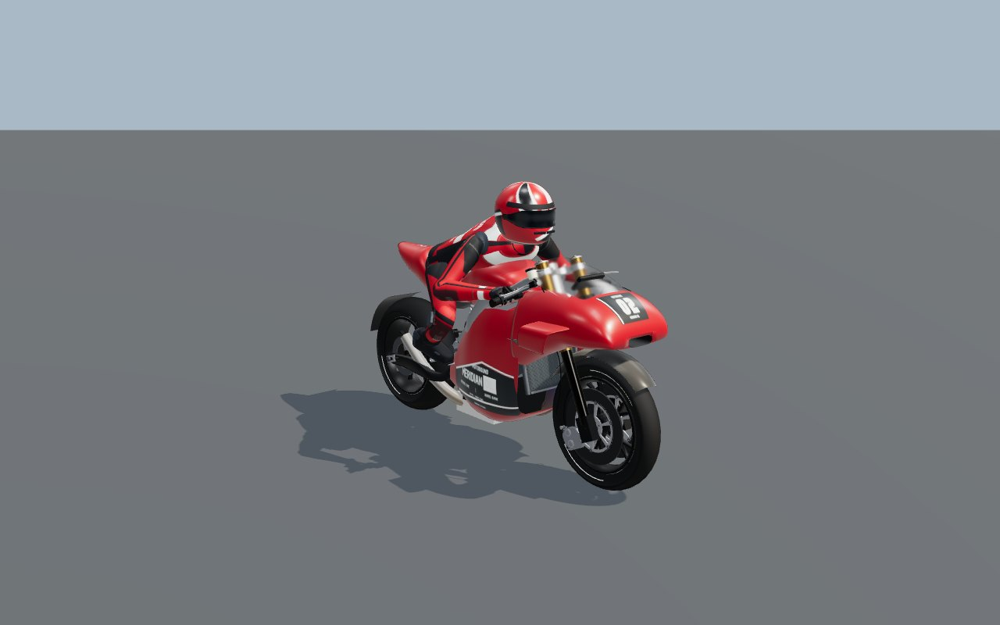 | 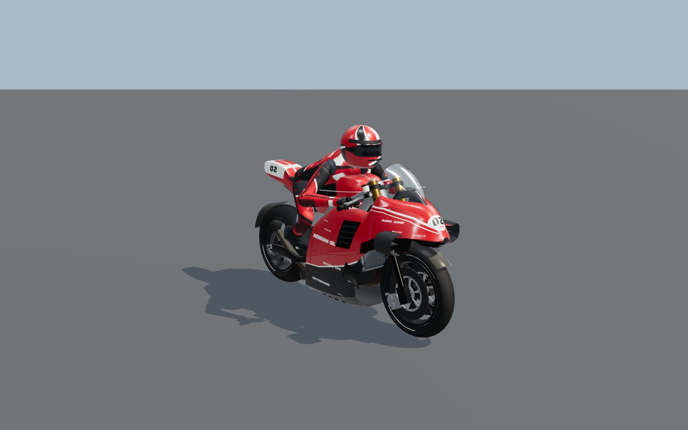 |
|  | 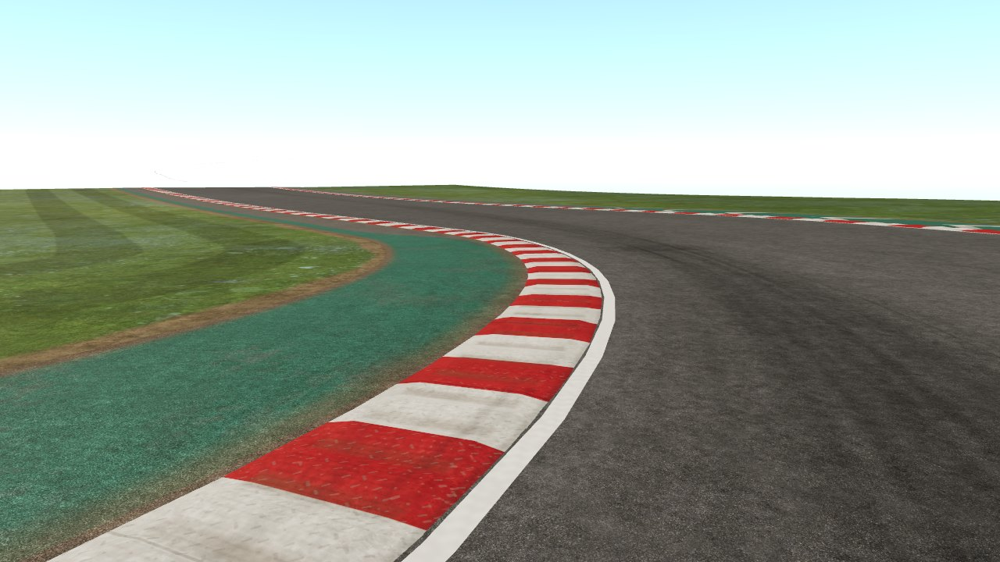 |

Isolated bike images come from the existing `e2e/fixtures/motogp-reference-review.ts` studio, with the same camera, light and pose before and after. Kerb images use the production circuit surface materials on Poggio Alto, through a scratch variant of `e2e/fixtures/motogp-environment-review.ts`.

The following come from the actual game at the **Medium** preset (the default), on the final production build: an eight-rider GP-R1 race at Poggio Alto, entered through the normal menu, on the grid.

| | |
| --- | --- |
| 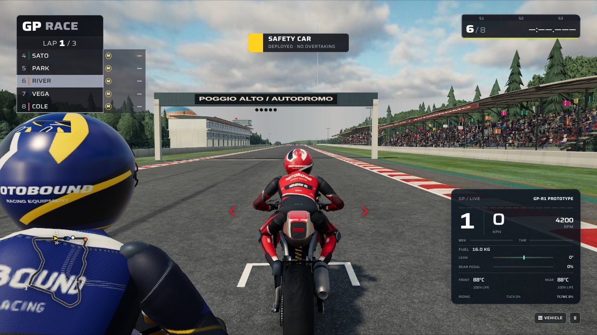 | 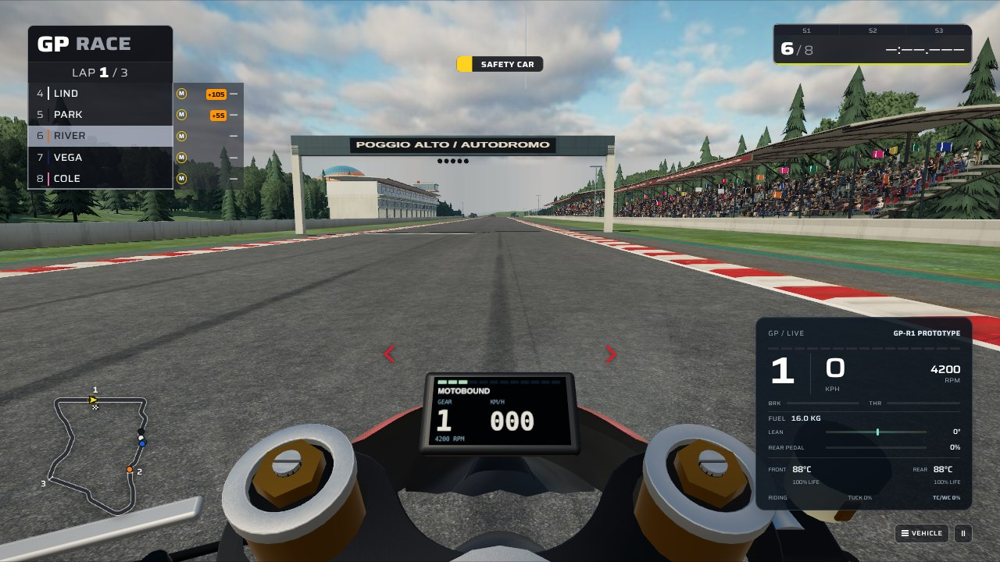 |

Entrant liveries on track, rendered with production circuit surfaces:

| | |
| --- | --- |
| 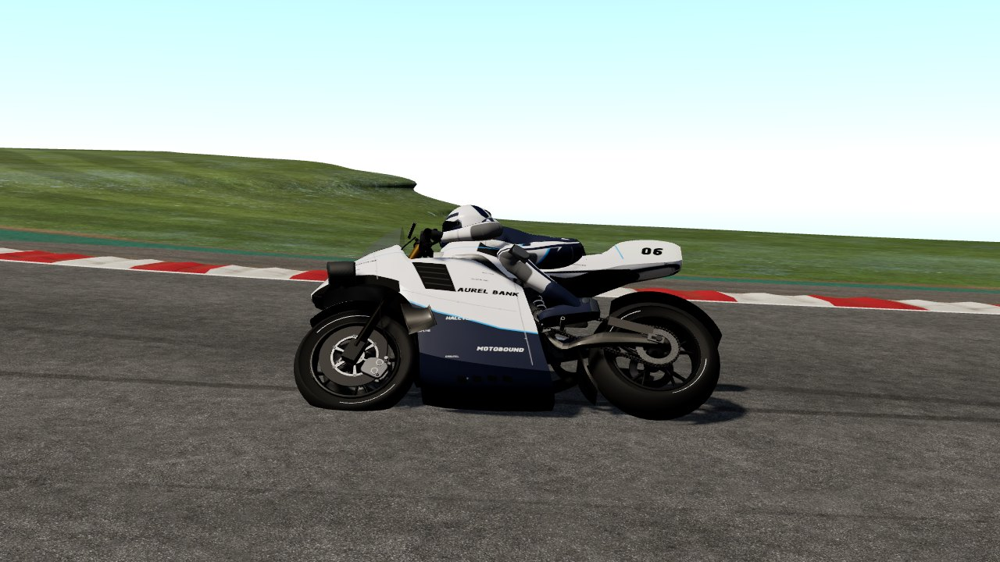 | 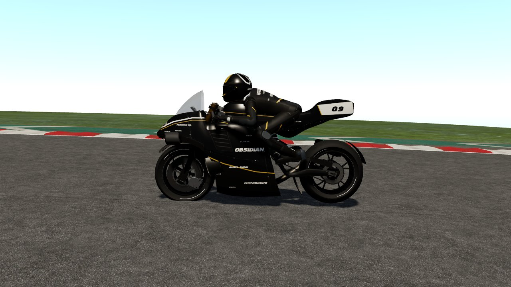 |

## Validation

| Check | Result |
| --- | --- |
| `npx tsc --noEmit`, `eslint src tests`, Prettier on changed files | Clean |
| `tests/gp-race-shell.test.ts` (new) | 9 passed: control-net interpolation and mirroring, trimming, finite owned geometry and UVs at all LODs, entrant paint, proportions, tyre envelope, front-assembly clearance for both prototypes |
| Bike, GP, kerb, road, scanned-ground and material suites (72 files) | 629 passed, 25 failed. The 25 failures are in 11 simulation files (`bike-session`, `bike-setup`, `bike-pit-service`, `gp-braking-approach`, `gp-contact-effects`, `gp-control-feedback`, `gp-corner-phases`, `gp-pit-departure`, `gp-riding-control`, `gp-seamless-braking`, `gp-tyre-contact`). The same 25 fail identically on the unmodified parent commit. |
| `e2e/41-motogp-reference.spec.ts` | Passed: LOD budgets, onboard instrument visibility contract, inert legacy-volume optics, same-instance wet rewind |
| `e2e/gp-rider-contact.spec.ts` | 7 passed. Its exact triangle pins were already stale on the parent commit (all 7 failed there); they now pin the R6 totals. |
| Other GP browser specs | 19 passed: `42-motogp-environment`, `gp-edge-design`, `gp-start-grid`, `gp-grounding`, `gp-r5-tyre-review`, `gp-contact-effects`, `gp-rear-chassis`, `gp-rider-motion`, `gp-fork-crown`, `gp-front-brake`, `gp-brake-lever` and `motorcycle-presentation` |
| Draw calls, isolated bike studio (same camera) | 201 before, 205 with the R6 shell and the old transmissive screen, 103 with the Fresnel screen: the transmission pass rendered the opaque scene a second time |
| Live application, Medium preset | Menu, GP-R1 practice (AI demonstration) and an eight-rider race grid at Poggio Alto, cycling chase, onboard and trackside cameras, with no page or console errors |

The browser checks run on software renderers (SwiftShader and Mesa llvmpipe). They establish compilation, determinism, budgets and contracts, not frame rates on physical hardware. For local live captures only, a scratch copy of the build raised the 45 s GPU-preparation deadline, which a CPU renderer cannot meet at Medium. The shipped build is unchanged.

## Limits

- The Low preset deliberately ships no photographic sky, vegetation or ground scans. Its procedural clouds and trees remain, so the realism gains on track are visible at Medium and above.
- The rider's geometry and helmet are unchanged apart from the suit artwork.
- Liveries are original artwork from the existing scheme palette; partner names are fictional.
