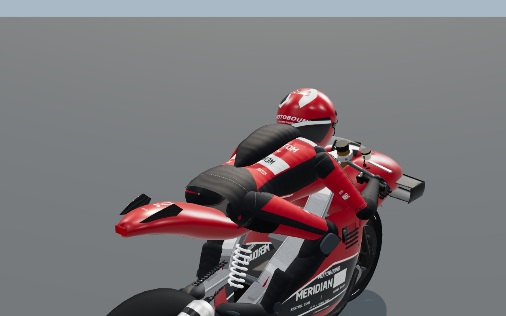
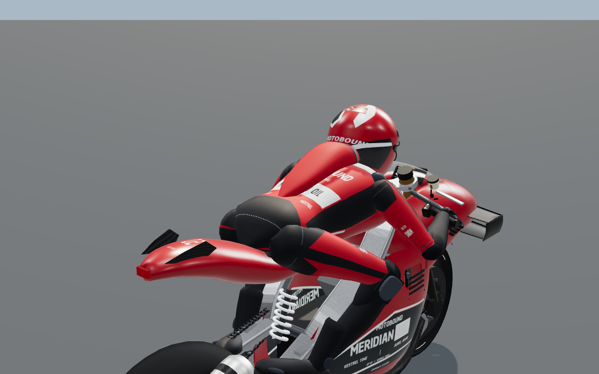
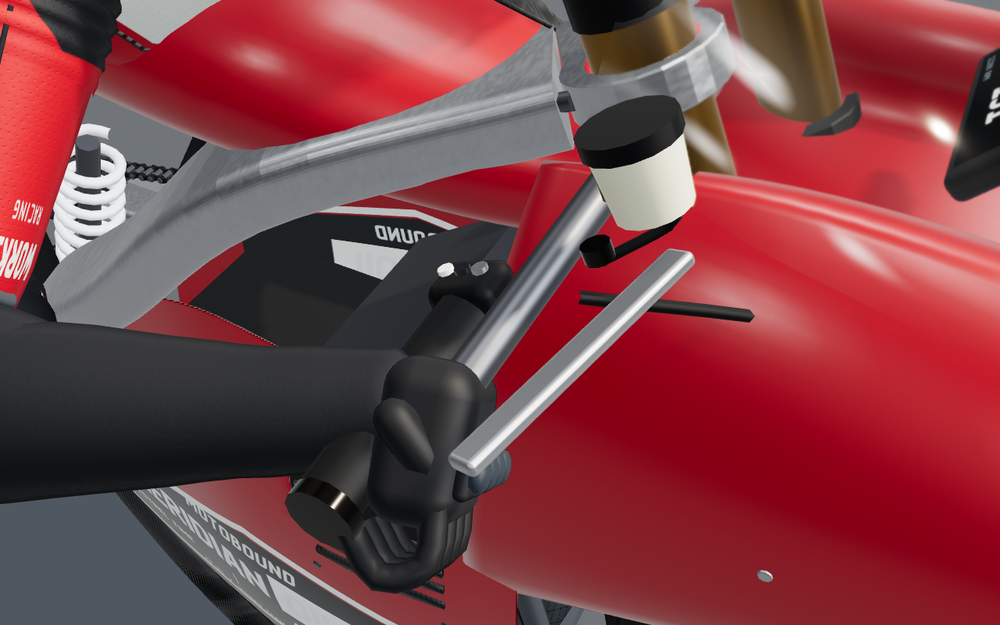
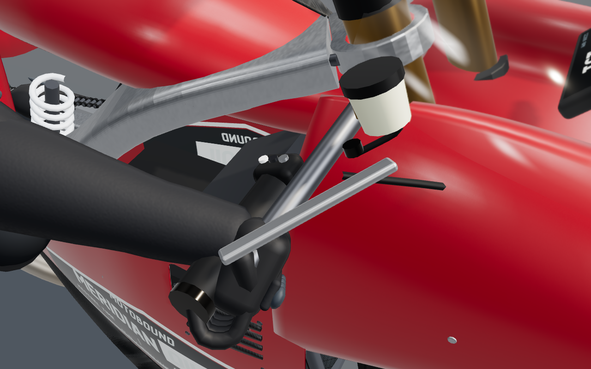
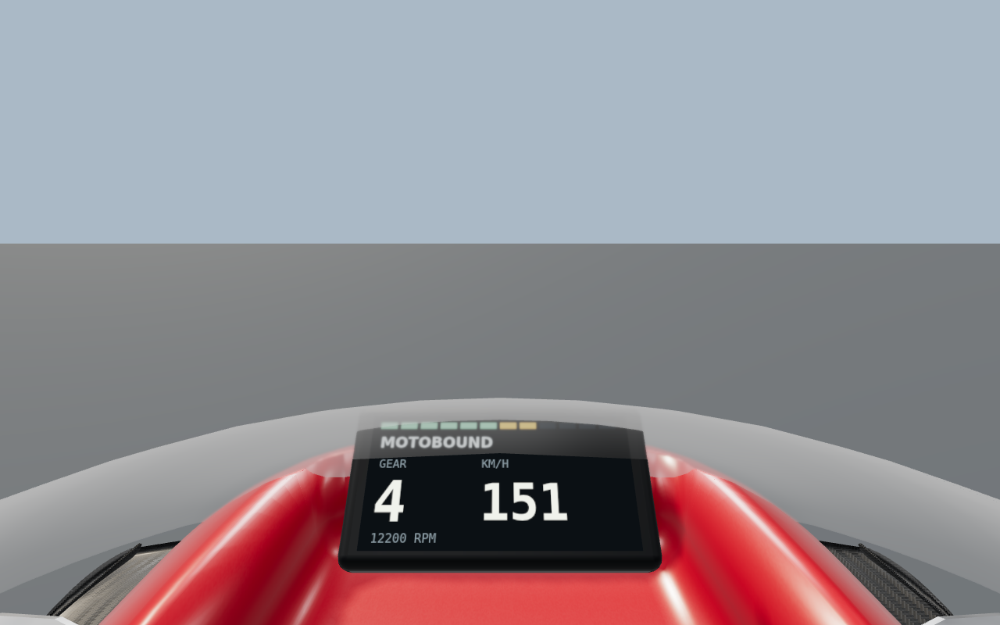
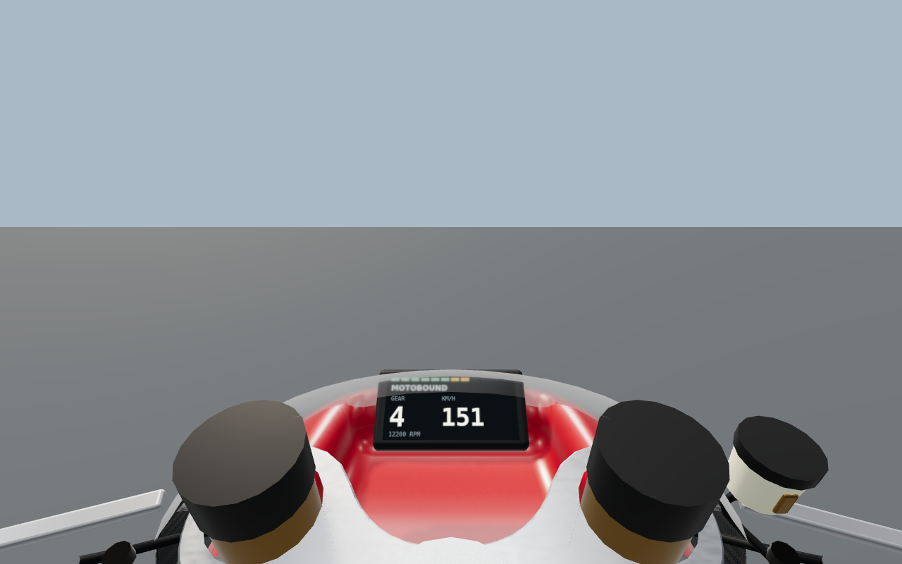
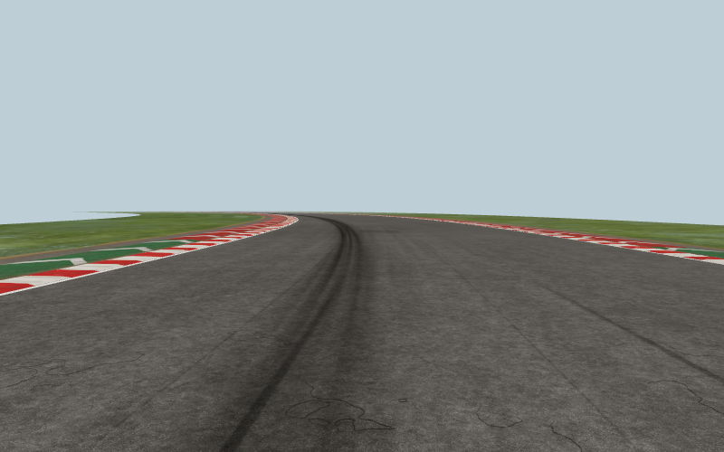
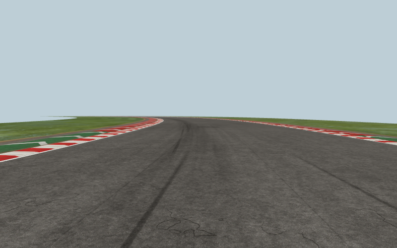
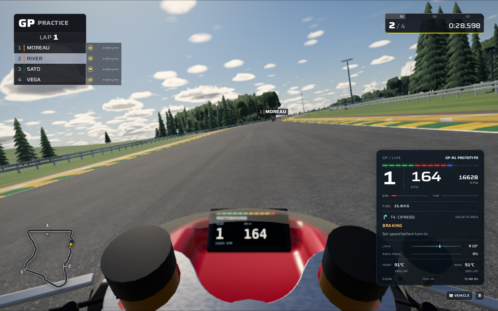
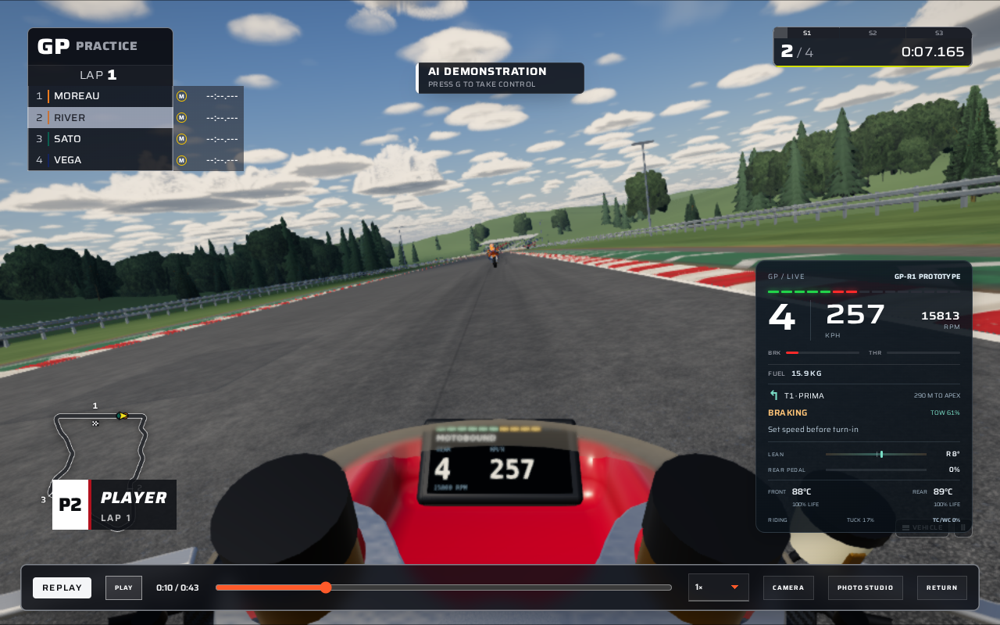

# MotoGP suit, cockpit and braking refinement — 19 October 2026

This pass builds on `4d20731`. It refines GP-R1 and GP-R2 with procedural Three.js geometry, existing texture atlases and composed material shaders, plus a correction to the existing motorcycle solver. The other vehicle families retain their previous presentation and shifting behavior.

## Reference review

All 100 numbered images in the tracked [reference archive](../reference/MotoGP26/MotoGP26_PS5_100_Reference_Images.zip) were reopened on ten contact sheets. The manifest contains the complete ID sequence 001–100, and every image payload matches its recorded SHA-256. The archive SHA-256 is `478517180397aa7022b508264e2e6383f721ea930a4035ef314e2e8fb421e7c6`.

The [existing image-by-image review](MOTOGP_THREEJS_REFERENCE_REVIEW.md) and [source audit](production/motogp-contact-pass/reference-audit.json) retain the observations, source pages and image hashes. This pass uses the following specific cues; the other images retain their existing contextual role rather than being represented as 100 newly implemented features.

| References | Observation applied in this pass |
| --- | --- |
| 018, 065, 071 | A rounded, closed suit seat, integrated airbag housing and controlled leather folds, rather than a hollow lower torso and separate black back pod. |
| 017, 057, 065, 073 | A front-brake lever articulating about the right-hand control pivot. |
| 014, 030, 031, 039 | Multiple wandering contact paths and interrupted rubber deposits, with open asphalt between heavy braking areas. |
| 017, 076, 088 | A readable display, a clear future path and a useful view of real steering hardware, subject to the production rider's lean and tuck clearance. |

The reference images guide shape, placement and material contrast. They do not supply measured friction coefficients, suspension settings or engine-braking forces.

## What changed

### GP rider and materials

The existing torso closes into a rounded seat section. The existing airbag housing uses a broader nape and a shallow lumbar taper, with dye sampled from the original torso atlas. Shoulder and hip accordion inserts use the suit material, and their UVs align with the underlying garment. Wordmarks on the GP body atlas now read outward without moving panel boundaries or the front zipper.

Small pressure folds reshape existing vertices by at most 3.2 mm; coincident UV-seam normals are averaged without welding the texture coordinates. The new GP leather shader adds filtered grain and small perforations. Weather remains the final owner of wet roughness. These changes add no suit meshes, material slots, textures or per-frame deformation, and leave the rider's inverse-kinematic anchors intact.

The redundant GP leather normal and roughness maps were removed after a close render exposed stretched UV ripples on the housing. The metre-space shader supplies that detail without the stretching, using two fewer textures per high/mid rider.

| Before | Final dry suit |
| --- | --- |
|  |  |

These are the same production-model inspection view and lighting, separate from the full game. The [wet suit capture](production/motogp-refinement/rider-wet.png) uses the final material on the same retained instance.

### Front-brake feedback

The existing right-hand lever is retained behind a steering pivot so rigid batching cannot freeze it. Normalized front-brake input turns it by up to 0.4 radians. Rear-pedal input does not pull the lever. The pose comes directly from the presented snapshot; holding a frame or returning to it after a replay seek restores the same transform.

This articulation is present on the high-detail GP models. The lever mesh is removed from a rigid batch, so its submission cost is measured separately from the suit's unchanged resource count.

| Released | Front brake applied |
| --- | --- |
|  |  |

These are explicit mechanical closeups. Most of the lever and forearms remain close to or beyond the ordinary cockpit frame edges.

### Cockpit framing

The GP eye moves 16 cm rearward and 6.5 cm upward within the existing model coordinates, retaining the original forward pitch. A six-degree wider field of view brings the actual steering bridge, fork tops and controls into the lower part of the view while keeping the instruments readable. The production vehicle definition now reaches the camera contract tests and model fixture, matching the existing live renderer call.

The instrument contract covers both GP prototypes and the two existing road-race motorcycles at four aspect ratios, three lean angles and three suspension-load cases: 144 combinations. Every combination must retain all nine optical visibility samples, a front-facing display and the original strict screen-margin limits. Other road-bike, motocross and tail-camera profiles retain their previous selection rules.

| Before | Final GP eye |
| --- | --- |
|  |  |

### GP road rubber

The road shader distributes the existing simulation rubber channel across three softly overlapping, slowly wandering contact paths. The existing braking profile governs their spread and deposit strength. Derivative filtering broadens distant paths while preserving their integrated coverage, and the noise closes around the lap.

Separate GP slip strokes are shorter, lighter and tapered at both ends. Their releases are stratified through braking zones with deterministic variation. They remain appearance detail; no grip values or painted guidance are added.

The presentation now has three bounded, lazily created surface families: cars, other motorcycles and GP. Only one is visible at a time, and all decal families share one material. Repeated menu, followed-vehicle and replay changes reuse their geometry.

| Previous generic motorcycle deposits | Final GP deposits |
| --- | --- |
|  |  |

The [dry apex](production/motogp-refinement/apex-gp-dry.png) and [wet apex](production/motogp-refinement/apex-gp-wet.png) use the production circuit component and shipped scanned surface materials. The [surface receipt](production/motogp-refinement/surface-receipt.json) records the exact compatibility and resource measurements.

### Seamless downshifts

The GP gearbox's 20 ms gear-selection lockout was incorrectly treated as an open clutch for engine braking, although positive drive already remained connected. A downshift therefore removed coast torque for four 240 Hz samples and then restored it, abruptly unloading and reloading the front tyre.

Coast torque now remains connected through that lockout on the two seamless GP prototypes. Rear-tyre friction allocation, rear ABS, throttle blending, map 0, gear-selection timing and the other motorcycles' interrupted shifts retain their existing behavior.

At 40 m/s, engine-brake map 3 and a fourth-to-third downshift, the measured maximum adjacent longitudinal-acceleration change fell from 2.007 to 0.255 m/s² on GP-R1 and from 1.668 to 0.207 m/s² on GP-R2. Maximum front-load steps fell from 210.3 to 26.8 N and from 171.9 to 21.4 N respectively. These are controlled simulation comparisons, not measured motorcycle telemetry.

The [braking comparison](production/motogp-refinement/braking-comparison.json) retains both traces and exact before/after snapshot compatibility results for the other road motorcycles. Engine-brake map 0 remains free coast; maps 1–3 exercise the corrected coast connection.

## Verification and evidence

The final combined production-model and front-lever browser gates both passed on verified **SwiftShader WebGL2**. The existing 300-second per-test deadline and original model budgets were retained. Both prototypes passed dry/wet, held-frame, release and rewind checks with zero GL or browser errors. The [complete numeric receipt](production/motogp-refinement/model-and-lever-checks.json) records the model inventory, instrument visibility, optical comparisons, source hashes and same-instance resource checks.

| Final production-model fixture | Expanded model triangles | Draw calls in the three-quarter view | Scene textures |
| --- | ---: | ---: | ---: |
| GP-R1 high | 109,337 | 217 | 23 |
| GP-R2 high | 101,636 | 207 | 23 |
| GP-R1 mid | 43,448 | 171 | 20 |
| GP-R1 far | 12,588 | 92 | 14 |

The high GP-R1 baseline was 109,337 triangles, 215 calls and 25 textures. Articulating the existing lever removes it from a rigid batch, adding two submissions in the measured view including the transmitted pass; the suit itself adds no draws. The complete models remain below the existing 110,000-triangle and 220-call limits. The revised onboard camera submits more existing visible hardware: 50 calls in its isolated inspection view versus 34 before.

The GP road cache adds 170,392 bytes of geometry, approximately 166.4 KiB, across seven cullable chunks. Final apex and braking views retain the same active draw counts as the generic motorcycle surface, with fewer submitted decal triangles. The surface gate also verifies 60 family switches, zero-rubber absence, exact dry/wet held and rewound pixels, and all ten original car/other-motorcycle captures matching the baseline pixel hashes.

### Repository checks

| Check | Result |
| --- | --- |
| Production TypeScript/Vite build | Passed. The existing large-bundle warning remains. |
| Complete ESLint run | Passed. |
| Content validation | Passed during the broad repository check; content definitions were not subsequently changed. |
| Final focused unit/integration run | 92 tests passed across 10 files, after the changed source was frozen. |
| GP production-model and lever browser gates | Both passed on SwiftShader WebGL2, with the original deadlines and budgets. |
| GP environment browser gate | Passed on SwiftShader WebGL2, including the 60 family switches and exact legacy-image comparisons. |
| Complete clear/wet GP application journeys | Not passed locally. The final clear run reached live driving, cockpit, pause and its first recorded replay frame before a later seek exhausted the test deadline. The wet run timed out at initial menu startup. |
| Broad `npm run check` | Not a clean pass: 3,660 tests passed and four failed across 437 files, with two worker RPC timeout errors. All four affected suites subsequently passed in the final frozen 92-test run. |

The broad check ran for approximately 38 minutes and overlapped implementation edits. Three failures compared newly edited expectations with earlier module state in the long-running workers; the fourth was a 120-second timeout in the unrelated car mixed-field case. The final focused run includes all four affected suites, alongside the GP solver, suit, lever, camera, road, startup, scanned-ground and replay-continuity cases. The broad command itself was not rerun to a clean result, so its partial result is retained explicitly.

The earlier riding regression run also passed 61 cases covering GP braking, high-speed corner approaches, passing and eight-rider dry/wet races. These are automated simulation checks, not a human assessment of how enjoyable the handling feels.

### Complete application journey

Both initial Mesa attempts to run the existing clear and wet GP application journeys timed out before a GP session began. The first run stalled while applying settings or waiting for the initial menu. On the retry, the clear case timed out waiting for the Apply button to become stable, and the wet case timed out waiting for the individual graphics controls to become stable. The original 300-second test deadlines and all interaction/assertion requirements were retained. The retry bounded software-renderer threads and disabled tracing to reduce host overhead.

The final attempt used verified SwiftShader WebGL2 with the same two specs, viewport, quality selection, assertions and deadlines. The clear case successfully entered four-rider Poggio Alto practice, applied manual throttle, advanced in AI demonstration, showed named corner guidance in chase and cockpit, paused the worker and displayed the first requested recorded replay frame. It then exhausted the overall 300-second test deadline while waiting for `replaySeekPending` to become false on the backward seek at `e2e/motogp-riding-flow.spec.ts:193`. Its remaining rewind-restoration and resume assertions did not complete. The wet case timed out waiting for the initial menu at its existing 180-second startup limit, before GP selection.

Both full-application specs therefore remain **failed**, despite the partial clear-session progress. The first clear replay capture is evidence of that checkpoint, not a pass for the complete replay journey. These failures do not establish whether a physical-device session has the same problem; no hardware session was run.

| Actual live cockpit | Actual first recorded replay checkpoint |
| --- | --- |
|  |  |

The [live chase capture](production/motogp-refinement/live-low-chase.png) shows the same four-rider session. These three full-application captures use the test's **Low graphics at 1280 × 800**. Their reduced model/material detail and existing procedural clouds are visible; the separate High-detail model captures above establish the close material changes.

The source hashes in the model receipt and the [final verification receipt](production/motogp-refinement/verification-receipt.json) identify the frozen implementation used by the build, final focused run and final production-model browser checks. The shared settings transition code was not changed by this pass.

## Try the changes

Select **GP-R1 Prototype** or **GP-R2 Prototype** under **Machine**, then choose **Poggio Alto Autodromo** and **Free practice**. Medium or High graphics show the detailed suit; the articulated lever is on the High model. Use **C** to cycle into the revised cockpit view.

To exercise the corrected coast connection, select the GP machine first, open **Garage & Settings**, find **Vehicle setup**, and set the existing **Engine braking map · 0 free – 3 strong** slider to **2 or 3**. Apply and save, then start a new session. The default map 0 disables modeled engine braking; aerodynamic drag and rolling resistance still slow the motorcycle.

| Default key | Action |
| --- | --- |
| W | Throttle |
| A / D | Steer |
| S | Front brake |
| Left Shift | Rear brake |
| [ / ] | Downshift / upshift |
| C | Cycle camera |

For an isolated coast-down comparison, accelerate, release W with both brake keys released, and downshift with `[`. The first manual shift disables automatic shifting for that vehicle, so subsequent upshifts use `]`. The lever follows S/front-brake input independently of the rear brake and restores the recorded pose in replay.

## Scope

This remains an original procedural racing game with a reduced motorcycle solver. These changes address specific visible and handling defects; they do not establish parity with the commercial reference game. Isolated production-model and surface captures are distinguished from actual application sessions. Software WebGL validation demonstrates shader compilation, deterministic presentation and bounded resources, not physical-device frame rates.
