# MotoGP riders, tracks and ride moments

This pass builds on the [contact and control update](MOTOGP_THREEJS_CONTACT_PASS.md) and the existing 100-image MotoGP 26 reference pack. It changes how the GP rider sits on the machine, what the onboard camera sees, adds two new dedicated GP circuits and adds a light ride-highlight layer to the GP HUD. Everything is original procedural Three.js and TypeScript; no reference image, livery, logo, rider likeness or circuit name is reproduced.

## Reference cues used

All five category contact sheets were reviewed again, and the individual originals below were compared side by side with isolated renders of the production `BikeModel` at matching camera angles.

| References             | What they show                                                                                               | Applied here                                                   |
| ---------------------- | ------------------------------------------------------------------------------------------------------------ | -------------------------------------------------------------- |
| REF 018, 056           | Tuck: back close to horizontal, helmet behind the screen                                                     | Tucked torso flexion ~85°, pelvis back and lower               |
| REF 052, 092           | Hard stop: chest up to ~45°, elbows wide, inside leg off the peg                                             | Braced braking posture and leg dangle                          |
| REF 004, 027, 030, 060 | Full lean: hips off the seat, chest low inside the tank, helmet forward to the inside grip, inside elbow low | Deeper hang-off, larger torso roll, elbow-down pole            |
| REF 046, 087           | Exit drive: rider low and forward over the tank                                                              | Throttle-driven forward/low exit posture                       |
| REF 017, 074, 088      | Onboard: raw carbon inside the cowl around the display                                                       | Carbon instrument well; rider's own torso kept out of the lens |
| REF 044, 045, 046, 047 | Alpine bowl, snow peaks, cyan escape paint, red/white kerbs                                                  | Steinhorn Alpenring                                            |
| REF 064, 072           | Floodlit night race, dark sky over bright asphalt                                                            | Zafra Night Grand Prix                                         |

The images establish posture, framing, materials and venue character. They do not supply joint angles, dimensions or physics; all values below are authored presentation targets.

## Riders: racing body language

`gpRiderStance` (`src/rendering/gp-rider-motion.ts`) replaces the generic seat offsets for GP prototypes only. It is a pure function of the presented snapshot (lean, hang-off, tuck, front brake, throttle, steer), so paused frames, replay seeks and LOD switches reproduce the same pose without springs or history. Other road and off-road riders keep their existing pose.

| Situation    | Before                                  | Now                                                                                             |
| ------------ | --------------------------------------- | ----------------------------------------------------------------------------------------------- |
| Full tuck    | Back ~45°, helmet well above the screen | Back near horizontal, helmet behind the screen                                                  |
| Hard braking | Chest close to upright                  | Chest raised to ~50° from vertical, arms braced, elbows open                                    |
| Full lean    | Torso in the bike's plane               | Hips 21 cm inside, chest rolled up to 0.48 rad further in, helmet forward, inside elbow dropped |
| Corner exit  | Same as mid-corner                      | Forward and low over the tank while leaned with throttle                                        |

Two further details:

- **Leg dangle.** In the last part of a hard straight-line stop the inside foot leaves its peg, swinging out, down and slightly forward with the knee opening wide. The side comes from the road ahead of the presented station (`gpTurnAhead`) and fades out as the bike rolls into the corner (`gpLegDangle`).
- **Helmet buffeting.** Above ~210 km/h the helmet shakes slightly in the wind blast. The oscillator is the recorded front-wheel phase, not wall time, so a held frame is identical.

Each pair below is the production `BikeModel` rendered from the unmodified tree and from this change, with the same camera, light and pose values:

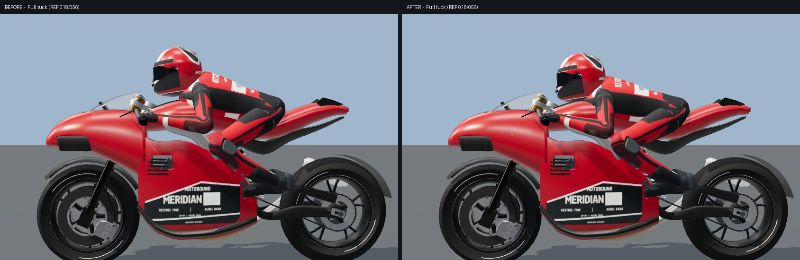

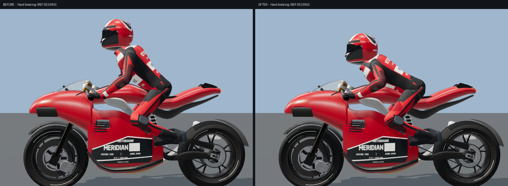

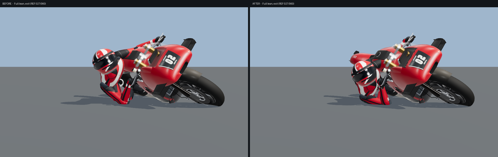

The rider IK, peg/grip contacts, knee continuity and road-relative head sight keep their existing contracts. `tests/gp-rider-stance.test.ts` covers the stance limits, symmetry, continuity, non-finite input, the dangle conditions and buffet bounds; the spine and suit tests now assert the pelvis against the same stance function.

## Bike: onboard view

- **Carbon instrument well.** `gpLinedWell` moves the visible interior of the GP-R1 cowl (walls and floor around the display) from the livery paint batch into the existing carbon batch. Triangle totals and draw calls are unchanged. The well's lip is smoothed over the complete authored cowl before the split, so the earlier specular-continuity fix is preserved.
- **Own torso hidden from the lens.** The braced and tucked chest now reaches in front of the fixed onboard eye. As with the helmet, the followed GP rider's articulated torso is not drawn into the first-person view but still casts its skinned shadow. The display stays in frame and unobstructed through the riding poses (`tests/bike-cockpit-view.test.ts`).
- **Lens framing kept.** A flatter, higher lens closer to REF 017 (horizon near mid-frame, fork caps cropped) was tried, but it breaks the existing contract that the fork-crown adjusters stay in view in every pose (`tests/gp-fork-crown.test.ts`), so the original `[0, 0.5, 0.18]` eye and −0.14 rad pitch are unchanged. A helmet-mounted camera that follows the rider's head would satisfy both and is the natural next step.

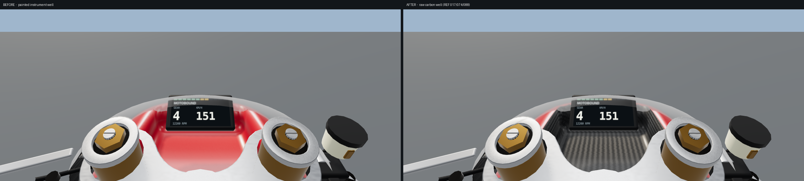

## Tracks: two new GP venues

Both are bike-safe, dedicated GP courses with all of the GP venue furniture: course boards, sponsor bridge, grandstand roofs, race control, paddock, painted edges and run-off identity.

### Steinhorn Alpenring (`steinhorn`, 4.318 km, clockwise)

An alpine amphitheatre with ~55 m of elevation change: the start climbs into a tight first corner, a long uphill drag reaches a hairpin at the top of the valley, a downhill run ends in a heavy stop, and the lap falls back through a linked pair of bends and fast downhill sweepers to the stands. The `alpine` theme supplies the mountain landform and conifer valley; the edge identity uses cyan escape paint beside red-and-white kerbs. Three DRS zones (main straight, uphill drag, downhill run).

| Main straight under the peaks                                                 | Cyan escape paint at the exit                                             | Drive out of the first corner                                         |
| ----------------------------------------------------------------------------- | ------------------------------------------------------------------------- | --------------------------------------------------------------------- |
| 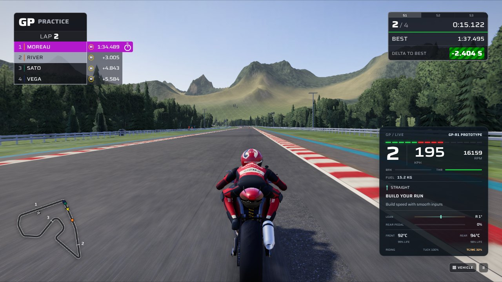 | 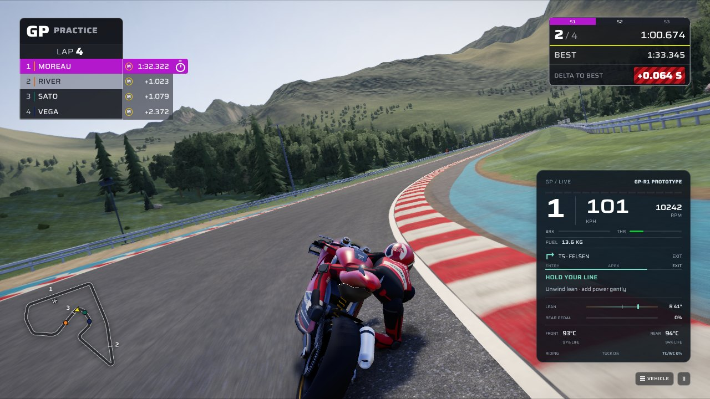 | 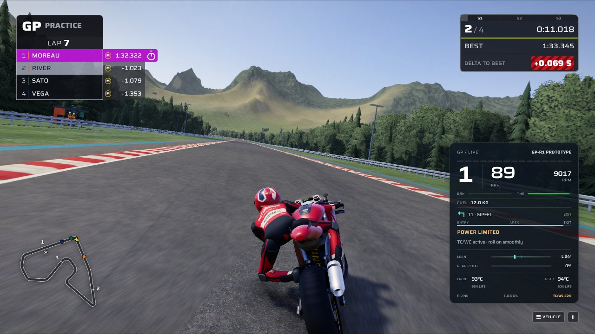 |

### Zafra Night Grand Prix (`zafra-night`, 5.380 km, clockwise, floodlit)

A flat desert lap under floodlights: a 1.1 km straight ending in a ~320 km/h stop into the first corner, then a chain of long, fast same-direction sweepers broken by a hairpin and short opposite-hand flicks. The `night-desert` theme supplies light towers, sand and scrub; saturated green aprons read under the lights.

| Seeded GP AI check (4 riders, 2 laps) | Best lap | Top speed | Falls |
| ------------------------------------- | -------: | --------: | ----: |
| Steinhorn                             |   1:32.7 |  318 km/h |     0 |
| Zafra Night                           |   1:55.5 |  320 km/h |     0 |
| Poggio Alto (control)                 |   1:54.7 |  320 km/h |     0 |

| Trail braking under the floodlights                                     | The kilometre straight                                                      |
| ----------------------------------------------------------------------- | --------------------------------------------------------------------------- |
| 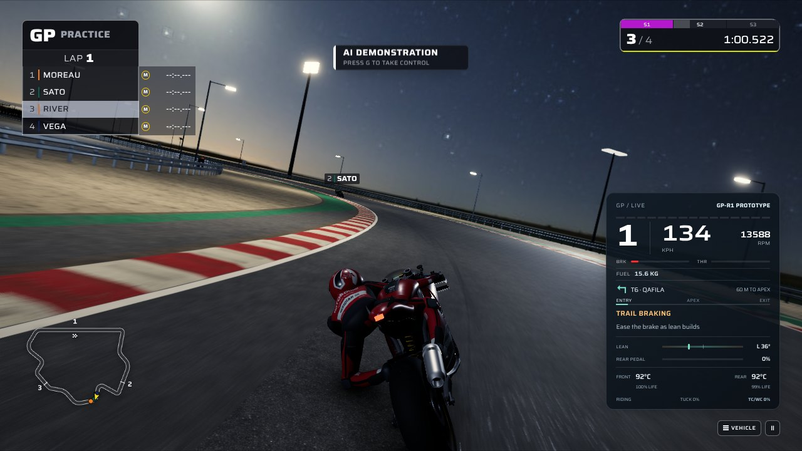 | 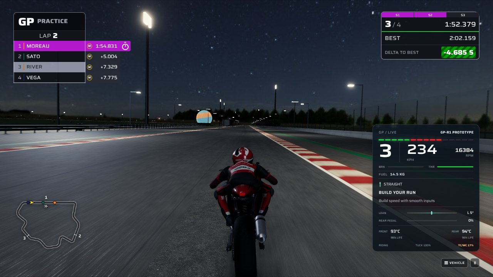 |

Each circuit has a built-in GP event (`steinhorn-gp-motorcycle`, `zafra-night-gp-motorcycle`). The catalogue race, motorcycle class clearance and bike event evidence files were regenerated with their own scripts; see [Validation](#validation).

## Gameplay: ride moments

`GpRideMoments` (`src/ui/gp-ride-moments.ts`) reads the player's own original worker snapshots and calls out:

| Moment                 | Trigger                                                             |
| ---------------------- | ------------------------------------------------------------------- |
| KNEE DOWN / ELBOW DOWN | ≥ 50° / ≥ 59° chassis lean, banked once per bend with the peak lean |
| HARD STOP              | ≥ 140 km/h lost in one continuous front-brake application           |
| WHEELIE / STOPPIE      | Nose-up pitch held ≥ 0.45 s / rear lift ≥ 0.2 s, banked on landing  |
| OVERTAKE               | Places gained on track                                              |
| TOP SPEED              | A new session top speed, announced as the bike leaves the straight  |
| FLOW LOST              | Running onto grass/gravel or a fall ends the combo                  |

Highlights within nine seconds of each other raise a flow multiplier (up to ×5) for a light-hearted ride score. Points are only scored for a human rider and never affect the simulation, AI, lap validity or classification. Replay, photo, pits and rewinds suspend detection, and a reversed simulation clock abandons any partial bend. The callout sits above the road, clear of the cluster and banners, respects `prefers-reduced-motion` and uses an `aria-live` status region.

| Knee down banked at the exit                                               | Places gained                                                            |
| -------------------------------------------------------------------------- | ------------------------------------------------------------------------ |
| 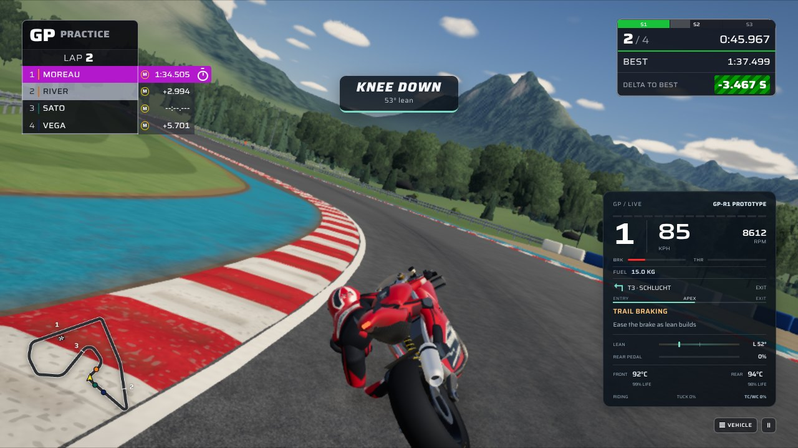 | 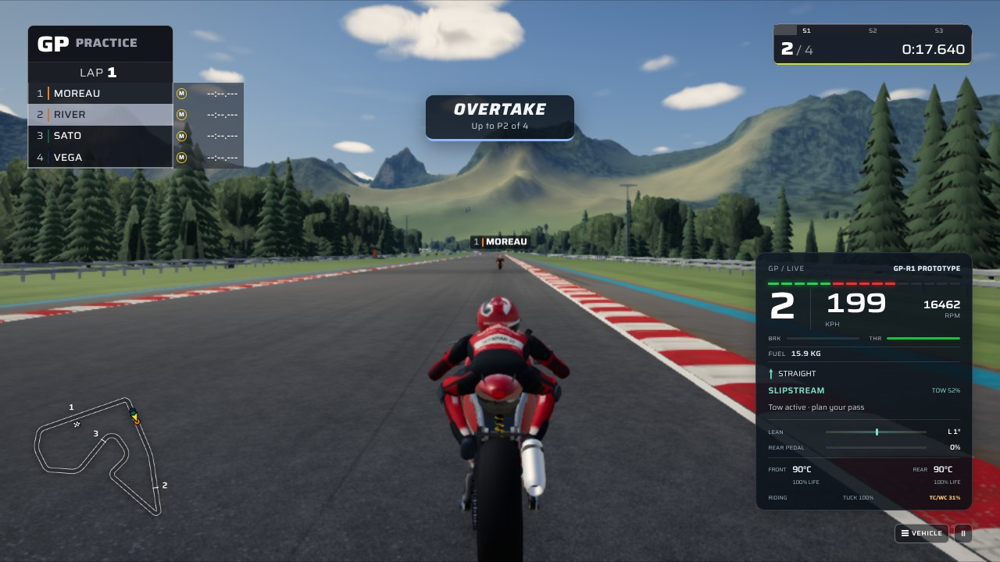 |

## Validation

All in-game images are from the actual application (normal menu entry, four GP-R1 riders, AI demonstration) under SwiftShader software rendering at 1280 × 720: the circuit images use the Medium preset, the callouts the Low preset. Software rendering takes seconds per frame, longer than a callout's 2.6 s simulation-time window, so the callout captures hold the real element visible for the screenshot; nothing else is altered. The stance and onboard comparisons are isolated renders of the production model. None of these establish frame rate on real hardware.

| Check                                                       | Result                                                                                                                                                                                                                                                 |
| ----------------------------------------------------------- | ------------------------------------------------------------------------------------------------------------------------------------------------------------------------------------------------------------------------------------------------------ |
| `npm run lint`, `npm run validate:content`, `npm run build` | Pass.                                                                                                                                                                                                                                                  |
| New unit tests                                              | `gp-rider-stance` (4) and `gp-ride-moments` (5) pass.                                                                                                                                                                                                  |
| Full `npx vitest run`                                       | 4,896 of 4,907 pass; all 11 failures are pre-existing (below).                                                                                                                                                                                         |
| Updated contracts                                           | Spine/suit pelvis, lined cowl, onboard display visibility, per-venue GP architecture suites (now covering six venues) pass.                                                                                                                            |
| `scripts/catalogue-races.ts`                                | Regenerated; all 42 layouts pass, including Steinhorn and Zafra Night. The previously committed file predated later physics changes: unmodified `HEAD` and this change produce identical results (for example `kansai-east` 43.59 s best).             |
| `scripts/bike-clearance.ts`                                 | Steinhorn clears gp-bike, superbike and supersport (classic falls 8 times in the hairpins and is not declared); Zafra Night clears all four classes. Only these two circuits' results were merged into `docs/bike-clearance.json`; see the note below. |
| `npm run test:bikes`                                        | Regenerated; passes, both new events race with zero falls.                                                                                                                                                                                             |

### Pre-existing failures, not changed here

These reproduce identically on the unmodified base commit and are outside this change:

- The full clearance run now shows `ardennes` superbike with 7 falls (limit 6), so a whole-file regeneration would record `passed: false`.
- `tests/gp-r2-bodywork.test.ts` front-assembly clearance (high and mid) exceeds its 2 mm regression limit.
- `tests/motocross-broadcast-controls.test.ts` historical camera signature for `cape-wrenna` differs.
- `tests/gp-fork-crown.test.ts` steering-group mesh count (28 vs 26 high, 17 vs 13 mid).
- One case each in `tests/a61-rival.test.ts`, `tests/frontend-retail.test.ts`, `tests/motocross-collision.test.ts` and `tests/open-world-session.test.ts`.

The full unit suite on this change: 553 files, 4,907 tests; the 11 failing tests are exactly the pre-existing cases listed above.
