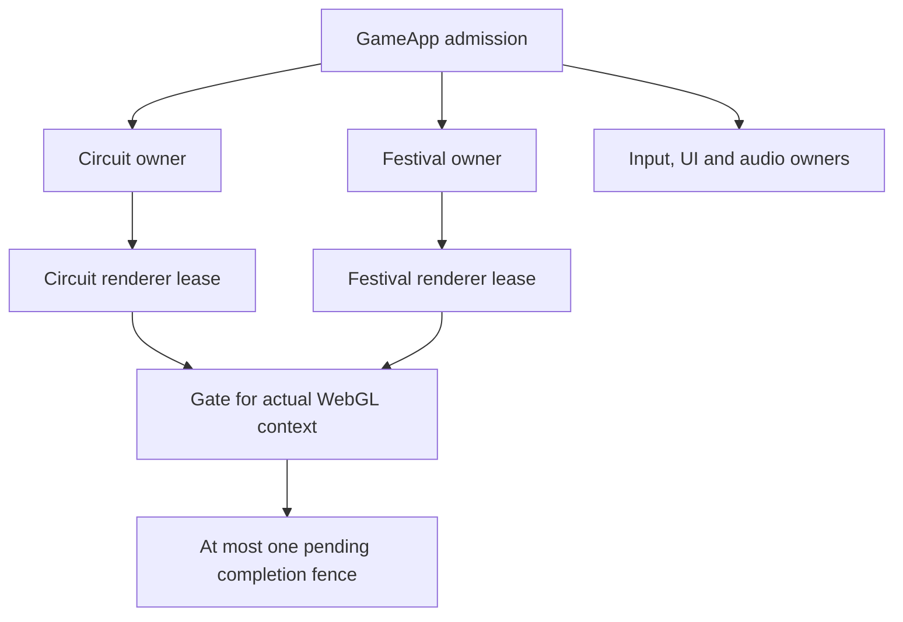

# Engine behavior, architecture and change guide

This guide describes the engine at executable candidate
`774e62fafdfd9ecd84001a2fcdb3b9f6ee973b86`, relative to original baseline
`350119e8ec0606e8c5de5b3ab80df41104025679`. It explains the contracts to retain
when extending the code. [README](README.md) carries current acceptance and
the programme index; [REPRODUCING](REPRODUCING.md) supplies commands and exact
historical measurement pins.

The changes fall into two connected themes: compute reusable values once while
preserving their validity rules, and make every asynchronous resource belong
to an explicit live owner. Neither theme changes authored models, scenes,
track definitions, sound profiles or handling constants. The
[scope audit](w09e-protected-content-audit.md) verifies the protected content
and reviews all 25 changed production files.

## Host, input and UI ownership

### Admission and callback boundaries

`GameApp` admits a circuit start, Festival start or conflicting settings
operation synchronously, before asynchronous imports, audio, rendering or
record preparation can yield. The admitted generation owns its completion.
Every meaningful asynchronous completion checks that identity before
installing state. Failed cleanup enters the fatal path; the host does not
offer menu recovery while pretending a failed owner has been released.
See [startup](w02d-startup.md) and
[host composition](w05d-device-lifecycle-composition.md).

Synchronous callbacks are ownership boundaries too. A session-start subscriber
can replace or dispose the host before event emission returns; a focus/blur
handler can do the same immediately before a worker is unpaused. The final
review supplied six failing witnesses and added checks after those callbacks.
Festival readiness checks the actual session owner and page epoch before
creating its demo clock or publishing session start. Normal event payload and
order are preserved. [W08F](w08f-host-lifecycle-review.md) records the concrete
pre-fix continuations and repair.

The rendering relationship is worth making explicit: a session owns its
renderer wrapper, while actual context identity owns GPU completion state.
The diagram shows possible ownership branches, not simultaneous admission of
two gameplay sessions.

### Retained page versus terminal exit

A persisted `pagehide` suspends the existing page. Input and worker activity
pause, audio is suspended, and callback epochs are revoked while retained
renderer/session resources stay owned. `pageshow` establishes a fresh callback
epoch and input baseline; gameplay remains paused until the supported resume
path. Terminal exit disposes the owner. A queued callback from the old epoch
cannot restart a loop merely because the page later becomes visible.
RAF identifiers use `null` as the empty sentinel, so an actual identifier of
zero is handled correctly. [W04B](w04b-page-lifecycle.md) defines the lifetime;
[W06B](w06b-native-page-history.md) exercises actual browser history restoration.

The native history fixture uses the actual host lifecycle declarations,
input pump, native physics worker and WebGL context. It checks two trusted
BFCache restoration cycles, the same document and worker identities, no
document refetch, paused worker ticks, fresh input before resumed motion and
terminal-reload cleanup. Its minimal UI endpoints make this evidence about
the lifecycle contract; it does not establish whole-game BFCache eligibility
or full Festival scene loading. [Native audit](w09c-native-evidence-audit.md).

### Device and modal ownership

Menu and credits polling retain controller identity as values. Device
replacement, focus/visibility changes and modal/scope replacement revoke the
old sample. A held direction must return to neutral before the new owner can
navigate or repeat; button edges are committed before calling actions. The
menu's ordinary 360 ms initial repeat delay and 110 ms repeat interval remain.
Page suspension cancels polling and restoration creates one fresh poll owner.
Native tests use real DOM focus, clicks, dialogs and RAF delivery with scripted
gamepad samples; physical gamepads are outside their scope.
[W03E](w03e-menu-gamepad.md), [W06F](w06f-native-device-ownership.md).

`Interface.dispose()` revokes ownership first, then attempts all owned cleanup
even if one release fails. Modal teardown snapshots the old handles before
calling their disposers, preventing a reentrant replacement from being
accidentally released. Modal opening now has its own operation identity:
after `showModal`, focus, cue or first-run binding callbacks, only the still
current operation may install resources. A disposer returned after ownership
was lost is released immediately. Seven actual-helper regression witnesses
cover disposal, replacement and close during those boundaries; the review
also checked all 1,413 Interface literal/template tokens unchanged.
[W08D](w08d-devices-audio-review.md).

**Source navigation:** [main.ts](../../../src/main.ts),
[free-roam.ts](../../../src/session/free-roam.ts),
[controller.ts](../../../src/input/controller.ts),
[interface.ts](../../../src/ui/interface.ts),
[menu-gamepad.ts](../../../src/ui/menu-gamepad.ts),
[credits.ts](../../../src/ui/credits.ts).

## Physics and surface state

### Conservative lane lookup

Paved circuits now use the existing `TrackLaneIndex` with a per-Track,
lazily populated 2,048-cell bound. A cell stores a conservative candidate
set; the original segment order and exact nearest-segment evaluation remain.
When local geometry or query height cannot prove a safe reduction, the code
retains the original candidate/fallback path. The index depends on immutable
track geometry, not evolving traffic or weather. Its bounded eviction is
insertion-order eviction, **not LRU**. Existing MX/SX retention and RX/rally
fallback behavior are separate and should not be described as receiving the
same cap. [W02A](w02a-lane-index.md),
[cache review](w08a-physics-cache-review.md).

The cost depends on reuse. Repeated paved queries measured 1.76–3.70 times
faster, while a deliberately sequential 4,096-cell working set remains all
misses under the 2,048-cell cap and measured 2.19–2.67 times slower.
Construction and controls were mixed. The bound is retained because those
results do not justify unbounded storage or a speculative admission rule.
A future admission change needs representative Simulation traces and the
same geometry/order proof. [W07A](w07a-lane-measurement.md).

### Exact water and thermal reuse

The surface implementation separates reusable mathematics from live forcing.
It preserves Float64 representation and the original arithmetic order rather
than replacing the solver with an approximation.

| Reused work                       | Validity and invalidation                                                                       | Contract retained                                                                                        |
| --------------------------------- | ----------------------------------------------------------------------------------------------- | -------------------------------------------------------------------------------------------------------- |
| Depression grid                   | Original row/column geometry expression, precomputed once per Track                             | Same cell values and iteration order                                                                     |
| Water gain                        | Current timestep and actual mutable drainage value for each slot                                | Existing validation, tiny-drainage branch and `-expm1(-k * dt)` arithmetic                               |
| Thermal matrix signature          | Timestep, effective air transfer, surface/substrate capacities, conduction and deep conductance | Changed signatures invalidate cached rainfall keys                                                       |
| Six thermal coefficients per cell | Actual rainfall under the current signature                                                     | Current ambient, solar, vapour and evaporation inputs still refresh; temporary cell rainfall is restored |
| Covered cells                     | Existing scalar zero-rain matrix in a separate solver                                           | Exposure changes select the appropriate solver without adding per-cell covered records                   |

The added fixed array payload is **286,720 bytes / 280 KiB per Track**:
28,672 depression bytes, 57,344 drainage/gain bytes, 28,672 rainfall-key bytes
and 172,032 thermal-coefficient bytes. Array/object headers and scalar keys
are additional; this is not a heap measurement. The cache banks remain fixed
arrays rather than growing maps. [W02E](w02e-surface.md).

The independent edge proof includes 3,920 water tuples, 15,680 exact scalar
comparisons, 672 positive-zero cases, paired invalid-input rejections and
480 thermal columns. Error behavior matters: an unconditional early return
for empty water could suppress existing optional-bank validation. The review
therefore retained that boundary. [W08A](w08a-physics-cache-review.md).

### Integrated effect and limits

The isolated surface measurement found consistent rain and staged mutable
weather gains, but penalties for clear/storm cases, first wet ticks and
changing solver timesteps. Some weather schedules spend many endpoints after
their final keyframe; they are not continuously changing weather throughout
the measured interval. The actual combined Simulation measurement separately
found paired time reductions of **11.88% for Aurel rain** and **12.14% for
Aurel storm**, with mixed results in the other four cases. Construction and
priming are outside its timed 480-step/240-frame-write interval. The exact
comparison includes 463,357 scalar observations, 44,474,976 typed-array bytes
and 81,168,000 packed frame bytes. These results demonstrate the tested
simulation work and retain the subsystem regressions; they do not establish
rendered FPS. [W07B](w07b-surface-measurement.md),
[W07F](w07f-simulation-measurement.md).

**Source navigation:** [track.ts](../../../src/simulation/track.ts),
[weather.ts](../../../src/simulation/weather.ts) (`WaterStepCoefficients`,
`advanceWater`),
[surface-thermal.ts](../../../src/simulation/surface-thermal.ts)
(`SurfaceThermalStep`). The existing index implementation is consumed by
Track; authored track definitions are protected.

## Network clocks, protocol and broadcasts

### Presentation clock is separate from authority

`RaceClient.view()` samples remote cars through `PresentationClock`. With
elapsed time `e`, it advances by
`e + clamp(target - predicted, -0.25e, 0.25e)`: playback advances between
0.75 and 1.25 times elapsed time, so a changed arrival anchor cannot rewind
or freeze it. Repeated reads at the same instant spend no correction budget;
backward local reads cannot move the stored anchor backwards. An unsynchronized
nonfinite target does not initialize it, and accepted grids reset it.

Input issue/resend selection, ACKs, command lead, prediction reconciliation
and raw clock observations continue using their authoritative paths. A
controlled 50-to-200 ms latency step changed the old remote displacement from
−2.75 m to +0.25 m in that scenario; it is a presentation correctness witness,
not a measured physical-network latency reduction.
[W02B](w02b-network-clock.md), [W08B](w08b-network-review.md).

### Owned packets and bounded dispatch

The server captures recipient identities, world state and every recipient's
owned final packet before invoking external send callbacks. The ordinary path
restores a temporary FULL flag in `finally`; the prepared path copies the
selected FULL car and compact peers into independent outputs. Prepared scratch
never becomes the queued packet's backing storage.

Slack, missing-input counters, contacts and pending events are consumed at
the captured boundary. A synchronous nested snapshot queues behind the active
batch; a latch bounds dispatch to the initial batch and one follow-up, with
further nested requests coalesced. Delivery checks that the captured connection
still belongs to the player, so replacement/disconnect callbacks cannot send
the remaining old batch into a new owner. These rules hold on both encoding
routes. [W02F](w02f-snapshot-batch.md),
[W05B](w05b-network-composition.md), [W08B](w08b-network-review.md).

Input encoder capacity is exact: 10 bytes for an empty packet, otherwise
`18 + 9 × commandCount`, reaching 162 bytes for 16 commands. Avoiding the
old writer growth preserves protocol validation and `finish()`'s owned copy;
it is not a zero-allocation encoder. The client reads `packet.byteLength`
before a transferable send can detach it and updates counters only after a
successful send return. A thrown transport error retains the original
success-based accounting behavior. [W04C](w04c-input-encoder-capacity.md),
[W06A](w06a-native-network.md).

### Current preparation threshold and cost

**Prepare shared car bytes only when at least 12 ready recipients are selected;
below 12, use ordinary encoding.** This replaces the earlier multi-recipient
default documented in W02/W07. At 12 cars, ordinary cumulative backing
capacity is `1,159 × recipients` bytes; prepared capacity is
`1,692 + 1,006 × recipients`. At 12 recipients that is 13,908 versus
13,764 bytes, but preparation still adds three backing buffers. These are
observed backing capacities, not retained heap or GC results.

The actual-baseline W07 experiment found paired time **−31.17%** at 12
recipients and **+29.15%** at two. The separate W08 crossover compares the
two actual current codecs: **−15.66%** at 12/12, but **+15.50%** at two
recipients in a full field and **+28.96%** in a minimal field. Intermediate
counts are noisy. Twelve is a conservative capacity-aware policy boundary,
not a universal CPU crossover for every runtime or field size. The untimed
original-wire oracle checks 4,576 packets / 1,958,528 bytes per variant.
[W07C](w07c-network-measurement.md), [W08B](w08b-network-review.md).

Native network coverage uses actual server/client/codec logic through browser
`MessageChannel` transfers, including detached senders, controlled loss and
connection churn. It checks 768 packets / 94,945 bytes in its scenario. It
does not exercise WebRTC, sockets, separate machines or physical network
conditions. [W06A](w06a-native-network.md).

**Source navigation:** [interpolation.ts](../../../src/net/interpolation.ts),
[client.ts](../../../src/net/client.ts),
[server.ts](../../../src/net/server.ts),
[codec.ts](../../../src/net/codec.ts),
[snapshot.ts](../../../src/net/snapshot.ts).

## Audio arithmetic and context ownership

Filter, low-pass and harmonic coefficient work is reused without changing
evaluation/summation order. In the measured 117-harmonic active update, sine
calls fall from 117 to one and cosine calls from 819 to 235. A lazy
2,048 × 40 Float64 sine basis adds **640 KiB** of logical retained payload
per evaluated module instance; it is allocated on demand, not at import, and
remains retained by that module. Short cold spectra retain their
original path, later eligible spectra reuse the basis, and spectra beyond
the supported 40 coefficients use the original calculation. Existing profile
WeakMap behavior and authored profiles remain.
[W03A](w03a-audio-coefficients.md), [W04A](w04a-audio-sine-basis.md).

The reuse has a real first-use cost. Independent median batch times in the
frozen experiment were 2.282→4.668 ms for the first full waveform and
6.386→7.839 ms for the first active family. With the basis warm, the family
was 3.502→1.238 ms; a 72-waveform sweep was 69.989→5.301 ms and 8,192
cached active updates were 86.436→26.763 ms. The zero-gain control regressed
71.060→74.738 ms. These are declared batch timings, not individual frame or
audible latency estimates. Exactness checks include 40,085,160 numbers,
of which 40 million belong to the zero-gain control; that distribution should
remain visible when quoting the total. [W07D](w07d-audio-measurement.md).

`UiSounds` detaches old ownership before asynchronous suspend/close cleanup.
Late resume or source-ended callbacks cannot revive or disconnect a replacement
context. Native checks require owned contexts to close and use actual source
completion barriers for the replacement. An abandoned old resume may remain
pending; the test records that outcome instead of waiting forever or treating
it as successful closure. [W05E](w05e-audio-composition.md),
[W06D](w06d-native-audio-advancement.md), [W08D](w08d-devices-audio-review.md).

Native audio acceptance separates exact supplied waveform/graph/automation
inputs from mixed PCM. Original-versus-original native mixing was itself not
bit deterministic. The fixture therefore retains its fixed Float32 budget
`2 * gamma_11 ≈ 1.3113030448e-6`, same-rate controls at 44.1/48/96 kHz,
and an actual output-gain perturbation of `1 + 2^-10` that must fail by more
than 100 times the budget. This is a sensitive fixture-specific contract,
not a universal DSP error theorem or physical speaker test.
[Native audit](w09c-native-evidence-audit.md).

**Source navigation:** [engine-loudness.ts](../../../src/audio/engine-loudness.ts),
[ui-sounds.ts](../../../src/audio/ui-sounds.ts).

## Render admission and buffer publication

### Shared completion ownership and pacing

`acquireGpuFrameGate()` keys a WeakMap by the actual WebGL2 context. Each
successfully constructed renderer owns a lease; the context owns one gate
and an owner count. Releasing a borrowed renderer leaves unfinished work
visible to other owners. Only final lease release deletes the shared gate
and its pending sync; releasing a wrapper does not dispose a borrowed backend.
The registry does not strongly retain contexts or a growing owner list.
[W04D](w04d-shared-gpu-ownership.md),
[W05F](w05f-graphics-composition.md).

Admission uses zero-time `clientWaitSync` polling and fails closed on context
loss or errors. It does not block on `gl.finish`. Presentation state is
prepared only after admission; draw reports whether submission really
occurred, and submitted work receives its fence in cleanup. Each GPU-admission
wait during preparation has a fresh 90-second deadline, checked between browser
task yields. This is not a single overall preparation deadline: it cannot
preempt a blocked JavaScript task or independently bound compilation. Compilation
promise rejection is observed immediately. These rules matter during cancellation
as well as ordinary draws.
[W04D](w04d-shared-gpu-ownership.md),
[render review](w08e-render-resources-review.md).

Festival renders each ready live frame, while paused/photo idle presentation
is paced to 15 Hz. Control, UI and audio callbacks continue at their normal
callback cadence. Pose/presentation preparation happens only for admitted
frames; a dirty revision is consumed only when a draw actually submits.
Manual photo requests remain immediate and gate-aware. This reduces redundant
idle preparation without claiming a faster GPU or changing authored scenes.
[W04E](w04e-festival-frame-pacing.md).

### Current dirty-range policy

`markItems()` keeps the common path constant-time: merge an overlapping or
touching last span, otherwise append while below 16 pending entries. When
capacity is threatened, normalize the **actual public mutable list**, compute
the union and fall back to a full upload only if that union still exceeds
16 entries. Three performs final sorting/merging when publishing. A hidden
order/coverage cache would be incorrect because callers can directly mutate
`updateRanges`; the implementation has no such cache.

An empty mark remains a no-op. Every nonempty mark increments the attribute
version once. A full mark is an explicit full range and stays full through
later partial marks until publication clears it. The algorithm retains exact
uploaded bytes and mutable unsorted-list compatibility.
[W03C](w03c-attribute-ranges.md),
[final revision](w08e-render-resources-review.md).

The first implementation normalized too much work and W07 exposed the
disjoint-range penalty. W08's separately frozen original-baseline experiment
measures the revised policy across 26 cases and two overlapping scopes:

| Case                     | Transfer effect              | Revised complete recording-upload CPU versus original         |
| ------------------------ | ---------------------------- | ------------------------------------------------------------- |
| Seventeen duplicates     | 49,152→48 bytes              | Paired ratio 0.316×                                           |
| Seventeen adjacent marks | 49,152→816 bytes             | Paired ratio 0.329×                                           |
| Bridge at 16 entries     | 49,152→732 bytes             | Paired ratio 0.721×                                           |
| Sixteen disjoint marks   | 192 bytes / 16 calls in both | 92.52→113.32 ns/mark independent medians; paired ratio 1.215× |
| Seventeen disjoint marks | Full upload in both          | 94.99→123.52 ns/mark independent medians; paired ratio 1.314× |

For 16 disjoint marks, helper-only medians are 22.95→37.26 ns/mark,
paired ratio 1.706×. The additional batch work is approximately 0.229 µs
in the helper scope or 0.333 µs in the complete scope; **do not add them**.
The new run and the previous candidate's 193.07/296.53 ns values are separate
executions, not a direct paired comparison between the two candidates.
Some revised medians are worse than the previous candidate for repeated,
contained, full, empty and small disjoint workloads; all 52 rows remain.
[W07E](w07e-attribute-measurement.md),
[W08E](w08e-render-resources-review.md).

Actual FestivalTrails composition separately reduced an observed 41-snapshot
upload from 81,920 to 25,600 bytes; a ring wrap still required 81,920 bytes,
and the following narrow update remained 640 bytes. The recording-driver
benchmark measures CPU work and upload arguments. Native `getBufferSubData`
checks establish complete actual buffer contents, not GPU duration.
[W05F](w05f-graphics-composition.md),
[W06C](w06c-native-gpu-advancement.md).

### Native material boundary

The accepted 47-case suite runs on ANGLE/Mesa llvmpipe. The shared-gate test
uses a test-only raw `vec4` material with strict full 256-byte red/green target
comparisons and retains its lease, wait, admission, fence deletion and backend
lifetime assertions. A six-path diagnostic still records MeshBasic/raw-`vec3`
limitations separately. Both the earlier failed checkpoint and accepted
`774e62fa` run show 64 differing bytes through bulk, individual-pixel and
Three readback for those paths;
clear, upload, constant and `vec4` controls were exact. Correct uniform values,
complete RGBA8 attachments and zero GL errors isolate the observed colour
path without identifying the exact native component responsible.

The diagnostic matrix and visible limitation annotations remain. Passing
shared ownership through the verified control does not certify the failing
material paths, every game image or physical GPU hardware. The historical
failed run is preserved. [W09C](w09c-native-evidence-audit.md).

**Source navigation:**
[shared-gpu-frame-gate.ts](../../../src/rendering/shared-gpu-frame-gate.ts),
[renderer.ts](../../../src/rendering/renderer.ts),
[festival-renderer.ts](../../../src/rendering/open-world/festival-renderer.ts),
[attribute-ranges.ts](../../../src/rendering/attribute-ranges.ts).

## Ghosts, telemetry and flashback

### First passage through a recorded distance

A ghost that reverses or repeats distance cannot use the original monotonic
distance search. Its new Float32 prefix-maximum index supports a binary search
for the first forward crossing while retaining **original adjacent sample
indices** for interpolation. Connecting record-high samples directly would
interpolate across a reversal incorrectly. Strictly increasing laps retain
their old path and allocate no index. The maximum added logical index payload
is 72,008 bytes for a nonmonotonic maximum-length recording; recorded pose
bytes and persisted layout are unchanged. [W03B](w03b-ghost-first-passage.md).

The later review found a sub-micrometre endpoint issue: an exact indexed
recorded station could return an earlier time because of the existing
interpolation denominator floor. Exact endpoint queries now return that
recorded endpoint's time, preserving first-sample behavior at an initial
repeated station. The strictly monotonic path and interior floor remain.
Three regression cases cover the demonstrated defect.
[W08C](w08c-storage-records-review.md).

### Lap continuity and journal retention

A completed telemetry lap now validates the closing segment `i − 1 → i`.
A gap greater than 0.15 seconds invalidates that lap even though the finish
sample belongs to the next lap's sample interval. Sample ownership remains
`[start, i)`, so the following lap is independent. Composition checks exercise
a wrapped 630-sample ring through capture and CSV-worker export.
[W03F](w03f-telemetry-lap-gap.md),
[W05C](w05c-records-integration.md).

Time trial and qualifying do not support flashback. Their worker journal is
now `null`, and the UI uses the same `supportsFlashback` contract. The existing
record/replay path remains. An actual 600-second worker scenario with
36,000 controls and 72,000 physics steps retained zero journal entries
instead of 36,000 in its same-worker retained-history control, with exact
inputs, frames and replay results. This is a retention count, not a heap-size
measurement. Supported race, endurance and practice modes still retain their
session-long input journal despite the 30-second rewind window; this change
does not impose a global history bound on those modes.
[W03D](w03d-flashback-retention.md).

Native saved-record coverage uses actual IndexedDB ghost save/reload and
capture/CSV workers with transferable records. It verifies those transactions
and their interpretation, not every storage failure or a broader disk
durability guarantee. [W06E](w06e-native-records.md).

**Source navigation:** [ghost-lap.ts](../../../src/core/ghost-lap.ts),
[telemetry-plots.ts](../../../src/storage/telemetry-plots.ts),
[flashback.ts](../../../src/core/flashback.ts),
[UI flashback](../../../src/ui/flashback.ts),
[physics.worker.ts](../../../src/workers/physics.worker.ts).

## Evidence and maintenance boundaries

| Evidence layer                    | What it establishes                                                                                    | What to retain when extending the engine                                                                                 |
| --------------------------------- | ------------------------------------------------------------------------------------------------------ | ------------------------------------------------------------------------------------------------------------------------ |
| Actual-baseline exact comparisons | Tested numerical state, protocol bytes, record outputs and arithmetic/error boundaries                 | Original source identity, unmodified inputs, comparison scope and adverse cases                                          |
| Frozen timing reports             | Elapsed work for declared workloads on the recorded runtime, including regressions                     | All pairs, warm/cold setup, timed scope, source manifests and current-policy follow-ups                                  |
| Focused unit acceptance           | 914 tests / 70 files at accepted `774e62fa`                                                            | Regressions for demonstrated failures, rather than assertions that mirror implementation                                 |
| Full compiler/build               | TypeScript and product/full Vite bundle succeed at that exact candidate                                | Test typing is part of the full compiler gate; preserve earlier failed receipts                                          |
| Native browser acceptance         | 47 browser contracts, with zero failures/flaky/skips                                                   | Software backend identity, scripted boundaries, full-buffer/image comparisons and unresolved material diagnostics        |
| Protected-content audit           | 1,758 paths / 263,530,318 bytes identical in baseline/candidate/worktree; engine-only production scope | Authored source and asset bytes; generated LOD file remains absent                                                       |
| Broader failure classification    | Four exact baseline/candidate unit failures; other browser cases still unresolved                      | Do not label all timeouts/cancelled jobs pre-existing without exact-baseline evidence                                    |
| Publication ancestry              | Preserved CI-report bot commits and verified source/tree receipts                                      | Read the current remote tip before final integration; do not infer historical transport flags from commit ancestry alone |

The full `src` subtree is identical between the previous `26efaeef` candidate
and accepted `774e62fa`; the latter repairs a test-only cast and preserves
emitted JavaScript for formatted fixtures. The former's compiler failure and
skipped native stage remain historical evidence, not a substitute for the
latter's successful run. [Static acceptance](w09b-build-static-acceptance.md),
[native acceptance](w09c-native-evidence-audit.md),
[publication audit](w09f-publication-ancestry-audit.md).

Further optimization should start with the explicit adverse cases: lane-cache
churn, coefficient misses and changing timestep, audio first use, and disjoint
dirty ranges. The existing reports identify those costs but do not claim an
unimplemented remedy. Preserve ownership revocation before callbacks,
authoritative/presentation separation, actual mutable cache keys, output
ownership and exact error boundaries when testing a proposal. The reproducible
inputs and pinned source commands are collected in
[REPRODUCING](REPRODUCING.md).
