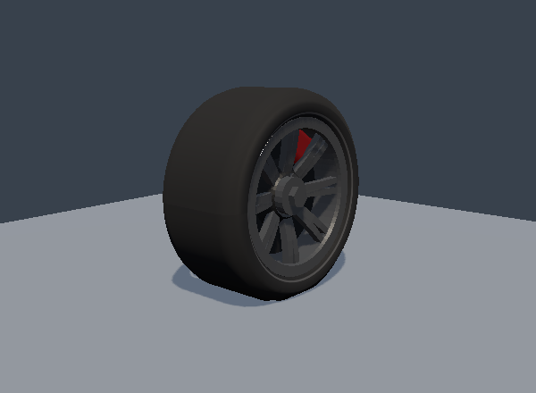

# Coupled tire contact, finite road footprint and recorded deformation — v13

This update starts from `9cfeef8ef6ea050561b62d3db2ad2f22a52b3cd7` on `main`. It extends
the existing v12 longitudinal-contact and thermal work in three places: lateral elastic
contact, finite-width support over paved road geometry, and animation driven by measured
contact state. The 120 Hz worker, maximum 1/240 s vehicle substep, steady tire curves,
vehicle coefficients and existing acceptance bands are retained.

During integration, `main` advanced to `468749bfc706283f7ba9b9a57752c32130d3959a`
(motocross bikes, rider gear and course landmarks), then to
`aad08a3a5449181d6812973c1e6db29d3f621586` (MotoGP machines, rider finish and course
readability). Both updates were fast-forwarded into this checkout. Neither overlaps this
change's files or numerical solver; the eight physics-source hashes still exactly match the
accepted calibration and sustained-driving runs after both integrations. The second update
also changes shared scene preparation for pure GP grids; Formula and catalogue grids retain
the existing full-scene compilation path. Validation provenance below distinguishes the
earlier accepted build from the final combined tree.

The force upgrade applies to the shared **four-wheel car solver**: Formula, touring,
road/festival and off-road cars. Finite crown geometry applies to paved circuit meshes;
analytic open-world and deformable-terrain adapters keep their authoritative queries.
GP and motocross retain their separate two-wheel physics and presentation models.

## Public engineering references

| Primary source | Principle informing this independent implementation |
| --- | --- |
| [Dave Kaemmer, Physics Modeling: NTM V7 Info (2018)](https://www.iracing.com/physics-modeling-ntm-v7-info-plus/) | Contact-patch motion relative to the rim has different longitudinal, lateral and vertical compliance; carcass behavior depends on construction and operating conditions. |
| [iRacing Development Update, May 2025](https://www.iracing.com/iracing-development-update-may-2025/) | Surface temperature excursions and recovery after short slides require careful physical accounting and calibration. |
| [Project Chrono, Wheeled Tire Models](https://api.projectchrono.org/development/wheeled_tire.html) | A finite road envelope can represent short undulations and obstacle crossing without a full finite-element tire. |

iRacing does not publish its proprietary model equations in the cited Kaemmer article.
The algorithms here are original reductions for this game, not iRacing source code or
a reproduction of its tire model. The rounded ellipsoid is also independent of Chrono's
documented envelope algorithm. Numerical consistency and repeatable handling regressions
do not establish measured real-car accuracy.

## 1. Two tangential elastic states inside the wheel solve

Previously, the longitudinal contact stored elastic deformation and energy while lateral
force followed a filtered slip angle. Lateral slip work was treated as heat immediately.
The new solver retains the existing steady combined-slip law but gives both force
directions an explicit spring state:

```text
Fx = Kx*x                  Fy = -Ky*y
Kx = slip stiffness / longitudinal relaxation length
Ky = cornering stiffness / lateral relaxation length

sx = wheel speed * rolling radius - longitudinal contact speed
sy = lateral contact speed * cos(beta) - hypot(longitudinal speed, 3) * sin(beta)
lambda_x = Kx*sx/Fx_steady
lambda_y = Ky*sy/(-Fy_steady)

x_new = (x_old + dt*sx)/(1 + dt*lambda_x)
y_new = (y_old + dt*sy)/(1 + dt*lambda_y)
```

Here beta is the existing equivalent camber slip-angle shift, bounded to ±pi/4 for
extreme inputs. At zero camber, `sy` equals the actual lateral contact velocity exactly,
including reverse travel and large sideways motion. At zero slip, the corresponding
combined-slip derivative supplies the finite limiting relaxation rate.

The original reference lengths remain 0.22/0.29 m longitudinal and 0.32/0.42 m lateral
for Formula/touring constructions. Existing load, pressure, wear and low-speed laws
modify them. These transport lengths are engineering parameters; they are not a claim
to implement the viscoelastic relaxation-modulus formulation discussed by iRacing.

Every trial in the existing 16-iteration wheel-speed root computes both spring forces.
Their pair is projected onto the current friction ellipse with a common nonnegative
scale; neither axis receives a reserved priority. Force-only probes do not mutate either
spring. The accepted force is the force used in both the wheel torque residual and the
vehicle force application. The original steady curves are recovered after relaxation.

### Signed energy and heat

For either prepared spring, using its resisting-force convention `F = K*q`:

```text
F*s*dt = change in stored energy (K*q*q/2)
       + physical sliding/projection loss*dt
       + backward-Euler numerical loss (K*(q_new-q_old)^2/2)
```

Stored strain can return energy during a reversal. Physical dissipation enters the tire
thermal model; numerical loss is tracked separately. This replaces the former lateral
`abs(Fy*vLat)` heat shortcut. Stiffness changes remap displacement at fixed stored energy.
Unloading and walking-speed fallback release remaining elastic energy into the carcass
once, without counting it as road sliding or tread abrasion. Placement and recovery reset
both contact memories; replacement tires start with fresh state.

Camber remains an explicit reduced-model boundary. Its signed geometric power port is
`camberPower = Fy*(vLat-sy)`. Actual lateral slip work plus this port equals the lateral
spring budget. No separate camber/overturning torque supplies this port, so this identity
does not prove whole-car energy conservation at nonzero camber. The scalar strains also
use the instantaneous tire frame; torsional patch transport is not solved.

### Reproducible impulse and reversal

`scripts/contact-pulse.ts [optional-checkout-directory]` runs the same 32-step fixture
against either revision: 40 m/s forward, 2200 N load, no drive, brake or camber, with a
0 → +4 → -0.001 → -4 m/s lateral sequence at 240 Hz. Its JSON records input and source
hashes, each signed work term, and a summed energy residual.

At the first +4 m/s impulse, the original v12 model reported 23.506388 J of work entirely
as slip heat. The candidate produces 19.043341 J of work: 5.686893 J stored strain,
7.669555 J physical dissipation, and 5.686893 J numerical spring loss. The different
initial force is the intended transient response, not a change to steady peak grip.

At the first small reversal, 0.007777 J is returned from the previously loaded spring.
Over all 32 steps:

```text
981.667083 J actual lateral work
  = 918.537221 J physical dissipation
  +  28.240929 J numerical loss
  +  34.888934 J final stored energy
```

The floating-point residual is about 1e-13 J. This is a software work-accounting check,
not a measured tire experiment. Dissipation may briefly rise while old strain relaxes.

## 2. Continuous finite-width support on road triangles

The former wheel support used only a ray through the wheel station. A raised feature
could therefore affect suspension only when that line crossed the feature. The new
`TireFootprint` adds a continuous sweep of an ellipsoid with radial/rolling semiaxes
equal to tire radius and axle semiaxis equal to half tread width.
The axle semiaxis is capped at the current rolling radius, preserving containment for
very wide or punctured tires; those cases use a conservatively narrowed envelope.

An axle-only scale transforms the ellipsoid into a sphere. Exact face, finite-edge and
vertex intersection roots are computed in that space and returned to world space,
including the correctly transformed normal. A reusable BVH stack, scratch vertices and
hit objects avoid per-query allocation. Expanded BVH bounds and supporting-plane pruning
reject unreachable triangles before expensive feature tests.

The existing center-ray result remains a candidate. Because this rounded crown fits
inside the former radius sphere, it cannot advance the original support on a plane.
Its extra influence is at reachable nonplanar geometry: leading edges, shoulders and
raised triangle corners. The rounded shoulder makes lateral onset continuous without
a hard tread-width cutoff or arbitrary spatial sample points.

The selected **actual road point and normal** determine wheel-point velocity, tire-force
orientation, force application and recorded contact geometry. Surface/material ownership
is sampled there using its vertical road layer. Geometry above the wheel station and
beyond the existing station-to-road reach is rejected. Penetration recovery remains
bounded by the original suspension cosine floor. Near-vertical source triangles and
support normals belong to side/chassis collision, not suspension support.

Custom analytic `Track.cast()` overrides and deformable-terrain queries retain their
original behavior. This is a rounded geometric crown, not a deformable footprint pressure
distribution, a general sidewall collider or an unsprung wheel-hop model.

The support height is continuous at a feature's onset, but its selected normal can switch.
A single contact does not reproduce gradual force sharing between the ground and a newly
touched curb. The query sweeps along the suspension axis at each physics substep, not
along the full forward path between substeps; sufficiently narrow features can still be
temporally undersampled. Alignment uses current steering and previous solved hub travel
for the query, then refreshes after the hub solve.

### Suspension coordinates and road-normal work

Review of a rounded curb exposed an inherited mismatch: geometric compression was
measured along the suspension axis, while its input rate used road-normal velocity.
The correction applies to rates, stiffness, damping and forces together. With
`c = max(0.15, chassisUp dot roadNormal)`:

```text
axis compression rate = -contact point velocity dot road normal / c
axis tire stiffness = normal tire stiffness * c²
axis tire damping = normal tire damping * c²
normal tire force = solved axis tire force / c
normal tire compression = c * (axis compression - hub travel)
```

Geometric link jacking is also a chassis-axis generalized force and divides by c when
added to road-normal tire load. The hub solver continues reporting `tyreForce` in normal
newtons; its standalone default cosine is one. Tire patch length and sinkage now consume
the actual normal compression rather than the longer axis distance.

For a 0.335 m tire approaching a 6 cm edge at 1 m/s, 0.17 m before the edge, independent
finite differencing gives 0.58892672 m/s of axis compression. The old normal-speed value
was 0.50746269 m/s; dividing by the measured 0.86167373 cosine gives 0.58892672 m/s.
The projection restores conjugate force/displacement units for each prepared contact
frame. It does not add unsprung inertia or close every changing-frame work term.

## 3. Record the contact that is actually solved

The old wheel-length field includes suspension travel plus radial tire deformation.
Using it as axle position and then independently compressing visible rubber can count
the same movement twice. The new snapshot block records separate measured values:

| Per-car/per-wheel value | Meaning |
| --- | --- |
| One four-bit validity mask per car | Which wheels carry measured car-contact state |
| Longitudinal and lateral strain | Meters; patch shift is +longitudinal along rolling forward and -lateral along the left road tangent |
| Radial compression | `Tire.deflection`, already measured along the road normal |
| Physical hub length | Rest length minus solved suspension hub travel |
| Road normal XYZ | Unit normal in the non-spinning steered/cambered wheel frame |
| Contact-plane distance | Measured normal distance from physical axle to the solved road point |

Recording the plane distance also covers the crown's non-spherical support under camber;
it is not inferred from nominal tire radius. Unloaded wheels publish zero strain and
compression, a canonical normal and measured hub length. `HubSolver.reset()` now also
clears compression, rate and contact flags, so placement cannot publish a previous road's
grounded state before the next physics step.

Both simulation snapshot writers and both recording paths carry these fields. Live and
replay frames interpolate measured strain linearly, normalize interpolated normals, and
apply the existing tire-service and chassis-discontinuity policies. Rendering does not
integrate a second contact simulation. Existing wheel phase and whole-turn counts continue
to control winding, including lock-up, wheelspin bursts and replay seeking.

### Rubber, rigid hubs and shadow agreement

Detailed Formula rubber uses the recorded physical hub position and deforms its crown against
the recorded road plane once. Longitudinal and lateral spring displacements move the patch in
the solver's signed tangent directions. The bead and wheel rim remain rigid. Catalogue rubber
and the supplied player car's actual tire and tire-decal primitives use the shared
`RecordedTire` vertex function; the imported mesh's authored scale, offset and spin are mapped
into metric wheel coordinates before applying that same contact pose.

Lit, depth and distance-shadow materials share the same pose uniforms. Surface normals and
tangents differentiate the production displacement at a fixed 0.1 mm wheel-space offset, so
the lighting follows the altered rubber surface even when an imported mesh uses different
source units. Shader hooks, material coverage controls and mesh ownership are preserved when
copying the imported rubber materials. CPU culling spheres and supplied draw-range tests
include a conservative displacement margin; the authored LOD triangle ordering is unchanged.

This is a bounded presentation mapping, not a volumetric rubber solver. Shear is limited to
±0.04 m, hub-to-plane distance is clamped to at least bead radius plus 0.006 m, and extreme
crown compression is bounded. Bead vertices remain undeformed; this scalar distance floor
does not guarantee clearance for every finite-width bead vertex on an inclined plane.
Distant Formula tires and catalogue merged shadow wheels remain
round approximations fitted to the measured hub, alignment and contact plane. A single recorded
plane represents the selected physical contact, not simultaneous force sharing over a curb
and the ground. Snapshots without measured car-contact state retain their existing presentation.

## 4. Version and compatibility

`SIMULATION_VERSION` advances from **12 to 13**, separating affected lap records and ghosts
from prior physics. `PROTOCOL_VERSION` advances from **14 to 15**. The new block appends
33 Float32 values per car, or **132 bytes per car per snapshot**; `CAR_STRIDE` grows from
298 to **331**, and every prior field offset is unchanged.

Old unsupported snapshot formats are explicitly rejected under the existing format policy.
They are never silently reinterpreted. GP/MX snapshots set the new car-contact validity
mask to zero; those models' existing dedicated suspension and wheel channels remain in use.

## 5. Validation and practical limits

Existing numeric bands, deadlines and rendering workloads are not weakened for this change.

### Original-band vehicle calibration

The unchanged `scripts/vehicle-calibration.ts --strict --only=apx01,tc1,rh3,sc7,dx8,gt6r`
passes with exit 0 on the original `9cfeef8` tree and on the complete projected-contact
physics. All 24 metrics pass at both 240 Hz and 120 Hz: **48 band checks per revision**.
The final candidate's 240 Hz measurements are:

| Vehicle | 0–100 km/h, s | Top speed, km/h | 100–0 km/h, m | Lateral at 80 km/h, g |
| --- | ---: | ---: | ---: | ---: |
| APX-01 Formula | 2.56 | 320.55 | 19.28 | 1.94 |
| TC-1 Touring | 4.95 | 232.25 | 28.23 | 1.33 |
| RH-3 Hot Hatch | 5.22 | 259.61 | 33.29 | 1.10 |
| SC-7 Supercar | 3.24 | 331.37 | 29.08 | 1.16 |
| DX-8 Trophy Truck | 5.40 | 210.54 | 39.45 | 0.93 |
| GT-6R Rear-engine GT | 3.53 | 290.60 | 24.58 | 1.33 |

At the script's displayed 240 Hz precision these values also match the original tree.
That is a steady/standard-maneuver regression result, not a claim that transient handling
is unchanged. The maximum displayed 240/120 Hz drift is 0.2%, for APX-01 acceleration;
strict mode checks the original metric bands and reports drift separately. These isolated
analytic runway/skidpad fixtures do not by themselves exercise the finite mesh envelope.

### CPU cost and solver work

Cost is higher, and the shared execution environment produced variable timings. The unchanged
`scripts/physics-cost.ts --repeat 1 --seconds 30` workload runs 20 cars, beyond the normal
session cap of 12, at the production 120 Hz tick with two vehicle substeps. One standalone
candidate run measured 59.42 ms process CPU per tick; its immediately following unchanged
baseline measured 12.87 ms. That large gap was not reproduced in a subsequent comparison
that loaded both revisions sequentially in one Node process.

The final same-process diagnostic retained the 30-second workload and added identical
`HubSolver` call counters to both revisions, with garbage collection between them:

| Measure | Original v12 | Complete v13 |
| --- | ---: | ---: |
| Process CPU per 120 Hz tick | 13.3687 ms | 15.6213 ms |
| Wall time per tick | 11.9697 ms | 13.4676 ms |
| Vehicle wall time per car/substep | 243.315 µs | 281.810 µs |
| Hub solves | 144,000 | 144,000 |
| Total force-residual evaluations | 1,826,786 | 1,830,172 |
| Maximum residual / work evaluations in one hub solve | 20 / 32 | 20 / 32 |
| Mean distance / retired cars | 1244.732 m / 0 | 1247.866 m / 0 |

Five-second segment counters showed no later-corner iteration explosion. An independent
fixed-input hub probe also retained the same iteration counts for loaded, curb and release
cases, with bit-identical aligned-road outputs. The numerical source hashes were unchanged
through these diagnostics. An earlier uninstrumented eight-second same-process comparison
measured 14.7622 → 16.6386 ms process CPU per tick.

The final instrumented pair is a **16.85% CPU increase in that sample**, not a stable machine
benchmark or guaranteed upper bound. Counter overhead, JIT startup and execution conditions
limit comparisons; the cause of the standalone outlier was not conclusively isolated. Both
revisions exceed the 8.333 ms whole-tick budget in this 20-car stress case on this host. No
physical-hardware frame-rate or real-time 20-car acceptance is claimed.

### Integrated source and presentation checks

The combined focused unit invocation passed **499 tests in 44 suites**, covering the original
physics, suspension, contact, braking, integration stability, wheel alignment/winding, recording,
replay clocks and imported-player contracts, plus the new regressions. Lint and content validation
also passed. This is a focused invocation, not a claim to have run the entire repository suite.

The first combined command stopped reporting before its build completion, and a detached build
also supplied no completion receipt. Neither is counted as a successful build. An attached
`NODE_OPTIONS=--max-old-space-size=2048` build subsequently passed TypeScript and Vite, and the
outer `scripts/source-stability.ts` guard exited zero. The heap bound changes build resource use,
not application physics, graphics workloads or test deadlines.

The unchanged sustained scripts ran under the same source guard, with their generated JSON
reports redirected to a temporary working directory so historical committed reports were not
overwritten. All three scripts and the outer guard exited zero:

| Check | Observed outcome |
| --- | --- |
| `scripts/validate.ts`: clear, changeable and rain | All three 320-second, four-car scenarios passed; requested dry pit stop and all four changing-weather compound services completed |
| `scripts/dynamics-benchmark.ts` | All 11 original braking, skidpad, repeated-slalom and curb cases passed |
| `scripts/integrated-driving.ts` | All 14 checks passed in the six-car, eight-lap event; all cars classified, none retired |
| Actual-history telemetry and CSV in that journey | 37,232 rows, 228 channels; 41 sampled CSV rows verified against their recorded state |
| Numeric replay in that journey | 9,308 frames over 620.467 s; all four out-of-order seeks matched actual history |

The dynamics stops from 100/200/300 km/h measured 19.226/55.471/97.047 m. Repeated-slalom yaw
settled to approximately 1.68e-6 rad/s; low/high/sausage-curb peak vertical acceleration measured
0.370/0.668/1.559 g. The driving journey reached real wheelspin, lock and recovery, grass/dirt
retention and cleaning, wet service, thermal wear, regeneration, and deliberate physical front
damage (2.439%). These results use production input requests and physics without directly
setting poses, forces, health, fuel or lap counters.

The journey's v2 source fingerprint is
`511bcf0befe539630d15d34643df30c9013bfde2d5abde2db09549350615d18f`; its simulation/core
fingerprint is `23c6bd0a3aa8d5c741ec5be28c78ca29623f9f0874a0620892fd360217b8748c`.
The source fingerprint predates the unrelated motocross fast-forward described above; the
numerical source remains identical. The journey uses an in-memory replay-page adapter, so
browser workers, IndexedDB and actual shader execution require the separate browser checks.

### Actual browser execution

The observed backend was `ANGLE (Mesa, llvmpipe (LLVM 20.1.2 256 bits), OpenGL 4.5)`.
The WebGL2 backend oracle returned its expected `[64,128,191,255]` pixel with zero GL error.
This is real execution of the production shaders on software graphics, not physical-GPU
performance acceptance.

The initial browser run exposed a genuine GLSL defect: `patch` is a reserved identifier,
so the new lit and shadow vertex programs could not compile. It was renamed to
`contactWeight`, and the existing imported-player test now also collects console errors
to report shader failures directly. After that correction, targeted lint and **36 tests
in four rendering suites** passed under the source guard.

| Browser check | Observed result |
| --- | --- |
| Physics/CSV worker portability across bundle origins | Passed, 20.5 s |
| New production tire shader probe after correction | Passed, 17.4 s; contact plane, rigid beads, metric normals, authored scale/spin, inclined/unloaded/fallback poses, lit/depth compilation, shadows and rewind all checked |
| Existing wheel geometry fixture | Both attempts crashed at `page.setContent` before the fixture script was injected; its geometry assertions were not reached |
| Existing complete imported-player fixture after correction | Reached rendering evaluation, then exceeded its unchanged 300,000 ms deadline; no console errors were recorded in that retry, but this is not a passed validation |

The passed tire probe measured **8,241 changed color channels**, maximum change **149**,
under imposed recorded strain; returning to the earlier pose gave **zero pixel difference**.
The shadow map existed, both lit/depth materials compiled in measured-contact mode, and
the final GL error was zero. Its screenshot was visually inspected for grounded tread,
shadow contact and an undeformed rigid rim.



Both browser batches exited nonzero because of the failures above; their source guards
reported no changed inputs. The shared host reached its 8 GB memory limit and recorded
additional OOM kills, but those observations do not prove the cause of every browser failure.
Test deadlines, viewport, rendering workloads and assertions were not reduced.

The normal post-correction build was killed during TypeScript checking with exit 137.
A 1 GB build-heap attempt then exhausted its JavaScript heap during TypeScript, with exit 134.
Neither reached Vite and neither is counted as a successful updated production bundle.
Final combined-source build and application outcomes are recorded after their remaining
checks complete.

### Committed measurement evidence

The following files retain the actual generated reports rather than reconstructed summaries:

- [Weather scenarios](physics-v13-verification/weather-scenarios.json),
  [dynamics benchmark](physics-v13-verification/dynamics-benchmark.json) and
  [integrated driving](physics-v13-verification/integrated-driving.json).
- [Numerical source fingerprints](physics-v13-verification/numerical-source-fingerprints.json),
  captured for the pre-fast-forward run described above.
- [v12 contact pulse](physics-v13-verification/contact-pulse-v12.json) and
  [v13 contact pulse](physics-v13-verification/contact-pulse-v13.json), with identical input
  hashes and the recorded energy-accounting sequence.
- [Passed GPU tire measurements](physics-v13-verification/recorded-tire-gpu.json) and
  [observed browser backend](physics-v13-verification/browser-backend.json).

The remaining model boundaries are material: calibrated steady force curves rather than
measured manufacturer data, massless suspension hubs, a reduced rounded road envelope,
lumped thermal nodes, operator-split wheel/chassis integration, and no torsional contact
state or closed camber-moment work model. These changes improve explicit state, geometric
contact and consistency; they do not establish iRacing-level physical accuracy.
