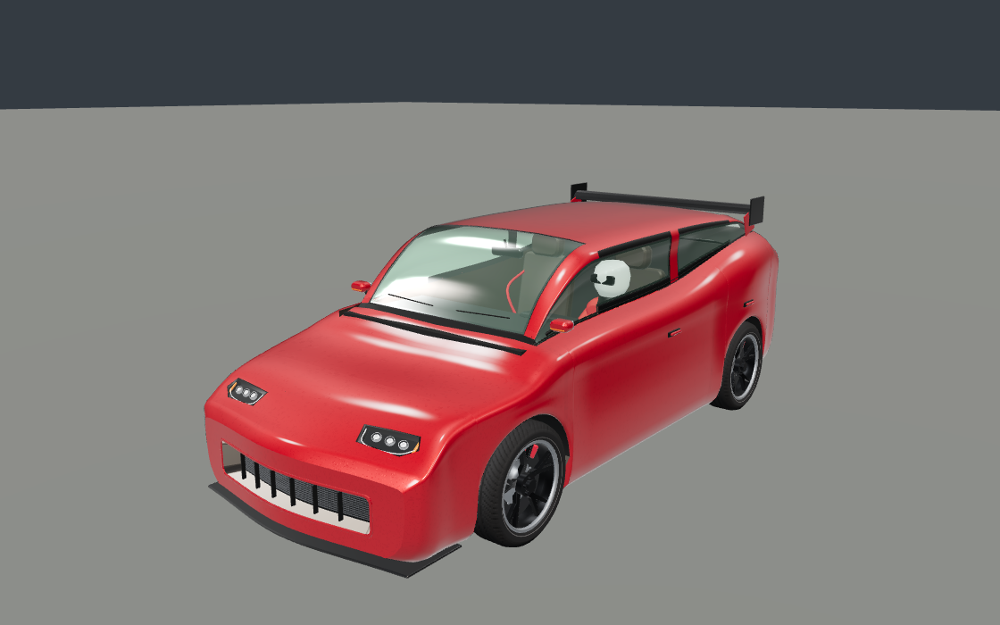
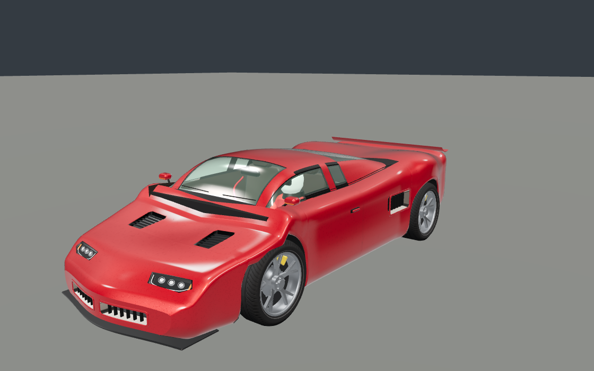
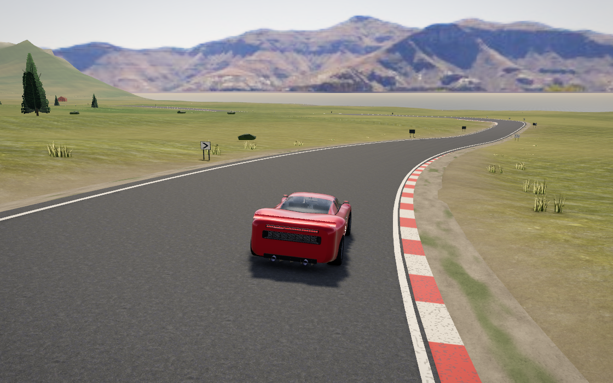
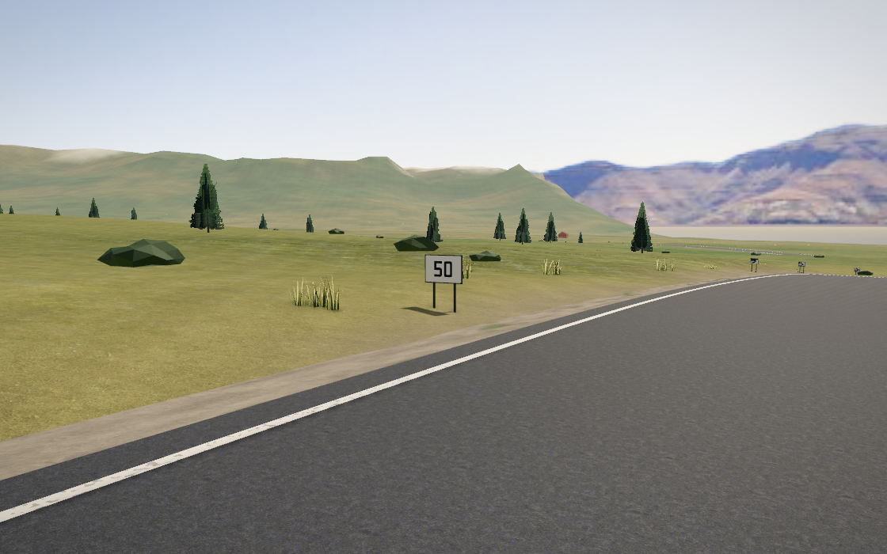

# Festival tracks and cars revision

This revision develops the Festival · open world section around an original Saltmarsh club circuit and more convincing RH3/SC7 construction. The emphasis is visible mechanical depth, readable bends, consistent road contact and opportunities to compare the cars through an actual race or a solo practice lap. Track and vehicle geometry are procedural Three.js work informed by the supplied 100-image reference collection.

## How to play

1. Open **Festival · open world**.
2. Press **T** for the world map and select **Saltmarsh Club Race** or **Saltmarsh Practice Lap**.
3. Choose **Travel to event**, then press **Enter** at the event card to start.
4. Use **Escape** to open the pause menu and select **RH3** or **SC7** in the garage/vehicle section. Return to the map to try the other event.

Both destinations are available on a fresh save. Travelling records discovery immediately; the map still distinguishes visited events and new routes. Drivers can also reach the circuit along Farm Road and Saltmarsh Club Access. Existing result controls support retrying or returning to driving; car selection remains in the pause menu.

Autopilot also continues controlling the selected car after travel or a garage change. Both operations now invalidate the cruise driver attached to the previous vehicle, so its replacement receives fresh steering and pedal commands. Two regressions verify actual throttle, speed and movement after these transitions.

| Event | Format | Driving opportunity |
| --- | --- | --- |
| Saltmarsh Club Race | Two laps; player and three rivals | Acceleration and passing on the long straight, broad eastern bends and linked infield turns |
| Saltmarsh Practice Lap | One lap; solo | Learn braking points, compare RH3 and SC7, and repeat a complete lap |

## Course, boundaries and road contact

The course measures approximately **3,182.063 m per lap** in plan view. Its running surface is **11 m wide**, with 1.4 m shoulders, a maximum authored grade of 7% and up to 6.5% bank. The layout and dimensions are original design choices. Both events follow the complete loop; the public access is connected to the road graph and cannot shorten a legal lap.

Permanent checker paint, four starting boxes and flush red/off-white corner aprons establish the course even while event markers are hidden. Sparse **50 m and 100 m approach boards** and bend chevrons serve both driving directions. Their positions follow the actual network, remain beyond the shoulders and preserve the view through the next corner. The road shader retains aggregate and maintenance detail while the circuit avoids public-road lane wear across its racing surface.

The painted surface now has one shared definition for rendering and physics. Both apron colors, white checker cells, 10 cm grid outlines and 15 cm edge lines use the paint material. Dark checker cells, box interiors and the clear road centre use asphalt. Edge paint is omitted at both ends of the single-access loop, including the end previously missed when its endpoints shared one node.

Paint keeps the existing class-scaled grip of **0.9114**, compared with **0.98** for circuit asphalt, and carries the existing wet-material response into the tyre model. Shader scuffs affect appearance without switching physical material grain by grain. Cached apron polygons reproduce the mesh footprint through narrowing corners; contact queries allocate no new objects and inspect at most three adjacent apron quads within the outer band.

Guarded highways and mountain roads also retain the improved folded steel beams, separate posts, stand-offs, overlaps, fasteners, reflectors and rounded end treatments. They follow the banked road and carved ground in spatial batches. Saltmarsh's low farmland setting has no drop-triggered barrier runs; its course cues provide the local boundary detail.

## Passing that respects the whole car

The retained [pre-integration passing diagnostic](horizon-tracks-cars-evidence/current/physics-before-passing-fix.json) records an SC7 opening-pass failure: **15 player collision contacts**, **6.5 seconds off route** and a maximum centreline offset of approximately **28.151 m**. Completing the event did not satisfy acceptance.

The [first-bend trace](horizon-tracks-cars-evidence/current/sc7-first-bend-diagnostic.json) identified an outside rear tyre leaving the paved edge during the fast manoeuvre while the driver still estimated available grip from the front-left contact. The revised driver uses the least grippy of all four tyre contacts for its car speed envelope. It also reserves additional shoulder clearance as passing speed rises, including the return from a pass. Ordinary racing-line reach and passing reach are calculated separately, so an unoccupied line does not inherit the manoeuvre's extra restriction.

The earlier passing-lane correction is retained: a committed car holds its corridor when the rival moves away and can move farther outward when that rival needs room. Swept traffic checks, width previews, following and release conditions remain active. These changes issue ordinary steering and pedal commands.

A dedicated **25-second SC7 grid-launch regression** exercises the opening pass and bend through the production tyres and collision solver. It requires loaded rear tyres, legal progress beyond the failed corner, racing pace, no player contacts and no replacement vehicles. Its result complements the complete-event checks below.

## Cars with constructed depth

Modern Festival wheels have dished branching spokes, open spoke gaps, a deeper barrel, separate rim lip and brake bell, and paired rotor faces joined around cooling passages. Calipers sit behind the spokes and remain attached to the steering upright while the wheel and rotor rotate.

The integrated cars retain upstream recorded tyre deformation and contact-based hub positioning. Rubber follows recorded compression and strain; rims and rotors remain rigid, and calipers stay on the steering upright. The merged wheel shadows follow the same physical hubs. The recorded deformation applies only when a valid contact pose is available, preserving the authored tyre shape in static menus and studio views.

RH3 and SC7 use coordinated curved nose construction across painted skin, fascia, intake tunnels, radiator/slats, splitter and lamps. The lights occupy real body apertures with opaque reveals, recessed optics and covers that follow the surrounding shape. Existing wheel-arch positions remain consistent with the car's physical layout.

The current SC7 refinement cuts its bonnet vents into the curved hood. Their rim, walls, floor and louvres conform to that surface and sit ahead of the cowl. Bounded tessellation keeps the transformed internal surfaces and their normals attached to the exterior. The car families retain distinct proportions; exact apertures, rotor topology and component dimensions are original construction choices.

## Grounding in the 100 references

The current audit uses the existing **Forza-Horizon-6-Reference-Pack-Under-30MB.zip**, **27,428,348 bytes**. All **100 compressed images** match their manifest and earlier compressed-image ledger. All ten contact sheets were visually reviewed, covering all 100 images; selected full-size JPEGs received additional direct views, including **019, 043, 050 and 099**. These are the supplied compressed reference files, up to 1920 pixels wide. This scope does not imply a new inspection of every detail in every original source photograph.

The [current reference appendix](horizon-tracks-cars-evidence/current/reference-audit.json) records exact archive and manifest hashes, image paths, inspection scope and interpretation limits.

| References | Visible cue informing the original implementation |
| --- | --- |
| 046, 047, 050, 077 | Connected access, differentiated course surfaces, varied bends and an obvious start |
| 043, 050 | Bend sightlines and restrained boundary highlights in low light |
| 044, 098 | Rolled barrier sections, separate supports and reflector faces |
| 019, 093, 099 | Continuous body surfaces surrounding recessed openings |
| 004, 091, 098, 099 | Distinct car proportions, layered lamps, rim/spoke/brake depth |

The earlier [original-source review](HORIZON_TRACKS_CARS_REFERENCE_REVIEW.json) and [R7 compressed-pack ledger](HORIZON_R7_REFERENCE_REVIEW.json) remain separate records. Photographs establish visible form and composition; course dimensions, grip, braking behavior and enjoyable driving require authored decisions and runtime verification. Reference screenshots and licensed vehicle meshes are not added as game assets.

## Current verification and evidence

The recorded unit, physics, build and car-validation source uses fingerprint `902e5d1891cc37323609b9c1e8a2d6badba95026beb760cbe99e85e32ce196bb`, based on upstream commit `0bb24350121947b165aa3ee810d7a7c22e1c32e2`. The [focused unit run](horizon-tracks-cars-evidence/current/unit.json) passed **156 tests across 19 files**, covering car construction, tyre contact, paint footprints, course connectivity, legal laps, passing, sessions and fresh-save travel. This run includes the tyre-contact integration and both autopilot-transition regressions. The later combined application identity is recorded separately below; `902e5d` identifies these receipts.

Whole-project ESLint, content validation and the guarded production build all passed with exit code zero on the recorded `902e5d` source. The build completed TypeScript and Vite under a source-stability guard; its [build identity](horizon-tracks-cars-evidence/current/build-identity.json) records that exact fingerprint. The [validation stages](horizon-tracks-cars-evidence/current/validation-stages.json), [lint log](horizon-tracks-cars-evidence/current/lint.log), [content log](horizon-tracks-cars-evidence/current/content.log) and [build log](horizon-tracks-cars-evidence/current/build.log) retain the actual outcomes. Earlier interrupted builds and separate successful stages remain historical evidence in [pre-integration/](horizon-tracks-cars-evidence/current/pre-integration/).

The application used by the recorded world review has fingerprint `7365c3573037ff7d60796bed31daa970dc8540b88cd46f96643510583f76df48`. The [upstream boundary record](horizon-tracks-cars-evidence/current/upstream-source-boundary.json) accounts for the nine later MotoGP application files and proves that the earlier tested simulation, car construction and Festival rendering remain byte-identical. A subsequent Motocross evidence commit changes documentation only. [Pre-publication whole-project TypeScript and ESLint checks](horizon-tracks-cars-evidence/current/final-static/review.json) passed on the combined source, each under the repository source-stability guard. The actual Festival fixture was also [bundled successfully in production mode](horizon-tracks-cars-evidence/current/fixture-bundle-build.log) with this combined identity. The complete minified product-build receipt above remains bound to `902e5d`; the focused fixture build is reported separately.

A further upstream MotoGP commit, `54c886dae43f6687a2d1c27f89eab96b3468c2e5`, arrived before publication. The shared `Interface` now retains its incoming practice methods together with the Festival description change. The [publication boundary](horizon-tracks-cars-evidence/current/publication-source-boundary.json) reconstructs the earlier world-review fingerprint exactly and proves that all Festival simulation, car-body and open-world renderer files remain unchanged. The final application fingerprint is `2a21aee53d71dd7611766cf50802ab7346dde8676b37dc7347f178055f71cdd4`. [Publication compatibility checks](horizon-tracks-cars-evidence/current/publication-static/review.json) passed whole-project TypeScript and ESLint on the merged shared UI module under source-stability guards. The existing world captures and earlier whole-project lint retain their recorded `7365c357` identity; no second complete browser or minified-product build is inferred.

<!-- CURRENT_VALIDATION_START -->

The [final integrated driving run](horizon-tracks-cars-evidence/current/physics.json) passed with simulation sources unchanged throughout:

| Case | Event time | Peak speed | Maximum centreline offset |
| --- | ---: | ---: | ---: |
| RH3 clear, two-lap race | 196.633 s | 196.882 km/h | 4.356 m |
| SC7 clear, two-lap race | 167.400 s | 246.330 km/h | 4.426 m |
| RH3 rain, solo practice | 149.467 s | 154.487 km/h | 4.760 m |

All three completed the required legal distance with zero player collision contacts, zero player off-route time and zero player or opponent recovery. Minimum upright alignment exceeded 0.992. Results correctly identify assisted driving; opponent recovery checks do not count every opponent collision or off-road excursion.

Both integrated car comparisons passed. The current full browser run completed three checks before a Photo Mode pointer timeout; a separate focused native-keyboard review passed all eight of its checks and produced the two current world inspection captures. These outcomes remain separate in the evidence below.

<!-- CURRENT_VALIDATION_END -->

### Current car captures

The integrated front-quarter [RH3 report](horizon-tracks-cars-evidence/current/vehicles-rh3/review.json) and [SC7 report](horizon-tracks-cars-evidence/current/vehicles-sc7/review.json) both passed. Each compares production car geometry using the same 1120-by-700 studio camera, lighting and renderer within its before/after pair. Repeated frozen frames are identical, geometry is finite, shaders are runnable and both readbacks have no WebGL error.

| Current front-quarter view | Original calls | Revised calls | Original rendered triangles | Revised rendered triangles |
| --- | ---: | ---: | ---: | ---: |
| RH3 | 57 | 61 | 74,240 | 127,108 |
| SC7 | 56 | 60 | 83,820 | 118,160 |

Each current view adds four uploaded geometry resources and one material, with no new textures. These are isolated static-car measurements; they do not establish full-world or target-device frame rate. Visual inspection of the RH3 pair found attached lamp pockets and wheel layers with continuous nose highlights. The studio images document improved procedural construction rather than photographic realism.

Each refreshed comparison replaces the five vehicle modules listed in its report with their bytes from upstream `0bb2435`. Both revised snapshots use the recorded `902e5d` fingerprint above. Both variants retain upstream tyre-contact support; only the listed car modules differ within each pair. This baseline does not recreate the entire upstream application.

| Recorded RH3 front-quarter | Recorded SC7 front-quarter |
| --- | --- |
|  |  |

### Historical car evidence

The [pre-integration RH3](horizon-tracks-cars-evidence/current/pre-integration/vehicles-rh3/review.json) and [SC7](horizon-tracks-cars-evidence/current/pre-integration/vehicles-sc7/review.json) front-quarter comparisons passed against vehicle-module baseline `9cfeef8`. They recorded RH3 at 57 to 61 calls and 74,240 to 127,108 triangles, and SC7 at 56 to 60 calls and 83,820 to 118,160 triangles. Their snapshots begin `bfaa89c25af84` and `7a2f265325d6`, respectively. The [historical source-boundary record](horizon-tracks-cars-evidence/current/pre-integration/source-boundaries.json) documents the two session statements separating those earlier snapshots; it does not describe the later tyre-contact integration.

Earlier front-wheel close-ups document retained rim, spoke, rotor and caliper geometry. Their `wheel.ts` hashes predate recorded tyre deformation, so those images remain historical construction evidence rather than validation of current contact animation or shadow behavior.

### Current world evidence and browser limits

The [verification summary](horizon-tracks-cars-evidence/current/verification.json) and [world review](horizon-tracks-cars-evidence/current/world/review.json) record completed coverage and remaining limits. The most recent world captures use the recorded `7365c357` application at **1120 by 700, medium quality**, with the production renderer and the actual Festival session, worker, HUD and controls.

The [full browser run](horizon-tracks-cars-evidence/current/browser-diagnostic/bundled-pointer-timeout.json) passed fresh-save travel to the RH3 race, world-map navigation and native throttle/braking on the circuit. The manual drive reached **75.384 km/h**, covered **68.188 m**, and stopped on route with autopilot off. Retry returned to countdown, but the subsequent Photo Mode mouse click timed out while waiting for a visible, enabled, stable button. The run did not record enough computed layout state to establish the exact cause; its nine-step outcome remains **partial**. Its first-frame readback took **194.447 seconds**, exceeding the original 180-second startup budget in this shared software-GPU environment.

The [separate focused review](horizon-tracks-cars-evidence/current/world/focused-review.json) passed **eight checks**: fresh-save loading, actual SC7 garage selection, map travel, starting solo practice, entering Photo Mode, capturing two inspection views, leaving Photo Mode and exiting the Festival. Button visibility, enabled state, layout and keyboard focus were recorded before native Enter activation. It produced no JavaScript or WebGL errors and no HTTP error responses; one aborted background texture request remains in its raw report. On exit, uploaded geometry resources fell from **185 to 1** and textures from **45 to 21**, with shared renderer resources retained. The focused run does not replace the failed full pointer run or establish its uncompleted retry/photo checkpoint.

| Actual SC7 on Saltmarsh | Actual 50 m braking marker |
| --- | --- |
|  |  |

The [current world map](horizon-tracks-cars-evidence/current/world/club-world-map.png) shows the connected loop, both events and available travel. Visual inspection accepted the planted car, readable course edge/aprons and shoulder clearance of the braking marker. The world car image is a rear three-quarter view; the studio pairs above provide the front-body evidence. The marker image does not show every chevron or the entire bend. Current RH3 grid, separate SC7 start-card and highway guardrail captures were not completed; earlier images remain historical evidence.

The environment still shows sparse angular vegetation, broad ground surfaces and an abrupt photographed-mountain transition. These images demonstrate the actual car and circuit improvements, while also showing the remaining landscape limits. SwiftShader and explicitly submitted frames do not establish continuous frame rate on a player's GPU. Assisted complete-event runs and brief manual pedal input also do not substitute for a human handling-preference evaluation.

Files outside `current/` and inside `current/pre-integration/` retain earlier driving, rendering and browser attempts with their original source identities. Raw failed reports are preserved; a focused pass does not change their outcomes.

## Focused reproduction

```bash
npm run lint
npm run build
npx vitest run tests/festival-circuit-markings.test.ts tests/festival-club-circuit.test.ts tests/festival-rival-passing.test.ts --maxWorkers=1 --pool=threads
node --experimental-transform-types scripts/horizon-club-validation.ts
```

The complete driving harness uses ordinary start/autopilot commands and 120 Hz simulation steps. Matched car captures and the full-session browser runner use the production renderer. These checks establish the recorded behavior and geometry; target-device frame rate and human handling preference require separate evaluation.
