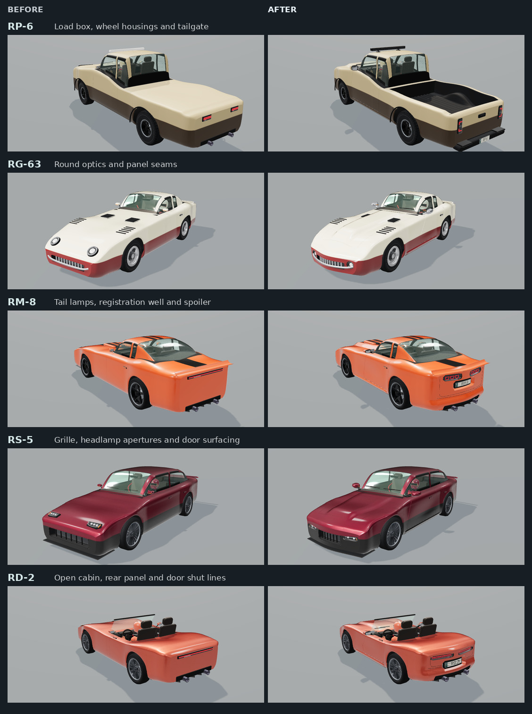
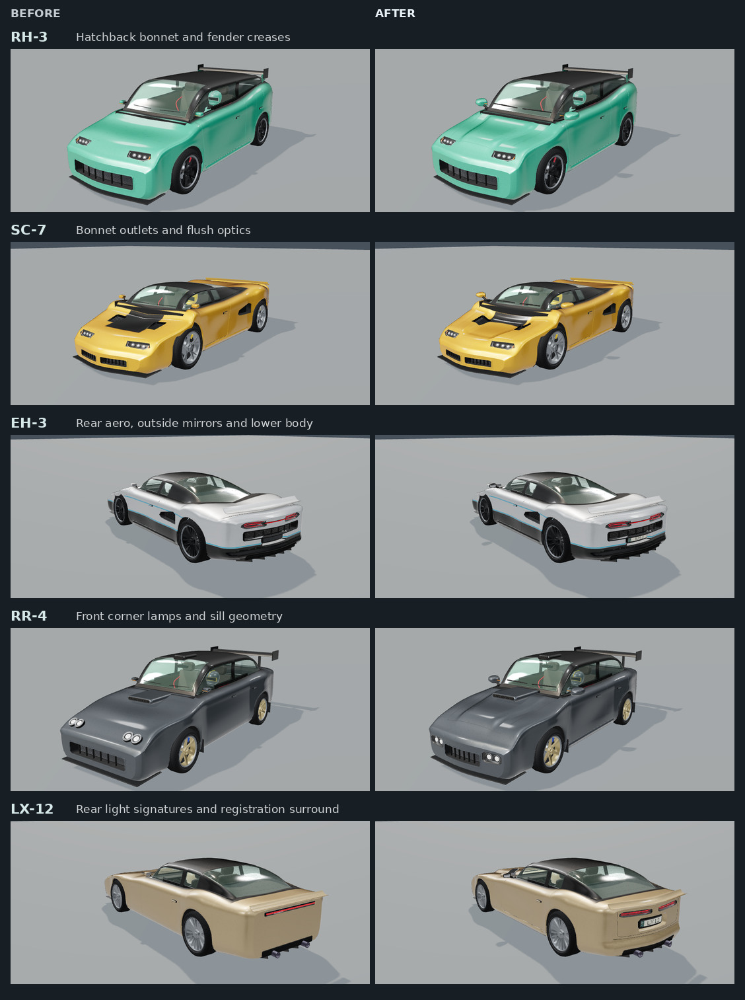
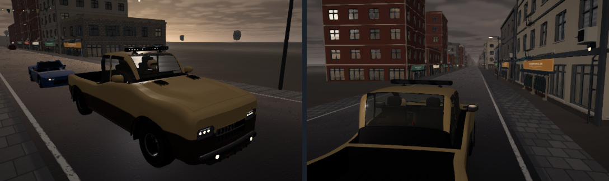

# Solvane Coast road-car review

All ten Festival road cars are shown at their nearest production detail level. Each pair uses the same vehicle, camera, light, floor, exposure and crop. The source frames are 860 × 500 WebGL2 renders of the playable models. Small changes in reflected light make the bonnet recesses, tail panels and window openings easier to read as the car turns.





## What happens in a drive

- The pickup has a ribbed load bed, wheel tubs, tailgate and independent tail lamps. Its roof projectors face forward, with the cooling enclosure visible from the chase camera.
- The ten road cars have working wipers, recessed optics, outward-facing mirrors and door and sill profiles. The swept portion of the windshield clears and then collects rain. Headlights originate at each car's lamp housings and the dipped pattern falls away above the cutoff.
- Ambient traffic pitches and rolls on its suspension. Headlights, braking and hazards work independently. Nearby racing rivals use the detailed exterior. The chase camera follows the chassis through frame-rate changes and the hood camera uses the selected vehicle's mount.
- Each tyre samples its contact with painted lines, including dash gaps. The wet route driver uses available driven-wheel traction and braking distance. Three Port Ilse streets now cross the canal on bridge decks, and harbour launches pitch and roll with the directional swell.

The RP-6 below is running in Port Ilse at sunset in 24 mm/h of rain. Both views use the packaged game, Low preset and its 540 × 324 drawing buffer. They completed with zero WebGL errors and no failed requests.



## Rendering measurements

The harbour comparison holds the EH-3, camera pose and 800 × 450 browser viewport fixed at the Low preset. It isolates the change to building grouping and facade detail. Counts include the work that WebGL submitted for that frame.

| Harbour frame | Before | After |
| --- | ---: | ---: |
| Whole-frame triangles | 1,426,714 | 979,492 |
| Whole-frame draw calls | 273 | 311 |
| Building triangles | 817,310 | 369,524 |
| Building draws | 15 | 53 |

Smaller building groups let the camera reject distant detail at the cost of 38 additional submissions in this view. One software-renderer timing sample measured 1.29 s before and 2.20 s after. A target-device frame-time distribution requires a hardware run.

Equal-size tyres and rigid wheel components share geometry within a body and detail level. Each corner retains its own tyre contact, steering, spin and brake temperature. The figures below count unique wheel geometry and its typed-array payload across all three detail levels for one vehicle.

| Car | Geometry buffers before → after | Array bytes before → after |
| --- | ---: | ---: |
| RH-3 | 48 → 21 | 3,305,696 → 1,586,744 |
| RP-6 | 48 → 21 | 3,182,432 → 1,525,112 |
| EH-3, staggered tyres | 48 → 42 | 3,472,736 → 3,340,528 |

The moving-wheel shadow update transfers 6,912 bytes for each of these cars. Previously an RH-3 pose invalidated its complete 205,200-byte shadow buffer. Holding the wheel pose steady now queues zero bytes. The Low preset also releases the previous road or Formula representation when changing vehicle.

The chase-camera collision search matched the original full scan for 4,096 sweeps beside the region's 648 building footprints, including 1,275 obstructed sweeps. The comparison checked the resulting camera coordinates as well as the hit flag.

## Driving checks

The reproducible event grid covers Valley Sprint and Coast Trap with every Festival road car in clear and wet conditions. All 40 runs completed and all 700 result, standings and persistence checks passed. The rainy RG-63 sprint required one automatic recovery. Across the grid the simulation recorded zero off-route seconds.

An additional wet Port Ilse Loop took 389.57 seconds in the EH-3, first of six, with zero player recoveries. The RH-3 finished in 495.60 seconds with one player recovery. Each run recorded six rival recoveries. On Coast to Summit in rain the RH-3 finished in 670.90 seconds with two player and five rival recoveries. The EH-3 finished the same ascent in 431.33 seconds with two player and three rival recoveries and 16.1 seconds off route.

The RD-2 banked 59 points at Kestrel in 48.07 seconds with raw pedal and steering inputs, zero collisions and zero off-road seconds. The separate automated Hairpin Drift controller scored zero with the RM-8 and failed the course with the GT-8F on both surfaces. These runs use scripted driving. Console frame pacing, physical controller latency and human competitive handling require hardware and playtesting.

The per-event outcomes and render observations are available in [measurements.json](measurements.json).

Run the following commands from the repository root to reproduce the event grid and Kestrel check.

```sh
node --experimental-transform-types scripts/studio/tools/festival-qa.ts \
  --events valley-sprint,coast-trap --vehicles eh3,sc7,rh3,rm8,rs5,rg63,rp6,rr4,lx12,rd2 \
  --weathers clear,rain --seed 73021 --out test-results/festival-road-grid.ndjson
HORIZON_DRIFT_OUTPUT=test-results/festival-kestrel.json \
  node --experimental-transform-types scripts/horizon-drift-validation.ts
```
