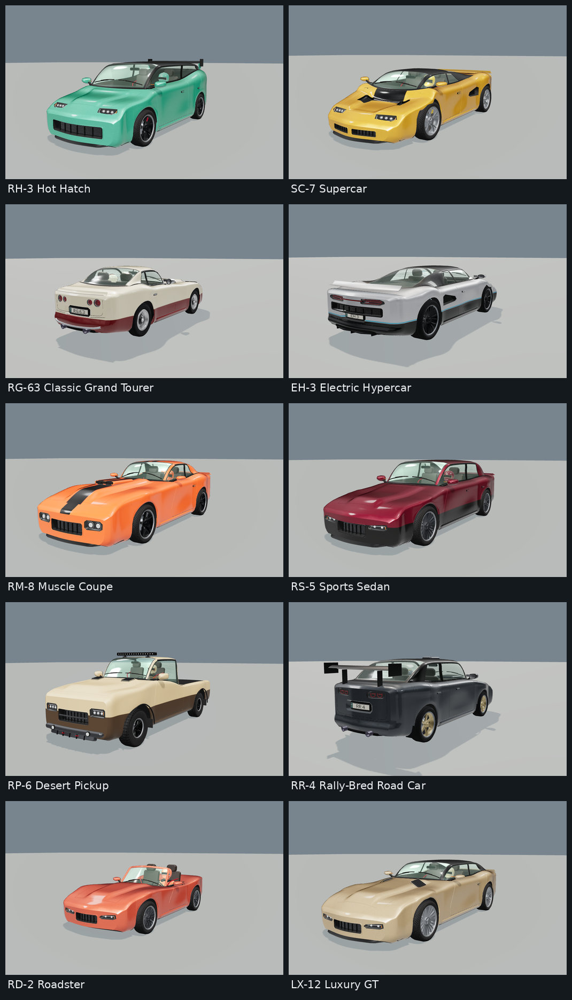
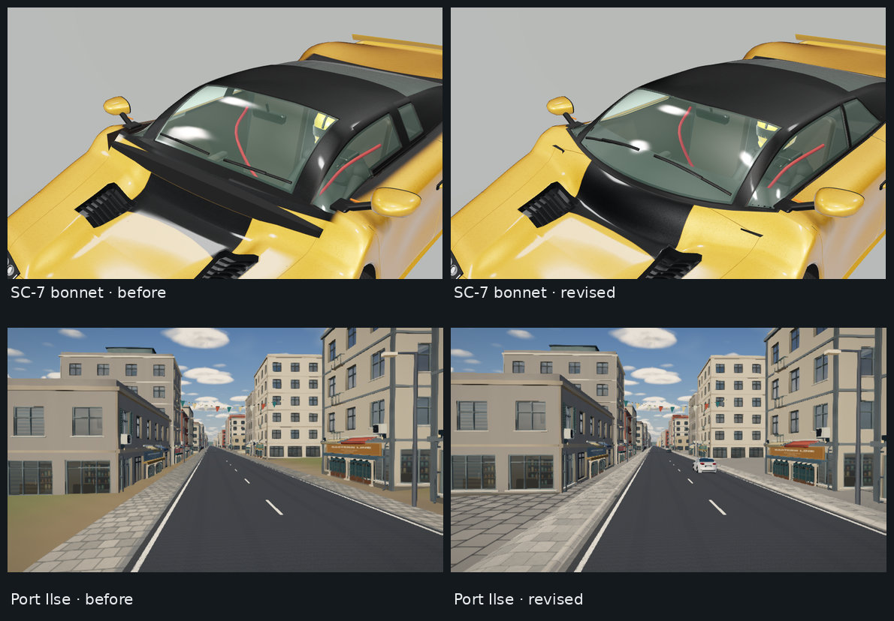
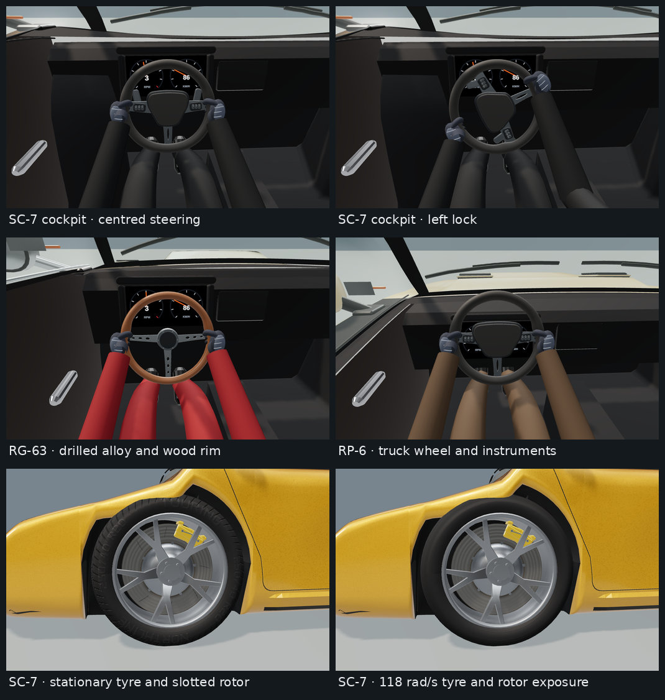
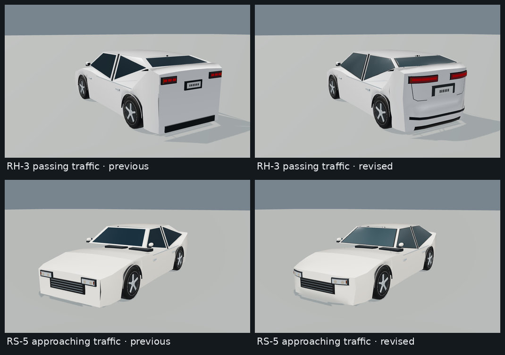

# Solvane Coast road cars and Port Ilse

The ten playable road cars use the production Three.js body builder. The garage views below were rendered from those meshes with one studio light rig, camera and colour transform. The in-game street views use the packaged Festival session and its workers.



## Coachwork and cockpit

The windshield, its black ceramic border, pillars, roof and scuttle meet at the sampled body surface. The wiper rests against the glass and follows the recorded weather and simulation clock. The SC-7 bonnet vents meet the openings in the paint. The sprung body carries the front splitter and the sealed rear diffuser. Their detachable sections follow the car's damage state.



The cockpit has formed front wheelhouses and a floor around the pedals. At steering lock, one hand retains the wheel while the other releases and takes a new grip. The RG-63 has a wood rim and drilled spokes. The performance cars use shaped grips and moulded controls. A wheel occupies one draw at either level of detail. The active camera's projection and viewport determine when its switches and fasteners are large enough to show.

Tyre markings use the model's section width, sidewall height and rim diameter. Their position follows the same recorded phase as the rim across a complete turn. The tread and machined brake slots filter across the camera shutter using each tyre's measured angular speed. A locked wheel stays sharp while an adjacent wheel can continue rotating. The brake caliper, pad retainers and spring remain fixed to the upright, and the swept rotor face responds to the recorded disc temperature. The two wheel views below hold the rim at the same phase to isolate the change in shutter exposure.



## Street surfaces

Port Ilse now has kerb faces, gutters, drain covers and stone paving with a wet response. The visible kerb profile also supplies the contact height and normal to the tyres. Shop doors meet the street grade, with sidelights and metal hardware at close range. Distant facades derive window placement, shop entrances and night lighting from the same facade as the close mesh. Regional building vertex attributes occupy 48 bytes per vertex, down from 60. Positions, facade identities and texture coordinates retain their original precision.

For the driving view, a posed hull and four wheel silhouettes cast an intact road car's sun and street-light shadows. Damaged and articulated aero and close-up photography keep their detailed casters. A directional light with a shadow texel wider than a window recess draws the building's outer walls and roof. Its colour pass still shows the appropriate windows and trim.

The terrain renderer removes interior grid edges on planar ground while retaining every tile perimeter and skirt vertex. It tests both the detailed surface and the parent transition, including shading and terrain-layer data. The maximum permitted geometric error between the original and simplified surface is 1.5 mm.

## Ambient cars

The ten ambient traffic profiles have formed bumpers, matching grilles and optical sections, and a separate glass seal. Their windscreens and quarter lights have curvature in two directions. Stop lamps, direction indicators and running lights react independently to the traffic snapshots. The close wheels roll and steer with each vehicle. Distant traffic switches to a simpler wheel when the entire batch projects below the pixel threshold.



The ten traffic bodies and four independently animated wheels per car share five draw calls. The position and normal morph targets plus the per-instance weight data occupy 657,696 bytes, down from 1,689,024. The close traffic model submits 5,992 triangles per car. The regression reconstructs all ten meshes from the shared index and compares every position and normal to the source. It also casts rays through each car’s illuminated stop lenses and bumper strip to catch fittings buried under the paint.

## Driving verification

The driver estimates lateral grip from all four contact patches, changes passing lanes at a bounded acceleration, and catches a rear slide using the car's measured direction of travel. The shorter steering lookahead on a slow, loose edge is blended using the local water film. A driver yields a pass from behind if the target moves into the remaining space beside a verge. Cars already alongside keep their side. The standard race QA drives through the same pedals, steering, contact model and opponents used by the Festival session.

At 120 Hz, tyres spend many consecutive steps on the same short stretch of road. The contact query now keeps a bounded cache of candidate segments for 8 m squares. Each wheel still resolves its own road height, normal, distance and bridge layer. A comparison against the previous search returned identical values for all 16,447 candidates from 12,330 mixed-radius queries. In nine alternating batches of 43,200 queries each, median lookup time fell from 55.44 ms to 37.96 ms on the same CPU. Repeating all fourteen six-car races reproduced every recorded field except host elapsed time, including finishing order, progress, contact data, rewards and saves.

The race checks can be repeated from the repository root.

```sh
node --experimental-transform-types scripts/studio/tools/festival-qa.ts \
  --events port-ilse-loop,coast-to-summit --vehicles rh3,eh3 --weathers rain --seed 73021
node --experimental-transform-types scripts/studio/tools/festival-qa.ts \
  --events port-ilse-loop,coast-to-summit --vehicles sc7,rd2 --weathers clear --seed 80779
node --experimental-transform-types scripts/studio/tools/festival-qa.ts \
  --events port-ilse-loop --vehicles rs5,rm8,rg63,rp6,rr4,lx12 --weathers clear --seed 77141
```

Each run starts from its event card with five opponents. The ten dry runs completed with zero player or rival resets. Four rainy runs used the same routes, cars and seed as the baseline. Times are simulation seconds at player finish. Rival resets count interventions through that instant. Across 78.5 simulated minutes, all fourteen player runs stayed within the legal route tolerance. No player or rival required a reset. The [recorded checks](checks.json) list each seed, finishing position, speed, player contact ticks and reset count. A contact tick is one 1/120 s step during which the player touches a rival.

| Rain, seed 73021 | Previous time | Revised time | Player resets, previous → revised | Rival resets, previous → revised |
| --- | ---: | ---: | ---: | ---: |
| RH-3, Port Ilse Street Loop | 520.33 s | 464.00 s | 2 → 0 | 2 → 0 |
| RH-3, Coast to Summit | 576.80 s | 475.43 s | 1 → 0 | 5 → 0 |
| EH-3, Port Ilse Street Loop | 564.97 s | 378.33 s | 2 → 0 | 4 → 0 |
| EH-3, Coast to Summit | 398.87 s | 419.80 s | 0 → 0 | 3 → 0 |

The isolated runway and skidpad calibration also exercised all ten road cars at 1/240 s and 1/120 s. All forty design targets passed at both steps. They cover 0–100 km/h, maximum speed, stopping distance from 100 km/h and steady lateral acceleration at 80 km/h. The electric hypercar reached 100 km/h in 2.44 s and stopped from 100 km/h in 29.45 m at both steps. These are measurements of the game's original vehicle definitions.

```sh
node --experimental-transform-types scripts/vehicle-calibration.ts \
  --only=rh3,sc7,rg63,eh3,rm8,rs5,rp6,rr4,rd2,lx12 --strict
```

On this host, a separate timing sample measured 3,600 six-car physics steps after 240 warm-up steps. The rainy RH-3 hill climb took 1.52 ms at the median and 3.90 ms at the 95th percentile. The dry SC-7 street race took 1.92 ms and 9.58 ms respectively. In the street race, 268 steps exceeded the 8.33 ms simulation interval. These measurements cover the simulation worker and exclude the renderer. The recorded checks include 99th-percentile and maximum step times for both samples.

## Visible geometry

These fixed-camera comparisons use the EH-3, clear daylight, the Low preset and a 960 × 540 CSS viewport. The game renders a 720 × 405 WebGL2 buffer at this preset. The original checkout (5359d2c) and the finished car, street and traffic geometry (71225b1) use the same camera positions. Counts cover the complete frame, including the player car. All three cameras completed with a clean WebGL error state. The recorded checks also retain the intermediate street and terrain captures.

| Camera | Original triangles | Revised triangles | Original / revised draws |
| --- | ---: | ---: | ---: |
| Harbour chase | 985,328 | 718,157 | 313 / 313 |
| Port Ilse street | 628,673 | 414,877 | 164 / 162 |
| Street edge | 608,241 | 396,927 | 160 / 158 |

Software WebGL establishes what the game drew at each camera. Frame pacing and input latency on console-class hardware require a hardware run. The existing [GPU benchmark](../../studio/HARDWARE_BENCHMARK.md) can drive the Festival journey at 1920 × 1080 across all three quality presets.
