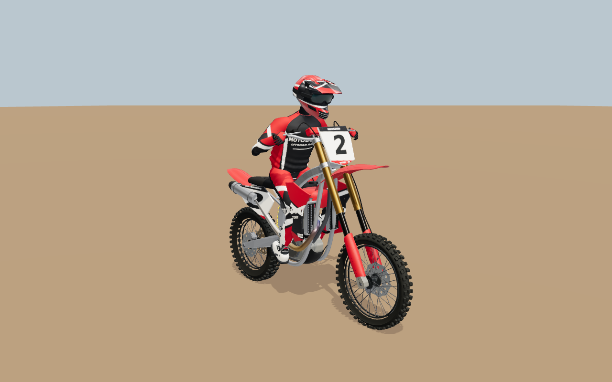
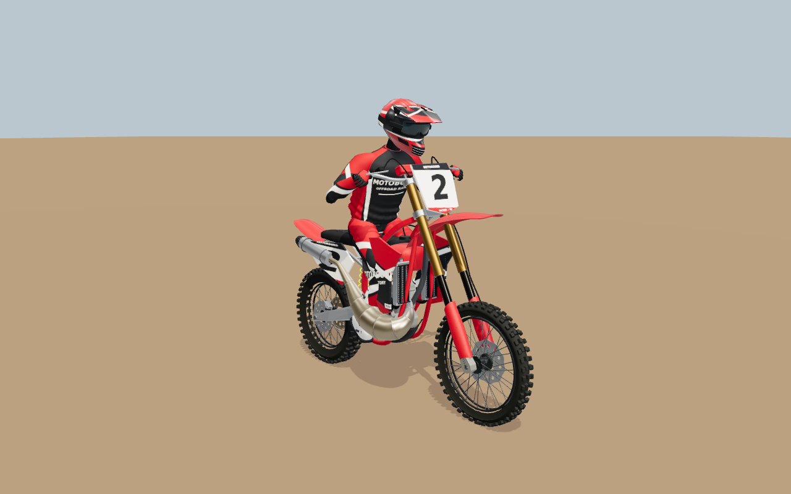

# Motocross: berm practice, bike mechanics and rider silhouette

The implementation is published on `main` at [`8e45d33`](https://github.com/cheshmakzanoon-ops/Experiment-3/commit/8e45d33d5bef350e33943306fc531698f6bfa3c2). It was developed against `468749bfc706283f7ba9b9a57752c32130d3959a`, integrated with the subsequent MotoGP work on `aad08a3`, and published after the documentation update `03ebf89`. It improves the MX bikes' exposed mechanical construction, refines the rider's sleeves and elbow posture, improves course-edge markers, and adds a timed corner-practice activity to the existing Outdoor MX and Stadium SX courses. The authored track layouts, jumps, banks and worked-soil presentation are retained.

## What changed

### Bike hardware

The MX radiator assemblies now have separate end tanks, frame rails, coolant tubes, folded fins and spaced protective guards. The high and medium detail models have actual openings through the core, so the silhouette and depth come from geometry. Curved hoses, a crossover connection and a filler cap complete the assembly; the highest detail adds hose collars. The far model keeps a simpler proxy.

The wheels now use leading and trailing spokes on each hub flange, with alternating attachment faces and nipples aligned to their spoke axes. Stepped annular hubs replace the plain cylindrical form. These changes use the existing materials and rigid-mesh batching. The existing MX250 expansion chamber and MX450 mechanical differences remain in place.

Implementation: [radiators](../../../src/rendering/offroad/motocross-radiators.ts), [wheel hardware](../../../src/rendering/offroad/motocross-wheel-detail.ts) and [bike assembly](../../../src/rendering/offroad/dirt-bike-model.ts).

### Rider sleeves and posture

The upper sleeve has a narrower, more gradual shoulder profile while preserving the buried armhole overlap with the jersey. The torso-to-arm skinning transition sits inside that buried armhole, reducing visible shoulder pinching during steering. A support bone follows the elbow's position and the midpoint of the upper-arm and forearm orientations, reducing the loss of cloth volume at a sharp bend without adding another visible sleeve mesh.

The elbow target gives seated and braced poses a lower, less square arm silhouette. Standing and forward rider weight still raise the elbows for an attack posture. The existing hand and foot targets remain the contact constraints. Garment support updates with the exterior, separated and onboard arm poses.

Implementation: [garment construction](../../../src/rendering/offroad/motocross-gear.ts) and [rider posing](../../../src/rendering/rider.ts).

### Timed berm practice

In player-controlled free practice, eligible existing banked turns become short timed sectors. The system samples entry, apex and exit, labels the apex line **inside**, **middle** or **outside**, and reports elapsed time, the difference from the rider's previous best, exit speed and soil state. It retains results for attempted lines rather than inventing a recommended or predicted fastest line.

Comparisons belong to the same corner and dry, damp or wet soil category. Changing the machine, assist setting or course resets the records. They are local to the current session. A valid attempt requires a continuous forward ride through the sector: crashes, airborne travel, leaving the legal course width, replay, AI control, cautions and discontinuous movement do not earn a clean result. Replay and control handoffs drop an unfinished attempt while preserving earned records. Nearby jumps and landing feedback retain priority in the existing riding card. A completed corner result can wait up to 12 simulation seconds for a safe display interval, then expires 2.6 simulation seconds after its first display. Higher-priority messages can still interrupt it. This keeps a short berm exit into a jump from immediately losing the comparison.

Implementation: [berm timing](../../../src/simulation/offroad/berm-practice.ts) and [riding HUD](../../../src/ui/offroad-hud.ts).

### Plastic blade course markers

Flat, tapered plastic blades with chamfered tops and a small bow replace the cylindrical course-edge stakes. Their broad faces provide a more recognizable track marker silhouette. The blades share one 28-triangle geometry and fit within the previous stakes' radius and height; placement, instancing, adjacent-lane clearance and material count are unchanged. Both Outdoor MX and Stadium SX use the updated markers.

Implementation: [course dressing](../../../src/rendering/offroad/mx-course-dressing.ts).

### Session-aware startup preparation

The live session passes its ruleset's `service.pitStops` capability to renderer preparation. A motocross moto no longer warms pit-crew service presentations that its rules disable. Practice and time trial still prepare service when their rules permit it. The renderer's default remains enabled for existing inspection and replay callers. Camera preparation, shader compilation and GPU completion gates remain in place.

Implementation: [live startup](../../../src/main.ts) and [renderer preparation](../../../src/rendering/renderer.ts).

## How to try the changes

1. In the paddock, choose **Outdoor MX** or **Stadium SX**, then an MX250 or MX450 machine.
2. Choose **Free practice**, or use the existing **Learn the jumps** preset for solo practice. Ride with player control; switch off the AI driver if it is enabled.
3. Approach a banked corner from before its entry. The **BERM PRACTICE** card appears when an eligible corner is near and another riding message has no higher priority.
4. Complete a clean turn with the bike grounded. Try the inside, middle and outside of the bank at the apex on successive passes, then compare your recorded time and exit speed. Keep the same machine, assist setting and soil category for a useful comparison.

The practice activity uses the current course and physics. It adds a reason to experiment with corner lines alongside the existing jump and landing activities; this pass does not add another track layout.

## Reference basis

The original 100-image archive was recovered and all JPEG hashes were checked against both its original index and the repository's existing ledger. All 100 references were inspected on labelled contact sheets, with selected originals opened individually. See [REFERENCE_REVIEW.md](REFERENCE_REVIEW.md) for the archive hash, exact image IDs, comparison scope and traceability limits. The references guide original procedural geometry and activity design; their screenshot pixels and sponsor artwork are not imported into the runtime.

## Validation of implementation `8e45d33`

The implementation tree is `518ca890283d2267884b9edbbe0543b9b0b987e0`. The production bundle fingerprint is `0d49880c2b14a45376478796062abd9795a0c602c7d9b8f97ea980a41d621072`; the build identity's commit field is null in this environment. See [validation.json](validation.json) for the precise scope and [logs](logs/) for the captured output. Absolute local paths in copied logs are normalized to `<checkout>` or `<scratch>`; trailing whitespace and extra blank lines at EOF are removed.

| Check | Final result / evidence |
| --- | --- |
| Type checking and production bundling | **Passed.** The full TypeScript check completed; after an execution-environment interruption during bundling, the standalone Vite production bundle completed with exit 0. The existing large-chunk warning remains. |
| Repository lint and content validation | **Passed.** `npm run lint` and `npm run validate:content`. |
| Focused mechanical, garment, berm-practice, HUD and startup tests | **115 distinct cases covered across focused batches.** The initial model/startup batch passed 55/56 and exposed a visible shoulder-radius regression. After correcting the buried-armhole weight transfer, all 10 garment/onboard cases passed. All 59 gameplay/environment/presentation cases passed on the corrected source. This is not a whole-repository test-suite claim. |
| Updated bike/rider captures and visual review | **6 accepted High-detail views**, with finite geometry, WebGL error 0 and hand/ankle target distances below 0.03 m. The MX250 required a fresh-browser retry after the sixth call in a shared capture browser reported shader validation errors; the failed image is excluded and its log is retained. |
| Menu/HUD and practice-card browser interaction | **2 production-component browser tests passed**, with no failures or flaky results. Test 44 covers menu/HUD layouts at four viewport/scale combinations. Test 54 covers both venues at 390 × 800 and 1280 × 800. These use controlled snapshot fixtures, not a ridden lap. |
| Normal full-game startup and riding | **Passed.** The production application and worker completed the existing two-venue browser journey: Outdoor MX/MX450 and Stadium SX/MX250. Both entered an eight-rider gate, accepted player throttle and body controls, completed an explicitly enabled AI demonstration with observed flight/touchdown, changed camera, paused, and returned to the paddock. No page/console errors were recorded. Low graphics were selected through the visible settings form on Mesa/llvmpipe. |

### High-detail bike and rider evidence

These use the production geometry, materials, suspension and rider rig in the existing controlled inspection fixture at 1280 × 800. They are rendered images of the implementation, not reference artwork. The source is pinned to `8e45d33`; the [capture manifest](bike/source-manifest.json) records every selected image hash, metric and capture attempt.

| MX450 | MX250 |
| --- | --- |
|  |  |

| Machine | High-detail bike + rider triangles | Fixture-reported draw calls | WebGL error |
| --- | ---: | ---: | ---: |
| MX450 | 126,154 | 74 | 0 |
| MX250 | 129,254 | 74 | 0 |

Both remain below the existing 130,000-triangle model limit. These are isolated-model counts, not complete gameplay or shadow-pass budgets. The closer helmet view reports 37 draws because of its camera framing.

Additional poses: [braced front](bike/standing-braced-front.png), [standing attack](bike/standing-attack-side.png), [inside boot corner](bike/inside-boot-corner.png), and [helmet/sleeves](bike/helmet-sleeves.png). Visual review found continuous shoulder joins and no obvious detached sleeve, exposed skinning wedge or new control-contact regression in these views. Close inner-elbow contours and fabric variation remain art limitations.

The first five MX450 captures succeeded in one browser. The sixth call, for MX250, returned WebGL error 1282 and shader validation errors. A fresh Chromium process rendered MX250 successfully with unchanged production code. The exact cause of the shared-browser failure was not established; [the initial log](logs/model-captures-initial.log) and [isolated retry log](logs/model-capture-mx250-isolated.log) preserve both outcomes.

### Full application evidence

[The complete journey record](gameplay/production-journey.json) preserves the observed simulation values; [the test summary](gameplay/test-summary.json) identifies the source, settings, software renderer and control path. Diagnostics were read only. This validates the normal game flow, not a complete manually ridden race or a measured berm-practice lap.

| Venue / machine | Human-controlled speed sample | Observed AI forward travel | Maximum observed airtime | Captures |
| --- | ---: | ---: | ---: | --- |
| Outdoor MX / MX450 | 27.3 km/h | 230.6 m | 1.13 s | [Gate](gameplay/valley-ridge-mx-actual-gate.png), [riding](gameplay/valley-ridge-mx-actual-chase.png) |
| Stadium SX / MX250 | 22.2 km/h | 158.5 m | 0.79 s | [Gate](gameplay/arena-nord-sx-actual-gate.png), [riding](gameplay/arena-nord-sx-actual-chase.png) |

The test explicitly switches to the game's AI driver after verifying ordinary player controls. Recorded movement, flight and touchdown are generated by the live simulation. These Low-setting software-rendered captures are functional evidence, not the High-detail bike inspection or a target-hardware performance comparison. Track-limit and caution messages remain visible when the observed run triggers them.

### Integration with the later physics update

While this evidence was being assembled, `main` advanced to [`f73fea5`](https://github.com/cheshmakzanoon-ops/Experiment-3/commit/f73fea56353e0df373ee0c61d1e61fb5d05a1bac), containing the parallel car-tire physics change `0bb2435`. That work was preserved by fast-forwarding the checkout. It changes the shared snapshot protocol from 14 to 15 and the entrant stride from 298 to 331 floats; existing motocross offsets stay unchanged, and motorcycles explicitly leave the new car-contact block invalid. The motocross model, rider, off-road solver, authored courses and HUD implementation are unchanged in this comparison.

The original model images, UI fixtures and game captures above remain pinned to `8e45d33`. The combined source is checked separately so that its results are not inferred from the earlier pass.

| Combined-source check | Result |
| --- | --- |
| Snapshot/recording/session identity/wheel state/motocross HUD | **79/79 passed** across five focused files. These overlap some earlier HUD cases and are not an additional count of distinct tests. |
| Full TypeScript checker | **Passed.** The chained build reached Vite after `tsc --noEmit`. |
| Production bundle | **Passed.** Vite completed with exit 0 and 742 modules after using a 2,048 MiB local heap allowance. The first attempt reached the 1,536 MiB limit during chunk rendering; production source was unchanged for the retry. |
| Two-venue production browser journey | **Failed.** The unchanged Outdoor MX session-readiness assertion exceeded its 300-second deadline. The test did not reach initialized-grid, riding, flight, camera, pause or Stadium SX checks on this combined source. |

The combined bundle fingerprint is `52d442a805b0a01aa2731c260d715a661a2ab6385e790ca694c02aa30796f303`. See the `integration` record in [validation.json](validation.json), [build identity](gameplay/integrated-build-identity.json), [bundle output](logs/integrated-production-bundle.log) and [integrated protocol test output](logs/integrated-protocol-tests.log) for exact scope. Type checking and bundling completed in separate invocations; the first chained command's heap failure is retained in the evidence.

The failed journey's final DOM snapshot contains the race briefing, but it was collected 128.239 ms **after** the timed-out assertion returned. The last preceding screencast still showed preparation at 94%. This supports a late readiness transition and does not turn the failed assertion into a pass. No protocol, worker or WebGL exception was captured in the available trace/log, and all 183 captured network responses were HTTP 200. The shared runtime was observed near its memory limit during the delay, but the cause is not established. No timeout or GPU completion gate was weakened. See the [test summary](gameplay/integrated-test-summary.json), [trace assessment](gameplay/integrated-trace-summary.json), [failure context](gameplay/integrated-error-context.md) and [browser output](logs/integrated-game-browser.log).

After that attempt, concurrent deployment and MotoGP work advanced `main` to [`9b598d8`](https://github.com/cheshmakzanoon-ops/Experiment-3/commit/9b598d8cb063fd9663d583d5d684467b8e0fc8f8). These changes were preserved before publishing this evidence. The additional shared rider edits target the GP glove branch; the motocross rendering directory, off-road simulation, HUD and journey test have no changes from `f73fea5`. No new full build or browser pass is claimed for `9b598d8`; the recorded checks remain pinned to the source identities above.

### Practice-card evidence

The scripted second attempt shows **OAK BERM: 3.59 s, −1.02 s, exit 65 km/h**, and **STAGE TURN: 1.67 s, −0.48 s, exit 65 km/h**, in dry conditions at both viewport sizes. The first scripted attempt is checked as a first timed run with exit 50 km/h. The fixture deliberately supplies 18 m/s for the second attempt and 14 m/s for the first; this validates the comparison display and does not establish that an inside line is physically faster.

| Venue | Desktop | Phone |
| --- | --- | --- |
| Outdoor MX / OAK BERM | [1280 × 800](ui/valley-ridge-mx-berm-lines-1280.png) | [390 × 800](ui/valley-ridge-mx-berm-lines-390.png) |
| Stadium SX / STAGE TURN | [1280 × 800](ui/arena-nord-sx-berm-lines-1280.png) | [390 × 800](ui/arena-nord-sx-berm-lines-390.png) |

The browser cases also check that the card fits without covering controls and yields to cautions, automatic control and replay. The separate HUD unit cases cover the short-exit jump queue and expiry behavior.

### Limits

Photorealistic parity with the supplied commercial-game references is not established. The rider remains a procedural skinned model; close cloth folds and some shoulder/elbow contours still need further art refinement. Fixture captures alone do not establish a successful full-game journey, and target-hardware GPU performance has not been measured in this report. The changes preserve the existing material and batching approach, but geometry budgets are not a substitute for frame-time measurements.

At the 2026-10-20 05:23 UTC CI review for `8e45d33`, [Build and validation](https://github.com/cheshmakzanoon-ops/Experiment-3/actions/runs/39370614870) was queued and [Motocross committed-source review](https://github.com/cheshmakzanoon-ops/Experiment-3/actions/runs/39370614796) was cancelled. The settings transition, settings interaction and garage integration workflows reported failures. Their logs include startup deadlines, missing environment diagnostics and a lighting assertion; these failures have not been attributed to a particular change here. See [ci-review.json](ci-review.json) for the observed workflow states, failed checks and source links. Local motocross results do not establish a green repository CI run or a successful deployment.
