# Motocross contact and flow — 20 October 2026

This pass improves how the rider holds the motorcycle, how prepared dirt describes a jump or berm, and how a player compares successive corner attempts. The implementation uses the existing Three.js models, terrain, animation and simulation data. The retained images are direct browser captures of production rendering code.

The existing game already had detailed motorcycles and equipment, skinned clothing, suspension-driven body motion, scanned soil, dynamic ruts, jump lines, banked corners, braking bumps and berm practice records. Those features provide the foundation here; this report identifies the specific changes made in this pass.

## What changed

### Hands, boots and calves follow their real contact points

The rider rig now distinguishes the anatomical wrist from the glove's hold point, and the ankle from the forefoot's peg contact. Steering supplies the actual grip axes. Inverse kinematics solves the joints with those offsets, keeping the gloves aligned with the bars and the supporting forefeet planted on the pegs through the supported riding poses. A deliberate inside-foot dab moves that boot forward and outward while the other foot stays planted.

Each existing continuous boot now uses a shared two-bone skin: its calf follows the solved shin, its forefoot follows the sole frame, and a short ankle bellows blends between them. This retains the boot's geometry count and material batches, with no per-frame vertex uploads. The middle and far detail levels also use the same peg-top height as the high-detail serrations. A recovery guard prevents a camera toggle from overwriting a deliberately separated hand pose.

The contact measurements use the rendered sole surface and GPU-equivalent skinned vertices, with a deliberately displaced boot as a negative control. See [contact landmarks](../../../src/rendering/offroad/motocross-rider-contact.ts), [boot skin](../../../src/rendering/offroad/motocross-boot-skin.ts), and the [rider GPU receipt](rider-gpu-validation.json).

### Prepared soil follows the actual jump and berm surveys

The new [course-wear sampler](../../../src/rendering/offroad/mx-course-wear.ts) reads the same jump and berm locations used by the course. It supplies four static values per terrain vertex: launch loading, landing loading, quieter traffic under the flight gap or deck, and signed berm strength. Its smooth station envelopes also work across the lap seam.

The existing soil shader uses those values to strengthen and straighten tyre passages on a loaded face, reduce repeated marks under an airborne section, and add restrained longitudinal scuffs at the landing. The gap keeps some traffic because riders can roll or case a jump. On a bank, the authored outside side and span place a packed, darker riding shelf below a looser upper lip. Wetness still changes the same material coherently.

This is a visual preparation model. Physical heights, grip, contact, dynamic rut deformation and replay state remain governed by the existing simulation. It adds no extra mesh, triangle, draw call, texture sampler or per-frame animation state. The soil hook is now `mx-groomed-soil-v4`.

### A live comparison against the player's best passage in the current practice session

The existing berm practice system now records elapsed time at 33 stations, covering 32 equal intervals between entry and exit. During a later eligible attempt it interpolates the previous best's recorded time at the player's current course station. A slow entry followed by a fast exit therefore produces an honest changing comparison, rather than assuming the previous attempt travelled at constant speed.

The HUD displays `LIVE · VS YOUR BEST`, a signed time difference, and the existing elapsed time, line and best-attempt information. Negative means ahead; positive means behind. Stops count as elapsed time, while held paused frames do not advance it. Interpolated station crossings handle a frame that spans multiple intervals.

The earlier eligibility rules remain: a complete observed forward traversal under human control is required, with invalidation for a crash, airborne interruption, cut, teleport, replay or control handoff. Comparison uses the same dry, damp or wet category; records reset with a different machine or course. Immediate jump, landing, recovery and race-control cues keep their existing priority.

To try it, choose **Free practice** (or the **Learn the jumps** preset) with MX250 or MX450 at **OUTDOOR MX** (Valley Ridge) or **STADIUM SX** (Arena Nord), complete an eligible berm, and ride it again. The live difference gives useful feedback while trying another line. See [berm practice](../../../src/simulation/offroad/berm-practice.ts) and [off-road HUD](../../../src/ui/offroad-hud.ts).

### Hidden Formula bodies are excluded from motorcycle shader warmup

Motorcycles reuse vehicle pose hosts whose Formula body roots are hidden. The shader compiler can still traverse invisible descendants. Warmup now excludes those inactive hosts for every motorcycle entrant, including motocross and mixed fields, during initial, chase and cockpit preparation. A host that becomes visible is retained. Active motorcycle parts, rider detail levels, terrain, lighting and the existing GPU completion gate still receive their required preparation. This removes unnecessary compilation work; this report does not assign a measured startup speedup. See [renderer](../../../src/rendering/renderer.ts).

## Reference review and scope

The existing `Motocross_PS5_100_Developer_Reference_Images` archive was reused. The [reference audit](reference-audit.json) records **100 indexed originals, 100 matching SHA-256 hashes, and 100 unique hashes**. The team reviewed all 100 through five labelled 20-image contact sheets. Selected originals **005, 011, 035 and 059** were also inspected at full resolution; this is not a claim that all 100 were individually inspected at full resolution.

The rider references informed the relationship between planted forefeet, flexing calves and control contact. Terrain reference 035 informed the packed riding shelf and loose upper soil; 059 informed the loaded launch channels and the distinction between wet hollows and raised faces. The archive includes game imagery and some ATV context, so it is used as visual direction, not as a complete physical measurement set. Existing rider comparison captures were also reviewed. No pixels or sponsor artwork from these reference images were introduced as game assets.

## Direct captures

These terrain views isolate production `TerrainView` and material code. The blue background is deliberate: surrounding world dressing is absent from the fixture. The generic-traffic image uses the same final shader, camera and geometry with the new course-wear weights set to zero; it is a controlled feature comparison, not a screenshot from an earlier commit.

| Valley Ridge jump: prepared wear | Same view: new wear weights zeroed |
| --- | --- |
| 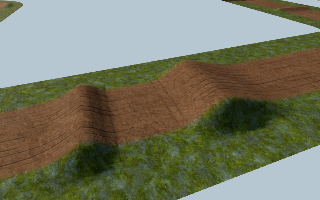 | 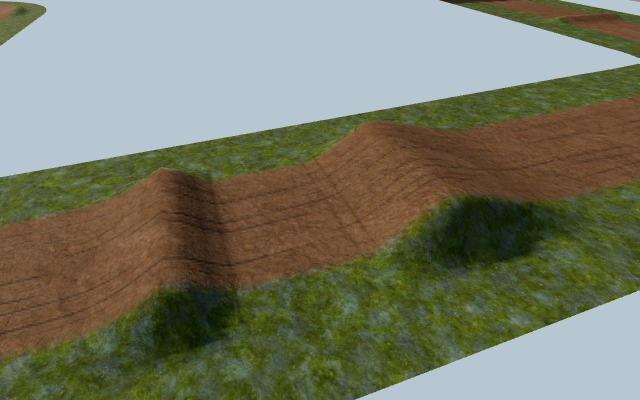 |

| Arena Nord berm: prepared | Same prepared berm: wet |
| --- | --- |
| 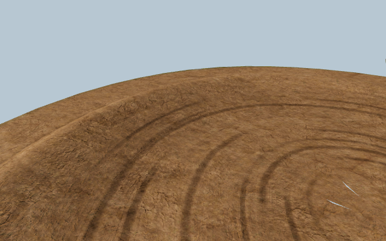 | 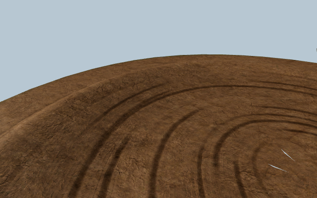 |

Tiny bright slivers visible on the stadium's inner bend also appear with the new weights zeroed. These captures do not establish a geometry fix for that existing detail.

The rider captures use posed production models. They show the new contact and calf behavior alongside the already existing suspension and body response; they do not depict a live simulated landing.

| MX250 high detail | MX450 onboard pose 1 |
| --- | --- |
| 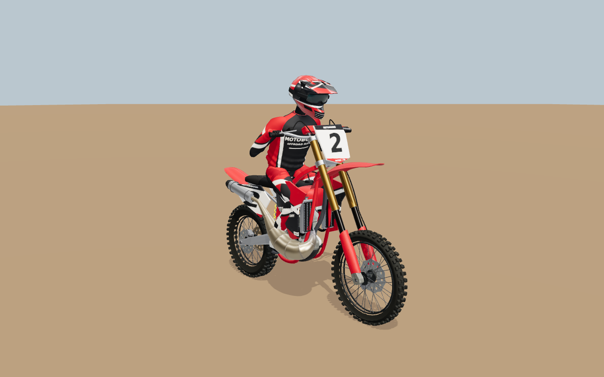 | 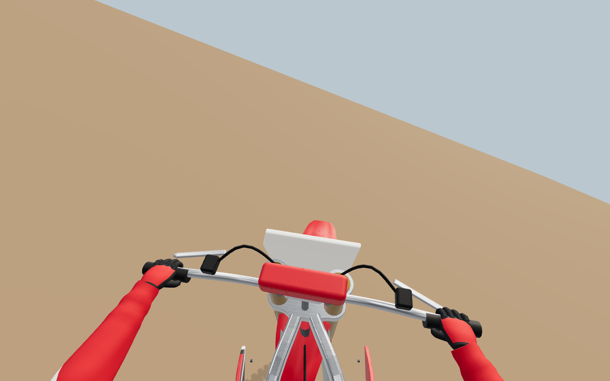 |

| Suspension pose 0 | Suspension pose 1 |
| --- | --- |
| 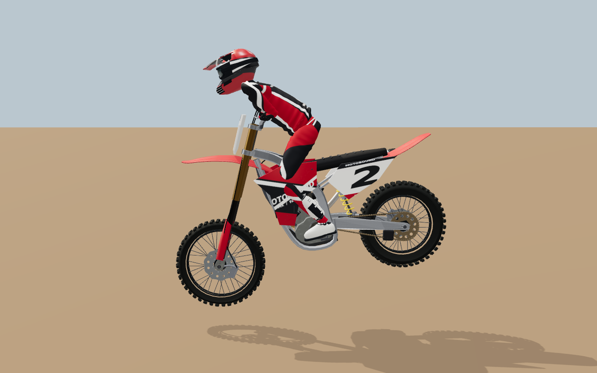 | 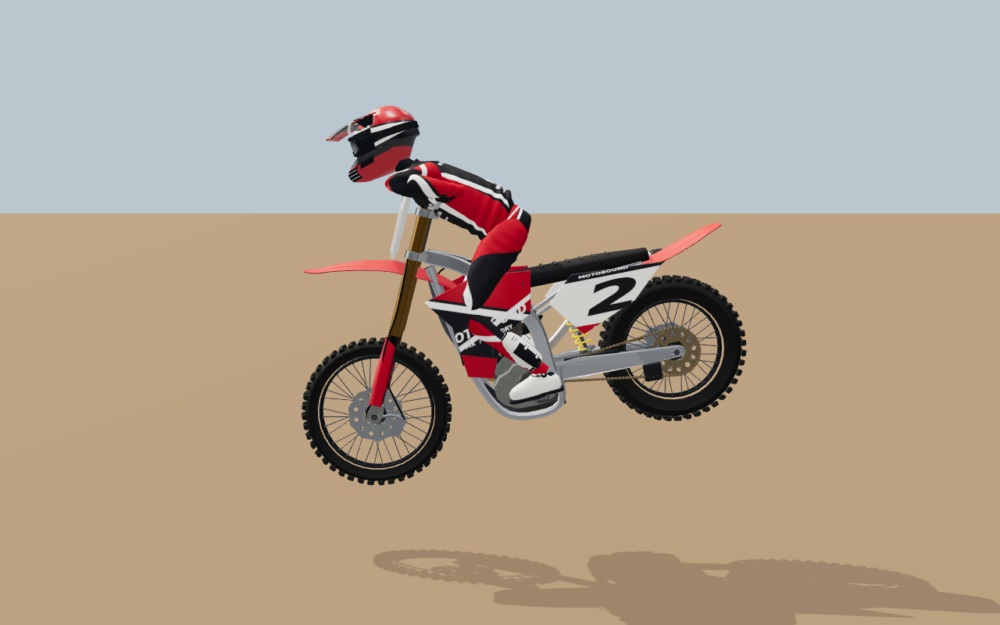 |

## Terrain cost and retained validation

The additional attribute is one static `vec4`, **16 bytes per vertex**. The existing width attribute is listed separately to make the incremental cost explicit. Attribute totals below exclude index buffers and textures.

| Venue | Existing terrain meshes | Vertices | Existing width bytes | Added wear bytes | Total attribute bytes after change |
| --- | ---: | ---: | ---: | ---: | ---: |
| Valley Ridge MX | 10 | 47,430 | 189,720 | 758,880 | 6,640,200 |
| Arena Nord SX | 7 | 30,527 | 122,108 | 488,432 | 4,273,780 |

Seventeen focused unit tests passed across `motocross-course-wear`, `motocross-worked-soil`, `motocross-soil-morphology` and `motocross-terrain-continuity`. Focused ESLint also passed. The [source evidence](terrain-source-evidence.json) records the exact production and fixture fingerprints.

The retained [terrain GPU run](terrain-gpu-validation.json) passed its combined browser case in **265.86 seconds**: two venues × three camera angles × six states, or **36 render states**. All GL errors were zero. Dry and wet pixels differed; a held wet state repeated exactly; restoring prepared state and restoring the new weights returned the original hashes. Setting only the new weights to zero changed pixels. Geometry, draw, triangle and resource counts stayed unchanged across states at each camera.

Measured fixture calls/triangles were Valley Ridge approach **8 / 72,800**, berm **1 / 9,600**, jump **6 / 57,600**; Arena Nord approach **7 / 45,446**, berm **3 / 19,890**, jump **6 / 42,044**. These are the actual camera-dependent renderer counters, not whole-game frame budgets.

The terrain run used Chromium with **ANGLE SwiftShader**, the software renderer. `APEX_MX_SOIL_COMPACT=1` explicitly selected **640 × 400** capture size and **512** shadow maps for this constrained environment. Normal fixture defaults remain **1120 × 700** and **1536** shadow maps. No physical GPU frame rate was measured.

## Rider validation retained here

The [rider GPU receipt](rider-gpu-validation.json) records **3/3 passing cases and 10 captures** on source commit `8c9757708fb6a1b9e9b741a207cc142e8d4b23e8`, with per-file hashes. Four original PNGs are retained above; the receipt includes measurements for all ten. The retained image paths are relative to this report; numeric measurements and pixel hashes are included for all ten samples.

MX250 high/middle/far views recorded **129,254 / 63,016 / 11,764 triangles** and **75 / 70 / 45 calls**. Across the retained suite the maximum rendered sole-to-peg gap was **2.929 mm**; the CPU geometry checks for hand, wrist-joint, ankle-joint and calf attachment were within floating-point roundoff (**4.51 × 10⁻¹⁶ m** maximum residual). That residual is a mathematical consistency check, not a measurement of GPU spatial accuracy. The receipt's historical `ankleError` field measures the rendered sole gap; `ankleJointError` is the anatomical-joint measurement. All GL errors were zero. The suspension A/B/B/A sequence repeated the matching image hashes with stable resources.

The three cases cover detail levels, MX450 onboard visibility/contact, and a controlled suspension sequence. They verify production geometry and animation under specified poses on SwiftShader. They do not establish hardware performance, complete in-game landing behavior, or a claim that photorealism has been achieved.

## Integrated verification

The source receipts above remain tied to the files actually tested. The tyre/AI integration produced local checkpoint `53eb4ca`; Festival integration produced `374853d`; the late shared physics/camera v17 integration produced `38621c6`. The [Festival integration review](festival-integration-review.json) establishes unchanged MX import closures for that Festival-only delta. It does not establish invariance across v17. Publication also preserves upstream documentation-only update `a8b5de3`; its two physics report files do not change the 794 build inputs.

The [v17 integration review](late-physics-review.json) identifies the relevant change: shared water and surface-temperature evolution reaches motocross contact sampling and can affect wet grip. Rubber-line inversion remains neutral on ordinary unsealed MX soil. The surveyed wear, boot/contact code and live berm comparator are unchanged. Of the 28 owned source, fixture and test inputs, 27 retain their previous hashes; the renderer also preserves the incoming camera-force sampling change. Persistent session identities use simulation version 17. Fresh CPU checks cover the shared wet-surface paths, MX contact/replay behavior and camera integration; no new GPU or full-journey run is claimed for this merge.

| Check | Final result / receipt |
| --- | --- |
| Validated source checkpoint and source manifest | Local checkpoint `38621c6`; 794 inputs; fingerprint `eaf5f5df3556f653ed9376633dba7f48a105e4ce0482bc90c82c7e341206687d` ([receipt](verification.json)) |
| Final build and TypeScript | Passed on the final merged source, exit 0 ([build](build.txt), [identity and timings](late-physics-build.json)); the normal prebuild, TypeScript check and production bundle ran with only generated output and temporary/cache storage relocated; existing large-chunk warning remains |
| Full lint and content validation | Passed, exit 0 ([lint](lint.txt), [content](content.txt)); full lint plus successful passes over nine incoming tyre/AI files, 27 incoming Festival files and all 19 incoming v17 TypeScript files ([late checks](late-physics-checks.json)); content validation was repeated after v17 integration |
| Original integrated unit suites, including shared AI/recorded tyres | **253 passed, 0 failed**, across 25 files: 205 integrated checks plus 48 checks for the later tyre/AI merge ([receipt](unit-verification.json)); retained at those source scopes |
| Fresh v17 regression run | **203 passed, 0 failed**: 201 cases across 14 test files plus two selected off-road replay/traction cases; 22 unrelated off-road cases were excluded by the explicit filter ([receipt](late-physics-checks.json)). This run overlaps the earlier 253 and is not added to them as a unique-test total |
| Berm HUD browser verification | Passed at 390 × 800 and 1280 × 800, both venues, eight live gain/loss states; text, bounds, control spacing and priority assertions passed ([receipt](berm-hud-evidence.json)) |
| Full menu → motocross entry and riding journey | Both software-renderer attempts failed the unchanged initial menu-readiness deadline before motocross entry; see the full-application limit below |
| Remote CI | The checks attached to the publication commit are the source for remote CI status; local receipts do not establish a remote CI result |

The production build command exited 0. A separate post-build identity helper initially failed because Python `Path` ordering differs from the full-string lexical ordering used by Vite. Recomputing with the exact Node/Vite algorithm matched the emitted identity, and every one of the 794 build inputs matched its committed Git blob. The [build receipt](late-physics-build.json) retains that helper failure and its correction separately from the successful build; no production source or build gate was changed to resolve it.

## Evidence files

- [Reference audit](reference-audit.json): all 100 original identities, hashes and the scope of visual review.
- [Terrain source evidence](terrain-source-evidence.json): focused unit results, inspected originals and exact source fingerprints.
- [Compact terrain GPU validation](terrain-gpu-validation.json): per-venue states, geometry/resource counters, hashes and capture fingerprints, without redundant encoded image logs.
- [Rider GPU validation](rider-gpu-validation.json): tested commit, source fingerprints and all ten posed render measurements.
- [Full-application journey receipt](production-journey.json): both initial-menu failures, exact tested build, backend proofs and the separate menu-only diagnostic.
- [Festival integration review](festival-integration-review.json): unchanged MX dependency closures for the Festival-only update.
- [Late physics integration review](late-physics-review.json), [203-case regression receipt](late-physics-checks.json), and [final build receipt](late-physics-build.json): the v17 dependency boundary and actual post-merge checks.
- [Previous build verification](verification-before-v17.json): retained source identity and results before the final physics merge.
- Eleven original PNGs: four terrain, four rider and three HUD captures.
- [Complete startup trace](startup-probe.json.gz), losslessly compressed; the compact timeline is in [startup observations](startup-observations.json).

## Live practice display

These are direct production HUD component captures with controlled telemetry, showing the comparison and mobile control spacing. They do not include the game renderer.

| Mobile: ahead of best | Mobile: behind best |
| --- | --- |
| 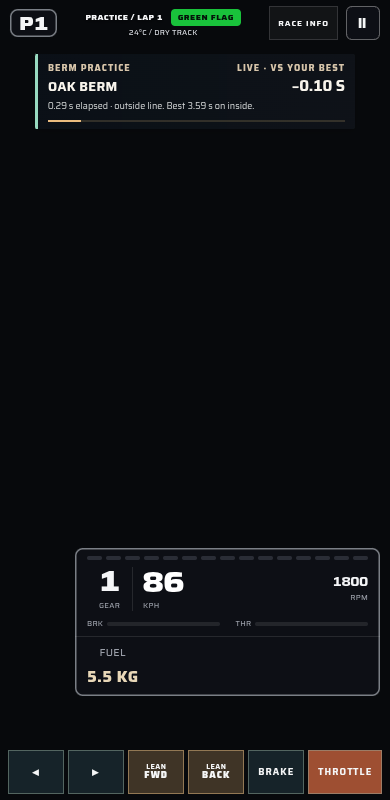 | 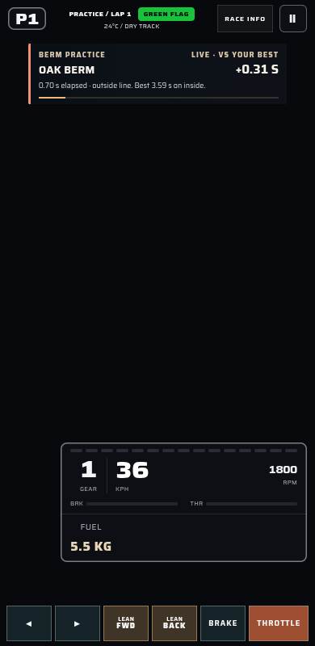 |

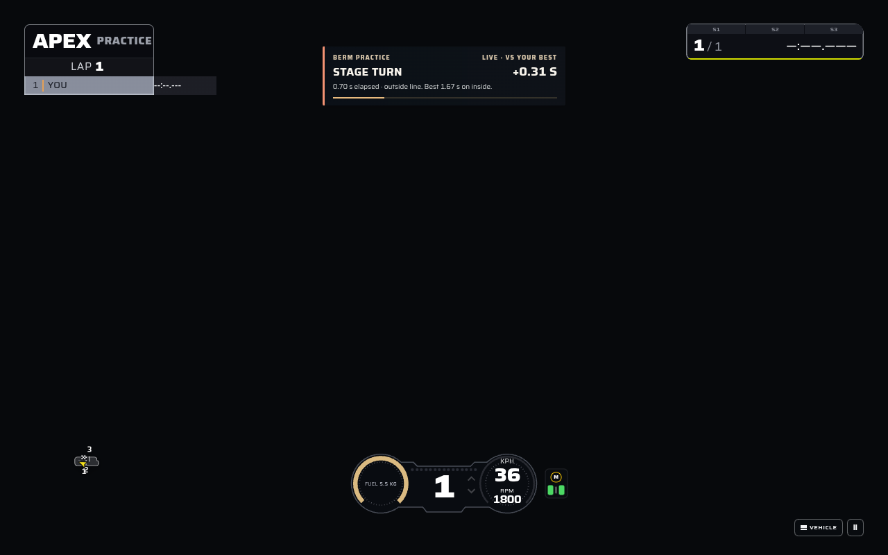

## Full-application limit and startup diagnosis

The unchanged `e2e/45-motocross-gameplay.spec.ts` was attempted with both **ANGLE SwiftShader** and the repository's existing **Mesa llvmpipe** backend. Both passed their renderer identity and framebuffer checks, then failed the same **180-second initial menu-readiness assertion**. Neither reached the visible Low graphics selection, motocross entry, the eight-rider gate, riding, camera changes or the venue switch. These are failed full-application checks; there are no gameplay screenshots from either attempt. The [combined journey receipt](production-journey.json) retains both results, backend checks, timings and source identity.

A separate read-only diagnostic run completed its first showroom GPU frame and first observed the menu visible at **141.393 seconds**, with 92 responses and no page, HTTP or request failures. That establishes one successful menu-only startup observation. It does not turn either failed journey into a pass or establish the cause of their timing difference. The [startup observations](startup-observations.json) and [original failure context](startup-timeout-context.md) preserve the distinction.

Both full-application attempts served fingerprint `96452ad0cd4219d361c26e7b827b613ef9b7c0cb0347769fc796d7c710635ca9`, before the later Festival and v17 integrations. The [Festival review](festival-integration-review.json) verifies unchanged MX component import closures only for that incoming Festival update. The subsequent v17 update changes shared simulation dependencies and received the separate CPU regressions and full build recorded above. Earlier component captures and startup attempts retain their original scope. Full menu-to-riding acceptance remains unverified for this pass.
