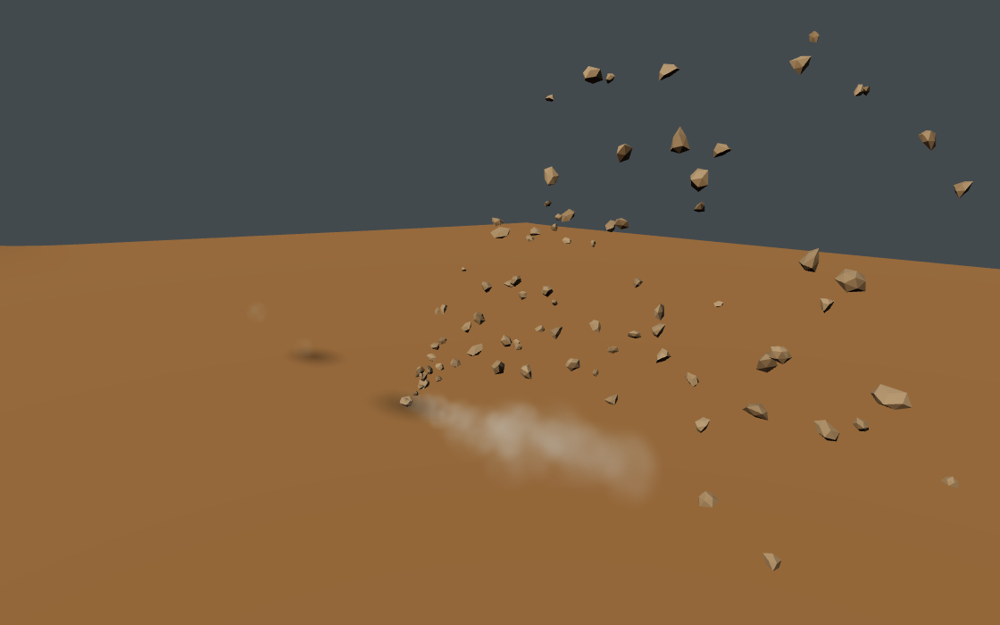
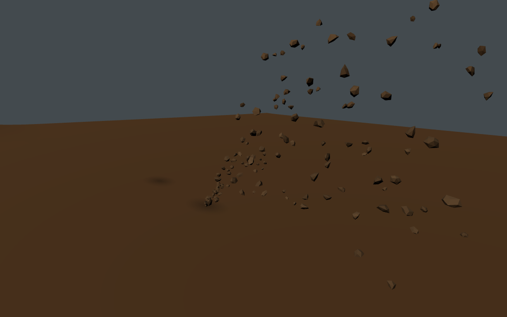

# Motocross contact, terrain continuity and lit roost — 2026-10-19

This pass improves tyre contact, rider braking control and soil presentation in the Three.js motocross section. It builds on the existing rider-weight controls, formed bike mouldings and worked-soil materials. The reviewed starting commit is `9e5ff534ecf4d8391eaa7075a284b141544de7ee`; the core implementation was published as `c1827511146611c8049569b555d40ea5719936c7`. The recovery correction was published as `cc7cb7ff19759609402d58a34af037a68fbe841d`. That exact commit passed the complete focused motocross CI build. The final validation section also records the full-game journey's initial Aurel startup timeout, before motocross entry.

## Reference review and provenance

The [existing 100-image audit](motocross-reference-review-20261019.json) supplies the image IDs, filenames, source URLs and archived hashes. This pass downloaded and decoded **100 current responses from those exact URLs**, visually reviewed all 100 through contact sheets, and separately inspected images **054, 058, 059, 066, 085, 092, 094, 095 and 096** at their downloaded resolution.

The [current-source review record](motocross-contact-reference-review-20261019.json) preserves all 100 exact URLs, current and archived hashes, decoded dimensions, download validity and inspection scope.

The original `Motocross_PS5_100_Developer_Reference_Images(2).zip` was located, but its download helper failed with HTTP 503. **Zero of the 100 current downloads matched the recorded archived image hashes.** The reason for the byte differences was not established. This is a current-source visual review; it does not reverify the archive or renew earlier audits' archive-hash claims. These images informed appearance and visible contact relationships. Physics coefficients, restitution and particle lifetimes were not measured from stills.

The following paths are exact reference-index paths, not newly committed image assets:

| ID | Reference-index path | Observation applied |
| --- | --- | --- |
| 054 | `04_Gameplay_Cameras_and_Race_Composition/054_SX25_dense_stadium_pack_at_takeoff.jpg` | Angular foreground soil fragments retain distinct lit faces. |
| 058 | `04_Gameplay_Cameras_and_Race_Composition/058_SX25_low_camera_on_a_multi_bike_stadium_launch.jpg` | Sharp fragments sit above softer contact dust. The current image shows a leaned corner despite its “launch” filename. |
| 059 | `04_Gameplay_Cameras_and_Race_Composition/059_SX25_chase_view_approaching_a_steep_ramp_and_finish_marker.jpg` | Highlights follow continuous curved rut shoulders into a ramp. |
| 066 | `04_Gameplay_Cameras_and_Race_Composition/066_MXGP21_congested_mxgp_corner.jpg` | Translucent dust overlaps lower riders while solid fragments remain distinct. |
| 085 | `05_Menus_HUD_Customization_and_Presentation/085_SX25_general_settings_screen_with_highlighted_options.jpg` | “Joint brakes Off” appears separately from Auto brakes and Rider Weight. |
| 092 | `06_Lighting_Weather_Dirt_and_FX/092_SX4_blue_rider_from_rear_on_dark_churned_soil.jpg` | The rear tyre follows a dark trough between raised soil shoulders. |
| 094 | `06_Lighting_Weather_Dirt_and_FX/094_MXATV_close_atv_corner_with_dirt_roost.jpg` | Individually shaded clods coexist with diffuse dust; this ATV image supports appearance, not motorcycle dynamics. |
| 095 | `06_Lighting_Weather_Dirt_and_FX/095_MXATV_backlit_motorcycle_jump_under_stadium_lamps.jpg` | A raised front tyre is separated from rear-origin debris. |
| 096 | `06_Lighting_Weather_Dirt_and_FX/096_MXATV_mountain_jump_with_dust_trail.jpg` | Rear contact, a raised front tyre and continuous rut shading remain distinguishable. |

## Production changes

**Lit soil and contact response — 054/058/066/094/095/096.** [Roost](../../src/rendering/offroad/roost.ts) now separates soft point dust from irregular, rotating `MeshStandardMaterial` clods. One instanced mesh shares the existing 2,400-particle pool. Dry fragments can make one damped hop; wet fragments settle, retain their orientation and shrink at expiry. Front and rear touchdown bursts wait for their respective loaded tyre. Front rolling dust receives no drive-spin clods.

[OffroadScene](../../src/rendering/offroad/index.ts) connects debris and contact shadows to the displayed terrain. Up to **128 moving-clod contact probes** refresh per frame, each using five height samples; tyre and shadow probes are additional. The rotating budget avoids permanently favouring early pool slots. Predicted contact requests a fresh probe, and bounce/settlement require confirmation so an exhausted budget cannot freeze a fragment against an outdated cached plane.

**Continuous ruts — 059/092/096.** [TerrainView](../../src/rendering/offroad/terrain-view.ts) propagates boundary wear to the previous strip and closing lap strip. [MxTerrainNormalEdges](../../src/rendering/offroad/mx-terrain-normal-edges.ts) joins raw, area-weighted face contributions across chunk boundaries after updates. Conservative bounds accommodate rut depth. `heightAt` samples the actual displayed triangles, including replay deformation and the short final lap row, so cosmetic contacts follow the visible surface.

**Braking and tyre load — 085/092/095/096.** [DirtBikeVehicle](../../src/simulation/offroad/dirt-bike-vehicle.ts) enables independent rear braking for player MX-250/MX-450 bikes on motocross and supercross courses. Sport retains front-lever assistance toward the rear. Sprung front/rear loads enter the existing tyre-force solve before integration; unloaded rear slip demand no longer works the soil. [Bike snapshots](../../src/simulation/bike-vehicle.ts) publish the off-road wheel loads used by the tyre readouts.

**Extreme contact recovery.** The broader CI collision suite exposed a second bump-stop impulse after a deeply overlapping bike had been projected out of terrain. The adapter now retains that compliant stop through the remainder of the bottomed stroke and releases it once travel recovers. Placement, remount and riderless recovery reset the state. The existing Raw/Sport height and vertical-speed bounds remain the acceptance criteria; a production input-journal regression also reconstructs and resumes an active corrected contact.

The final contact model uses **physics version 7** under the repository’s existing record/ghost policy, so previous physics categories remain distinct. This changes no journal or snapshot format.

**Browser verification guard.** The source-stability wrapper now recognises the generated root `browser-backend.json` and `browser-progress.json` as run evidence. Its regression still rejects changes to source, root configuration, and same-named files inside input directories.

## Try the controls

Start a player session with MX-250 or MX-450 at **VALLEY RIDGE / MOTOCROSS**. With default bindings, use **W** to accelerate, **A/D** to steer, **S** for the front brake and **Left Shift** for the rear brake. Compare short rear-pedal corrections with front braking on a straight approach. Sport may add rear braking from S; Left Shift remains rear-only. Repeat in Raw to compare without the braking/traction aids.

Use the existing **Q** forward and **Z** backward rider-weight controls during an approach, then release to return the input to neutral. **C** cycles cameras. These bindings and their motocross labels are verified in [bindings](../../src/input/bindings.ts), [controller](../../src/input/controller.ts) and the [controls screen](../../src/ui/interface.ts); saved custom bindings take precedence.

## Validation

### Published-source build and physics

The [focused CI run](https://github.com/cheshmakzanoon-ops/Experiment-3/actions/runs/39301590589) validates **`cc7cb7ff19759609402d58a34af037a68fbe841d`**. Its [prepare job](https://github.com/cheshmakzanoon-ops/Experiment-3/actions/runs/39301590589/job/118227894514) passed:

- Full repository lint and content validation.
- **43 test files / 376 tests**, with no failing or skipped test reported in that run. The collision file passed all **11** cases, including the unchanged Raw/Sport contact bounds, the eight-rider stadium start and the new active-contact input-journal reconstruction/continuation case.
- `tsc --noEmit` and the production Vite build, followed by source-stability and clean tracked-input checks.
- Checksum-pinned native-kit reproduction and independent reopening of the existing saved editable source. This pass does not claim to have newly authored that kit.

The [retained CI record](motocross-contact-evidence-20261019/motocross-final-ci-evidence.json), [build log](motocross-contact-evidence-20261019/ci-build.log) and [build identity](motocross-contact-evidence-20261019/BUILD_IDENTITY.json) preserve the source and result. The independently built local distribution and the downloaded CI proof have the same fingerprint: **`1e90ebc8e4a2969d6ef8882bde78152f16a9dee5b2e3d5edb80494d2a1da984c`**. The final local Vite build exited 0 in 200.223 seconds.

Additional local checks passed: the eight-file development regression (**75/75**), final integrated physics-v7 identity coverage (**10/10**) and the source-stability guard (**19/19**). The [local regression record](motocross-contact-evidence-20261019/local-regressions.json) also retains the earlier collision/contact run that passed 19/20 but exceeded the original 30-second stadium-test deadline. That case subsequently passed in the exact-commit CI run; its local timeout is not represented as a clean local run. A separate filtered run passed the new replay/contact case with exit 0.

### Rendered terrain and dirt

Both new WebGL cases passed with their original assertions and deadlines on the verified SwiftShader backend: **two cases, exit 0, 350.212 seconds**. They cover both Valley Ridge/Arena Nord terrain and dry/wet roost. The [component summary](motocross-contact-evidence-20261019/motocross-component-evidence-summary.json) retains the exact counts, timings, backend proof and source-scope limits; its companion [source manifest](motocross-contact-evidence-20261019/motocross-component-evidence/component-source-manifest.json) records 35 selected unchanged blobs between the core and final publication.

The component fixtures were bundled from the worktree during development. The original asset-serving distribution identified `c182751`; a complete runtime worktree snapshot and fixture-bundle hash were not recorded. These checks therefore establish the observed component behavior, without claiming a pristine full-tree browser validation of the later `cc7cb7` build.

- Shared-edge normal error is **zero** in both venues. Changing only to independent strip normals changes the pixel hash; restoring the joined normals reproduces the original hash exactly. Draw counts, triangle counts and resources stay unchanged across that comparison.
- The dry fixture contains **104 solid clods / 154 active particles**; the wet fixture contains **144 clods / 144 active particles**. The isolated clod mesh adds one draw and exactly 20 triangles per active clod. Changing the light position changes the fragment image; repeating the held lighting produces the same hash. The fixture reports no GL errors or source-snapshot mutation.
- Root and the terrain reviewer inspected all relevant captures. The retained PNGs below are original attachments without image edits.

**Dry soil component:** angular opaque fragments over soft dust, captured under controlled lighting on a simple receiver.

**Wet soil component:** darker clods with suppressed loose dust under the same controlled-fixture approach.

These isolated fixtures do not establish full gameplay acceptance, Arena Nord's actual night-lamp presentation, hardware frame rate or completed photorealism.

### Full-game journey: startup gate failed before MX entry

The unchanged `e2e/45-motocross-gameplay.spec.ts` did **not** complete a motocross ride-through. Both the local SwiftShader run and the exact-commit Mesa [CI journey](https://github.com/cheshmakzanoon-ops/Experiment-3/actions/runs/39301590589/job/118229908361) exceeded the original **180-second initial `#menu` visibility deadline** while constructing the default Aurel circuit. Neither run selected a motocross venue or exercised its riding controls. The local run requested the supported Low setting, but that visible settings step occurs after menu readiness and was never reached.

The [local startup record](motocross-contact-evidence-20261019/local-gameplay-startup.json) preserves its failed exit and artifact hashes. Its trace reports 168 successful network responses and no recorded application console/page errors. At the assertion failure, the pending task was `Track surface` at raw 56% queue progress (displayed as 48%); subsequent failure artifacts show construction continuing. This is queued geometry construction, not a download percentage.

The initial Aurel/APX-01 state does not instantiate the revised MX terrain, roost or bike adapter. `offroadSceneFor()` returns null for that circuit. The shared construction queue batches work into measured slices and the game starts its scene-draw loop after construction; the saved trace does not justify attributing the timeout to a specific faulty task or changing the motocross implementation to mask it.

The CI trace also shows the default Aurel Formula menu eventually becoming visible after the failed assertion. That later frame does not turn the timed-out test into a pass, and no MX gameplay frames were captured. The source-stability wrapper preserved the real test failure without the former false browser-receipt mutation error.

The separate CI models/world job was still running when the evidence record was sealed at **2026-10-19 18:47:25 UTC**; no outcome is claimed for that job here. The [evidence manifest](motocross-contact-evidence-20261019/evidence-manifest.json) records the exact retained file hashes.

The remaining acceptance boundary is a complete browser ride-through. The physics, terrain and dirt results above stand on their stated checks; they are not presented as a completed full-game approval.

### Concurrent integration

While this report was being finalized, `main` received [the separate GP/menu-pacing correction](https://github.com/cheshmakzanoon-ops/Experiment-3/commit/d0720d8ab52de0d7ae4b792e1ae65bc07f8949e4). This delivery preserves that commit, including its shared menu handoff and GP render-budget work. Its 81-case menu/state regression and other validation are documented in [the GP report](motogp-corner-drive/README.md).

The motocross physics and terrain/roost source files are unchanged by that integration. The browser results above remain pinned to `cc7cb7`; they are not observations of a new run with the later menu-pacing change. In particular, the recorded `cc7cb7` cold-start timeout must not be relabelled as either a passing journey or a demonstrated failure of the newer menu implementation.
