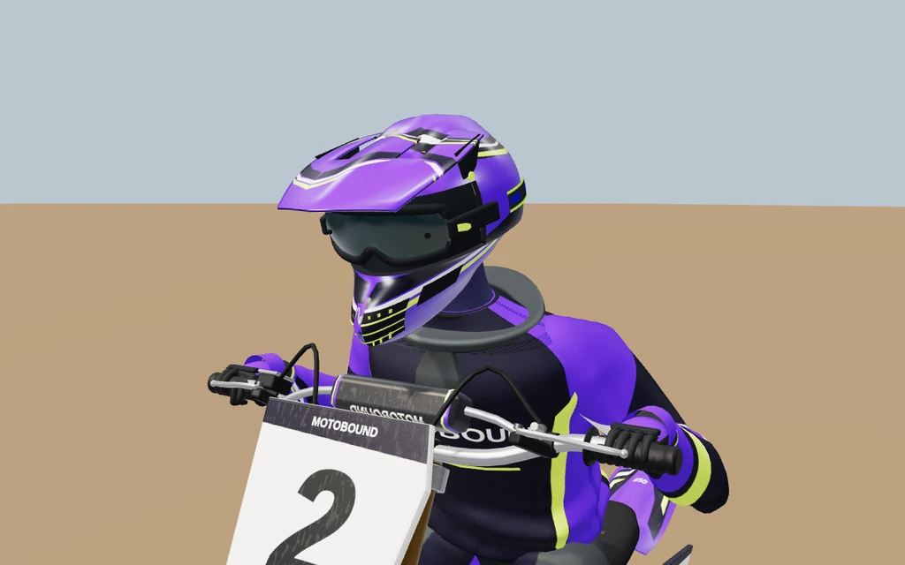
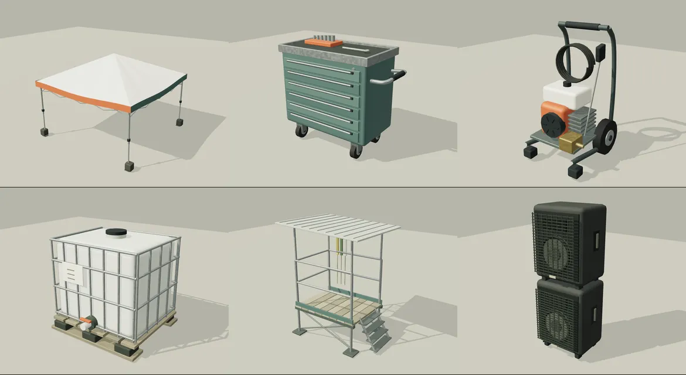

# Motocross rendering, 20 November 2026

Chromium captured these images from the game's Three.js geometry on WebGL2 using SwiftShader. The images below use WebP for download size. Pixel comparisons in the tests use the original framebuffer.

## MX250 under the Arena Nord roof

The eight-by-five lamp grid lights the jersey, shell plastics and metalwork according to each rider's position. The model test moves one MX250 under two lamp banks, then restores its outdoor lighting and compares the full image with the original. The inspection scene uses a plain backdrop so the material response is visible.


On the MX450, the filmed goggle lens follows the helmet's curvature. Its two tear-off edges, posts and folded tab catch the light at different angles. The brake fingers and throttle hand follow their respective controls.



## Wheel passage

Each row shows the same camera and soil before and after a grounded wheel passes. Valley Ridge is above Arena Nord. The WebGL test recorded 300 outdoor segments and 301 indoor segments. Both added one draw call and restored the original pixels on rewind.


In a separate CPU benchmark an eight-bike Valley Ridge simulation produced 1,080 snapshots at 30 Hz and 9,833 imprint segments. At the 84 measured terrain updates, the median time to place the visible tread on the deformed surface went from 2.03 to 0.545 ms and the 95th percentile went from 3.313 to 0.910 ms. These timings cover the imprint update alone.

## Trackside equipment

The outdoor and indoor layouts share five material batches for their equipment. Across the top are the folding canopy, tool trolley and pressure washer. Below are the water tank, marshal post and speaker cabinets. The surfaces use part-local metre coordinates so that moving or rotating equipment preserves its finish.



## Eight-rider races

These chase views came from an eight-rider race through the normal game menus with fresh tyre tracks enabled, before the later helmet-camera and goggle refinements. Valley Ridge is on the left and Arena Nord is on the right. Both were captured at 1280 × 800 on the Low preset. The test used the player's throttle before handing over to the riding AI, observed a jump and touchdown, switched to the onboard camera and paused each race.


Six seeded race runs passed the repository's motocross, supercross and supermoto handling limits. Observed crash rates ranged from 0.00 to 0.13 per rider-lap. The longest continuous stop was under 15 seconds in each run. [Race results](race-checks.json)

## Frame workload

* In a CPU benchmark of eight ordinary Formula hosts with eight active motocross models, all 1,600 hidden Formula descendants were skipped. Across 400 samples the median field matrix update took 0.67 ms with the change and 1.30 ms before it. The active bike geometry and root transforms were the same.
* After close, medium and wide camera cuts, the eight riders retained 22 loaded bike models. Skipping the 1,995 descendants of the fourteen inactive models reduced the median matrix update from 1.189 to 0.504 ms in a separate 400-sample run. The 95th percentile fell from 2.745 to 1.690 ms. The camera-cut test also checks that each returning model immediately restores its current world transform.
* The 720 Hz tyre integrator reuses each wheel's force record within a simulation tick. A comparison of 16,384 inputs produced identical numerical results for the previous and revised integrators, including braking, mixed grip, unloaded wheels and different timesteps.
* The tyre renderer submits only unexpired quads. The index buffer spans a circular wrap in one draw, and a replay seek restores the visible range.

These are CPU timings and functional tests on software WebGL2. A sustained target-hardware frame-time measurement is still needed for a competitive performance claim.

## Reproduce

Run a production build, then run the model, venue, equipment and tyre-passage browser checks with Chromium installed.

```sh
npm run build
npx playwright test --config playwright.motocross.config.ts \
  e2e/42-motocross-bike.spec.ts e2e/43-motocross-world.spec.ts \
  e2e/47-motocross-trackside-models.spec.ts e2e/56-motocross-tyre-traces.spec.ts
```

The full player journey can use the same preset and controls as the race captures.

```sh
APEX_MOTOCROSS_JOURNEY_QUALITY=low npx playwright test \
  --config playwright.motocross.config.ts e2e/45-motocross-gameplay.spec.ts
```
