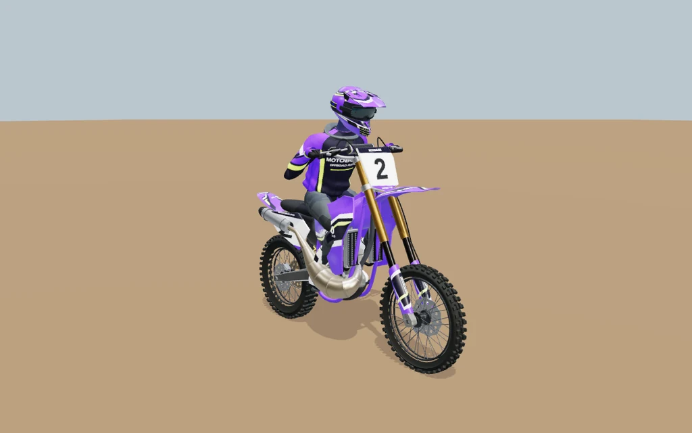

# Motocross rendering, 20 November 2026

Chromium captured these images from the game's Three.js geometry on WebGL2 using SwiftShader. The images below use WebP for download size. Pixel comparisons in the tests use the original framebuffer.

## MX250 under the Arena Nord roof

The eight-by-five lamp grid lights the jersey, shell plastics and metalwork according to each rider's position. The model test moves one MX250 under two lamp banks, then restores its outdoor lighting and compares the full image with the original. The inspection scene uses a plain backdrop so the material response is visible.



## Wheel passage

Each row shows the same camera and soil before and after a grounded wheel passes. Valley Ridge is above Arena Nord. The WebGL test recorded 300 outdoor segments and 301 indoor segments. Both added one draw call and restored the original pixels on rewind.


In a separate CPU benchmark an eight-bike Valley Ridge simulation produced 1,080 snapshots at 30 Hz and 9,833 imprint segments. At the 84 measured terrain updates, the median time to place the visible tread on the deformed surface went from 2.03 to 0.545 ms and the 95th percentile went from 3.313 to 0.910 ms. These timings cover the imprint update alone.

## Trackside equipment

The outdoor and indoor layouts share five material batches for their equipment. Across the top are the folding canopy, tool trolley and pressure washer. Below are the water tank, marshal post and speaker cabinets. The surfaces use part-local metre coordinates so that moving or rotating equipment preserves its finish.


## Reproduce

Run a production build, then run the model, venue, equipment and tyre-passage browser checks with Chromium installed.

```sh
npm run build
npx playwright test --config playwright.motocross.config.ts \
  e2e/42-motocross-bike.spec.ts e2e/43-motocross-world.spec.ts \
  e2e/47-motocross-trackside-models.spec.ts e2e/56-motocross-tyre-traces.spec.ts
```
