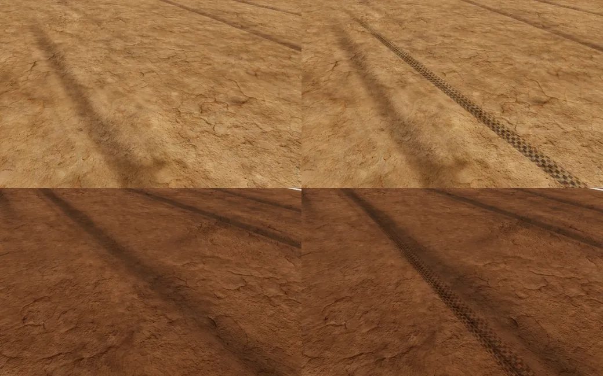
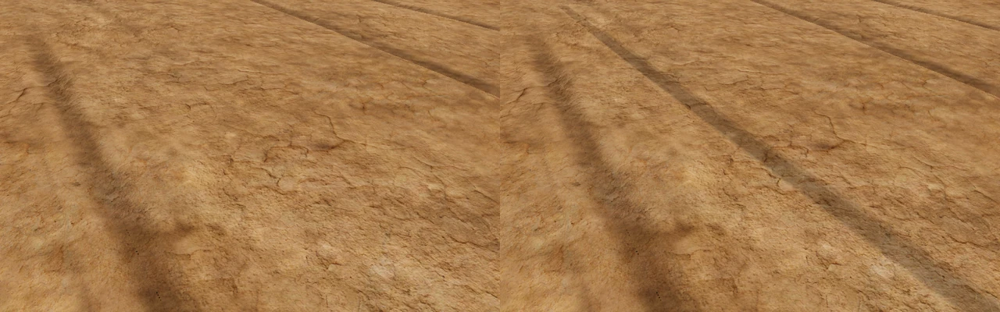
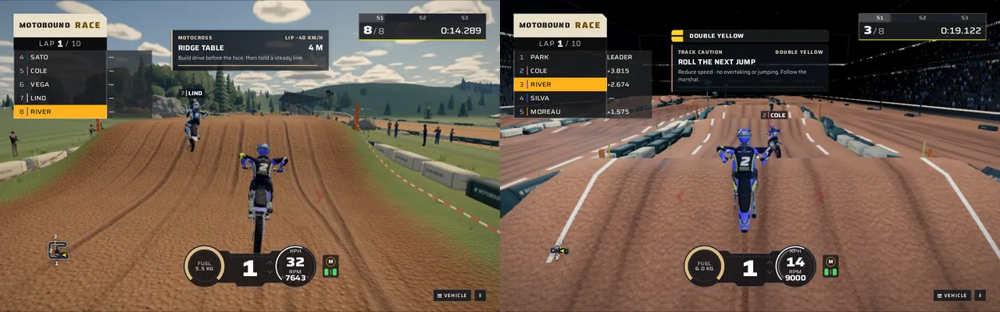
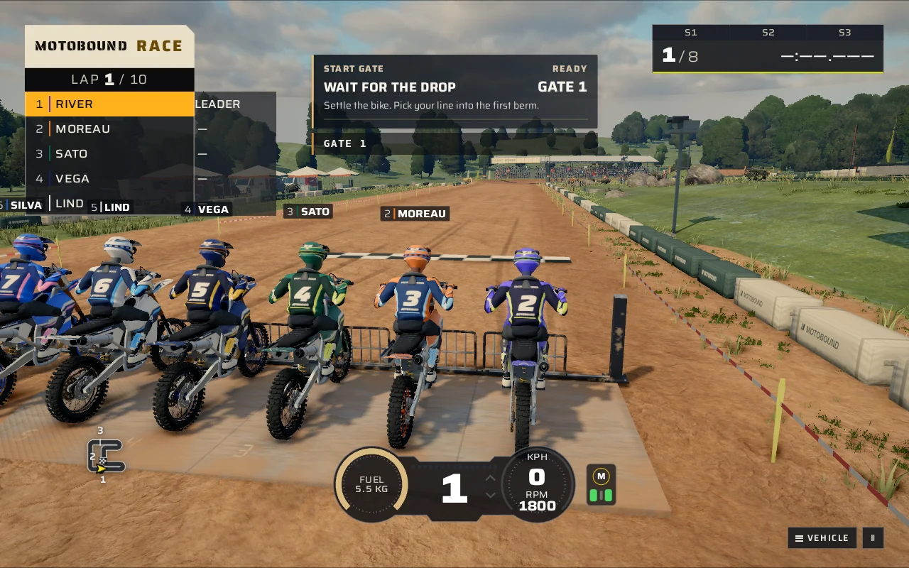
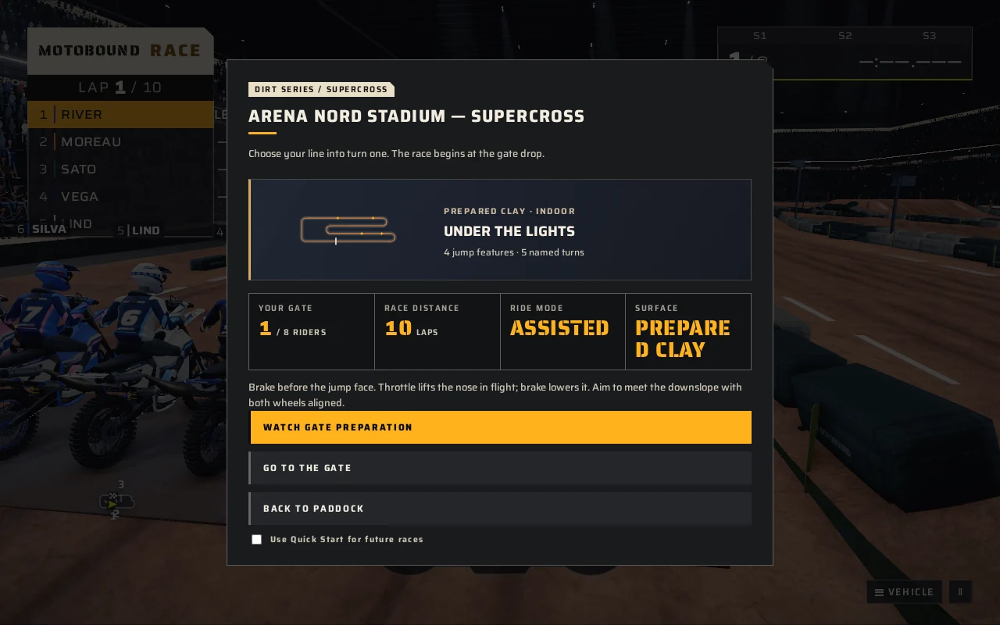

# Motocross rendering, 20 November 2026

Chromium captured these images from the game's Three.js geometry on WebGL2 using SwiftShader. The images below use WebP for download size. Pixel comparisons in the tests use the original framebuffer.

## MX250 under the Arena Nord roof

The eight-by-five lamp grid lights the jersey, shell plastics and metalwork according to each rider's position. The model test moves one MX250 under two lamp banks, then restores its outdoor lighting and compares the full image with the original. The inspection scene uses a plain backdrop so the material response is visible.


On the MX450, the filmed goggle lens follows the helmet's curvature. Its two tear-off edges, posts and folded tab catch the light at different angles. The brake fingers and throttle hand follow their respective controls.


## Rider movement

The MX450 and SM450 ran on Valley Ridge and the MX250 ran in Arena Nord. Each 40-second run reached full throttle, full braking and a standing posture. Across 720 sampled high-detail poses, 45 were in flight. The largest sole-to-peg gap was 1.48 mm across 1,406 planted-boot observations. The skinned wrists, ankles and calves stayed attached, including during touchdown. Seeking backwards to 129 recorded poses restored every element of the four hand and boot transforms exactly. [Motion measurements](race-checks.json)

## Wheel passage

Each row shows the same camera and soil before and after a grounded wheel passes. Valley Ridge is above Arena Nord. The MX tread has 22 alternating centre-block pairs per revolution. Each impression follows the wheel rotation recorded by the solver, including reverse rotation and slides with a locked wheel. At 800 × 500, the passage changed 21,829 pixels across 300 outdoor segments and 24,451 pixels across 301 indoor segments. Each course added one draw call. Seeking back restored the original framebuffer byte-for-byte, and seeking forward restored the marked image.



The SM450 uses road tyres with 20 swept channels on the front and 24 on the rear. Their impression follows the recorded axle rotation, bar angle and terrain normal. The Valley Ridge run recorded 301 segments. With wheel path, load and rotation held constant, increasing the slip alone changed 26,148 pixels. The original and marked images each restored exactly on replay.



In a separate CPU benchmark an eight-bike Valley Ridge simulation produced 1,080 snapshots at 30 Hz and 9,833 imprint segments. At the 84 measured terrain updates, the median time to place the visible tread on the deformed surface went from 2.03 to 0.545 ms and the 95th percentile went from 3.313 to 0.910 ms. These timings cover the imprint update alone.

## Trackside equipment

The outdoor and indoor layouts share five material batches for their equipment. Across the top are the folding canopy, tool trolley and pressure washer. Below are the water tank, marshal post and speaker cabinets. The surfaces use part-local metre coordinates so that moving or rotating equipment preserves its finish.


## Eight-rider races

These chase views came from an eight-rider race through the normal game menus with fresh tyre tracks enabled, before the later helmet-camera and goggle refinements. Valley Ridge is on the left and Arena Nord is on the right. Both were captured at 1280 × 800 on the Low preset. The test used the player's throttle before handing over to the riding AI, observed a jump and touchdown, switched to the onboard camera and paused each race.



The High preset captures below are at the original 1280 × 800 resolution. The first shows the unobscured starting grid at Valley Ridge. The second shows the eight-rider field behind Arena Nord’s pre-race briefing. The game rendered both through the normal race menus.





Six seeded race runs passed the repository's motocross, supercross and supermoto handling limits. Observed crash rates ranged from 0.00 to 0.13 per rider-lap. The longest continuous stop was under 15 seconds in each run.

Both eight-rider venues also ran for 24 seconds at 120 physics steps per second. With the same rider inputs, publishing at 30, 60 or 120 Hz produced identical bytes in all 720 shared snapshots on each course. The final rut depth and compaction hashes also matched. [Race, timing and tyre results](race-checks.json)

## Frame workload

* In a CPU benchmark of eight ordinary Formula hosts with eight active motocross models, all 1,600 hidden Formula descendants were skipped. Across 400 samples the median field matrix update took 0.67 ms with the change and 1.30 ms before it. The active bike geometry and root transforms were the same.
* After close, medium and wide camera cuts, the eight riders retained 22 loaded bike models. Skipping the 1,995 descendants of the fourteen inactive models reduced the median matrix update from 1.189 to 0.504 ms in a separate 400-sample run. The 95th percentile fell from 2.745 to 1.690 ms. The camera-cut test also checks that each returning model immediately restores its current world transform.
* In a mixed MX250/MX450 field, camera cuts left eight motorcycles visible and fourteen other levels ready for reuse. Detaching the inactive levels reduced the meshes reachable by a scene traversal from 1,815 to 856. During shader preparation, one representative of each missing machine and detail level temporarily raised that count to 1,130, then restored it to 856. A separated rider also follows camera cuts and returns to the original seat on replay.
* Stadium collisions and wheel probes used to test several neighbouring rhythm lanes for every contact. A four-metre spatial index reduced the candidates from 2,996,789 to 164,797 across 4,482 recorded Arena Nord queries. Alternating batches of 128 queries took 2.592 ms and 0.256 ms at the median. On Valley Ridge the corresponding times were 1.774 ms and 0.244 ms. Both eight-rider simulations produced identical bytes in all 1,200 snapshots and identical final terrain hashes over 40 seconds.
* Dirt grids leave the hidden Formula models’ material registrations and merged shadow geometry unbuilt. With the shipped bodies loaded, eight dirt slots needed zero Formula shadow casters. Switching the same slots to Formula cars created 264 casters with 3,267,612 bytes of buffers. The next frame reused all of them. Motocross venues also skip the Formula wheel guns and jacks.
* The 720 Hz tyre integrator reuses each wheel's force record within a simulation tick. A comparison of 16,384 inputs produced identical numerical results for the previous and revised integrators, including braking, mixed grip, unloaded wheels and different timesteps.
* The tyre renderer submits only unexpired quads. The index buffer spans a circular wrap in one draw, and a replay seek restores the visible range.

Whole-step timings varied with host load. In a paired run, Arena Nord’s 95th percentile fell from 7.870 to 2.533 ms, while Valley Ridge’s rose from 6.052 to 7.921 ms. Some individual steps on both courses exceeded the 8.333 ms simulation budget. These are CPU timings and functional tests on software WebGL2. A sustained target-hardware frame-time measurement is still needed for a competitive performance claim.

## Reproduce

Run a production build, then run the model, venue, equipment and tyre-passage browser checks with Chromium installed.

```sh
npm run build
npx playwright test --config playwright.motocross.config.ts \
  e2e/42-motocross-bike.spec.ts e2e/43-motocross-world.spec.ts \
  e2e/47-motocross-trackside-models.spec.ts e2e/56-motocross-tyre-traces.spec.ts
```

The full player journey can use the same preset and controls as the race captures.

```sh
APEX_MOTOCROSS_JOURNEY_QUALITY=low npx playwright test \
  --config playwright.motocross.config.ts e2e/45-motocross-gameplay.spec.ts
```

To check that presentation sampling preserves the physics and terrain state, run the fixed-step snapshot comparison.

```sh
npx vitest run tests/motocross-snapshot-cadence.test.ts tests/motocross-sprung-pose.test.ts
```
