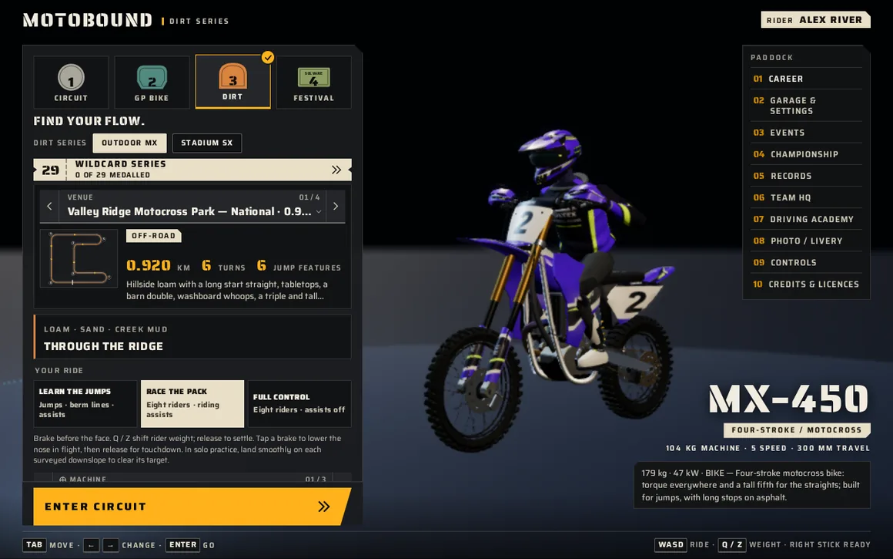
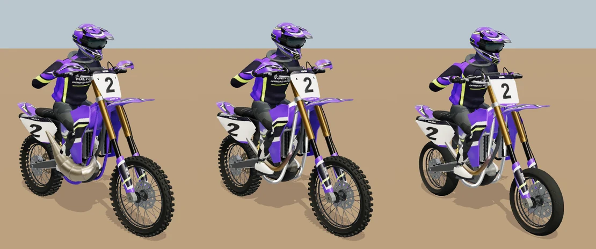
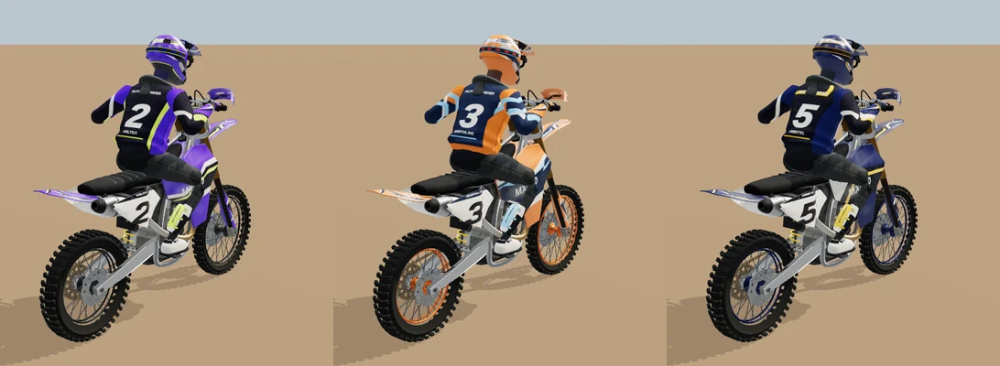
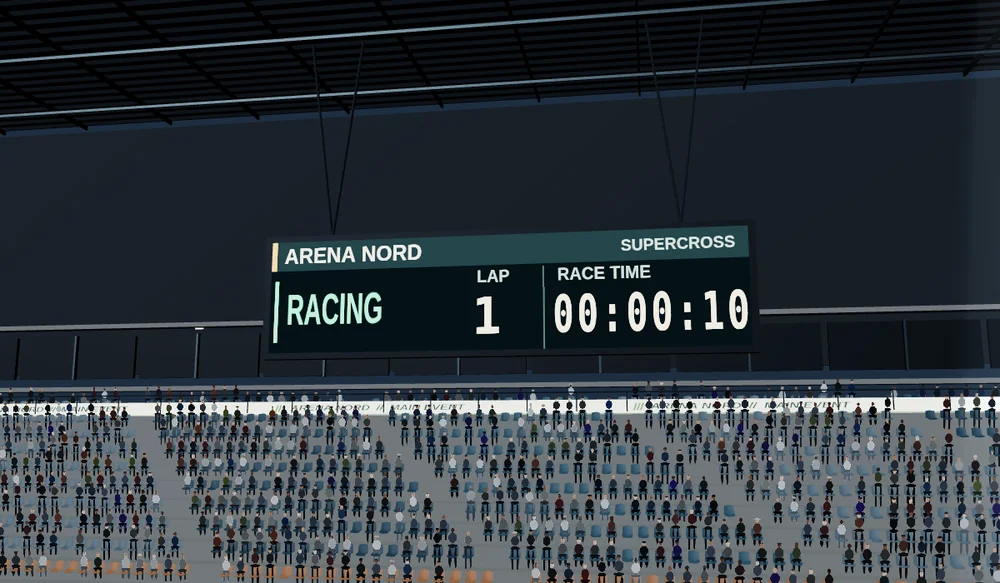
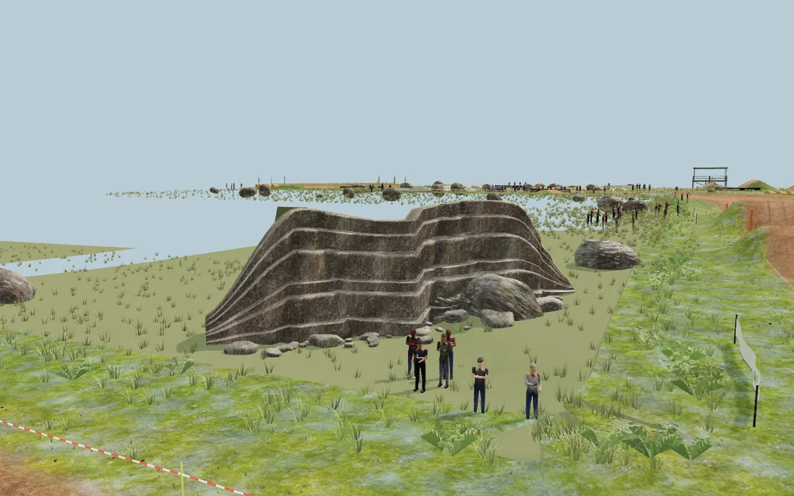
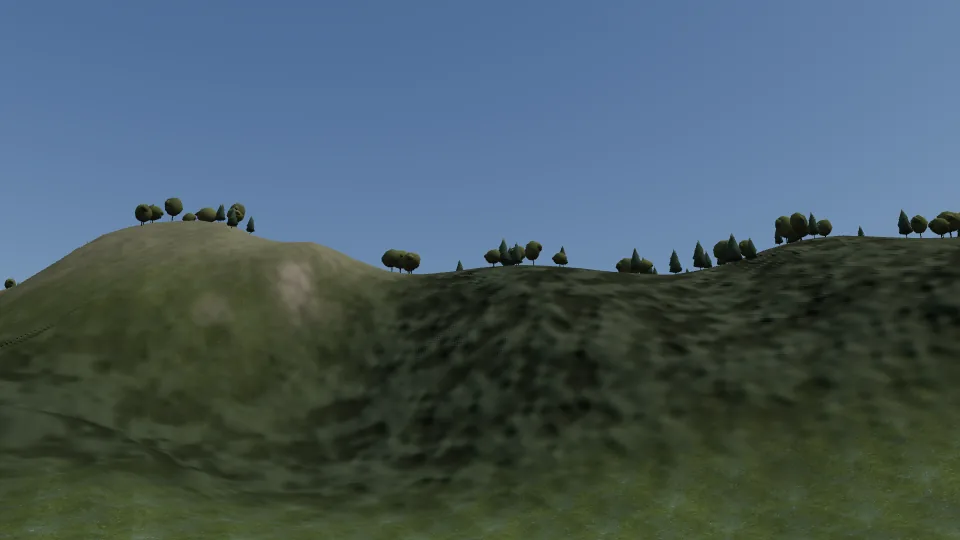

# Motocross and Supercross

Choose **DIRT** in the paddock, select **OUTDOOR MX** or **STADIUM SX**, choose the MX250 or MX450, then select **ENTER CIRCUIT**. The photographs supplied for this pass informed the original game models, terrain, light and motion. Every image below comes from Three.js.

## Bikes and riders

From left to right, the MX250 has a two-stroke exhaust, the MX450 has a formed four-stroke silencer, and the SM450 wears the smaller paved-course wheels. Look through the silencer hanger and the rear helmet vents, or follow the seat pleats along the top of the bike. These close-ups use the high-detail production models in a fixed review camera.

The eight entrant liveries use three original patterns. Voltex, Northline and Orbitel appear here in the same rear camera. Numbers, helmet panels, jersey and plastics stay associated with the entrant through replay and distance changes.

The helmet and chest follow the landing direction through a whip. The helmet camera responds to standing and fore-aft load transfer. A gear change cuts rear-wheel drive in flight, and an empty tank stops delivering drive torque. The hands stay registered on the controls and the boots follow the pegs.

## Inside Arena Nord

Two suspended boards show the official lap, race clock and finish state. This close-up uses a real eight-rider session ten seconds into racing. The roof’s two lighting banks reflect independently in metal, plastic and goggles. Sheltered clay keeps its groomed moisture while the outdoor weather continues.

## Outside at Valley Ridge

The quarry cutting has exposed strata, broken turf and fallen rock at its base. The mechanics area and spectator group in this course-detail camera give the bank its scale. Both circuits have open steel launch grates set into the concrete.

Two wooded ridges frame the course about 0.8 and 1.25 km from its centre. This landscape study isolates the production terrain and trees. During a race, flags, grass and fine dust respond to the recorded outdoor wind. The heavy clods retain their ballistic arc. Spectators near the leaders turn as the riders pass.

## Verified in the game

| Check | Result |
| --- | --- |
| Landing targets | 18 of 18 on the two race bikes and both circuits. Only the setup position and approach speed were supplied before the player controls took over. |
| Linked rhythm sections | 8 of 8 earned their targets across the complete sequences. Four of those approaches were also sampled at seven nearby speeds, with 28 successful trials. |
| Twelve-rider Arena Nord hairpin | Seed 50206, two laps on MX450s. An outside-line restart under double yellow previously held the queue for 20.83 seconds. The revised rider inputs reduced the longest stop to 15.22 seconds. All twelve classified. |
| Full race fields | All 56 entrants classified over six two-lap races with 2,444 landings. The longest stop across the six fields was 15.67 s. The [individual race results](race-results.json) identify each seed, weather setting and field. |
| Covered race during outdoor rain | In the final ten-rider test, seed 50204, the race finished in 208.94 s with 519 landings. The longest stop was 12.90 s. The same seed on the exposed stadium floor took 428.79 s with a 30.59 s stop. |
| Helmet-camera framing | The pad, number plate and grips were checked across MX250, MX450 and SM450 at 4:3, 16:10 and 21:9. |
| Animation playback | Recorded jumps on both race bikes at both venues produced identical helmet, torso, hand, boot, wheel and suspension transforms in 6,080 comparisons at 30, 60, 120, 144 and 240 Hz. The checks include fractional frames and camera detail changes. |
| High model budget | The complete MX250, MX450 and SM450 models contain 139,754, 136,654 and 121,510 expanded triangles respectively. The MX250 and MX450 fixed-camera checks each used 92 draw calls. |
| Eight-rider race equipment | A gate-start moto avoids building 160 unused wheel-service meshes. The riders retain private garment samplers while sharing six identical grain images. The measured source storage for those images fell from 4.50 MiB to 0.28125 MiB for the eight near and middle kits. |
| Rider removal in WebGL2 | One high-detail MX450 used 31 textures and 91 geometries. Two riders used 56 and 110. Removing one restored the first image pixel for pixel and its original resource counts. Removing both released all textures and geometries. The four draws reported zero WebGL errors. [Frame measurements](field-resources.json) |

The race results use the production simulation at 120 Hz. The model captures use software WebGL2. Console frame time, input latency and human competitive play require separate hardware testing.
