# Motocross race review

Valley Ridge and Arena Nord use the same articulated MX250 and MX450 models in racing, onboard views and replay. The SM450 supermoto shares the motocross frame and rider controls and uses its own road wheels.

## MX250 and MX450 race refinement

Both starting grids below were captured at 800 × 500 on High. The player selected each class and venue through the paddock and released the eight-rider gate through the normal race controls. Chromium used the SwiftShader WebGL2 software renderer.

| Valley Ridge · MX450 | Arena Nord · MX250 |
| --- | --- |
| 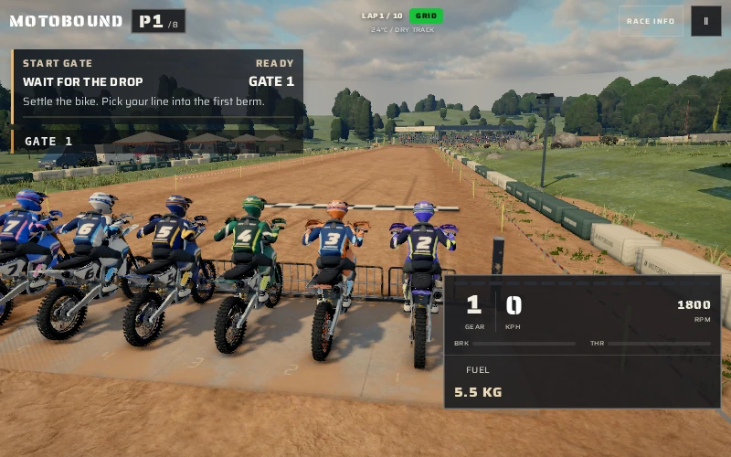 | 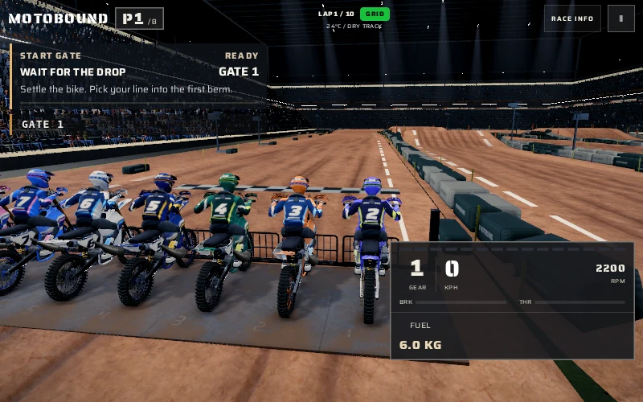 |

The MX450 cockpit and tail below are photographed from the same cameras on main at `e5a863d` and `0903d39`. The handguards have open vents, mounts and throttle clearance. The front number board curves around the cables and the bar pad has an open bore. The tail panels turn in around the silencer and its retaining bands. In the closest detail level the MX250 and MX450 contain 139,930 and 136,830 triangles respectively, including the rider.

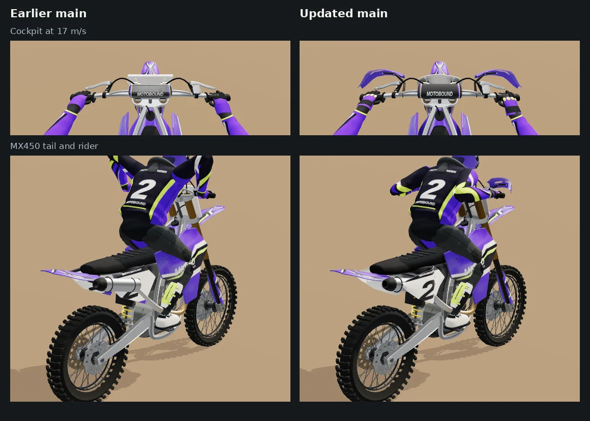

The four frames below come from eight-rider races entered through the production paddock on Low at an 800 × 500 viewport. The upper row shows the start at Valley Ridge and Arena Nord. The lower row shows the player’s view while riding. Both bikes use the same formed parts in chase, cockpit and replay. An axle that locks immediately returns to sharp crossed spokes while its rolling partner keeps its own shutter exposure.

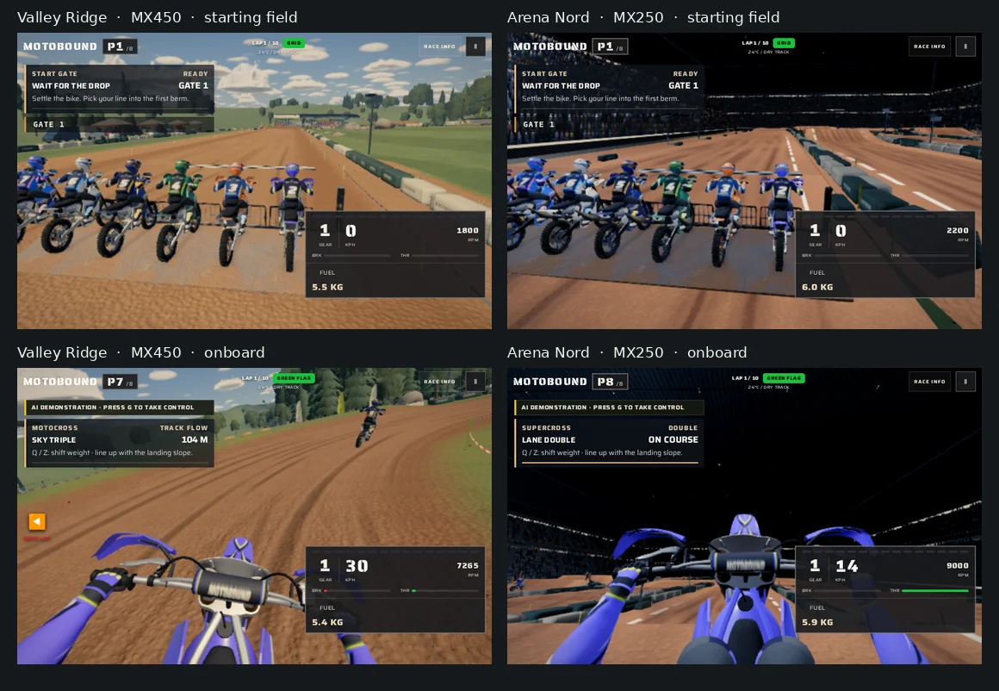

| Measurement | Earlier main | Updated main |
| --- | ---: | ---: |
| Smallest distance between the tail panel and exhaust across both classes and all three detail levels | 62.9 mm overlap | 17.6 mm clearance |
| Left-to-right knee displacement across neutral lean, sampled at ±0.00001 rad | 33 mm | Under 0.001 mm |
| Largest single-tick rise of the rider’s pelvis during the measured get-up | 81 cm | 1.41 cm |
| 95th-percentile gap under Arena Nord pads, widest gap on each of 482 pads | 10.49 cm | 0.54 cm |
| Worst gap under a Valley Ridge pad, across 736 pads | 2.67 cm | 0.28 cm |
| Near-detail stadium spectators submitted at the starting gate | 581 | 225 |
| Marshal restarts over eight solo Valley Ridge AI laps, four per class | 7 | 0 |

The starting gate now follows the measured green instant between snapshots. In an eight-rider replay recorded at 20 Hz on each venue, the 52 cm gate tip previously jumped 25.3 cm in one display frame. At 120 Hz its largest step fell to 5.32 cm. At 240 Hz it fell to 2.68 cm. At all five tested display rates from 30 to 240 Hz the tip stayed within 0.003 mm of its timed path. The gate remains upright until green when a snapshot pair spans the release.

The pad survey samples the hems between the corners as well as the corners themselves. Each venue still draws the pads in two batches. The stadium test covered 18 trackside, gate and telephoto views. Every spectator within those camera frames retained the same seat, model and clothing.

While the starting grid is held on High, the renderer finishes the local reflection and near shadow maps separately before shading the riders. In the 1280 × 800 WebGL inspection, moving the MX450 and returning it to its earlier pose produced identical pixels with separate and combined shadow rendering. In a live race, a long frame also keeps the existing reflection while the next six faces are built one at a time. Six successive ten-second gaps previously forced 36 face renders. The regression now records six and verifies that the previous complete map stays visible until its replacement is ready. Replay seeks, vehicle changes and lighting changes still trigger immediate captures.

The Arena Nord pad photographed below had the largest original gap. Both frames use its actual placement, the same surveyed ground, material, camera and lighting. The visible gap under this pad fell from 17.30 cm to 0.95 cm.

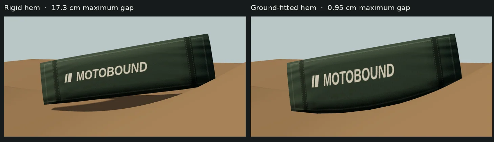

The recovery sequence below starts with the separated MX450 rider resting on a Valley Ridge slope. The 120 Hz simulation supplies the pelvis, heading, rise and distance travelled. The inspection camera follows 39 samples over 1.58 seconds at 24 fps on the surveyed surface. The rider rises over 0.72 seconds, the arms swing against the planted foot, and the boot tilts through its free swing before it lands. Each boot samples the triangle under its sole. Across the 16 planted-foot observations in this sequence, the deepest sole penetration fell from 31.2 mm to zero and the mean absolute placement error fell from 7.9 mm to 0.28 mm. Rewinding to a recorded pose reproduces the same image.

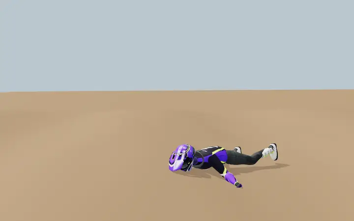

A loaded wheel with a small speed error used to cross rolling speed back and forth on every physics substep. The tyre now caps the corrective impulse using the effective mass at each contact. The tests cover front and rear braking, steered contacts, lateral sliding and high landing loads. They check for extra kinetic energy as well as reversals.

The 120 Hz four-lap probe completed all 32 laps across the outdoor and stadium venues, both bike classes and both physics paths. On the dedicated AI path the Valley Ridge MX450 and MX250 completed all eight laps without a stall or fall. Their lap-time spreads were 2.03 and 1.87 seconds. Driving the player’s solver with the same controls still produced one outdoor MX250 lowside. Arena Nord recorded two assisted restarts across its 16 laps. The separate full-field race suite passed all ten events, including both Valley Ridge motos, the six-lap Arena Nord main and changeable weather.

### Supermoto grid and crew

The SM450 shares the MX chassis and now uses the same starting-gate apron and radio crew. It previously received four car tyre blankets and four removal mechanics per bike. An eight-rider grid loses 32 misplaced blankets and 64 straps. The nearest crew position moves from 0.40 m ahead of the chassis origin to 6.52 m behind it. The two-person teams use radios and clear the apron before the start. Rewinding restores their poses. Tests also return the same scene to Formula and check the blanket transforms. [SM450 presentation and venue-switch tests](https://github.com/cheshmakzanoon-ops/Experiment-3/commit/31456578feb53811ad5f240ff30a3ff7bd3c554f)

### Race traffic and recovery

An approaching bike now predicts the first contact of either tyre with the banked landing and checks where slower opponents will be at touchdown. Both dirt classes can roll an occupied landing and take the full jump on a clear approach. Over eight recorded 120 Hz trajectories, the worst touchdown-time error per trajectory in the final 200 ms of flight fell from 112–178 ms to 8–29 ms. [Tyre contact and jump timing](https://github.com/cheshmakzanoon-ops/Experiment-3/commit/498fa888afec347e0dc117ab12914818319b8d32) · [Occupied and open landings](https://github.com/cheshmakzanoon-ops/Experiment-3/commit/b1220cde34be7ee6369d166d9fcf197ece2fc08d)

A wet four-lap Valley Ridge moto exposed a rider repeatedly remounting against the same takeoff. The marshal now checks for four seconds of grounded, driven immobility and checks whether the run-up allows enough speed to roll the lip. Riders holding the brakes behind traffic can queue normally. In the same seeded race, the longest stop fell from 33.7 to 15.0 seconds. All ten riders classified, with four falls across forty rider-laps. The six-lap Arena Nord main recorded three falls and a longest stop of 13.9 seconds. The native race suite passed ten scenarios and all twenty surveyed jump speeds. [Earlier race](https://github.com/cheshmakzanoon-ops/Experiment-3/actions/runs/44812461910/job/136552285964) · [Updated race and jump results](https://github.com/cheshmakzanoon-ops/Experiment-3/actions/runs/44846364023/job/136667149504)

A further run at `3ab61fa` passed all ten full offroad scenarios and twenty jump calibrations. Every starter finished in the six motorcycle fields. In the changeable-weather four-lap Valley Ridge moto, the ten riders recorded two falls and the longest stop was 14.33 s. In the six-lap Arena Nord main they recorded five falls and a longest stop of 13.87 s. Standing-start times over 60 m were 4.53 s for MX450, 4.50 s for MX250 and 4.43 s for SM450. [Seeds, finish times, falls and terrain hashes](field-checks-2026-11-21.json)

Four additional two-lap races alternated the MX250 and MX450 across eight starting slots. Seeds 285109 and 83047 covered clear and rainy Valley Ridge and clear and changeable Arena Nord. All 32 starts produced finishes across 64 rider-laps, with four falls. The longest stop ranged from 2.93 seconds on dry Valley Ridge to 14.69 seconds in steady rain. At `a2cab68`, the production calibration and race scripts also passed all 20 jumps and all 11 event scenarios, including the enclosed stadium in rain. The ten-rider changeable outdoor event again recorded two falls and a longest stop of 14.33 seconds. [Seeds, classifications and race measurements](terrain-replay-and-field-results.json)

At `e970788`, the same eight-rider field ran for 40 seconds with snapshots published at 30, 60 and 120 Hz. The MX250 and MX450 alternated across the grid. During rain at Valley Ridge and changeable weather at Arena Nord, all 70 sampled chassis, rider, wheel and contact values per rider matched at each of 1,200 shared timestamps per course. The final deformed terrain also matched at all three rates. In the rainy outdoor runs the 95th-percentile physics step took 2.20–2.86 ms and the 99th percentile took 5.23–14.33 ms. The stadium ranges were 1.12–1.70 ms and 1.77–2.52 ms. The fixed step is 8.33 ms. Rendering and browser input are measured separately. [Settings, hashes and timing distributions](wet-field-cadence.json)

### Outdoor shoulder plants

The riding camera submits the grass, ferns, scrub and tufts in cells that can reach its frame, including their wind motion. The original instances still supply leaf colour and wind phase. Shadows and reflections use the full field. In a 1120 × 700 Mesa WebGL comparison, the shoulder test scene went from 613,589 to 456,433 triangles with 27 draw calls in both cases. All 784,000 RGBA pixels matched. The test then moved the venue by (0.45, 0.12, −0.25) metres and froze its world matrices as in the race. The new image again matched the complete field pixel for pixel. Both comparisons reported zero WebGL errors. [Native WebGL framebuffer comparisons](https://github.com/cheshmakzanoon-ops/Experiment-3/actions/runs/44839293785/job/136645607384)

### Soil detail at race distance

The soil shader evaluates three neighbouring wheel passages. Outside 82% of a lane spacing, the passage's filter gives it zero weight. The shader now skips its tread, lip and pressure calculations at that point. Beyond the track shoulder it skips the three passages altogether. It also skips the noise that breaks up a tyre edge when that effect has faded completely. For clods and chips, the same rule applies when their material weight is zero or their projected footprint has passed the existing resolution cutoff. The full-size regression renders the production soil scans and terrain at 1120 × 700 with a 1536 × 1536 shadow map. [Production soil shader changes](https://github.com/cheshmakzanoon-ops/Experiment-3/commit/6b8ab39448ac55f8b817102cf80b8189c0429a1a)

On Mesa, six pairs of 640 × 400 WebGL frames compared the production shader with the same shader evaluating every passage and grain. The cameras covered a dry approach, a wet berm and a jump on each course. All 1,536,000 RGBA pixels matched, with identical geometry, draw counts and zero WebGL errors in every pair. Summed warm draw-and-readback time was 27.793 s with the skips and 27.874 s with exhaustive shading. Four views were faster and two were slower, for a 0.3% aggregate difference on this software renderer. [Paired framebuffer results](https://github.com/cheshmakzanoon-ops/Experiment-3/actions/runs/44839293785/job/136645607385)

At `2571e03`, changing moisture on clean ground leaves its vertex buffers resident. Compaction at a strip boundary updates the soil attributes on both copies of the row. A depth change also moves the vertices, rebuilds the affected normals and updates the receiving cells beneath tyre prints. During an empty reset, wetness change and rewind, the outdoor CPU median fell from 63.165 to 0.321 ms and the stadium median from 32.219 to 0.194 ms across 24 warmed samples per course. All 18 paired hashes of positions, normals and soil attributes matched the preceding implementation, including seam deformation and rewind. These timings cover the terrain update alone. [Buffer measurements](terrain-replay-and-field-results.json) · [Terrain implementation](https://github.com/cheshmakzanoon-ops/Experiment-3/commit/2571e037b8c00807880466d5c688983ef6d13e44)

The same 18 photographs at 1120 × 700 were decoded and compared before and after the terrain update on Mesa. All 14,112,000 RGBA pixels matched. All 36 original framebuffer signatures, draw counts, triangle counts and WebGL error codes also matched. The first repeat produced the full set but reached the five-minute limit while finishing the stadium check. Both venues now run on independent pages under the same deadline. On local SwiftShader they finished in 2.2 minutes with 1536-pixel shadows. The six additional shader comparisons took 1.1 minutes. Independently hashing the decoded PNGs reproduced all 18 corresponding framebuffer signatures. [Earlier terrain images](https://github.com/cheshmakzanoon-ops/Experiment-3/actions/runs/44853936524/artifacts/14687281351) · [Terrain update images](https://github.com/cheshmakzanoon-ops/Experiment-3/actions/runs/44859529738/artifacts/14690777711) · [Two-course check](https://github.com/cheshmakzanoon-ops/Experiment-3/commit/e9707881168a8e2585c8ed0dcc53c7d87f0ba576)

### Starting-grid rendering

An earlier Ultra run lost its WebGL context while preparing the hidden cockpit. The cockpit had submitted 350 colour draws and 3,429,646 triangles after both shadow maps and all six venue reflection faces were ready. At 1280 × 800, loading now prepares each motorcycle view over a 320 × 200 rectangle on the original multisampled attachments. The game restores the viewport and scissor before drawing the full-size grid. [Recorded context loss](https://github.com/cheshmakzanoon-ops/Experiment-3/actions/runs/44823270234/job/136594005820) · [Startup changes](https://github.com/cheshmakzanoon-ops/Experiment-3/commit/40cfaa4cef25b3e7114852e55a1bf73bfa11a2a7)

The race clock starts after the first visible gate has finished rendering. In an earlier Mesa run the GPU was still drawing a second copy of that same tick-zero image 53.1 seconds into the race. The renderer now detects when the selected simulation snapshot and completed gate would produce the same view. A rider input, camera cut, viewport change or moving simulation frame still gets its own draw. [Duplicate-gate diagnosis](https://github.com/cheshmakzanoon-ops/Experiment-3/actions/runs/44823270234/job/136594005735)

### Production preset checks

The table records shader revision `6b8ab39` and names the earlier starting-grid revision `40cfaa4` where a repeat differed. Each SwiftShader test used the normal game menus and a 1280 × 800 viewport. A completed journey covers an eight-rider gate, human throttle and both rider-weight inputs, AI-assisted riding with a verified jump and touchdown, chase and onboard images, pause and return to the paddock on both courses.

| Renderer and preset | Eight-rider result |
| --- | --- |
| SwiftShader Low | Valley Ridge and Arena Nord passed in 4.8 minutes. Each reused the completed gate for two display callbacks. [Both courses](https://github.com/cheshmakzanoon-ops/Experiment-3/actions/runs/44839293785/job/136645607437) |
| SwiftShader Medium | The starting-grid revision passed both venues in 10.9 minutes. On the soil revision at Valley Ridge, Chromium reported a lost graphics context 30.1 seconds after Escape. The error dialog replaced the pause controls. The file labelled pause contained 1,024,000 pixels of the same colour. The attempt to return to the paddock reached the test deadline. [Both courses on the starting-grid revision](https://github.com/cheshmakzanoon-ops/Experiment-3/actions/runs/44828850102/job/136610511702) · [Return-to-paddock result](https://github.com/cheshmakzanoon-ops/Experiment-3/actions/runs/44839293785/job/136645607739) |
| SwiftShader High | Both courses passed in 11.1 minutes, including rearward rider input, chase, onboard and pause. The starting-grid revision also completed both courses. [Earlier failing outdoor run](https://github.com/cheshmakzanoon-ops/Experiment-3/actions/runs/44812461615/job/136554996068) · [Starting-grid revision](https://github.com/cheshmakzanoon-ops/Experiment-3/actions/runs/44828850102/job/136610511696) · [Current races](https://github.com/cheshmakzanoon-ops/Experiment-3/actions/runs/44839293785/job/136645607589) |
| SwiftShader Ultra | Both courses completed the eight-rider journey in 11.1 minutes. The tests exercised the starting grid, rearward input, flight, touchdown, camera switching and pause. Visual inspection of the recorded X11 images found that some files still showed the preceding camera view. The preceding outdoor run reached the chase view and missed the 60-second cockpit-switch deadline. [First cockpit timeout](https://github.com/cheshmakzanoon-ops/Experiment-3/actions/runs/44828850102/job/136610511629) · [Both completed courses](https://github.com/cheshmakzanoon-ops/Experiment-3/actions/runs/44839293785/job/136645607366) · [Full-resolution Ultra captures](https://github.com/cheshmakzanoon-ops/Experiment-3/actions/runs/44839293785/artifacts/14681402036) |
| Mesa, saved/default graphics settings | Valley Ridge reused the finished gate for three callbacks, then submitted a moving frame at 0.0092 s. It recorded 776 shadow draws (2.52 million triangles) and 740 colour draws (3.30 million triangles). The GPU fence was still pending after 51.5 s, and the rearward-input image exceeded its 45-second deadline. The preceding run reached the same point with a 52.8 s pending frame. [Current frame diagnostics](https://github.com/cheshmakzanoon-ops/Experiment-3/actions/runs/44839293785/job/136645607420) · [Preceding run](https://github.com/cheshmakzanoon-ops/Experiment-3/actions/runs/44828850102/job/136610511687) |

The left column shows the rider from chase. The right column shows the handlebars and gloves from onboard. Valley Ridge is above Arena Nord. Each frame comes from the 1280 × 800 Ultra run at `6b8ab39` and is reduced to 640 × 400 here. The original files named onboard show chase and the files named pause show onboard. The corrected captions below describe the visible pixels.

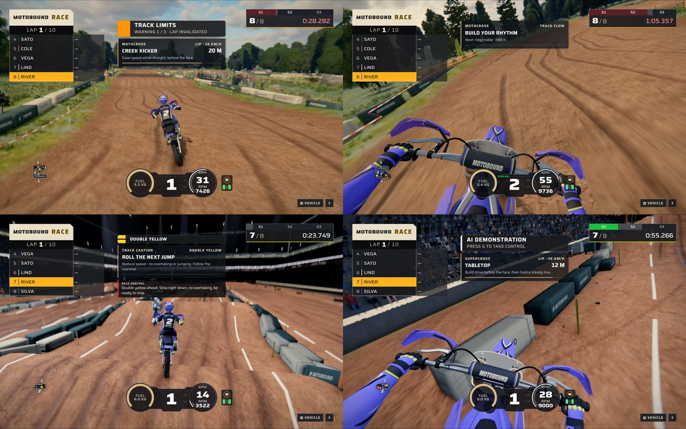

The focused review passed 914 tests and built 984 modules. Blender reproduced the committed runtime meshes byte-for-byte. A separate Blender process reopened the editable rider-and-pad scene and compared the geometry with the shipped mesh data. Chromium/Mesa passed all 28 motorcycle, world and trackside checks. [Build and tests](https://github.com/cheshmakzanoon-ops/Experiment-3/actions/runs/44846364119/job/136666951647) · [Blender asset verification](https://github.com/cheshmakzanoon-ops/Experiment-3/actions/runs/44846364119/job/136666951969) · [Browser model checks](https://github.com/cheshmakzanoon-ops/Experiment-3/actions/runs/44839293785/job/136645607411)

On the starting-grid revision, the terrain suite passed eight of nine checks on two runners. Both courses retained photographed soil, reversible wetness, lit jump shadows, normal-map detail, continuous lighting at worn chunk edges and reversible tyre prints. The worked-soil comparison exceeded its five-minute deadline on both runs. All nine checks had passed on the preceding build. [First terrain run](https://github.com/cheshmakzanoon-ops/Experiment-3/actions/runs/44828850102/job/136610511671) · [Repeat at the same commit](https://github.com/cheshmakzanoon-ops/Experiment-3/actions/runs/44828850102/job/136627499025) · [Preceding terrain run](https://github.com/cheshmakzanoon-ops/Experiment-3/actions/runs/44823270234/job/136594005716)

On the soil revision, nine of ten terrain checks passed, including the paired shader comparison. The 1120 × 700 worked-soil case reached its five-minute deadline with both venues' 20 evidence attachments present. Its six frames per view were each encoded as a PNG even though the report attaches three. The review now draws and reads all 36 frames, hashes each independently, and encodes the 18 PNGs that the report attaches. The evidence includes each prepared, wet and temporarily unweighted view. [Full-size test and attachments](https://github.com/cheshmakzanoon-ops/Experiment-3/actions/runs/44839293785/job/136645607385) · [Readback and export change](https://github.com/cheshmakzanoon-ops/Experiment-3/commit/4aab278249c10e836a35bf1f308a1c491c11822b)

Two independent Mesa runs completed the 36 full-size soil frames in 4.6 and 4.7 minutes under the original five-minute limit. Both also reproduced every pixel in the six 640 × 400 shader comparisons. On the first repeat the paired warm times were 25.743 s with the skips and 25.652 s with exhaustive shading. The timing difference changed direction between runs. The second archive contains 18 verified 1120 × 700 PNGs and a complete HTML report. [First full-size result](https://github.com/cheshmakzanoon-ops/Experiment-3/actions/runs/44849637734/job/136677661744) · [Repeat and image check](https://github.com/cheshmakzanoon-ops/Experiment-3/actions/runs/44850627245/job/136680871457) · [Download the 18 soil photographs](https://github.com/cheshmakzanoon-ops/Experiment-3/actions/runs/44850627245/artifacts/14685417908)

These four terrain-only views show the production soil layers under constant daylight. The upper pair looks across the Valley Ridge berm. The lower pair looks across an Arena Nord jump. Each left frame shows prepared dirt and each right frame shows the same camera at 72% wetness.

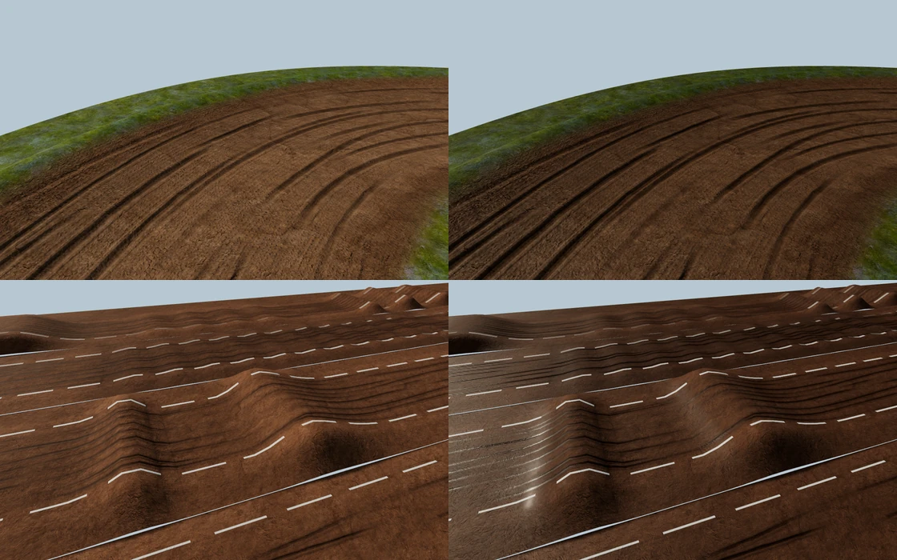

The normal motocross pause menu now holds the last race image while the outstanding GPU fence finishes. Resizing the viewport or choosing a different paused camera permits a fresh draw. The race test waits for the fence belonging to the requested rider pose or camera, checks actual image contrast, and samples the painted Resume button on pause. The archived flat Medium image fails this check. [Pause and capture changes](https://github.com/cheshmakzanoon-ops/Experiment-3/commit/39528f8afbeda9162905d0a65f38d50cb638ddac) · [Archived Medium trace](https://github.com/cheshmakzanoon-ops/Experiment-3/actions/runs/44839293785/artifacts/14682344380)

On `7a6bdb0`, Medium produced the four outdoor photographs below. From upper left to lower right they show the rearward weight input at the gate, riding in chase, the cockpit in motion, and the painted pause panel over that cockpit. The worker held its tick on pause, but the submitted-frame count moved from 17 to 18. The Escape handler had cleared the identity of the driving image. Commit `16d2888` retains that identity when pausing a dirt race with Escape, a loss of focus, or controller disconnection. At Ultra, the renderer submitted the rearward pose with rider weight −1, but its GPU fence was still pending at the 45-second image deadline. The default Mesa backend was still processing its first moving frame after 51.2 seconds. The same build completed all 29 native motorcycle and trackside cases and all 11 course cases. [Medium race and trace](https://github.com/cheshmakzanoon-ops/Experiment-3/actions/runs/44855322497/job/136698548479) · [Input fix](https://github.com/cheshmakzanoon-ops/Experiment-3/commit/16d28885295c1f21fbaa3c2b8ffcdc5935619723) · [Ultra](https://github.com/cheshmakzanoon-ops/Experiment-3/actions/runs/44855322497/job/136698548488) · [Default Mesa](https://github.com/cheshmakzanoon-ops/Experiment-3/actions/runs/44855322497/job/136698548453) · [Models](https://github.com/cheshmakzanoon-ops/Experiment-3/actions/runs/44855322497/job/136698548521) · [Courses](https://github.com/cheshmakzanoon-ops/Experiment-3/actions/runs/44855322497/job/136698548438)

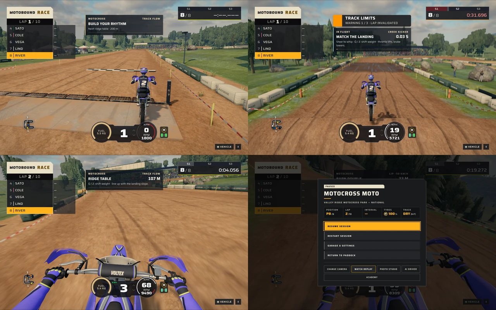

On `e970788`, the 1280 × 800 Low Valley Ridge test released the MX450 from an eight-rider gate. It recorded both rider-weight inputs, 276.39 m of progress, 1.11 s of airtime and the landing. Escape held worker tick 14,708. The last cockpit image remained on screen as the outstanding GPU draw finished, with 17 presentation frames and 15 submissions throughout the pause. The painted Resume button passed the image check. Chromium closed during the subsequent return to the paddock. A separate solo MX450 check on `082bf10` held tick 1,885 at 12 frames and ten submissions. The smaller two-venue eight-rider run on `585f268` completed both returns at an 800 × 500 viewport. [Two-venue controls and captures](../motocross-evidence/reference-upgrade-2026-11-20/player-race-cameras.json) · [Pause input handling](https://github.com/cheshmakzanoon-ops/Experiment-3/commit/16d28885295c1f21fbaa3c2b8ffcdc5935619723)

### Two-course riding and pause

These six photographs come from one production session on `e970788`. The player entered both eight-rider races through the paddock, using the saved Low preset at its standard 0.75 render scale. The 3D scene measured 960 × 600 inside the 1280 × 800 viewport. The MX450 at Valley Ridge is above the MX250 at Arena Nord. Each row shows riding in chase, the cockpit and the pause menu over that cockpit.

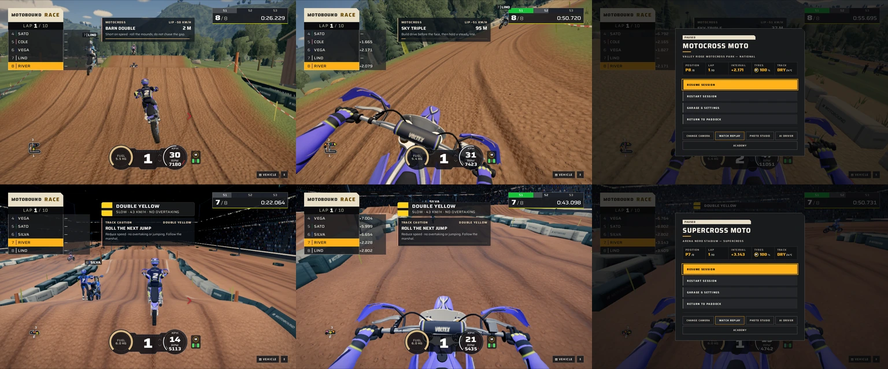

The rider used the keyboard for forward and rearward weight and for throttle before enabling assisted riding. The outdoor race recorded 231.37 m of progress and 0.496 s of flight. The stadium recorded 149.00 m and 0.454 s. Both recorded tyre touchdown and held the same worker tick and presentation-frame count through pause. Both returned to the selected bike in the paddock. The complete check took 366.3 seconds on SwiftShader. A separate fresh-profile attempt to switch graphics presets crashed in the settings form before entering the stadium. [Controls, landings, pause ticks and image signatures](eight-rider-camera-check.json)

The full production build at `e970788` processed 1,004 modules. All 950 focused assertions passed across 98 files in four single-worker groups. On hosted `10a6735`, all 944 focused tests passed and the 1,004-module production build completed. Blender reproduced the 682,972-byte motocross kit and reopened the editable scene. [Production source](https://github.com/cheshmakzanoon-ops/Experiment-3/commit/e9707881168a8e2585c8ed0dcc53c7d87f0ba576) · [Native mesh rebuild](https://github.com/cheshmakzanoon-ops/Experiment-3/actions/runs/44861382041/job/136715989275) · [Hosted build and tests](https://github.com/cheshmakzanoon-ops/Experiment-3/actions/runs/44861382041/job/136716038634)

On `164e28c`, SwiftShader completed both circuits on Low, Medium and High. Ultra lost its graphics context before it could present the outdoor cockpit. The default Mesa run again reached its first rearward-input deadline. Nine of ten terrain cases passed in the combined 31.7-minute suite, with the full-size soil case exceeding five minutes. The dedicated two-course result above remains reproducible on its own runner. On `7a6bdb0`, which includes the stricter image check, the production build processed 1,001 modules and all 931 focused tests passed. [Low](https://github.com/cheshmakzanoon-ops/Experiment-3/actions/runs/44850974032/job/136684421685) · [Medium](https://github.com/cheshmakzanoon-ops/Experiment-3/actions/runs/44850974032/job/136684421755) · [High](https://github.com/cheshmakzanoon-ops/Experiment-3/actions/runs/44850974032/job/136684421650) · [Ultra trace](https://github.com/cheshmakzanoon-ops/Experiment-3/actions/runs/44850974032/artifacts/14686421300) · [Default Mesa](https://github.com/cheshmakzanoon-ops/Experiment-3/actions/runs/44850974032/job/136684421655) · [Combined terrain suite](https://github.com/cheshmakzanoon-ops/Experiment-3/actions/runs/44850974032/job/136684421892) · [Production build and focused tests](https://github.com/cheshmakzanoon-ops/Experiment-3/actions/runs/44855322497/job/136696195047)

The recorded 40-second run per bike covered 720 rider poses across the three machines. The largest boot-to-peg gap in 1,406 planted-boot observations was 1.472 mm. All 129 backwards seeks restored both hand and boot transforms exactly. In the eight-rider 120 Hz CPU benchmark, the 95th-percentile physics step took 2.720 ms at Valley Ridge and 4.995 ms at Arena Nord. At the 99th percentile, the two courses took 7.031 and 13.208 ms against an 8.333 ms step budget. [Recorded poses and physics timings](../motocross-evidence/race-presentation-2026-11-20/race-checks.json)

The WebGL gallery includes matched views of all three machines, rider motion, soil marks, and full-resolution High race captures. Sustained frame pacing and end-to-end input latency still require measurements on physical graphics hardware. [Race and model gallery](../motocross-evidence/race-presentation-2026-11-20/README.md)

## Earlier track and rider captures


These High screenshots come from production races entered through the paddock at `1a5fb40`. The player accelerated and shifted weight in both directions before enabling the race AI. The outdoor run covered 282 m and recorded 1.10 s of flight. The stadium run covered 187 m and recorded 0.79 s. Both sessions paused and returned to the paddock after the chase and onboard captures.


The Valley Ridge onboard frame above captured a spectator terrace extending over the approach to the last turn. The corrected layout at `282d233` moves that 64 m terrace 30 m along the straight. A quarter-metre survey found 15.75 m of rideable dirt under the earlier terrace and zero after the move. An independent half-metre survey of all three roofs and footings measured a minimum of 4.65 m beyond the physical track boundary. The venue still has 154 m of spectator terraces.

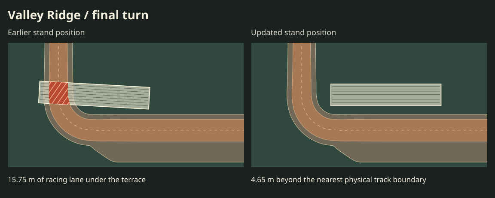

The comparisons below use the production Three.js geometry on a neutral floor. Each pair uses the same pose, camera, lighting and scale. The earlier images come from main at `7423a49`.

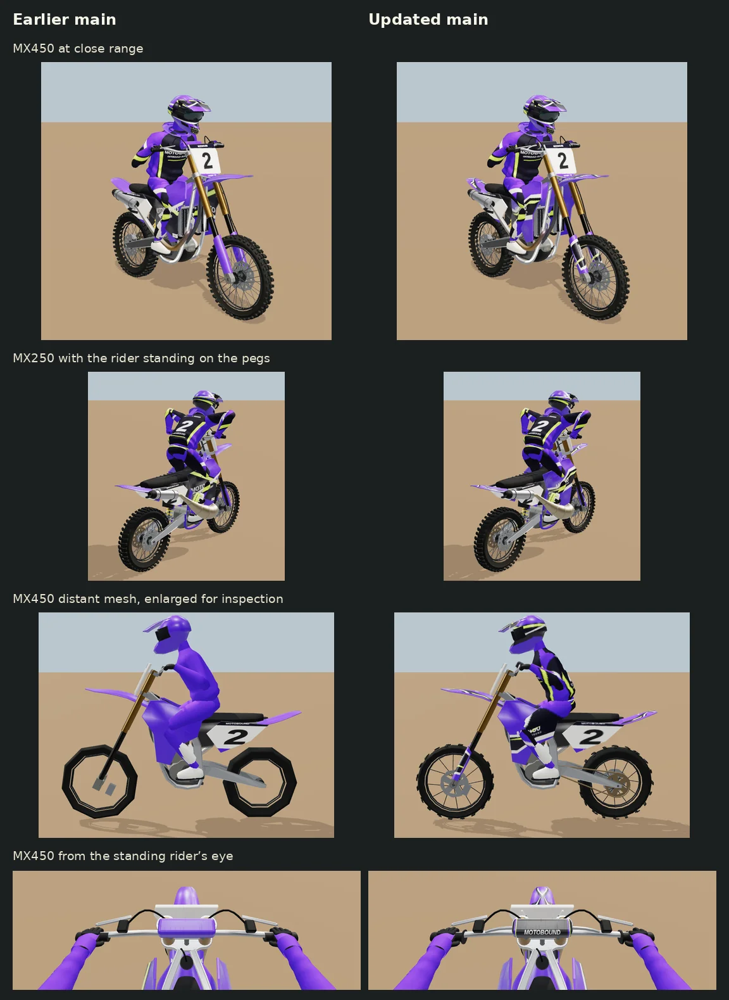

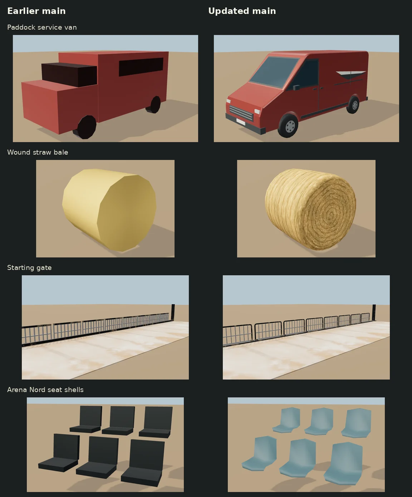

This MX450 jump was recorded at 120 Hz on Valley Ridge. The inspection camera follows the production bike and rider over the sampled takeoff and landing terrain. The animation plays 42 frames at 24 fps.


## Bike and track checks

- The front brake lever moves with the two braking fingers. The right boot operates the rear pedal and pushrod independently of the handlebar lever. Both brake discs read their own recorded temperature. Changing the camera or seeking back in a replay restores the control positions.
- Four laps supplied 349 riding poses across both bikes and venues. Ray tests sampled both boots in chase and onboard poses at all three mesh detail levels. All 4,188 rays hit the skinned sole. Its largest offset from the requested peg or extended-foot position was 3.01 mm.
- The same jump recording was played at 30, 60, 120, 144 and 240 Hz on each bike and venue. Ten bike and rider joint transforms were compared at common display times and between snapshot times while the camera switched through all three detail levels. All 6,080 comparisons produced identical world matrices.
- Terrain contact now accounts for the sideways component of a banked landing. The two-venue jump calibration passed all 20 approach-speed cases. The off-road scenario suite completed all six race cases on these two venues at 120 Hz, including changeable weather in the second Valley Ridge moto and the six-lap Arena Nord main.
- Each safety pad is fitted to the soil under its four corners. The 90th-percentile difference in corner clearance fell from 14.9 to 1.4 cm across 736 Valley Ridge pads and from 50.8 to 8.7 cm across 482 Arena Nord pads.
- Two instanced meshes carry the moving gate leaves. The anchors, shaft and slab bring the entire gate to five structural meshes. The outdoor fabric retains its pinned edges in the colour and shadow passes. The stadium uses seated spectator meshes on High and Ultra and camera-facing crowd images on Low and Medium.
- Each race marshal stands beside an approved platform with both feet fitted to the terrain. Officials show the local caution or passing flag recorded near their post. Clear running leaves the flag lowered. Crowd density changes preserve the officials.

At the starting gate, the race worker holds at tick zero until the first unobscured driving HUD and circuit frame complete and the browser has had a paint opportunity. In the Low production journey, all eleven observations across the two starts were still at tick zero before release. The riders then covered 242 m outdoors and 147 m in the stadium.

A separate four-lap stress test drove the player’s tyre solver with the game’s AI controls. The MX450 fell twice outdoors near the same turn. In the final samples before those falls it was 7.8 m from the centre of a 5 m half-width lane and leaned 69–72 degrees. The MX250 fell once after a flat landing. Both completed Arena Nord without a fall. The MX250 needed three marshal recoveries there.

Cycling both bikes through all three detail levels exposed duplicate mud shader declarations on 12 materials during development. All 156 tested materials now emit a single mud layer alongside the weather shader.

## Starting-grid model allocations

The grid contains four MX250s and four MX450s, all at near-camera distance. The paused loader prepares the other camera distances and registers their materials before racing begins. The 16 unused models stay outside the active scene. Riders share byte-identical vertex data within a bike class and detail level. Identical rigid parts also share a GPU mesh. Each rider owns its moving suspension, skinned geometry, skeleton, instance transforms and material controls.

| Eight-rider gate | Earlier main | Updated main |
| --- | ---: | ---: |
| Rider models prepared across the three detail levels | 24 | 24 |
| Rider models attached to the scene | 24 | 8 |
| Rider models drawn | 8 | 8 |
| Distinct geometry objects attached to the scene | 1,600 | 286 |
| Vertex, index and morph buffers across all prepared models | 106.17 MiB | 27.69 MiB |
| Base texture images across all prepared models | 112.13 MiB | 79.75 MiB |
| Base texture images on scene-attached models | 112.13 MiB | 61.56 MiB |

The figures count distinct CPU backing buffers and four-channel base image dimensions before GPU upload and mipmapping. The geometry totals include clothing morph targets. An independent WebGL test uploaded 86 geometries for one visible MX450 and 105 for two. Removing its rival preserved every pixel of the surviving rider. Removing both reduced the renderer’s geometry count to zero.

A separate CPU probe moved the eight bikes out to distances of up to 250 m in one camera cut. It used the production pose, weather, atmosphere, reflection and texture-registration paths with a canvas stub and no graphics submission. In three runs, building fresh detail on that cut at `32865ee` took 373–498 ms. Preparing the field during loading reduced the same presentation update to 0.78–1.33 ms. The additional preparation took 1.07–1.11 s on this machine.

## Reproduce

With the dependencies installed and Chromium available to Playwright, run the model and venue checks from the repository root.

```sh
npm run build
npx vite-node --script scripts/bench/motocross-field.ts
npx vite-node --script scripts/bench/motocross-field.ts --cadence
npx playwright test -c playwright.motocross.config.ts e2e/42-motocross-bike.spec.ts e2e/43-motocross-world.spec.ts e2e/47-motocross-trackside-models.spec.ts e2e/51-motocross-roost-lighting.spec.ts
APEX_MOTOCROSS_JOURNEY_QUALITY=high npx playwright test -c playwright.motocross.config.ts e2e/45-motocross-gameplay.spec.ts
APEX_MOTOCROSS_JOURNEY_QUALITY=low npx playwright test -c playwright.motocross.config.ts e2e/45-motocross-gameplay.spec.ts
npm run test:offroad
node --experimental-transform-types scripts/motocross-feel-probe.ts
```

The focused GitHub workflow runs the two-venue journey through the Low, Medium, High and Ultra settings and retains the full-resolution shots from each preset. Its separate headed Mesa run captures the actual X11 viewport, calibrated at both corners before opening the game. It also retains the rendered model, lighting and terrain checks.

The WebGL2 model inspections ran on Chromium with SwiftShader and Mesa llvmpipe. Both adapters passed the two-rider GPU lifetime test. The terrain checks covered six states in both camera views on both venues. On Mesa, 22 of 23 browser checks passed in one run. The Arena Nord terrain check timed out there and passed on its own in 3.1 minutes, with the same 472 geometries, 428 textures and 62 shader programs throughout.

For a physical desktop GPU, the existing benchmark records the adapter, frame pacing and driving stalls with `npm run bench:gpu -- --journeys motocross --qualities low,medium,high`. Console performance and competitive input latency still require measurements on the target hardware.
