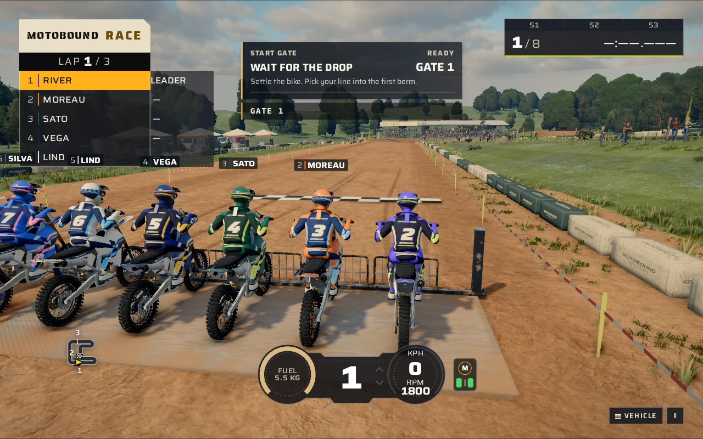
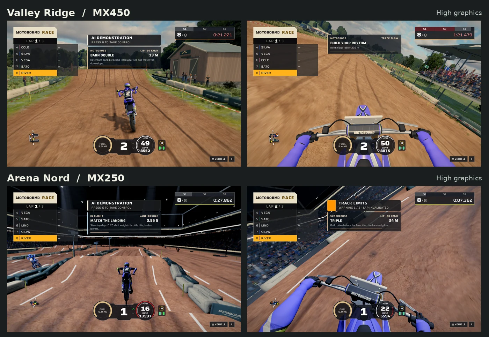
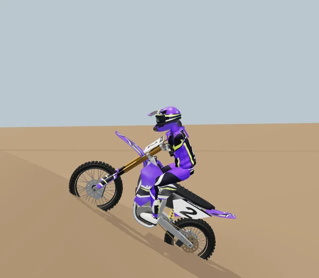

# Motocross race review

Valley Ridge and Arena Nord use the same articulated MX250 and MX450 models in racing, onboard views and replay. The SM450 supermoto shares the motocross frame and rider controls and uses its own road wheels.



These High screenshots come from production races entered through the paddock at `1a5fb40`. The player accelerated and shifted weight in both directions before enabling the race AI. The outdoor run covered 282 m and recorded 1.10 s of flight. The stadium run covered 187 m and recorded 0.79 s. Both sessions paused and returned to the paddock after the chase and onboard captures.



The comparisons below use the production Three.js geometry on a neutral floor. Each pair uses the same pose, camera, lighting and scale. The earlier images come from main at `7423a49`.


This MX450 jump was recorded at 120 Hz on Valley Ridge. The inspection camera follows the production bike and rider over the sampled takeoff and landing terrain. The animation plays 42 frames at 24 fps.



## Bike and track checks

- The front brake lever moves with the two braking fingers. The right boot operates the rear pedal and pushrod independently of the handlebar lever. Both brake discs read their own recorded temperature. Changing the camera or seeking back in a replay restores the control positions.
- Four laps supplied 349 riding poses across both bikes and venues. Ray tests sampled both boots in chase and onboard poses at all three mesh detail levels. All 4,188 rays hit the skinned sole. Its largest offset from the requested peg or extended-foot position was 3.01 mm.
- The same jump recording was played at 30, 60, 120, 144 and 240 Hz on each bike and venue. Ten bike and rider joint transforms were compared at common display times and between snapshot times while the camera switched through all three detail levels. All 6,080 comparisons produced identical world matrices.
- Terrain contact now accounts for the sideways component of a banked landing. The two-venue jump calibration passed all 20 approach-speed cases. The off-road scenario suite completed all six race cases on these two venues at 120 Hz, including changeable weather in the second Valley Ridge moto and the six-lap Arena Nord main.
- Each safety pad is fitted to the soil under its four corners. The 90th-percentile difference in corner clearance fell from 14.9 to 1.4 cm across 736 Valley Ridge pads and from 50.8 to 8.7 cm across 482 Arena Nord pads.
- Two instanced meshes carry the moving gate leaves. The anchors, shaft and slab bring the entire gate to five structural meshes. The outdoor fabric retains its pinned edges in the colour and shadow passes. The stadium uses seated spectator meshes on High and Ultra and camera-facing crowd images on Low and Medium.
- Each race marshal stands beside an approved platform with both feet fitted to the terrain. Officials show the local caution or passing flag recorded near their post. Clear running leaves the flag lowered. Crowd density changes preserve the officials.

A separate four-lap stress test drove the player’s tyre solver with the game’s AI controls. The MX450 fell twice outdoors near the same turn. In the final samples before those falls it was 7.8 m from the centre of a 5 m half-width lane and leaned 69–72 degrees. The MX250 fell once after a flat landing. Both completed Arena Nord without a fall. The MX250 needed three marshal recoveries there.

Cycling both bikes through all three detail levels exposed duplicate mud shader declarations on 12 materials during development. All 156 tested materials now emit a single mud layer alongside the weather shader.

## Starting-grid model allocations

The grid contains four MX250s and four MX450s, all at near-camera distance. The paused loader prepares the other camera distances and registers their materials before racing begins. The 16 unused models stay outside the active scene. Riders share byte-identical vertex data within a bike class and detail level. Identical rigid parts also share a GPU mesh. Each rider owns its moving suspension, skinned geometry, skeleton, instance transforms and material controls.

| Eight-rider gate | Earlier main | Updated main |
| --- | ---: | ---: |
| Rider models prepared across the three detail levels | 24 | 24 |
| Rider models attached to the scene | 24 | 8 |
| Rider models drawn | 8 | 8 |
| Distinct geometry objects attached to the scene | 1,600 | 286 |
| Vertex, index and morph buffers across all prepared models | 106.17 MiB | 27.69 MiB |
| Base texture images across all prepared models | 112.13 MiB | 79.75 MiB |
| Base texture images on scene-attached models | 112.13 MiB | 61.56 MiB |

The figures count distinct CPU backing buffers and four-channel base image dimensions before GPU upload and mipmapping. The geometry totals include clothing morph targets. An independent WebGL test uploaded 86 geometries for one visible MX450 and 105 for two. Removing its rival preserved every pixel of the surviving rider. Removing both reduced the renderer’s geometry count to zero.

A separate CPU probe moved the eight bikes out to distances of up to 250 m in one camera cut. It used the production pose, weather, atmosphere, reflection and texture-registration paths with a canvas stub and no graphics submission. In three runs, building fresh detail on that cut at `32865ee` took 373–498 ms. Preparing the field during loading reduced the same presentation update to 0.78–1.33 ms. The additional preparation took 1.07–1.11 s on this machine.

## Reproduce

With the dependencies installed and Chromium available to Playwright, run the model and venue checks from the repository root.

```sh
npm run build
npx vite-node --script scripts/bench/motocross-field.ts
npx vite-node --script scripts/bench/motocross-field.ts --cadence
npx playwright test -c playwright.motocross.config.ts e2e/42-motocross-bike.spec.ts e2e/43-motocross-world.spec.ts e2e/47-motocross-trackside-models.spec.ts e2e/51-motocross-roost-lighting.spec.ts
APEX_MOTOCROSS_JOURNEY_QUALITY=high npx playwright test -c playwright.motocross.config.ts e2e/45-motocross-gameplay.spec.ts
APEX_MOTOCROSS_JOURNEY_QUALITY=low npx playwright test -c playwright.motocross.config.ts e2e/45-motocross-gameplay.spec.ts
npm run test:offroad
node --experimental-transform-types scripts/motocross-feel-probe.ts
```

The WebGL2 model inspections ran on Chromium with SwiftShader and Mesa llvmpipe. Both adapters passed the two-rider GPU lifetime test. The terrain checks covered six states in both camera views on both venues. On Mesa, 22 of 23 browser checks passed in one run. The Arena Nord terrain check timed out there and passed on its own in 3.1 minutes, with the same 472 geometries, 428 textures and 62 shader programs throughout.

For a physical desktop GPU, the existing benchmark records the adapter, frame pacing and driving stalls with `npm run bench:gpu -- --journeys motocross --qualities low,medium,high`. Console performance and competitive input latency still require measurements on the target hardware.
