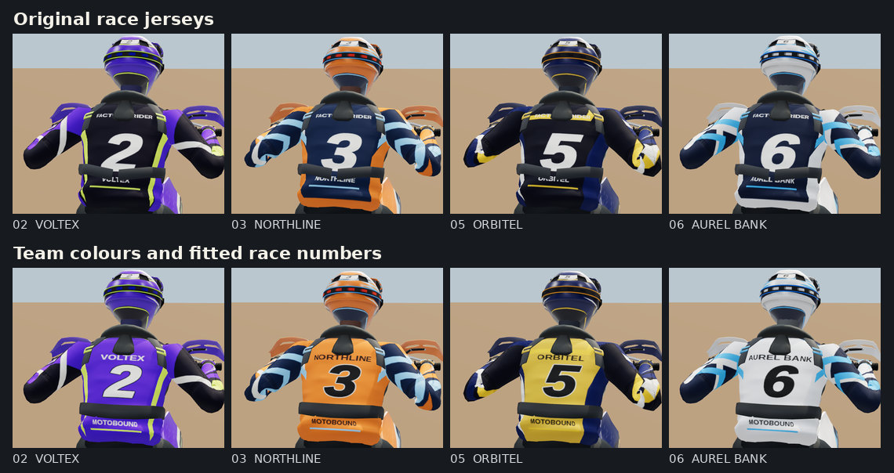
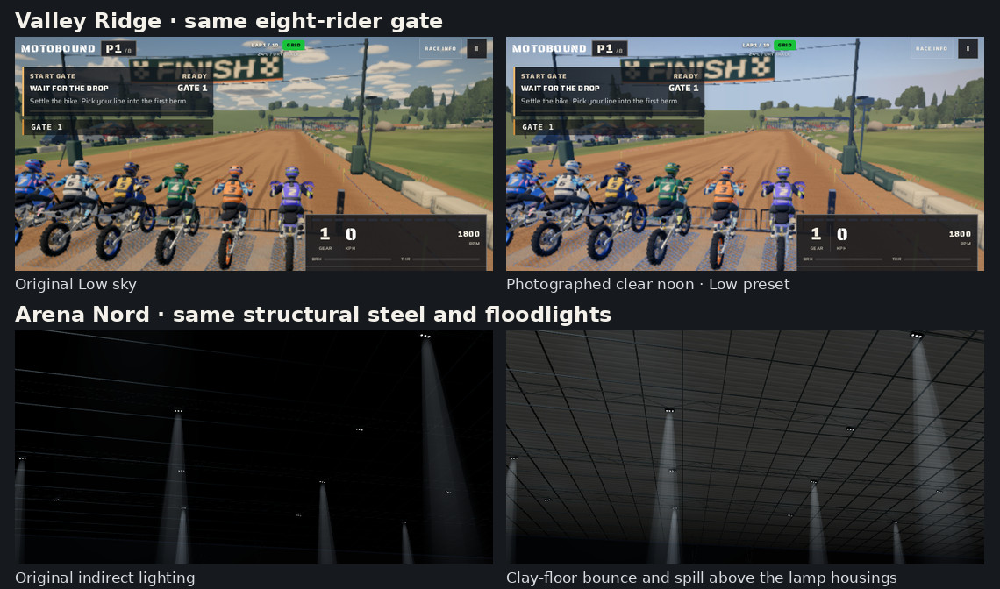
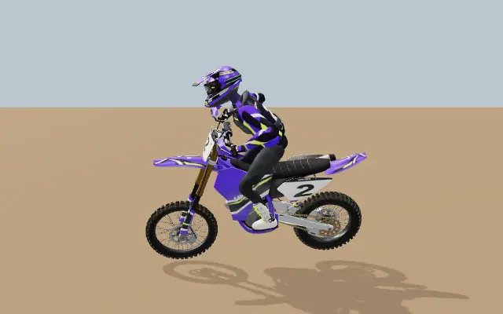

# Valley Ridge and Arena Nord motocross review

The outdoor motocross and indoor supercross modes use the same dirt that the player and rival tyres sample. This pass gives each authored berm two banked lines, a compressed bed and an outer lip. Live rut depth and packing blend under the width of each tyre, including across the lap seam. The chassis contact shadow rests on the local slope or the metal starting pad and fades as the bike clears the ground.


The front and rear brake carriers have open arms, staggered cooling slots and a visibly swept pad track. Both rear suspensions have a working rocker and pull rods. The hydraulic hose flexes with the swingarm. The two-stroke MX250 also emits a short exhaust trail from the silencer. A fitted lens reveals the MX450 rider's eyes, the knee guard follows the bend of the leg, and the rider loads the outside peg through a supported turn.



Each pair uses the same Mid-detail model, camera and starting pose. The violet, orange, yellow and white jerseys carry contrasting numbers between the neck brace and the shaped kidney belt. The band wraps around the lower back and fastens at the front quarter. On the former kit, the belt hid eight of 88 sampled points on number 2 and four of 89 on number 3. Five WebGL captures of the refit covered all three detail levels. All 291 sampled points on the printed numbers were visible.


Valley Ridge gained continuous berm banners, worn crew areas and service tracks in the pasture. Arena Nord's LED displays keep their brightness across small camera movements. The seating, trackside fixtures and replay camera sites share a boundary measured from the full rideable run-off. At the previously intersecting rider position, the inner stadium wall is now 6.41 m away. The nearest chair vertex is 6.77 m away across all 18,408 installed seats.



At Valley Ridge the clear race uses a photographed noon sky. Clouds build through a rural panorama as the weather changes, and rain brings in a lower deck. The same sky lights bike reflections. The Low preset decodes a 1024 × 512 sky, Medium uses 2048 × 1024, and High and Ultra use 4096 × 2048. The venue keeps its own wooded skyline. References 035 and 042 guided the outdoor daylight, and references 010 and 038 guided the indoor contrast.

In Arena Nord the floodlit clay reflects warm light onto the underside of the ribbed steel deck. Cooler spill falls on the steel immediately above each lamp bank. In the matched structural view, the median Rec. 709 luma of the upper 60% of the image rose from 0 to 46 on an eight-bit scale. Both views submitted seven draw calls and 71,344 triangles.

## Recorded riding motion



The side view replays three seconds of a Valley Ridge MX250 run, sampled at 20 Hz from the 120 Hz simulation. It covers course stations 527–565 m. The studio camera follows the bike and the inspection floor represents the local ground height. The recording supplies the chassis pitch and clearance, axle travel, wheel rotation, throttle, steering and rider pose. Twenty-six of the 60 samples are airborne.

## Checks

| Check | Observation |
| --- | --- |
| Riding, graphics and adjacent regression suites | 1,008 tests passed across 100 files. |
| Three-bike jump calibration | All 20 jump runs landed within their acceptance bands. |
| Off-road event regression | All 11 race scenarios passed, including the wet outdoor moto and enclosed supercross. |
| Six-lap replay | Three seeds × two weather conditions × two venues, each run twice with eight riders. All 192 rider entries finished. Each pair matched on finish tick, the sampled riding trace and final terrain. |
| Tick-timed player controls | Both venues ran the same 24 seconds of throttle, steering, body and brake inputs with seven constant worker wake rates from 24 to 240 Hz and one irregular schedule. All 360 sampled snapshots and the final dirt field matched for each venue. |
| Ridden Sport handling | The actual player contact and flight solver completed two laps of each venue with the course planner supplying ground controls. Both runs met the existing zero-fall and under-one-second stall criteria. |
| Normal race entry | The Low preset reached the eight-rider gate at both venues. Ordinary player throttle put the followed bike above 3 m/s, the camera changed on screen, and the race paused. |
| High-detail WebGL inspection | The complete MX250 model contained 139,983 triangles and the MX450 contained 138,343. Both brake close-ups reported zero WebGL errors. Returning to the initial front-wheel angle restored the initial pixel hash. |
| Weather and reflections | On Low, Medium and High, the real HDR loader and reflection renderer drew clear, half-blended and rainy skies. Returning to clear restored the exact initial pixels at every preset. |
| Dirt-grid materials | The eight-rider grid avoids 56 unused road fairing and number-plate textures, with 11 MiB of uncompressed base-level image data. The dirt bikes retain their own printed plates and the tyre, saddle and metal surfaces they draw. |
| Outdoor wet-ground replay | Both riding and venue cameras restored the exact dry image after rewind. Holding the wet state produced the same wet image twice. The 1280 × 800 renders kept stable geometry, texture and shader-program counts. |

During 120 racing seconds per venue on a shared Intel Xeon Platinum 8573C, 95% of physics steps took at most 1.50 ms outdoors and 1.43 ms indoors. This CPU measurement covers the eight-rider simulation. The browser's render loop and display latency need separate measurements. [Timing samples](physics-step-timing.json)

The gate images are from the ordinary race menu at Low quality. The model and soil inspections use High detail in controlled lighting. Browser rendering used Chromium and SwiftShader. A PS5 or comparable physical GPU still needs a frame-time and visual comparison before assigning a console performance rating.

[Jump calibration](../../offroad-calibration.json) · [Race reports](../../offroad-races.json) · [Six-lap traces](six-lap-verification.json)

Run `npm run test:offroad` for the project's calibration and race checks. Run the following command from the repository root to replay one pair and compare it with the included receipt. Omit the three arguments to replay all 12 pairs.

```sh
node --experimental-transform-types docs/production/motocross-racecraft-20261123/check-replay.mjs 61343 clear arena-nord-sx
```
