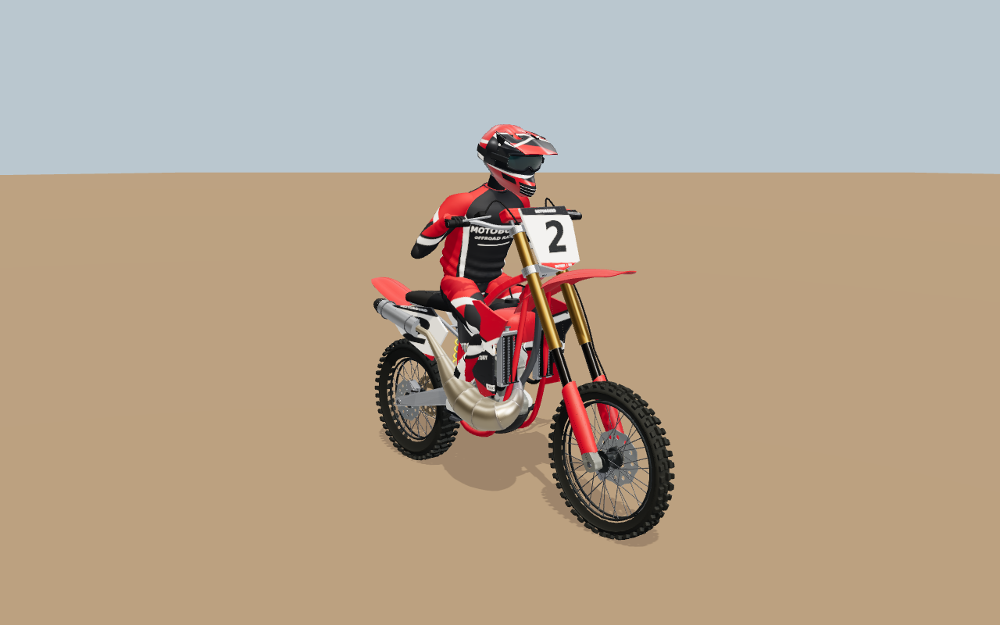
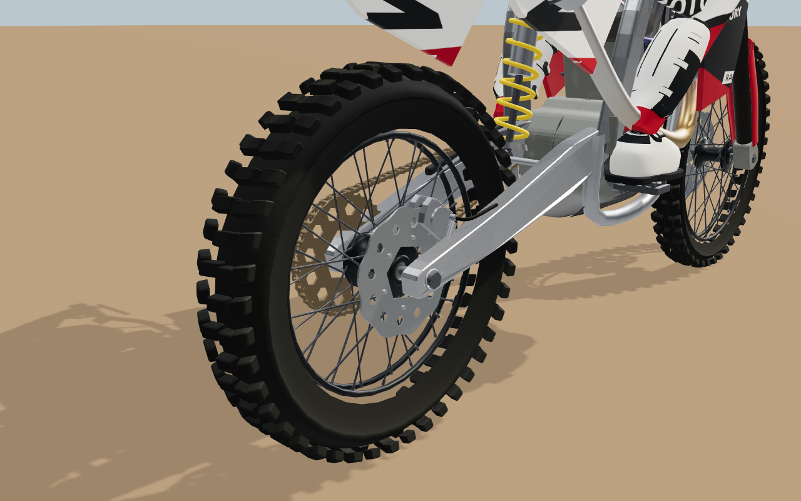
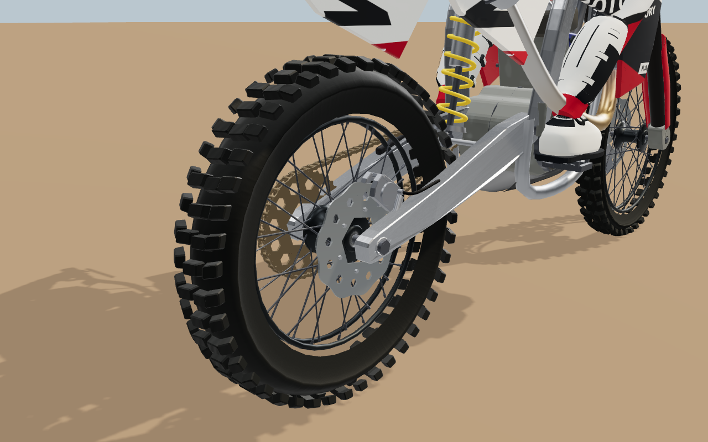
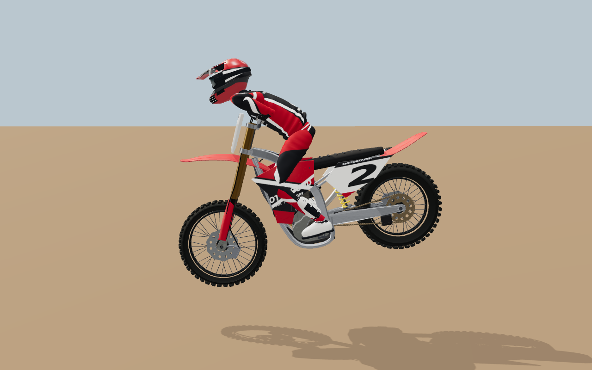
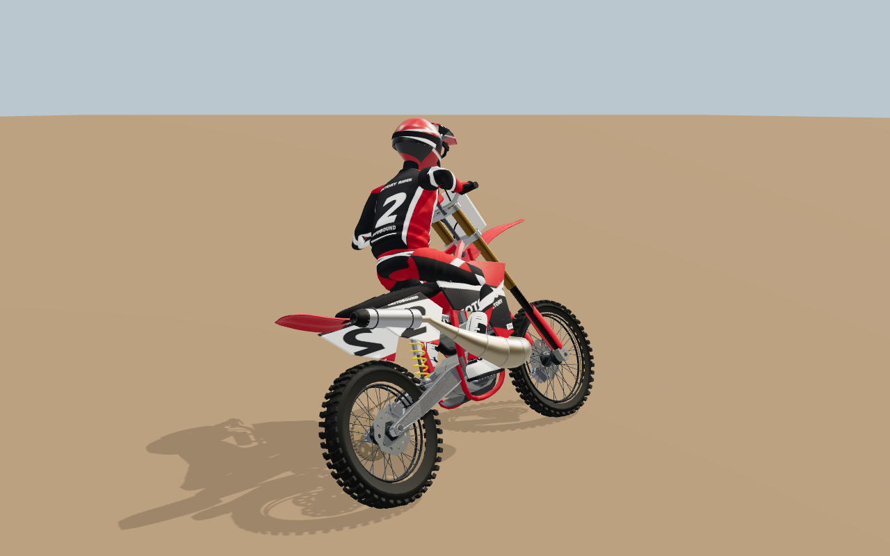
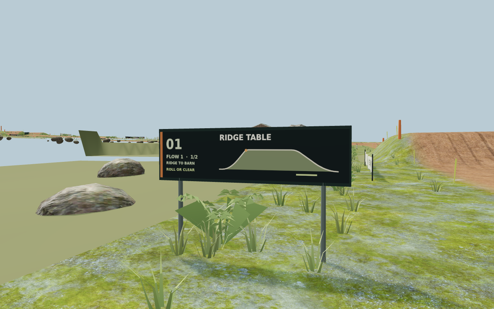
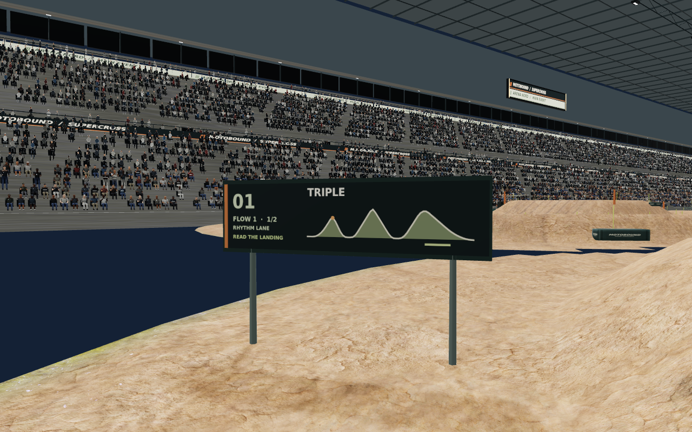
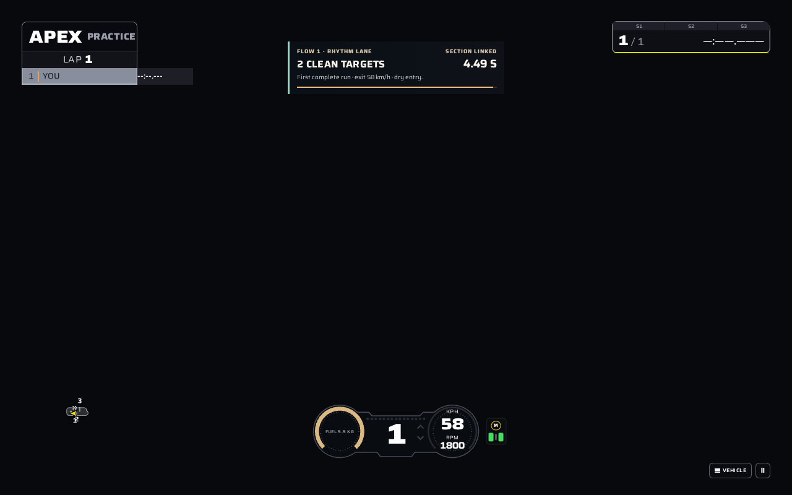
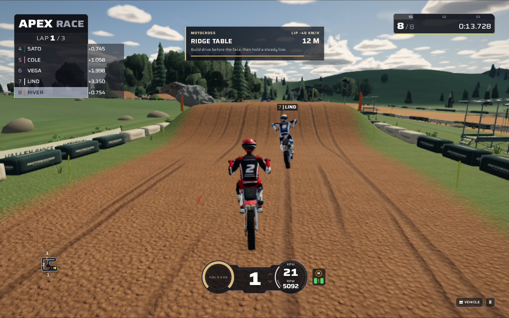
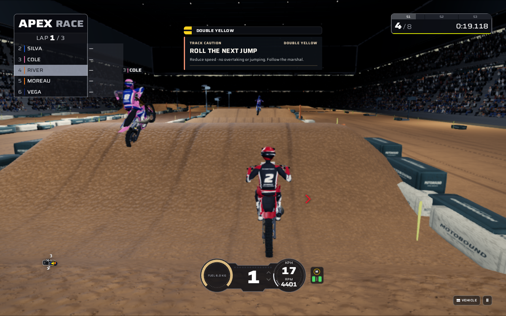

# Motocross: articulated riders, tyre finish and linked track sections

This pass improves the procedural MX250 and MX450, makes the rider's upper body respond more naturally to standing, compression and cornering, and adds four repeatable linked-section challenges to the existing outdoor and stadium courses. All new presentation is Three.js geometry, skinning and material code. No new model downloads, runtime dependencies or reference-image textures are required.

The existing implementation already supplied detailed engines, radiators, suspension, chain motion, glove/boot contact, scanned soil, braking bumps, individual landing targets and course landmarks. This update builds on that work; those systems are not claimed as new here.

## Bikes and riders



### Front and rear tyres have different jobs and different surfaces

- Front tread uses narrower longitudinal steering blocks; rear tread uses broader drive blocks. Shallow chevrons and open shoulders improve the silhouette without increasing the triangle count or changing the physical wheel envelope.
- A procedural rubber material distinguishes moulded sidewalls, tread crowns, block roots and scuffed faces. Small normal and roughness variations fade with distance.
- Front and rear wear and water are sampled independently from the existing recorded state. Wet rubber darkens and changes roughness, and the existing mud overlay still renders above it.
- Tyre carcass and tread now share compatible vertex attributes, allowing one rigid material batch per wheel. There are no additional tyre textures or per-frame geometry uploads.
- Repeated and reversed state sequences produce the same image on the same model instance; the shader does not accumulate its own wetness or wear history.

| Recorded dry state | Recorded worn/wet state |
| --- | --- |
|  |  |

### The jersey bends between the hips and shoulders

The motocross rider now has pelvis, lumbar and chest frames. The existing jersey vertices blend between them, while the trouser waist stays with the pelvis. Standing and landing compression produce a distributed bend above the hips, and cornering adds bounded twist and side bend. Shoulder attachments follow the chest and the existing limb solver keeps the gloves and soles connected to their controls.

Helmet orientation blends low-speed steering with the direction of the turn at riding speed. This avoids looking out of the corner simply because the bars countersteer. The production bike-to-rider path now forwards speed for this purpose. Recovery resets every spine frame, and direct state evaluation keeps replay and held poses deterministic.

A visual review caught the collar still following the pelvis after the chest had moved. Binding it to the existing upper-body skeleton removed the exposed edge behind the helmet. The collar remains inside the existing first-person visibility boundary.

| Compression and standing | Cornering and countersteer |
| --- | --- |
|  |  |

These angles are authored visual interpretations of the references. They are not motion-capture measurements, and this pass does not add physical forces to the rider or change tyre grip.

## Track gameplay: four linked sections

In **Free practice**, a section begins when the player crosses its entry on the ground. Land each named target in order, remain on course, and carry the run through the exit. The timer includes the connecting corners, rollers and any stops.

| Venue | Section | Required sequence |
| --- | --- | --- |
| Valley Ridge / Outdoor MX | **Ridge to Barn** | Ridge Table → Barn Double |
| Valley Ridge / Outdoor MX | **Sky to Valley** | Sky Triple → Summit Table → Valley Double |
| Arena Nord / Stadium SX | **Rhythm Lane** | Triple → Lane Double |
| Arena Nord / Stadium SX | **Finish Run** | Tabletop → Finish Triple |

The HUD shows the section name and the number of linked targets. A successful run reports its time, exit speed and difference from the previous best. Records are local to the current machine, assistance and session, with separate dry, damp and wet entry categories. They are not persistent career records.

The existing landing judge decides whether each landing is clean. Crashes, cuts, skipped targets, discontinuous movement, AI control and replay cannot earn a section. Rewinding also clears the active traversal's event deduplication, so valid new landings are not suppressed by timestamps from a later run. Caution, crash and immediate jump information retain priority over completion messages.

Trackside profile boards now show the section name, FLOW number and sequence position, while retaining the original jump name, profile and landing cue. The labels reuse the existing atlas, material and board geometry. Course shape, collision geometry and approach speeds remain the existing surveyed values.

| Valley Ridge guide | Arena Nord guide |
| --- | --- |
|  |  |

### Try it

1. Choose **OUTDOOR MX** or **STADIUM SX** in the normal menu.
2. Select **MX250** or **MX450**, then **Free practice**. Sport assistance is a useful starting point for these sections.
3. Follow the named jump boards. Build speed before the face, use the existing standing and weight controls, and aim to settle each landing before the next feature.
4. Complete the section and try another pass to improve the same-session time.



The [mobile result capture](flow-sky-to-valley-mobile-best.png) verifies that the result panel stays clear of the touch controls at 390 pixels wide. Those interface captures use synthetic continuous snapshots; physical feasibility was checked separately below.

## Verification

### Real continuous physics: 8 of 8 cases completed

`scripts/motocross-flow-feasibility.ts` drives the actual simulation and live deformable terrain using a fixed public-input schedule. It initializes the bike once, 12 metres before the first face, then traverses every target, connector and exit without intermediate position, speed or physics writes. Actual simulation snapshots feed the existing landing judge and the new section judge. AI control stays disabled.

| Section | MX250 | MX450 |
| --- | ---: | ---: |
| Ridge to Barn | 16.234 s | 16.140 s |
| Sky to Valley | 19.589 s | 19.710 s |
| Rhythm Lane | 5.850 s | 5.856 s |
| Finish Run | 9.623 s | 9.838 s |

Every case earned all targets in order with **zero crashes, off-course samples or ineligible samples**. This establishes scripted feasibility on fresh dry terrain with Sport assistance. It does not establish human ease, wet/Pro balance or a complete lap from the gate. Exact events and measurements are in [flow-physics-verification.json](flow-physics-verification.json).

Reproduce with:

```sh
node --experimental-transform-types scripts/motocross-flow-feasibility.ts --out report.json
```

### Browser and rendered checks

- **Seven final WebGL tests passed**: both bikes at high/mid/far detail, both onboard views, reversible corner articulation, reversible suspension/lever response, and production course components with the updated boards. The corrected collar is present in these captures.
- **Five earlier WebGL tests passed**, including independent recorded tyre appearance and A/B/B/A replay on the same model. Resource counts remain stable during state changes.
- **One HUD browser test passed across 16 captured states**: all four sections, first and improved times, desktop and 390-pixel layouts. This is a production-interface fixture, not a physical riding test.
- **The complete two-venue application journey passed** through normal controls: menu and machine selection, the held eight-rider gate, body inputs and human throttle, explicitly enabled AI demonstration of progress/flight/touchdown, chase/onboard cameras, pause, return to the paddock and venue switching. It used the production worker and read-only diagnostics, with the visible low-quality setting on SwiftShader.

The whole-application journey ran before the final collar attachment correction and before integrating subsequent concurrent MotoGP and Festival updates. The final rider rendering checks cover the corrected collar. The shared rider code and the combined production build were checked again after integration; their results are recorded in the verification manifest. The [journey data](motocross-production-journey.json) records human input separately from AI-assisted riding; it does not claim a manually ridden race or a hardware FPS benchmark.

| Real Valley Ridge session | Real Arena Nord session |
| --- | --- |
|  |  |

Measured model geometry and draw calls in the production-bike fixture:

| Detail | MX250 triangles | MX450 triangles | Fixture draw calls, either bike |
| --- | ---: | ---: | ---: |
| High | 129,254 | 126,154 | 74 |
| Mid | 63,016 | 61,424 | 69 |
| Far | 11,764 | 11,604 | 45 |

These are component measurements, not complete-scene rendering budgets. The captured contact checks include the real deformed boot sole and glove hold, with the largest observed sole error below 3 mm. Geometry is finite, shader GL errors are zero, and the onboard checks retain controls and clear forward sight. Full measurements are in [render-verification.json](render-verification.json).

### Build and regression results

TypeScript/build, ESLint, content validation and whitespace checks passed. The wider selected regression run had **626 passing tests out of 629**. Its three failures were investigated individually:

| Check | Finding and disposition |
| --- | --- |
| Non-GP rider input isolation | The test classified speed as GP-only. MX gaze now intentionally uses speed. The corrected test holds speed constant while varying the actual GP-only inputs at slow, blended and fast speeds, and preserves separate speed-invariance coverage for ordinary leathers. **22/22 focused rider/spine tests passed afterward.** No production workaround was needed. |
| Cape Wrenna camera golden | Initial commit `81ee98b` and current code produce byte-identical camera records and the same mismatch with the older stored golden. Left unchanged; [baseline evidence](baseline-camera-check.json). |
| Motocross collision setup threshold | Initial commit `81ee98b` and current code both produce a 4.894227 mm correction against a greater-than-5-mm test setup requirement. The two masses straddle this threshold; subsequent velocity checks match the authoritative derivatives. Left unchanged; [baseline evidence](baseline-collision-check.json). |

After integrating the concurrent MotoGP and Festival updates, **48/48 focused tests passed** across the GP/MX spine and gaze, incoming GP garment deformation, motocross tyre finish and linked-section state machine. The combined production build, ESLint and content validation passed again. [integration-unit-verification.json](integration-unit-verification.json) records that final run.

The selected broad suite is therefore **not claimed fully green**. [initial-unit-verification.json](initial-unit-verification.json) preserves the original result and exact failing cases. The [verification manifest](verification.json) links subsequent results and scopes.

## Reference provenance and limits

The existing index contains 100 reference images. All 100 current public URLs were downloaded, fully decoded and reviewed in five contact sheets; 12 images received individual full-resolution inspection. Tyre profiles, body posture, muddy surfaces, track rhythm and advance feature readability informed this pass.

**None of the current-source hashes match the archive hashes recorded in the index. The cause is unknown.** This is a review of the current images at the same 100 indexed URLs, not a claim that the original archive was recovered or verified. The collection consists of commercial game screenshots, promotional art and context images; it is not measured real-world photography or motion capture. No source-image pixels were added to the game or included here. [reference-review.json](reference-review.json) contains all 100 URL/hash entries and the interpretation mapping.

The screenshots demonstrate the actual procedural result. They do not establish photographic indistinguishability, commercial-game parity, animation capture accuracy or performance on a physical GPU. SwiftShader was used for functional and rendering checks; the existing large production-bundle warning remains.
