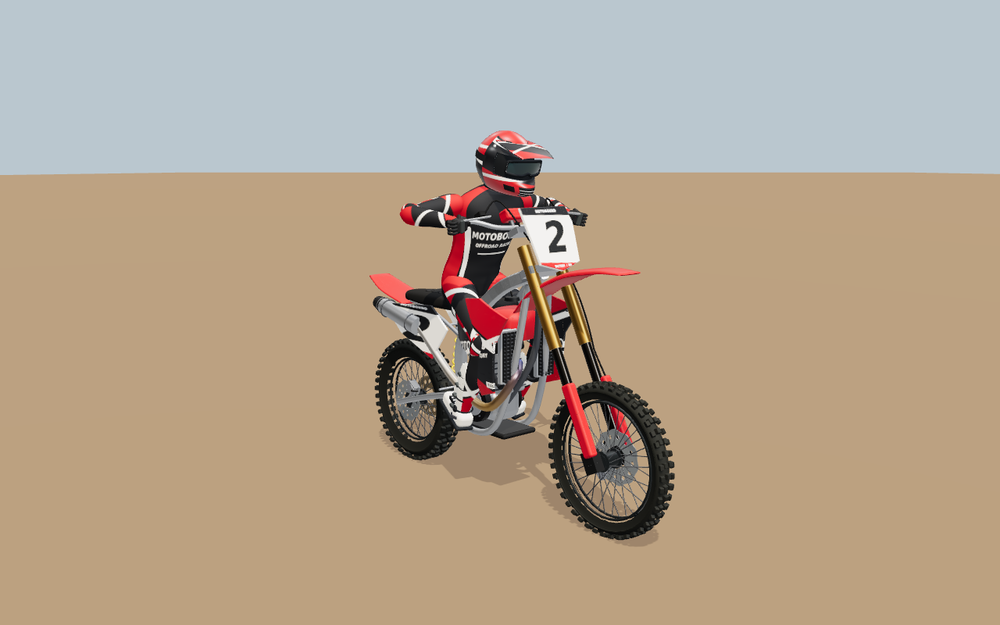
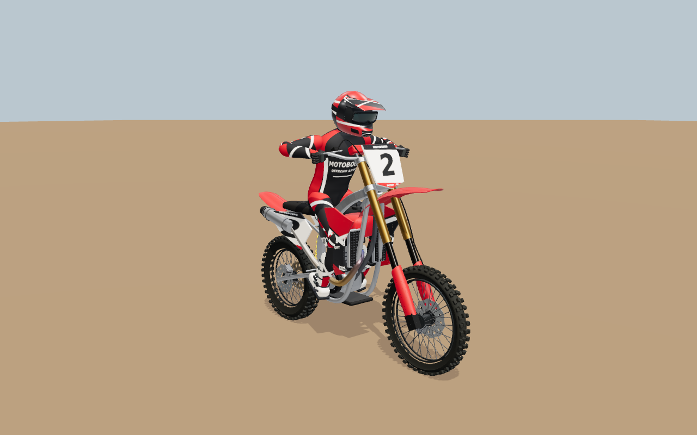
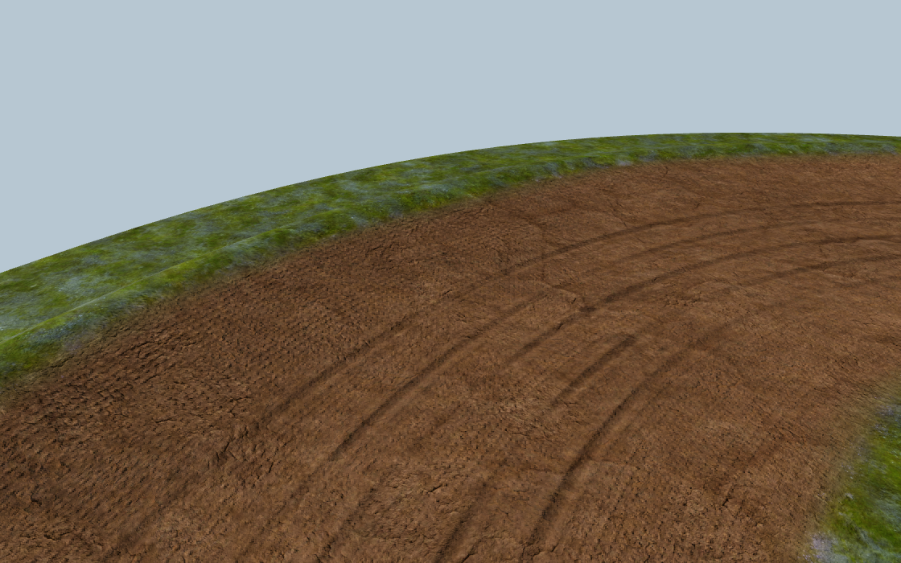
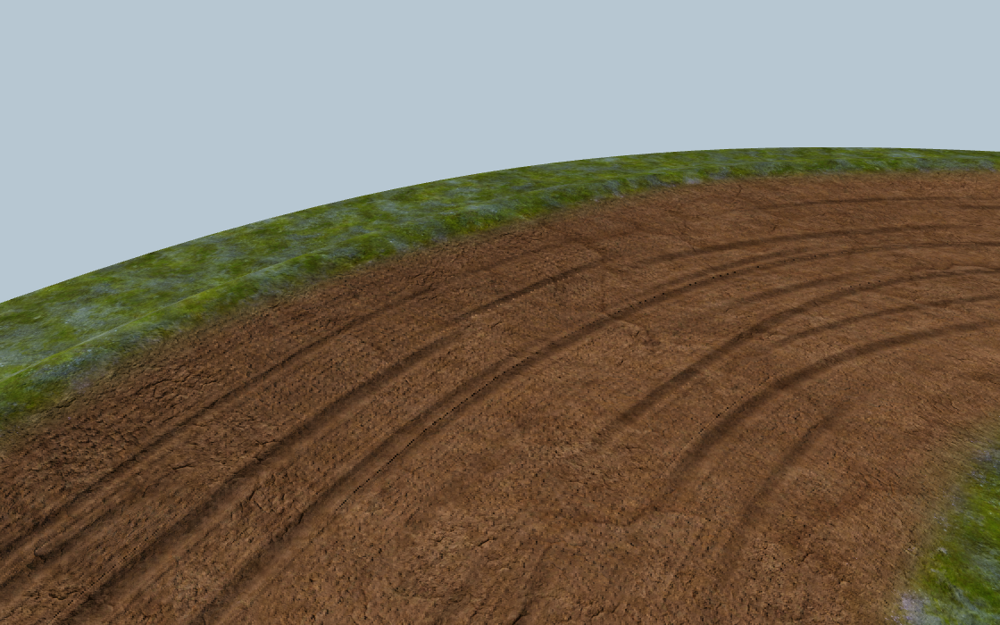
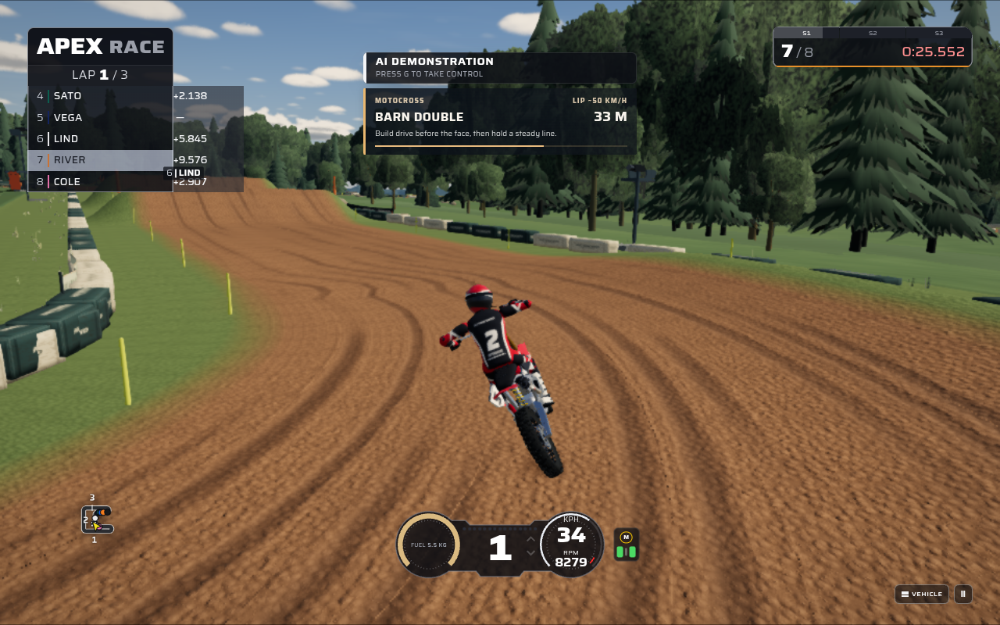

# Motocross rider control and course wear — 2026-10-19

This pass adds independent player weight shifts, more convincing formed bike parts, and broader worked dirt to the motocross section. The feature was developed on `4d20731` and then integrated with the concurrent MotoGP commit `31bc93d` and Horizon commit `7cb7ba1`. The new graphics are original Three.js geometry and shader code that reuse the game's existing materials and course data.

## Playing with rider weight

Choose **OUTDOOR MX** or **STADIUM SX** and select **MX250** or **MX450**. The existing **Learn the jumps** practice mode provides landing targets for experimenting with the new control.

| Input            | Forward weight    | Backward weight    |
| ---------------- | ----------------- | ------------------ |
| Default keyboard | Hold **Q**        | Hold **Z**         |
| Standard gamepad | Right stick up    | Right stick down   |
| Touch            | Hold **LEAN FWD** | Hold **LEAN BACK** |

Weight is independent of throttle, brake and steering. The rider takes a short, bounded stroke to move over the bike; releasing the input returns to the ordinary automatic riding posture. Forward weight loads the front suspension on the ground and supplies a finite nose-down adjustment in flight. Backward weight does the reverse. Holding the endpoint does not continue generating manual pitch torque. Returning the rider reverses that finite stroke, so it is useful to plan a movement and its release around the landing.

Throttle and either brake retain their existing airborne pitch effects. Steering retains its existing bank/whip control and release recovery. Existing brake-release guidance, landing feedback and the practice target checklist remain available. These retained systems are documented in the [previous mechanical/practice pass](motocross-mechanics-and-practice-20261019.md).

Keyboard controls can be remapped in **Garage & Settings**. The menu, briefing and airborne HUD use the actual assigned keys. Saved layouts keep their original assignments: migration searches preferred keys and then unused letter keys, including when every preferred new key is already occupied. Standard gamepads use a deadzone on the right stick; custom wheels and axes assigned to another driving control do not become body controls. Keyboard and touch can still position the rider when using such a device.

The touch layout exposes six buttons in motocross and retains the existing controls elsewhere. Pause, lost pointer capture, cancelled touches and window blur release held body input. Holding both body buttons deliberately produces neutral.

## What the physics does

`RiderWeight` supplies an analytically integrated, critically damped coordinate in the range −1 to +1. At the chosen response, a centred full throw reaches 90% travel in about 0.65 seconds. The supported rider reaches 0.25 m fore/aft at full stroke. On the ground, the existing suspension moment receives the combined rider posture and redistributes support between the wheels.

In flight, a reduced braced-rider coordinate exchanges pitch momentum with the chassis through a finite arm/hip stroke. It integrates the exact stroke distance and retains the associated relative rate. It adds no centre-of-mass air force and does not directly modify either wheel's angular speed. Actual wheel contact hands the incoming chassis rate back to the ordinary spring/damper and landing model. The automatic riding aid has its own posture coordinate, so holding a manual weight position cannot turn into the aid's continuing pitch torque.

This is a calibrated game model of bracing through hands and feet. Its effective lever and response are explicit design constants, not measurements inferred from still images or a solved articulated-human multibody system.

Measured stationary probes transfer approximately 124 N of support from rear to front at full forward input, with unchanged total support and zero speed. At 0.9 seconds into the fixed Ridge Table flight, forward input produces about 6.5° of additional nose-down chassis rotation on raw MX450 and 6.9° on raw MX250. Sport gives a smaller correction because the existing landing aid reacts. The same probes preserve the airborne path and wheel speeds until contact. These measurements describe those scenarios, not universal landing guarantees.

Manual weight applies to player-controlled MX250/MX450. Demonstration riders ignore the held manual command and smoothly recenter an inherited stroke; SM450 retains its former behavior. A direct comparison against the starting solver with neutral input matched all selected authoritative fields in 24 cases over 28,800 substeps, covering both venues, all three dirt-bike machines, both assists and player/AI control.

## Bike shape and attachment

The previous front and rear fenders were solid rounded lofts. Their replacements have a thin outer and inner skin, a centre crown, paired longitudinal relief channels, tapered tips and returned edges. The nominal wall is 3.5 mm. This produces a visible underside and a convincing moulded lip without adding textures.

Near and mid-distance fork guards now use 3 mm C-section shells around the actual lower tubes, with a real opening behind each guard. They remain attached to the existing sliding fork group. Near and mid-distance triple clamps are continuous forms with open fork and steering-stem bores. Those bores exposed a prior attachment gap: the upper tubes ended eight centimetres below the upper clamp. The MX tubes now pass through both collars while retaining their lower endpoint and suspension overlap.

The rider's existing inverse-kinematic mapping already supported the complete weight stroke. Contact tests verify the full range at the grips and footpegs across standing, braking, steering and independent suspension travel. The rider artwork and anatomy were retained in this pass. SM450 also retains its original fenders, guards, clamps and tube dimensions.

| Equipment fixture detail, either MX machine | Before triangles | After triangles | Draw calls before → after |
| ------------------------------------------- | ---------------: | --------------: | ------------------------: |
| High                                        |          105,874 |         109,930 |                   71 → 71 |
| Mid                                         |           50,833 |          52,977 |                   67 → 67 |
| Far                                         |           11,971 |          12,451 |                   45 → 45 |

The high fixture increases by 3.83%. Geometry-object, texture and shader-program counts remain unchanged at each detail level. New geometry is built once and uses the existing material batches.

The fixed equipment view below uses the same camera and fixture lighting. The change is most visible in the thin fender crown, wrapped fork guards and shaped steering castings.

| Starting bike                                                                      | Current bike                                                                     |
| ---------------------------------------------------------------------------------- | -------------------------------------------------------------------------------- |
|  |  |

## Worked dirt across the corridor

The old five-pass pattern left much of the broad riding corridor without directional traffic. Terrain vertices now supply the actual authored half-width to the soil shader. The shader evaluates only the three neighbouring passages at each pixel, allowing worn lines to cover the track width with local merging, separation, pressure breaks and a modest outside-bank shift.

Narrow cuts, raised loose lips, broader compacted swathes and staggered cleat impressions use distinct physical scales. Compacted bands smooth the soil normal response while loose shoulders retain their granular detail. Fine torn edges fade when unresolved. Domain warping reduces the square lattice previously visible in the angular fragment distribution. The new longitudinal traffic variation closes smoothly at the lap seam.

These prepared surface marks are appearance, not a prescribed racing line or a new grip map. The existing deformable course continues to supply the actual jumps, braking bumps, wheel contact, depth and compaction. Existing wetness and replay states drive the material as before. Repeating a held wet state and rewinding to the dry state reproduce the same framebuffer hashes in the focused captures.

The soil pass adds no textures, draw calls, meshes or triangles. One additional float per vertex costs 189,720 bytes at Valley Ridge and 122,108 bytes at Arena Nord. The shader adds arithmetic; unchanged draw counts do not establish unchanged GPU time.

These component captures hold course geometry, camera and lighting fixed. Their empty background intentionally exposes the terrain layer being reviewed.

| Starting outdoor berm                                                                       | Current outdoor berm                                                                      |
| ------------------------------------------------------------------------------------------- | ----------------------------------------------------------------------------------------- |
|  |  |

## Integrated game capture

This outdoor chase frame comes from the production application at **Low** quality on **SwiftShader**, during the explicitly enabled AI demonstration after the manual weight and throttle checks. The same journey completed the onboard camera, pause and return-to-paddock sequence. The image shows the worked surface, ordinary jump guidance and rider together in the complete scene.

## Reference review

The same 100 numbered originals were recovered and every image hash matched the repository's existing index. The archive SHA-256 is `d8c8fbb62974432e8feafa853917deb45765dccc18be7d1da8ece9be512a9c73`. All 100 images were visually inspected on five labelled contact sheets. Specialists reviewed the bike, terrain and gameplay ranges and selected originals at full resolution.

The [current per-image audit](motocross-rider-control-reference-review-20261019.json) links each original identity to the earlier review, records the current review method, and separates explicit new-change guidance from retained systems, context and images with no separate specialist finding. Reviewing 100 images does not mean implementing 100 new features.

| Principle                                                        | Representative references | Application in this pass                                                      |
| ---------------------------------------------------------------- | ------------------------- | ----------------------------------------------------------------------------- |
| Thin fender sections, returned edges and connected fork castings | 005, 006, 020, 027        | Formed fenders, wrapped guards and bored clamps                               |
| Broad ridden bands with narrow tyre cuts and loose shoulders     | 035, 047, 050, 056, 058   | Full-width prepared traffic and reduced fragment lattice                      |
| Rider posture and independent weight controls                    | 068, 070, 085, 087        | Separate bounded rider input, retained hand/foot contacts and usable guidance |

The originals guide proportions, surface structure and riding readability. No commercial screenshot is embedded in a game asset, and image capture hardware is not independently established.

## State and compatibility

The normal input path carries `riderLean` through keyboard/gamepad/touch, Main, the worker, authoritative input journals and flashback. Old absent values normalize to zero. Weight-only changes and release events are recorded, and full input resimulation restores an active stroke through landing.

The network control word uses its formerly unused upper seven bits for signed lean; the serialized controls remain seven bytes. Network protocol version 2 rejects older peers before they interpret the changed word. Simulation version 3 separates records made with the new solver from previous physics categories, as required by the repository's record policy. This is a shared category version, so older records from every discipline retain their original category. The snapshot schema and its stride remain unchanged.

## Validation and limits

The [validation receipt](motocross-rider-control-validation-20261019.json) records exact source hashes, build fingerprint, final command outcomes, browser scope, measured resources and the independent physics probes. It distinguishes full-suite results from isolated checks and component captures from the real game.

Reproduce the normal application checks with `npm run lint`, `npm run validate:content`, `npm test` and `npm run build`. Relevant browser specifications are `42-motocross-bike`, `43-motocross-world`, `44-motocross-interface`, `45-motocross-gameplay`, `48-motocross-practice` and `49-motocross-worked-soil` under `playwright.motocross.config.ts`.

The completed two-venue game journey uses the visible Low-quality setting on ANGLE Mesa/llvmpipe. Detailed equipment, soil and interface checks use SwiftShader; an earlier SwiftShader run also completed the outdoor journey before its stadium screenshot timed out. The receipt preserves those failed attempts and the final passing results. These checks validate functioning presentation and control integration on software GPUs; consumer-GPU frame rates, high-quality full-game performance and subjective human difficulty remain unmeasured. The rider and world still have a procedural appearance. This pass improves component construction, surface structure and control depth without claiming photographic or AAA parity.

## Integration with concurrent work

The feature-base verification completed 439 unit files / 3,670 cases across the original run and the documented recovery runs, plus eight distinct browser cases. Those results retain their original source hashes and build fingerprint in the receipt.

After integrating MotoGP commit `31bc93d`, the build, full lint/content checks and 133 targeted cases across 13 files passed. The bike fixture passed again: all 29 images are byte-for-byte identical to the retained MX pass, and all non-identity metrics and six LOD resource inventories match. The complete outdoor/stadium production journey also passed on Mesa/llvmpipe, exercising manual weight and throttle inputs before explicitly enabling AI demonstration, then observing jumps, landings, camera changes, pause and paddock return. That run used application fingerprint `285cc09acf6348fe3c83d39f3f89c95e892d8a47a039e2834c92bd9d930fa58e`.

Horizon commit `7cb7ba1` then merged cleanly. Its two overlapping files retain both the motocross touch/input additions and the separate festival behavior. Its other source edits are confined to the open-world section. The final build, full lint/content checks and 51 targeted cases across 7 files passed. The final independently verified application fingerprint is `5f711509e1d6cac416c1992e342873a641b4b12006b66dd64abbd09985a9bcc5`. The original full suite and post-MotoGP browser runs were not repeated after this isolated Horizon integration; their scope is explicit in the receipt.
