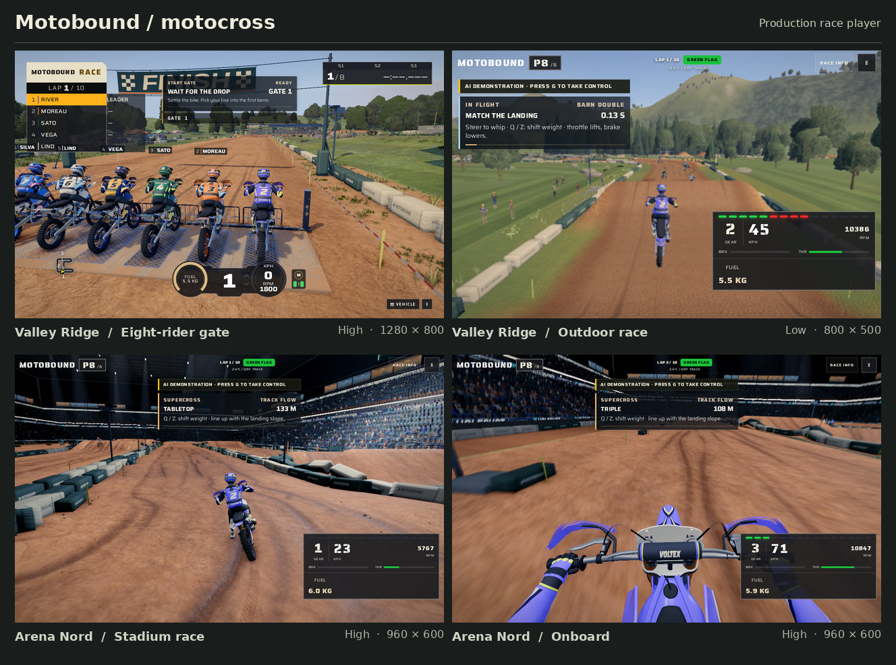
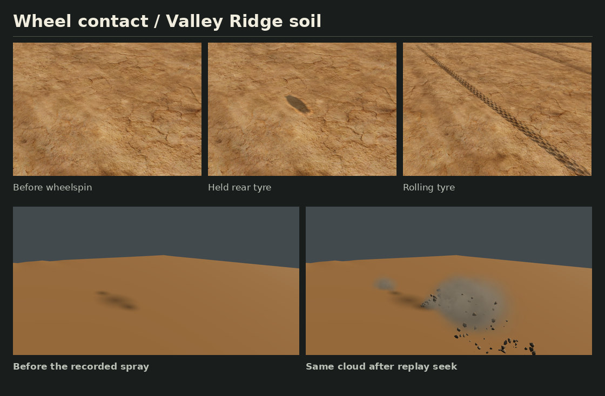
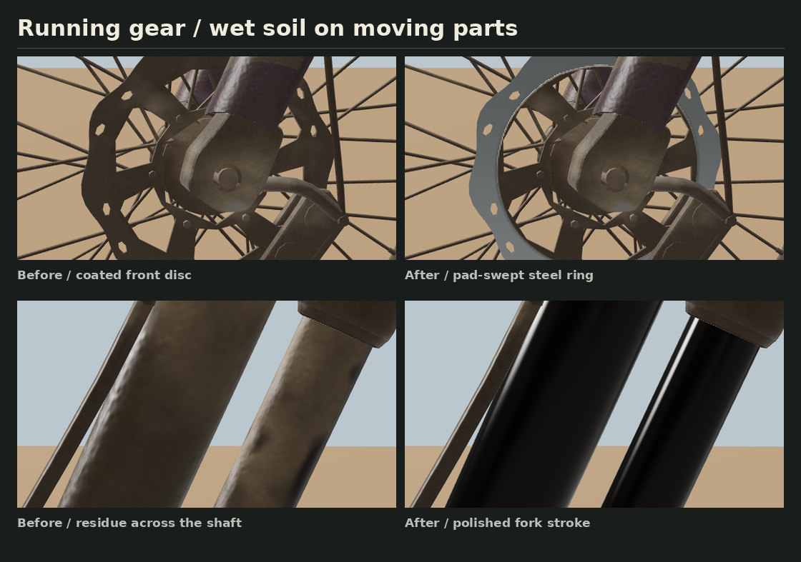
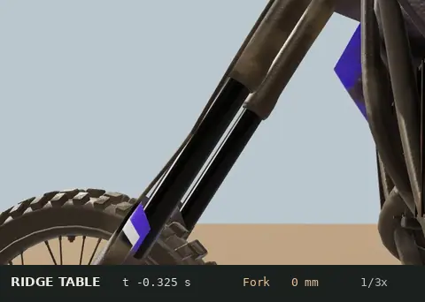
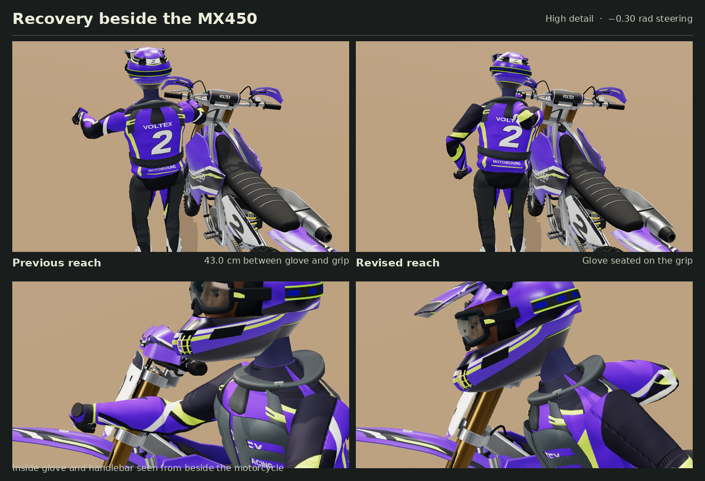
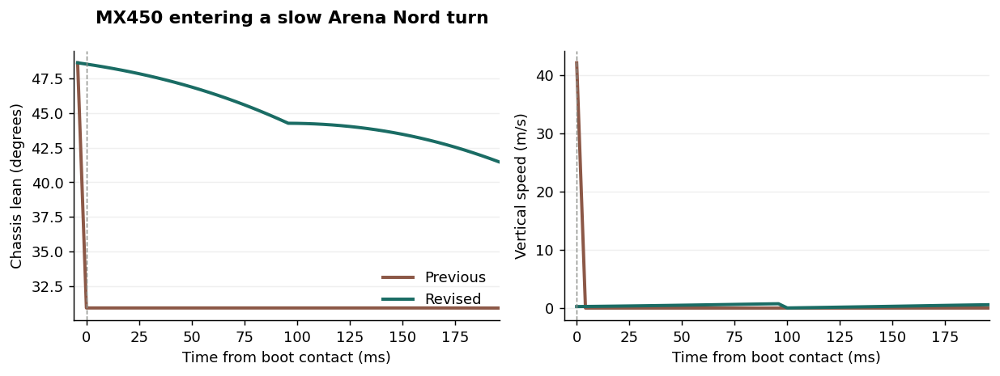

# Motocross surface and contact review

The MX250 and MX450 run at Valley Ridge and Arena Nord. Reference images 007, 020, 024 and 028 informed the close rider and equipment work. Images 036, 047 and 092 informed the outdoor terrain, camera scale and depth of the riding lines. The screenshots show original game assets rendered in Three.js.

## Dirt under the wheels

At Ridge Table, shallow traffic lines cross lightly ridden soil and deeper passages build uneven shoulders. On the measured touchdown view, 33,867 pixels changed with the same 185 draw calls and 1,596,422 submitted triangles. The 109 large Valley Ridge fieldstones now sit into the surveyed ground and take the colour of the soil at the base.

A loaded tyre pushes fresh dirt toward the side of the wheel’s measured slide. A stationary spinning rear wheel leaves one pocket. In the controlled view that pocket changed 2,549 pixels. The running, skidding and stationary tracks share one draw. The contact shadows and thrown soil use the local receiving facet under each tyre.

Dry fines and heavy clods have separate drag and gravity responses. Replay seeks reconstruct the particles from recorded wheel loads, landings and wind. In the illustrated test the resumed image matched the first rendering at the same instant, including all 116 solid fragments.

## Rider and hardware

The rider turns toward the actual exit of a berm and uses the surveyed landing elevation to look over a crest. Steering direction, travel and head pitch come from the same recorded state on a rewind. On the two close rider rigs, wet goggle deposits absorb transmitted light and suppress the interference tint within the flecks.

The brake pads sweep the front and rear wave discs. The carrier, apertures and scalloped outer edge retain wet soil. The controlled material test measured a mean colour change of 0.33 levels on the wiped faces and 10.1 to 11.1 levels on the carriers, using an 8-bit channel scale. Returning both discs to a clean state reproduced the original pixels.

The seal wipes the sliding section of each inverted fork. The lower ends retain soil, and a narrow collar moves with the seal through compression and rebound. A fit check measured the collar against both modelled seals through five suspension poses on all three rider detail levels.

The MX450 below lands the Ridge Table on the 120 Hz vehicle solver. The close-up follows the chassis, with one rendered sample every three physics ticks. The animation plays at one-third speed. Time zero is first ground contact. The front suspension takes load after the rear touches down.

## Recovery beside the bike

When a rider reaches the motorcycle, their inside hand follows the left handlebar through steering. The rider reaches for the bar over 0.38 seconds. On a bank they keep the arm loose while the grip is outside their reach. Both bikes were checked at all three rider detail levels. In the measured MX450 pose the glove moved from 43.0 cm off the bar to within 0.1 mm. Rewinding reproduced the same rendered hand and body position.

## Venue rendering

The same two printed fabrics and contact-fitted foam meshes are grouped into 48 m stadium sectors and 64 m outdoor sectors. All eight tested camera positions produced pixel-identical boundary images. Together they submitted 542,720 padding triangles, down from 1,247,232. The smaller batches trade extra draw calls in wide views for fewer transformed vertices.

| Venue | Camera station | Previous triangles | Revised triangles | Previous draws | Revised draws |
| --- | ---: | ---: | ---: | ---: | ---: |
| Arena Nord | 0 m | 123,392 | 101,888 | 2 | 12 |
| Arena Nord | 96 m | 123,392 | 15,872 | 2 | 2 |
| Arena Nord | 242 m | 123,392 | 61,440 | 2 | 7 |
| Arena Nord | 450 m | 123,392 | 57,856 | 2 | 8 |
| Valley Ridge | 0 m | 188,416 | 73,216 | 2 | 12 |
| Valley Ridge | 100 m | 188,416 | 20,480 | 2 | 4 |
| Valley Ridge | 196 m | 188,416 | 116,224 | 2 | 18 |
| Valley Ridge | 518 m | 188,416 | 95,744 | 2 | 15 |

Each row counts the padding alone in an isolated WebGL render. Whole-frame cost also depends on the rider count, lighting, scenery, post-processing, driver and hardware.

## Race validation

Both player-solver lap fixtures completed without a fall. A knobby tyre now distributes pressure around the actual footprint and carries it continuously across the lap seam. Under yellow, riders close the gap as soon as the two bikes have room. On a banked restart the rider can overcome the grade while the front tyre carries weight. A rider approaching another triple also accounts for recent landing errors. Lap records remain grouped by physics version.

| Race set | Races | Classified | Falls | Longest stop |
|---|---:|---:|---:|---:|
| Official 12-rider MX and SX | 8 | 96 / 96 | 9 | 15.05 s |
| Standard off-road fixtures, including mixed disciplines | 11 | 84 / 84 | 11 | 15.97 s |
| Additional MX and SX seeds on the previous physics | 24 | 288 / 288 | 49 | 29.90 s |
| Same additional seeds on the revised physics | 24 | 288 / 288 | 28 | 15.58 s |

The official races passed every limit. Across the 24 additional seeds the longest stop fell from 29.90 to 15.58 seconds. The field recorded 28 falls, down from 49. One rider exceeded the repeat-fall limit. In Arena Nord seed 71268, rider 10 landed front-first at 457.8 m on the first lap, then went down in a lateral slide at 471.8 m on the second lap. Run `node --experimental-transform-types scripts/offroad-races.ts --mx-stress-grid` to repeat the 24 races. Set `OFFROAD_RACE` to a seed number to inspect a single race.

Two further eight-rider runs replayed recorded controls on each venue. A 30 Hz host, a 144 Hz host and a separately sliced resimulation produced identical vehicle frames, soil depths, compaction and crash histories at five checkpoints through 14,400 physics ticks. All 20 calibrated jump cases passed.

## Live terrain transfers

Real WebGL buffer writes were counted over 30 seconds of eight-rider racing at each venue, followed by four replay seeks. The ground mesh, shading normals and soil-state hashes matched across all eight captured checkpoints per venue. These runs force all terrain strips into view to include the complete course in each measurement.

| Venue and workload | Previous bytes | Revised bytes | Reduction | Buffer writes before / after |
|---|---:|---:|---:|---:|
| Valley Ridge live | 19,684,368 | 4,280,088 | 78.3% | 372 / 498 |
| Valley Ridge seeks | 1,728,288 | 861,720 | 50.1% | 32 / 40 |
| Arena Nord live | 17,754,072 | 4,332,204 | 75.6% | 354 / 483 |
| Arena Nord seeks | 1,765,764 | 944,988 | 46.5% | 35 / 43 |

## Boot contact

The 75 kg rider props the bike through a slow turn as the inside boot takes load. The solver limits the roll moment and lets the boot unload as the chassis recovers. With the earlier hard angle limit, the MX450 changed its roll by 17.67 degrees in one 1/240-second step and acquired 42.17 m/s of vertical speed. On the same entry the revised model changed by under 0.1 degrees and measured under 0.3 m/s. The contact and collision checks exercise both lean directions.

## Twelve-rider simulation cost

Both 12-rider fields used the rain weather setting. Each simulation ran for 20 seconds of warm-up and 90 simulated seconds of sampling. Each observation averages process CPU time across 120 physics ticks. The simulation exported 60 frames and two soil updates per second. These timings cover physics and frame export on AMD EPYC 9V74 80-Core Processor. GPU rendering is measured separately.

| Venue | Median CPU time per tick | 95th percentile |
|---|---:|---:|
| Valley Ridge | 1.34 ms | 3.13 ms |
| Arena Nord | 0.96 ms | 1.72 ms |

[Race results, simulation checkpoints and render hashes](validation.json) · [Earlier venue and rider review](../motocross-track-and-rider-20261124/README.md)
