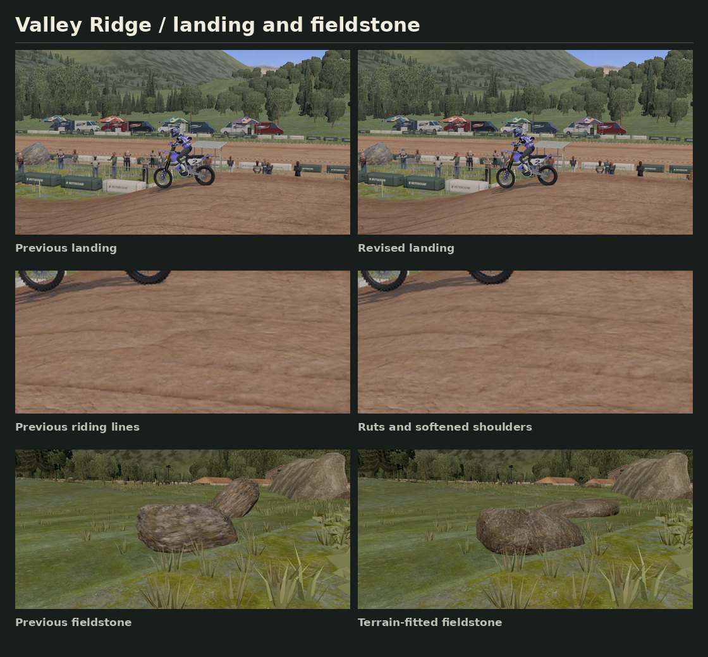
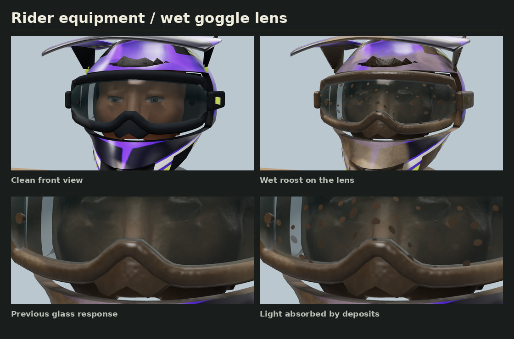

# Motocross surface and contact review

The MX250 and MX450 run at Valley Ridge and Arena Nord. Reference images 007, 020, 024 and 028 informed the close rider and equipment work. Images 036, 047 and 092 informed the outdoor terrain, camera scale and depth of the riding lines. The screenshots show original game assets rendered in Three.js.

## Dirt under the wheels

At Ridge Table, shallow traffic lines cross lightly ridden soil and deeper passages build uneven shoulders. On the measured touchdown view, 33,867 pixels changed with the same 185 draw calls and 1,596,422 submitted triangles. The 109 large Valley Ridge fieldstones now sit into the surveyed ground and take the colour of the soil at the base.

A loaded tyre pushes fresh dirt toward the side of the wheel’s measured slide. A stationary spinning rear wheel leaves one pocket. In the controlled view that pocket changed 2,549 pixels. The running, skidding and stationary tracks share one draw. The contact shadows and thrown soil use the local receiving facet under each tyre.

Dry fines and heavy clods have separate drag and gravity responses. Replay seeks reconstruct the particles from recorded wheel loads, landings and wind. In the illustrated test the resumed image matched the first rendering at the same instant, including all 116 solid fragments.

## Rider and hardware

The rider turns toward the actual exit of a berm and uses the surveyed landing elevation to look over a crest. Steering direction, travel and head pitch come from the same recorded state on a rewind. On the two close rider rigs, wet goggle deposits absorb transmitted light and suppress the interference tint within the flecks.

The brake pads sweep the front and rear wave discs. The carrier, apertures and scalloped outer edge retain wet soil. The controlled material test measured a mean colour change of 0.33 levels on the wiped faces and 10.1 to 11.1 levels on the carriers, using an 8-bit channel scale. Returning both discs to a clean state reproduced the original pixels.

The seal wipes the sliding section of each inverted fork. The lower ends retain soil, and a narrow collar moves with the seal through compression and rebound. A fit check measured the collar against both modelled seals through five suspension poses on all three rider detail levels.

The MX450 below lands the Ridge Table on the 120 Hz vehicle solver. The close-up follows the chassis, with one rendered sample every three physics ticks. The animation plays at one-third speed. Time zero is first ground contact. The front suspension takes load after the rear touches down.

## Venue rendering

The same two printed fabrics and contact-fitted foam meshes are grouped into 48 m stadium sectors and 64 m outdoor sectors. All eight tested camera positions produced pixel-identical boundary images. Together they submitted 542,720 padding triangles, down from 1,247,232. The smaller batches trade extra draw calls in wide views for fewer transformed vertices.

| Venue | Camera station | Previous triangles | Revised triangles | Previous draws | Revised draws |
| --- | ---: | ---: | ---: | ---: | ---: |
| Arena Nord | 0 m | 123,392 | 101,888 | 2 | 12 |
| Arena Nord | 96 m | 123,392 | 15,872 | 2 | 2 |
| Arena Nord | 242 m | 123,392 | 61,440 | 2 | 7 |
| Arena Nord | 450 m | 123,392 | 57,856 | 2 | 8 |
| Valley Ridge | 0 m | 188,416 | 73,216 | 2 | 12 |
| Valley Ridge | 100 m | 188,416 | 20,480 | 2 | 4 |
| Valley Ridge | 196 m | 188,416 | 116,224 | 2 | 18 |
| Valley Ridge | 518 m | 188,416 | 95,744 | 2 | 15 |

Each row counts the padding alone in an isolated WebGL render. Whole-frame cost also depends on the rider count, lighting, scenery, post-processing, driver and hardware.
