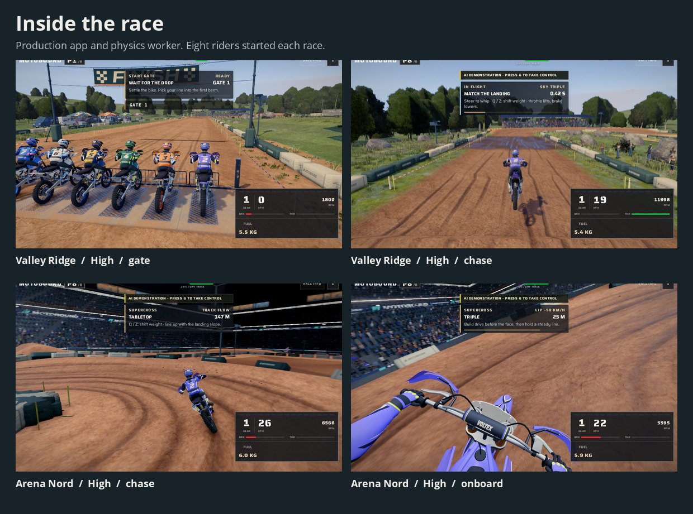
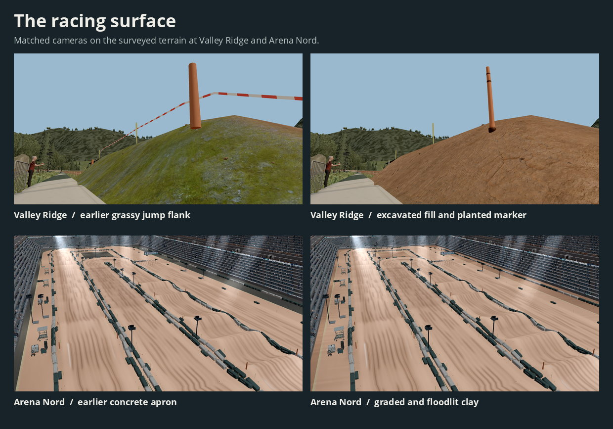
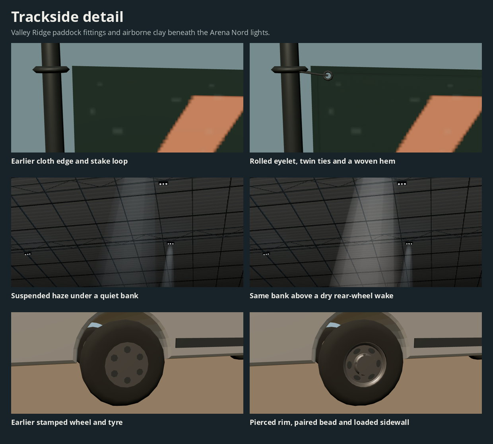
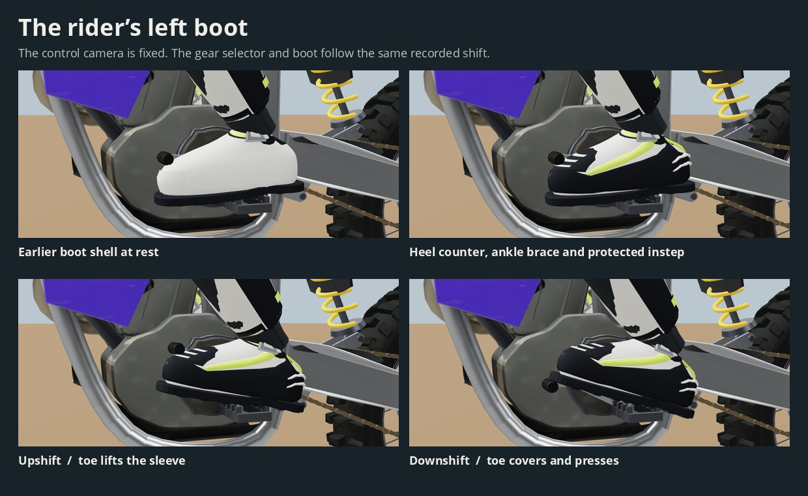
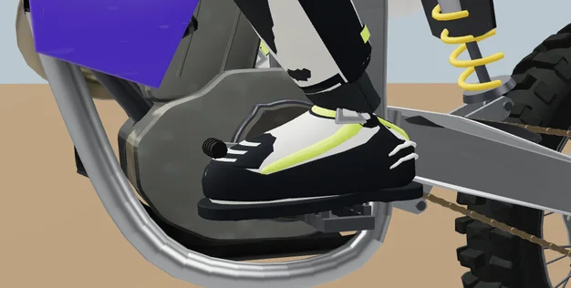

# Valley Ridge and Arena Nord

The changes in this review cover the two motocross venues, the MX250 and the MX450. The supplied 100-photo reference pack guided the shape of the protective equipment, the exposed earth on jump faces, the trackside fabric and the way dust catches the stadium lights. The images below come from the game's own Three.js models, materials and cameras.



## Track and atmosphere

Valley Ridge's raised jump flanks and outer berms now expose the graded earth used to build them. The tyres encounter hardpack there. The legal racing corridor retains its original boundaries. At Arena Nord, graded clay covers the apron around the racing lanes and takes the same overhead light as the rest of the floor.



Tall amber and short pale markers distinguish takeoffs from landings. A ray survey placed all 40 markers within 2 mm of the rendered ground and checked the intended embed of all 404 perimeter blades. Tape follows the actual mounting points and sags between them. Single-ply banners have rolled eyelets, pole lashings, a reinforced hem and a paler reverse print.

The arena's 20 visible light shafts share one draw. Each samples the rear-wheel loading, slip, direction, speed and measured soil moisture of riders crossing its pool. A dry spinning tyre brightens the lower shaft behind the bike. A saturated or airborne tyre contributes no airborne soil. The same recorded input restores the same lighting after a seek.

The eight Valley Ridge service vans sit on flattened tyre contact patches. Each pressed-steel wheel has six open vents, a recessed drum and five lugs. The survey checks 32 tyre contacts against the rendered paddock surface within 2 mm. All eight vans share one material draw. Indexing the assembly reduced its geometry buffers from 938,552 to 368,600 bytes while retaining the same pixels in the full van, wheel and ground-contact views.



## Bikes and riders

The downshift guard accounts for rear-tyre regrip speed. A rider can still shift up under wheelspin. Successful gear changes drive the selector and left boot from the recorded simulation stroke. A refused request leaves them at rest. Downshifting moves the forefoot over the selector around the loaded peg. The right foot continues to follow its own brake input.

If another rider ends up travelling backwards along the verge, the marshal waits for space and for an approaching hairpin to clear before helping the rider turn. The bike rotates through the push and remount. Riders who have taken the chequered flag ease down the straights and roll the next jump while the rest of the field races.

The boot has an articulated ankle brace, heel counter, wraparound toe bumper and an instep protector on the gear side. Narrow seams follow their physical width. The complete High-detail MX250 and rider use 139,107 triangles. The MX450 and rider use 137,467. Both fit the existing 140,000-triangle limit.



The MX450 downshift below follows 33 consecutive 120 Hz simulation samples. Playback is at one-quarter speed.



## What the cameras submit

These are triangles issued in controlled draws. The two sides of each comparison use the same camera, mesh population and output size. The terrace rows isolate 128 spectators. The arena rows cover the venue scene. The forest row isolates the fallback tree belt.

| Scene or view | Earlier | Updated | Verification |
| --- | ---: | ---: | --- |
| Valley Ridge terrace, near detail transition | 1,019,392 | 580,140 | Identical colour pixels, two draws |
| Valley Ridge terrace, middle detail transition | 260,096 | 127,696 | Identical colour pixels, two draws |
| Arena Nord start | 1,038,501 | 899,109 | 72 draws |
| Arena Nord berm | 1,071,913 | 961,929 | 95 draws |
| Arena Nord approach | 1,073,971 | 953,299 | 83 draws |
| Arena Nord wide bowl | 1,074,949 | 1,080,133 | 97 draws, now includes chair pedestals |
| Valley Ridge Barn Double tree belt | 156,684 | 83,292 | Eight draws reduced to four |

All 18,408 arena seats now have pedestals. The renderer can skip sections beyond each camera's frustum, including on camera cuts. Four views rendered identically to the new fully populated bowl. On the outdoor terraces, each pass retains the original guest's seat, garment and skin tone. A single volumetric sculpt casts each visible guest's shadow during a detail transition. The closest photographic trees retain detail as the broadcast lens zooms in.

When a dry, stationary race view is late, the renderer reserves more frames for the rider before updating another face of its local reflection cube. The previous cube stays available during the refresh. Movement, a camera cut or a change in the scenery can still request fresh reflections.

## Race verification

The focused suite passed 914 motocross tests and 35 reflection tests. The off-road calibration passed all 20 jump cases and all 11 race scenarios. In the seeded eight-rider races, Valley Ridge recorded one crash and Arena Nord recorded three. Both fields finished with no retirements. The replay-cadence check made 1,520 matrix comparisons per bike and venue pairing, 6,080 total, with zero matrix-element difference.

The 960 × 600 High and 1280 × 800 Low journeys completed both venues with an eight-rider field. High used an extended screenshot timeout on SwiftShader. The race captures use the production menu, worker, gate, manual controls and race cameras. The isolated before-and-after images use deterministic camera positions for comparison. GPU timings from software rendering cannot establish a console frame rate.

### Reproduce the checks

Run these commands at the repository root after `npm ci`. The full-grid run writes its per-entrant finish times, incidents, terrain measurements and failures to `test-results/motocross-full-grid.json`.

```sh
npx vitest run tests/motocross tests/reflections.test.ts --maxWorkers=2
npm run test:offroad
node --experimental-transform-types scripts/offroad-races.ts --mx-full-grid
npx vite-node --script scripts/bench/motocross-field.ts --cadence
npm run build
npm run check:bundle
APEX_MOTOCROSS_JOURNEY_QUALITY=high npx playwright test --config=playwright.motocross.config.ts e2e/45-motocross-gameplay.spec.ts
```
