# MotoGP circuit and motorcycle review

## Tyres, rider controls and race-day weather

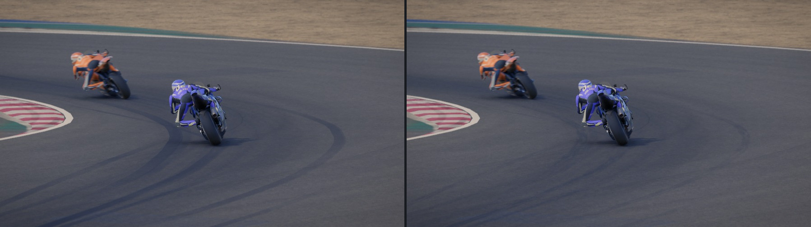

Four riders enter the same Poggio Alto corner on High. The followed bike is travelling at 58.4 km/h and leaning 21.6°. The earlier frame is on the left. On the right, the worn surface has soft edges and each axle can leave a fresh mark from its measured tyre slip. Across the 21,763 road pixels selected from the old marks, mean darkening fell from 7.69 to 2.89 on a 0–255 luminance scale. The adjacent road changed by 0.16. The new frame contains 356 live mark segments in one draw call.

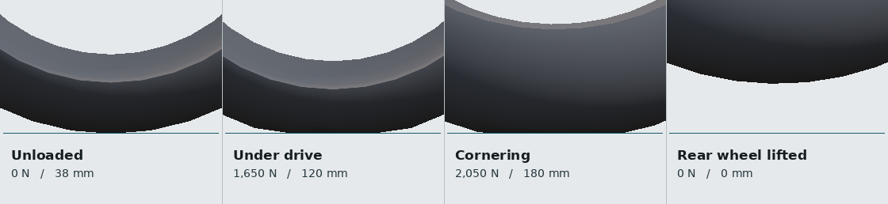

The tyre shader uses the load, inflation pressure and measured road plane at each axle. This side-on inspection resolves one millimetre per pixel. The visible footprint grew from 38 mm unloaded to 120 mm at 1,650 N. Raising the inflation pressure at that load reduced deflection from 8.51 to 6.56 mm. The lifted wheel cleared the plane by 63 mm.

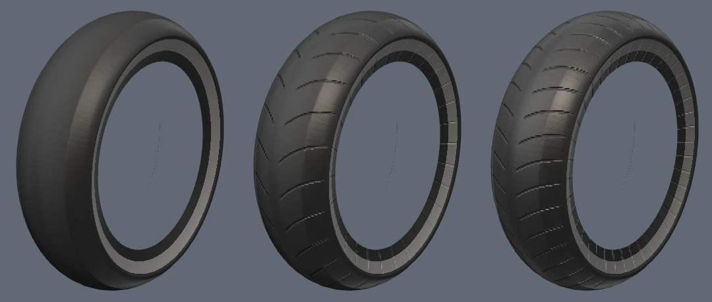

From left to right, the same rear wheel wears a used slick, an intermediate and a wet tyre. When the rain channels project smaller than a pixel, the camera retains the proportion of cut rubber. In a controlled WebGL measurement, one groove period per pixel previously produced zero channel coverage. It now measures 9.60%, matching the 9.6% of the mould cut by the channel. The close-up slicks reproduced the previous pixels exactly.

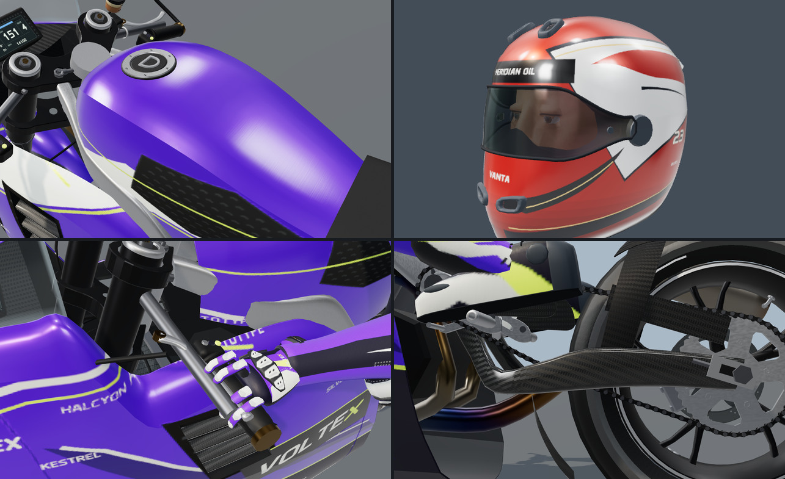

The tank has a recessed filler latch, socket heads and molded knee grips. The helmet has two jaw intakes and a replaceable visor film with a folded release tab on the left retaining post. At the rear wheel, five open windows and five recessed wrench sockets rotate with the carrier. Its hollow collar seats inside the wheel hub. The complete High models submit 109,980 triangles for the GP-R1 and 109,382 for the GP-R2, including the repeated chain plates and rollers.

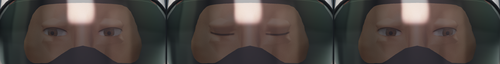

The rider looks into each turn and the lids meet when blinking. Light reflects from the cornea while the iris turns beneath it. In this close-up, the bands of light and dark swept by the pigments were 23.0 and 23.9 pixels apart in the two eyes. Replaying the leftward gaze reproduced the same pixels.

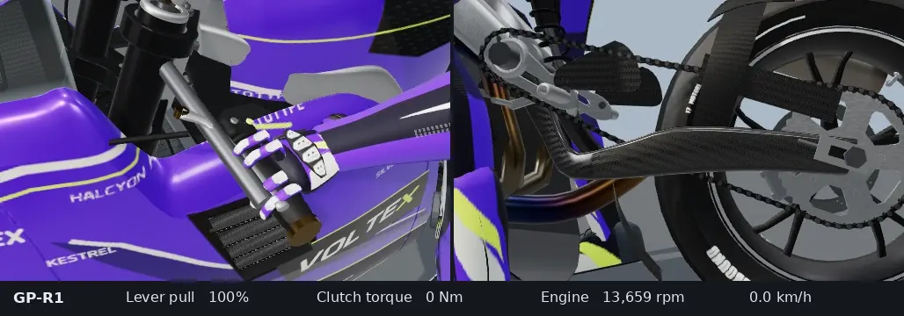

Both camera views use the same 48 samples from a 120 Hz simulation. The rider holds 80% throttle and releases the manual clutch over one second. The left hand follows the lever as plate torque rises and the bike reaches 43.3 km/h. The drive and return runs share up to 16 mm of free-span deflection. The boot pedal operates the rear brake independently. In automatic mode the original secondary brake binding remains available. [Frame measurements](gp-clutch-launch.json)

The 102-link chain took a median 9.63 µs per update after the two side plates began sharing one transform basis, down from 17.13 µs. This CPU measurement used nine alternating batches of 4,800 moving poses in Node 24.22.3. Six 1280 × 800 WebGL close-ups covering drive, neutral and overrun on both motorcycles had identical pixels before and after the change.

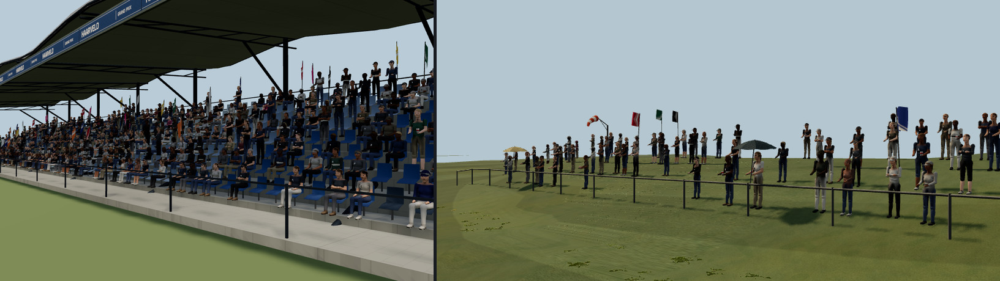

At Haarveld, closed concrete risers support the seats and three shallow steps connect each pair of rows in the aisles. At Cape Wrenna, four umbrellas on the first bank unfold in a shower and follow the wind. Holding the weather or rewinding to dry reproduced the original pixels. In a separate shadow measurement at race shadow-map density, the 10–90% edge width below an eight-metre canopy grew from 5 cm in sun to 14 cm under thin cloud and 30.5 cm in a shower. A plate eight centimetres above the road kept its 5 cm edge in all three conditions.

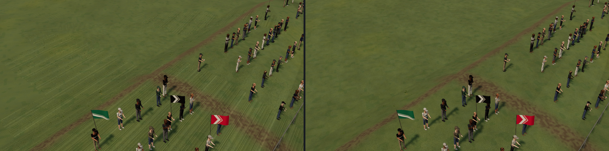

Fans reach the standing rows through the central opening and a service aisle behind the fourth row. Flattened stems give way to exposed earth along those routes. The two images use identical foot traffic and lighting. Earlier grass textures followed the nearest racing station, which stretched the pattern by up to 52.7 times on this bank. Sampling the grass in world metres keeps blades at a consistent scale. Floodlights and edge markings still follow the surveyed course.

## Circuit cameras

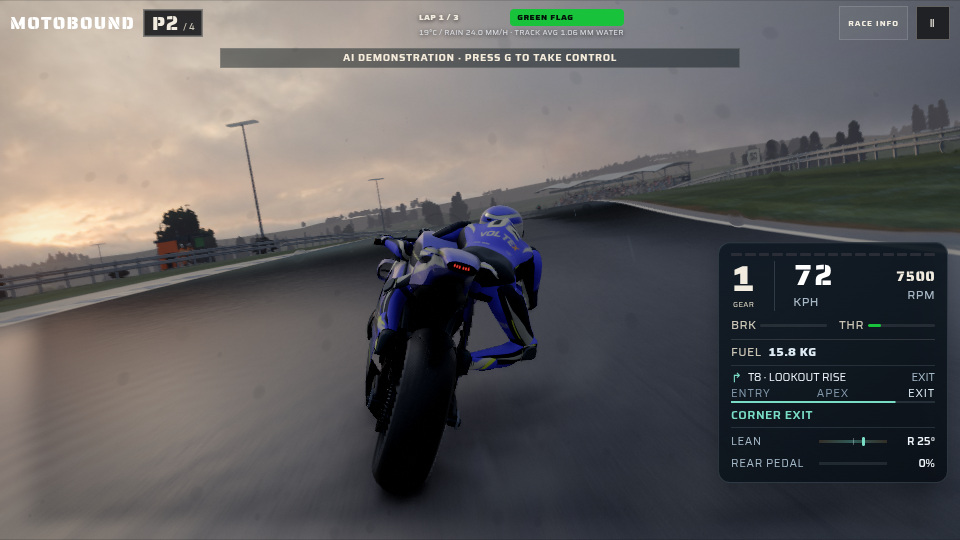

Four GP-R2s started this race through the player menu with wet tyres and the High preset. The chase camera caught the rider exiting Lookout Rise at 72 km/h and 25° of right lean. At native 960 × 540, the renderer used 4× MSAA, ambient occlusion and 2048-pixel shadow maps. The moving sample recorded ten tyre-spray particles and 516 raindrops. [Original frame, diagnostics and browser test](https://github.com/cheshmakzanoon-ops/Experiment-3/actions/runs/45137496302/job/137567860320)

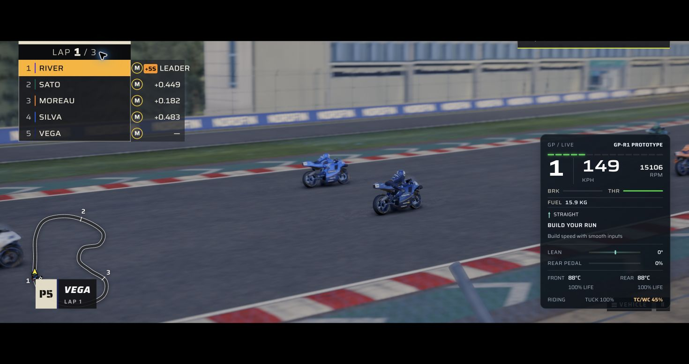

The public game’s race menu started this eight-rider Grand Prix at Aurel Grand Circuit. The trackside camera caught the field accelerating on the first lap, with the GP-R1 telemetry reading 149 km/h. This frame includes the live broadcast overlay.


The GP-R1 enters a bend at Haarveld at 122 km/h and 22.3° of lean. The steering-mounted display shows the same speed as the simulation. The race stills use the production simulation and Three.js renderer on High with seed 34100 and alternating GP-R1 and GP-R2 machines. They are 800 × 450 unless a different resolution is given.

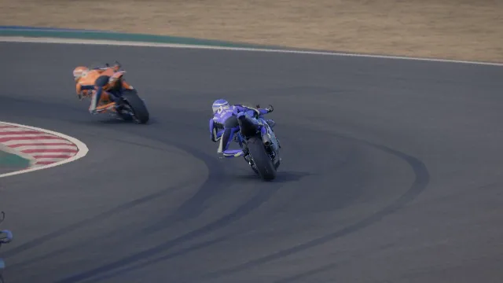

The trackside camera follows four AI riders through the bend at Poggio Alto. Lean on the followed bike increases from 21.8° to 32.5°. The 640 × 360 sequence contains 48 distinct renders at 24 fps. Every frame advances five physics ticks. [1920 × 1080 race still](poggio-corner.jpg) · [Frame telemetry](poggio-corner-telemetry.json)

| Poggio Alto, dry start | Cape Wrenna, wet start |
| --- | --- |
|  |  |


The timing bridges span the surveyed road and pit widths. Front and rear contact points sample water and rubber independently. Wheel load and the local water film determine the source of the spray. A surveyed plane gives nearby wet surfaces a reflection that follows the slope and bank through corners.

## Start-line broadcast camera

| Earlier tower | Revised tower |
| --- | --- |
| 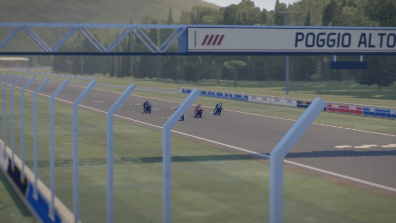 |  |

Both frames show the same four riders at 7.0 seconds. The camera and its visible tower now sit on the public side of the barrier, with the lens 7.1 metres above the surveyed surface. Across all four GP circuits, 684 camera-to-tyre sightlines cleared the fence crown by at least 1.5 metres. The fence remains visible at the lower left of the revised shot.

## Twelve-rider race at Poggio Alto

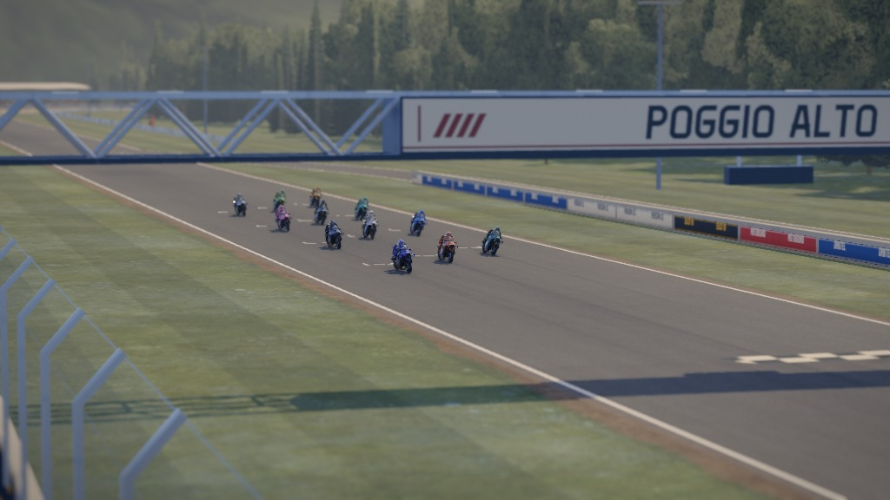

Six GP-R1 and six GP-R2 machines are accelerating at 21–32 km/h. At this 1024 × 576 resolution the followed motorcycle uses the full model and the eleven opponents use the middle model. Narrowing the lens, moving closer or increasing the render resolution brings back the fine wheel, brake and rider geometry. Two transition bands keep detail stable when a rider approaches a changeover distance.

| At the same camera position and race tick | Earlier field | Revised field |
| --- | ---: | ---: |
| Draw calls across all passes | 2,698 | 2,269 |
| Submitted triangles across all passes | 7,272,029 | 5,798,260 |
| Shadow triangles | 2,655,278 | 1,942,876 |

The 351 × 124 crop enclosing all twelve riders differed by an average of 0.94 per 8-bit colour channel. Distance along the circuit, speed and lean angle matched exactly for every rider in both runs. With both fields rendered as opaque silhouettes from the same lens, 99.0% of the covered pixels were shared. The chassis, front and rear axles and helmet kept the same world positions to within 0.001 mm when the models switched. In the overlay, white pixels belong to both meshes, red to the earlier field and green to the revised field. [Silhouette overlay](poggio-full-grid-silhouette.png) · [Earlier frame](poggio-full-grid-before.jpg) · [Per-rider telemetry and image measurements](poggio-full-grid-telemetry.json)

## Montejaral after dark

| Earlier pavilion | Revised pavilion |
| --- | --- |
|  |  |

The GP-R1 is travelling at 161 km/h in both shots, 12.5 seconds into the same dry race. The roof now reflects the venue lighting and the two glazed floors emit through individual window bays. Both frames submitted 1,596 draw calls and 1,144,160 triangles with identical camera and exposure settings.

## Motorcycle and rider

| GP-R1 under braking | GP-R2 rear wheel |
| --- | --- |
|  |  |
| **109,852 triangles** in the complete High model | **109,230 triangles** in the complete High model |

| Visor and face | Steering-mounted display |
| --- | --- |
| 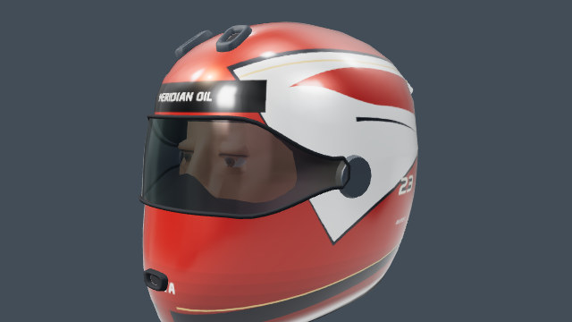 |  |

These close-ups use the game meshes under controlled lighting. The brake pose sets the same inputs as the riding renderer. The dashboard capture shows 15,200 RPM. The temperature, lean, speed and gear channels use the live instrument code. A held or rewound frame restores the instrument, rider gaze, leather folds and optical state.

Behind the tinted visor, the brow and temple pads shade the rider’s skin. The wet surface of the eye reflects the lamps at the circuit. In an 86-pixel-wide crop of one eye, moving the test lamp from left to right shifted the centre of the brightest pixels by 65 pixels. Turning off all light reduced the brightest sample to black. Repeating the left lamp position reproduced its original pixels.

## Spectators and wind


Haarveld’s stand has 952 moulded seats. Its six crowd groups share the venue’s railings, flags and roof shadows. This eye-level view uses the production spectators and their distance-dependent meshes. Holding the same rider position reproduced the head-turn image exactly.


This controlled trackside view uses Cape Wrenna’s surveyed bank, standing race crowd and local terrain. This bank carries 165 photographed grass clumps along its unwalked edges. The clumps share the normal track wind and distance fade. Each GP circuit has two viewing banks. The wind sleeve has an open mouth, a suspended bridle and a tapered fabric outlet. In the Cape close-up, reversing the recorded wind changed 19,792 pixels. Restoring it produced the original pixels exactly.

## Practice through the game menus

| Poggio Alto, chase view at 196 km/h | Wet cockpit at 155 km/h |
| --- | --- |
| 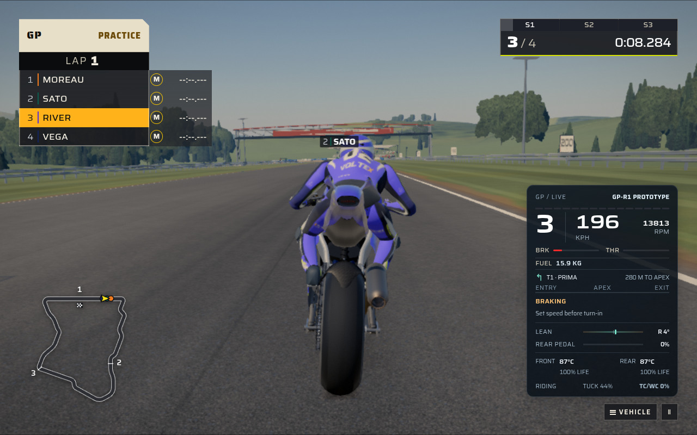 | 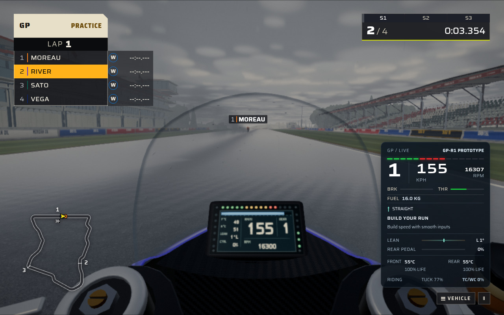 |

These 1280 × 800 screenshots came from the production build’s dry and wet practice tests. Both tests entered through the menus and used the Low preset. The wet practice test enabled full spray density. The dry run also switched to the cockpit, paused and opened the recorded replay. [Hosted test run and original attachments](https://github.com/cheshmakzanoon-ops/Experiment-3/actions/runs/45104672026)

## Measurements

| Comparison | Result |
| --- | --- |
| Poggio Alto chase camera, dry, same simulation tick at 6.5 s | The shadow pass fell from 2,325,998 to 1,820,318 submitted triangles. The colour pass stayed at 2,628,362. |
| Four low-detail shadow casters against the next higher tier, same sun and camera | 96.1% silhouette intersection over union |
| Distant spectators against the 3D crowd, same camera | Standing silhouette agreement rose from 28.9% to 86.0%. Rear seated agreement was 75.5%. Each distant spectator uses two triangles. |
| Dry road shimmer, controlled foreground and sky | Shimmer changed 5,071 pixels. All 12,160 sampled foreground pixels and the sky stayed fixed. The rain control produced zero changed pixels. |
| Montejaral night camera, same 27 × 27 pixel region above the GP-R1 rear tyre | The number of bright pixels fell from 37 to 2 (mean 8-bit RGB above 155). In the separate HDR light test, the revised filter retained 89% of the halo around a 16-pixel-wide floodlight while reducing halo energy around a single-pixel glint by 90%. |
| Twelve riders, two wet laps of Cape Wrenna, fixed 120 Hz | All twelve riders finished without a fall in each run. The combined race and track-surface digest matched after 63,484 steps. [Results for every entrant](cape-full-field-replay.json) |
| Eight riders, two wet laps of Poggio Alto, fixed 120 Hz | Both runs classified all eight riders with zero falls and the same replay digest after 70,897 steps. |
| One-lap races at Aurel, Cape Wrenna, Haarveld and Poggio Alto, twelve riders per circuit | All 48 entrants finished with zero falls. Peak speeds were 243.9, 278.5, 232.4 and 293.4 km/h respectively. Cape Wrenna and Haarveld ran in rain. Aurel and Poggio Alto ran in clear weather. |

The revised twelve-rider grid, the Full HD corner and the menu-driven practices share one gameplay revision. The tower and pavilion pairs preserve the original captures from those stages of development. [Gameplay commit](https://github.com/cheshmakzanoon-ops/Experiment-3/commit/d02273c9fe8a25ce55c9baa6b45734befce3fee9)

The geometry measurements count submitted primitives across separately recorded passes. The High race frames and controlled model views used Chromium with SwiftShader. The menu-driven practice frames used Chromium with Mesa llvmpipe. Physical-GPU frame times and console image-quality parity require hardware measurement.

The hardware benchmark runs the GP journey through the game and records the GPU identity, presented frame rates and longest stall.

```sh
npm run bench:gpu -- --journeys gp-race --qualities high --target-quality high --viewport 1920x1080
```

The replay check can be repeated from the repository root.

```sh
node --experimental-transform-types scripts/gp-contact-replay.ts b4e0ef84203401f3be14a8f743ef4b6fe4973cdb3f4341ee578047c145fd52eb
```

The paired photographic checks run through the repository’s browser tests.

```sh
npm run test:e2e -- e2e/gp-visor-and-flags.spec.ts e2e/gp-fan-silhouettes.spec.ts e2e/gp-rider-contact.spec.ts --workers=1
```

To render the same 48 JPEG frames and their telemetry, install the repo dependencies and run the capture from the repository root. The script starts a local Vite server and closes it after the last frame.

```sh
npx playwright install chromium
node scripts/studio/gp-race-clip.mjs ./captures/gp-corner
```
