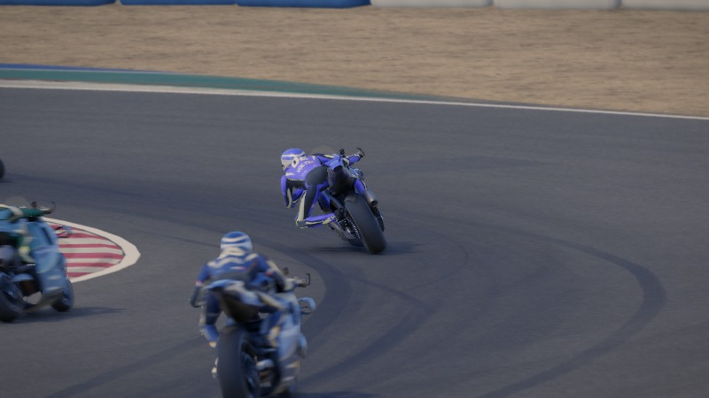
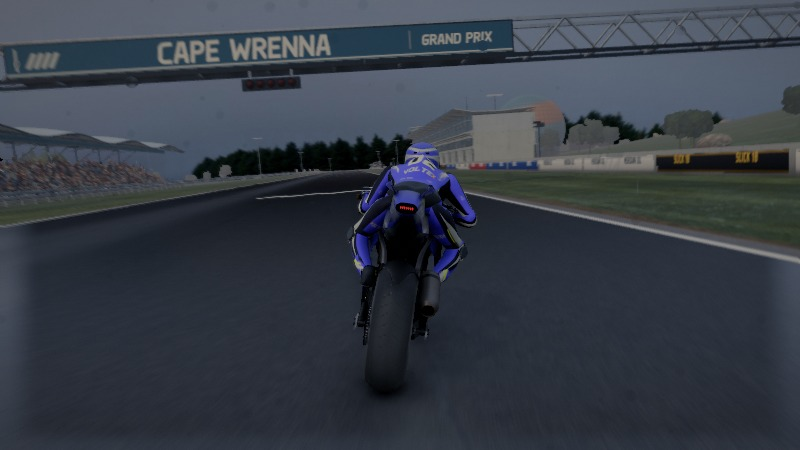
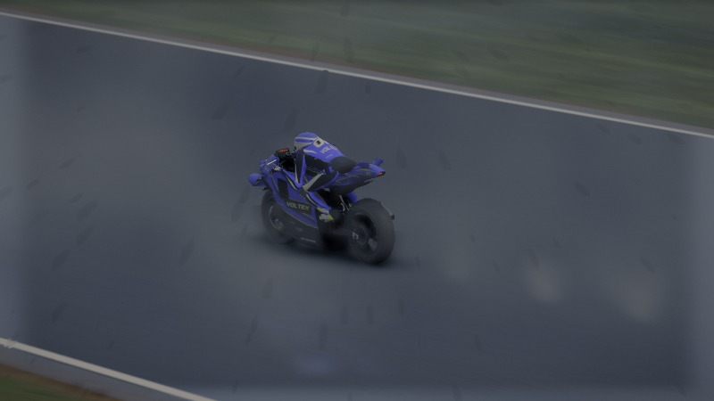
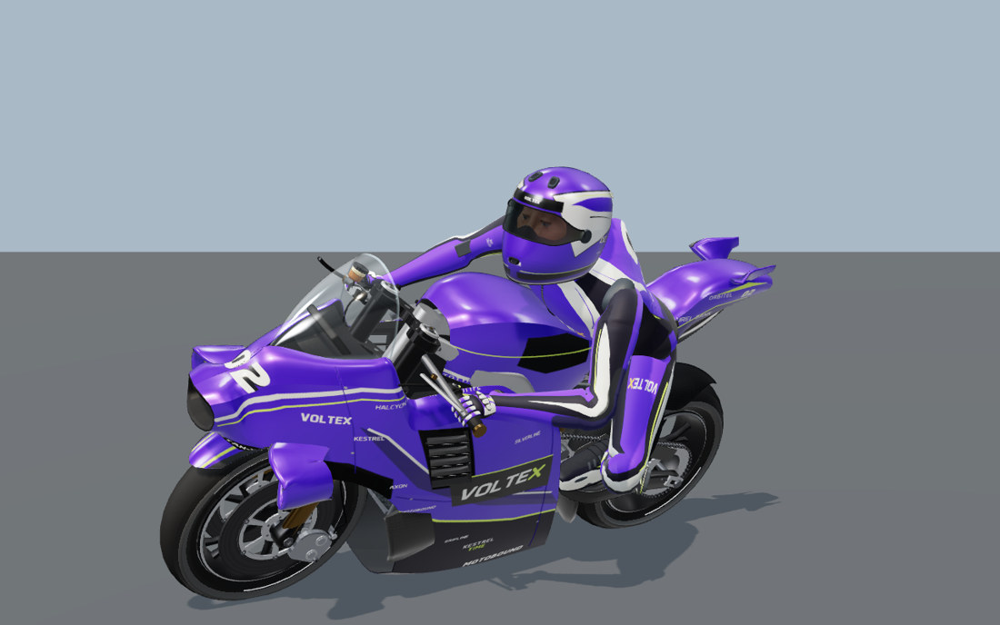
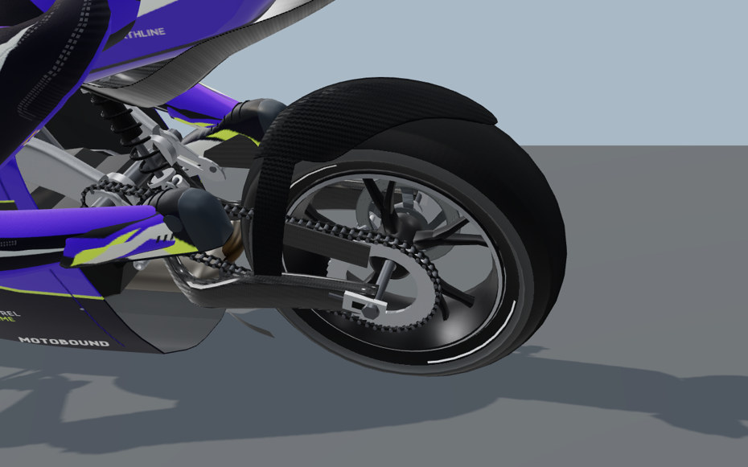
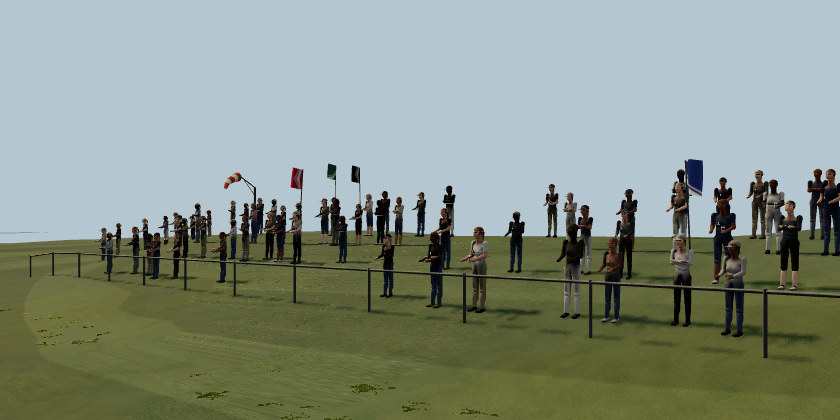

# MotoGP circuit and motorcycle review


The GP-R1 enters a bend at Haarveld at 122 km/h and 22.3° of lean. The steering-mounted display shows the same speed as the simulation. The race stills use the production simulation and Three.js renderer at the High preset, 800 × 450, with seed 34100 and alternating GP-R1 and GP-R2 machines.



Four AI riders enter a bend at Poggio Alto. The trackside camera follows the leading bike as the field crosses the dark rubbered line.

| Poggio Alto, dry start | Cape Wrenna, wet start |
| --- | --- |
|  |  |



The timing bridges span the surveyed road and pit widths. Front and rear contact points sample water and rubber independently. Wheel load and the local water film determine the source of the spray. A surveyed plane gives nearby wet surfaces a reflection that follows the slope and bank through corners.

## Motorcycle and rider

| GP-R1 under braking | GP-R2 rear wheel |
| --- | --- |
|  |  |
| **109,852 triangles** in the complete High model | **109,230 triangles** in the complete High model |

| Visor and face | Steering-mounted display |
| --- | --- |
|  |  |

These close-ups use the game meshes under controlled lighting. The brake pose sets the same inputs as the riding renderer. The dashboard capture shows 15,200 RPM. The temperature, lean, speed and gear channels use the live instrument code. A held or rewound frame restores the instrument, rider gaze, leather folds and optical state.

## Spectators and wind



This controlled trackside view uses Cape Wrenna’s surveyed bank, standing race crowd and local terrain. This bank carries 165 photographed grass clumps along its unwalked edges. The clumps share the normal track wind and distance fade. Each GP circuit has two viewing banks. The wind sleeve has an open mouth, a suspended bridle and a tapered fabric outlet. In the Cape close-up, reversing the recorded wind changed 19,792 pixels. Restoring it produced the original pixels exactly.

## Measurements

| Comparison | Result |
| --- | --- |
| Poggio Alto chase camera, dry, same simulation tick at 6.5 s | The shadow pass fell from 2,325,998 to 1,820,318 submitted triangles. The colour pass stayed at 2,628,362. |
| Four low-detail shadow casters against the next higher tier, same sun and camera | 96.1% silhouette intersection over union |
| Distant spectators against the 3D crowd, same camera | Standing silhouette agreement rose from 28.9% to 86.0%. Rear seated agreement was 75.5%. Each distant spectator uses two triangles. |
| Dry road shimmer, controlled foreground and sky | Shimmer changed 5,071 pixels. All 12,160 sampled foreground pixels and the sky stayed fixed. The rain control produced zero changed pixels. |
| Eight riders, two wet laps of Poggio Alto, fixed 120 Hz | Both runs classified all eight riders with zero falls and the same replay digest after 70,897 steps. |

The geometry measurements count submitted primitives across separately recorded passes. The captures used Chromium’s SwiftShader WebGL2 backend. Physical-GPU frame times and console image-quality parity require hardware measurement.

The replay check can be repeated from the repository root.

```sh
node --experimental-transform-types scripts/gp-contact-replay.ts b4e0ef84203401f3be14a8f743ef4b6fe4973cdb3f4341ee578047c145fd52eb
```

The paired photographic checks run through the repository’s browser tests.

```sh
npm run test:e2e -- e2e/gp-visor-and-flags.spec.ts e2e/gp-fan-silhouettes.spec.ts e2e/gp-rider-contact.spec.ts --workers=1
```
