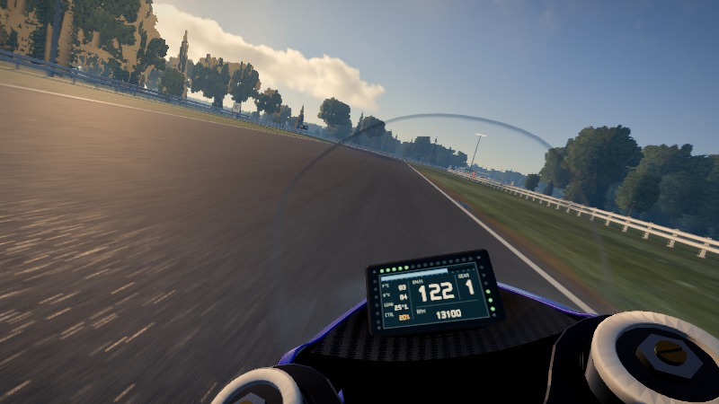
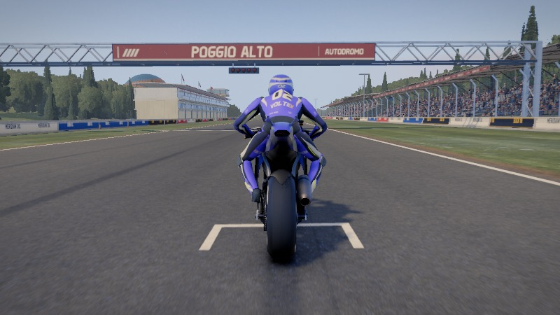
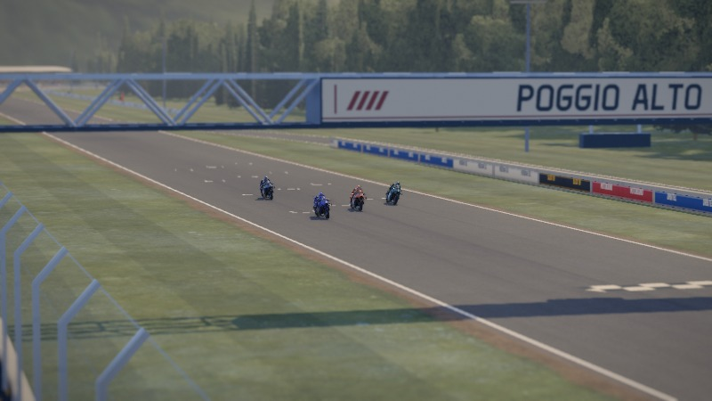
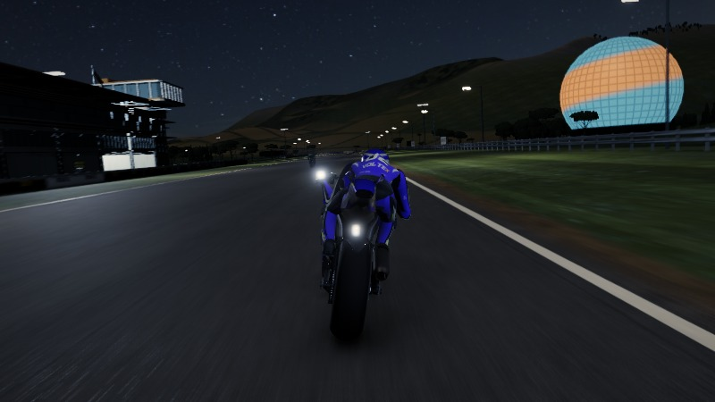
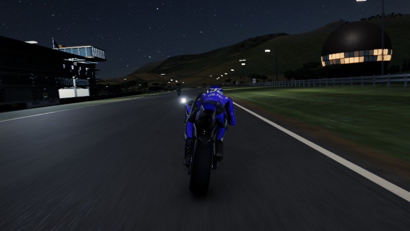
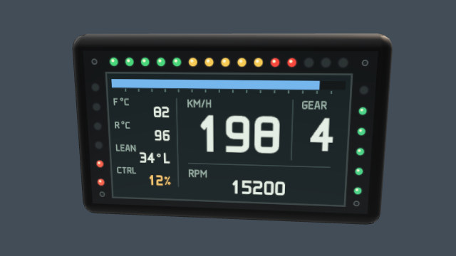
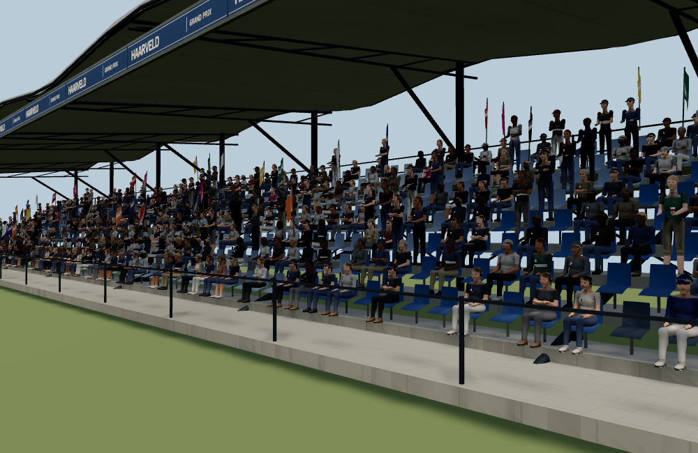

# MotoGP circuit and motorcycle review



The GP-R1 enters a bend at Haarveld at 122 km/h and 22.3° of lean. The steering-mounted display shows the same speed as the simulation. The race stills use the production simulation and Three.js renderer at the High preset, 800 × 450, with seed 34100 and alternating GP-R1 and GP-R2 machines.


The trackside camera follows four AI riders through the bend at Poggio Alto. Lean on the followed bike increases from 21.8° to 32.5°. The 640 × 360 sequence contains 48 distinct renders at 24 fps. Every frame advances five physics ticks. [Full-size still](poggio-corner.jpg) · [Frame telemetry](poggio-corner-telemetry.json)

| Poggio Alto, dry start | Cape Wrenna, wet start |
| --- | --- |
|  |  |


The timing bridges span the surveyed road and pit widths. Front and rear contact points sample water and rubber independently. Wheel load and the local water film determine the source of the spray. A surveyed plane gives nearby wet surfaces a reflection that follows the slope and bank through corners.

## Start-line broadcast camera

| Earlier tower | Revised tower |
| --- | --- |
|  |  |

Both frames show the same four riders at 7.0 seconds. The camera and its visible tower now sit on the public side of the barrier, with the lens 7.1 metres above the surveyed surface. Across all four GP circuits, 684 camera-to-tyre sightlines cleared the fence crown by at least 1.5 metres. The fence remains visible at the lower left of the revised shot.

## Montejaral after dark

| Earlier pavilion | Revised pavilion |
| --- | --- |
|  |  |

The GP-R1 is travelling at 161 km/h in both shots, 12.5 seconds into the same dry race. The roof now reflects the venue lighting and the two glazed floors emit through individual window bays. Both frames submitted 1,596 draw calls and 1,144,160 triangles with identical camera and exposure settings.

## Motorcycle and rider

| GP-R1 under braking | GP-R2 rear wheel |
| --- | --- |
|  |  |
| **109,852 triangles** in the complete High model | **109,230 triangles** in the complete High model |

| Visor and face | Steering-mounted display |
| --- | --- |
|  |  |

These close-ups use the game meshes under controlled lighting. The brake pose sets the same inputs as the riding renderer. The dashboard capture shows 15,200 RPM. The temperature, lean, speed and gear channels use the live instrument code. A held or rewound frame restores the instrument, rider gaze, leather folds and optical state.

## Spectators and wind



Haarveld’s stand has 952 moulded seats. Its six crowd groups share the venue’s railings, flags and roof shadows. This eye-level view uses the production spectators and their distance-dependent meshes. Holding the same rider position reproduced the head-turn image exactly.


This controlled trackside view uses Cape Wrenna’s surveyed bank, standing race crowd and local terrain. This bank carries 165 photographed grass clumps along its unwalked edges. The clumps share the normal track wind and distance fade. Each GP circuit has two viewing banks. The wind sleeve has an open mouth, a suspended bridle and a tapered fabric outlet. In the Cape close-up, reversing the recorded wind changed 19,792 pixels. Restoring it produced the original pixels exactly.

## Practice through the game menus

| Poggio Alto, chase view at 190 km/h | Wet cockpit at 185 km/h |
| --- | --- |
|  |  |

These 1280 × 800 screenshots came from the production build’s dry and wet practice tests. Both tests entered through the menus and used the Low preset. The wet practice test enabled full spray density. The dry run also switched to the cockpit, paused and opened the recorded replay. [Hosted test run and original attachments](https://github.com/cheshmakzanoon-ops/Experiment-3/actions/runs/45096209309)

## Measurements

| Comparison | Result |
| --- | --- |
| Poggio Alto chase camera, dry, same simulation tick at 6.5 s | The shadow pass fell from 2,325,998 to 1,820,318 submitted triangles. The colour pass stayed at 2,628,362. |
| Four low-detail shadow casters against the next higher tier, same sun and camera | 96.1% silhouette intersection over union |
| Distant spectators against the 3D crowd, same camera | Standing silhouette agreement rose from 28.9% to 86.0%. Rear seated agreement was 75.5%. Each distant spectator uses two triangles. |
| Dry road shimmer, controlled foreground and sky | Shimmer changed 5,071 pixels. All 12,160 sampled foreground pixels and the sky stayed fixed. The rain control produced zero changed pixels. |
| Montejaral night camera, same 27 × 27 pixel region above the GP-R1 rear tyre | The number of bright pixels fell from 37 to 2 (mean 8-bit RGB above 155). In the separate HDR light test, the revised filter retained 89% of the halo around a 16-pixel-wide floodlight while reducing halo energy around a single-pixel glint by 90%. |
| Eight riders, two wet laps of Poggio Alto, fixed 120 Hz | Both runs classified all eight riders with zero falls and the same replay digest after 70,897 steps. |

The geometry measurements count submitted primitives across separately recorded passes. The High race frames and controlled model views used Chromium with SwiftShader. The menu-driven practice frames used Chromium with Mesa llvmpipe. Physical-GPU frame times and console image-quality parity require hardware measurement.

The hardware benchmark runs the GP journey through the game and records the GPU identity, presented frame rates and longest stall.

```sh
npm run bench:gpu -- --journeys gp-race --qualities high --target-quality high --viewport 1920x1080
```

The replay check can be repeated from the repository root.

```sh
node --experimental-transform-types scripts/gp-contact-replay.ts b4e0ef84203401f3be14a8f743ef4b6fe4973cdb3f4341ee578047c145fd52eb
```

The paired photographic checks run through the repository’s browser tests.

```sh
npm run test:e2e -- e2e/gp-visor-and-flags.spec.ts e2e/gp-fan-silhouettes.spec.ts e2e/gp-rider-contact.spec.ts --workers=1
```

To render the same 48 JPEG frames and their telemetry, install the repo dependencies and run the capture from the repository root. The script starts a local Vite server and closes it after the last frame.

```sh
npx playwright install chromium
node scripts/studio/gp-race-clip.mjs ./captures/gp-corner
```
