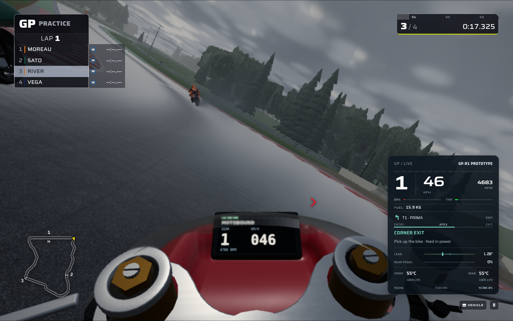

# MotoGP: continuous leathers, visible fork controls, and wheelie touchdown

This pass improves GP-R1 and GP-R2 with procedural Three.js construction and a
focused riding correction. It builds on the existing corner guidance, independent
rear pedal, traction control, wet contact effects, and replay system. It adds no
runtime image assets or dependencies.

The [reference review](REFERENCE_REVIEW.md) records inspection of all 100 images
in the existing MotoGP26 pack, their manifest verification, and the selected
details used here. The pack mixes direct MotoGP imagery and contextual references;
it is not a set of calibrated motorcycle measurements. This pass does not claim
complete photorealism or reproduction of every reference scene.

## Continuous racing leathers

GP high and mid detail now use continuous fitted sleeves and trouser legs. Four
small skinned surfaces follow the existing solved rider pose, with a dedicated
bend ring retaining elbow and knee volume during deep cornering. Compression
folds are part of the garment surface. This removes the former segmented leather
caps, spherical flex joints, and separate patches that could read as an action
figure or float away from a bent limb.

Shoulder and hip openings follow the torso, while cuffs retain the existing
wrist, glove, ankle, and boot contacts. The existing leather finish, livery atlas,
sliders, and wet shading remain in use. Posing updates bone transforms without
rewriting the vertex positions. Recovery and replay use the same pose function.

| Rider inventory       | Before |  After |
| --------------------- | -----: | -----: |
| High-detail triangles | 40,120 | 32,344 |
| High-detail meshes    |     48 |     36 |
| Mid-detail triangles  | 22,668 | 19,468 |
| Mid-detail meshes     |     44 |     32 |
| Far-detail triangles  |  2,748 |  2,748 |

These are model inventories, including hidden meshes, rather than whole-scene
GPU timings. The new skinning uses 16 render bones and four small bone palettes;
material-bound image maps are unchanged. No frame-rate gain is inferred from
triangle or mesh counts alone.

## Fork controls visible from the actual riding eye

The old GP adjusters existed below an opaque fork cap. The replacement has an
open aluminium retaining ring, exposed anodised preload hex, and, at high detail,
a physically recessed screw slot. It uses the same production cockpit camera and
existing materials. Actual adjuster-face visibility improves from 0/12 to 12/12
sampled rays across the two GP bikes. The full measurement and preservation
checks are in [fork-crown-receipt.json](fork-crown-receipt.json).

The crown adds 872 triangles at high detail and 480 at mid, without adding
steering mesh or material batches. Combined with the garment reduction, complete
high-detail models change from 107,617 to **100,713 triangles for GP-R1**, and
from 99,916 to **93,012 for GP-R2**. GP far models and the inspected non-GP model
geometry retain their previous construction.

## Steering follows front lift and touchdown

Previously, handlebar angle generated road steering even when the front tyre
was unloaded. Releasing the throttle also restored the quasi-static normal load
before the visibly raised wheel reached the road.

GP steering now depends on both front load and the recorded wheelie attitude.
It fades through the lowest 5% of static front load and is absent while the
front wheel is more than 2 mm above the road plane. The final 2 mm blend contact
back in. The last part of the existing pitch descent closes at a minimum
0.2 rad/s and stops exactly at zero, allowing a finite touchdown. The same
curvature controls heading, roll response, lateral tyre demand, and body yaw.

The **FRONT LIFT** cue uses the same contact calculation. It remains visible
through coasting descent and clears when the front settles, including in held
or replayed frames. Ordinary supported riding remains identical in 48 paired
profiles covering both GP bikes, Sport/Raw, three wheelie maps, two grip levels,
and both 120/240 Hz timesteps. Raw wheelspin and loop-over risk remain possible.

In the controlled lift/release comparison, unsupported steering yaw changes
from 0.01078–0.01148 radians to zero during lift, and from 0.08461–0.08547 radians
to zero during visibly airborne descent. Both GP bikes settle and remain riding;
touchdown occurs 0.750 s after release at 120 Hz and 0.7625 s at 240 Hz. These are
results of the specified test input, not universal real-world landing times.
The [comparison receipt](front-contact-comparison.json) includes inputs and hashes.

This remains a reduced motorcycle model. The load ramp, contact tolerance, and
settling rate are authored response tuning. Full single-wheel balance, rear-tyre
camber steering, and the inherited quasi-static front hydraulic braking model
are outside this correction. This GP correction introduced physics category
**11** without adding replay state or changing the transport schema. The later
shared engine update is preserved: the integrated source uses physics **12**
and snapshot protocol **14**, including its recorded wheel motion.

## Prepare the sky actually used by the menu

Initial lighting preparation now uses the same Float32 cloud cover as the menu
snapshot. The previous zero-cloud preparation left a cloud-field bake, panorama,
and second environment-lighting bin for the first menu draw. Preparing the actual
menu value also avoids a redundant atlas blend caused by decimal/Float32
rounding. Cache tests cover standard/high detail and day/night/sunset lighting.
The incoming showroom-only startup is preserved, with its initial preparation
using the same daylight illumination as the studio even for a night venue.
The displayed weather, quality settings, GPU completion gates, and browser test
deadlines are unchanged.

GP loading also identifies the field as riders and gives motorcycle construction
its own visible preparation stage. It yields for the loader to repaint and checks
cancellation before building the bike models. This makes the stage and cancellation
behavior explicit; it does not remove the inherited Formula host construction or
claim a measured startup-time reduction.

The menu-to-circuit renderer handoff also clears stale texture-upload flags before
Three.js creates its fallback 3D textures. A real WebGL regression reproduces the
old invalid uploads and verifies that the replacement renderer allocates them
successfully while retaining ordinary 2D texture orientation. This fixes a
reproduced graphics-state defect; full circuit-entry timing is recorded separately.

## Actual in-game view

This unedited browser capture comes from the completed four-rider wet practice
journey at Poggio Alto. It uses the original test's Low preset with full particle
density. The exposed fork controls are visible during actual cornering alongside
the existing guidance HUD. This is separate from the neutral model-review views
used to inspect garment contact and instrument visibility.

## Review and try it

Select **GP-R1** or **GP-R2**, **Poggio Alto**, and **Practice**. Use Sport for a
supported session, then try Raw to feel the lift and touchdown behavior. Switch
to the cockpit to inspect the fork crowns and use a deep corner or replay view
to inspect the continuous suit. Default controls include W/S for throttle/front
brake, A/D to steer, Left Shift for the independent motorcycle rear pedal, C to
change camera, and Escape for the session menu.

[Validation results](VALIDATION.md) distinguish focused geometry/physics checks,
actual WebGL captures, complete application journeys, and remaining limits.
