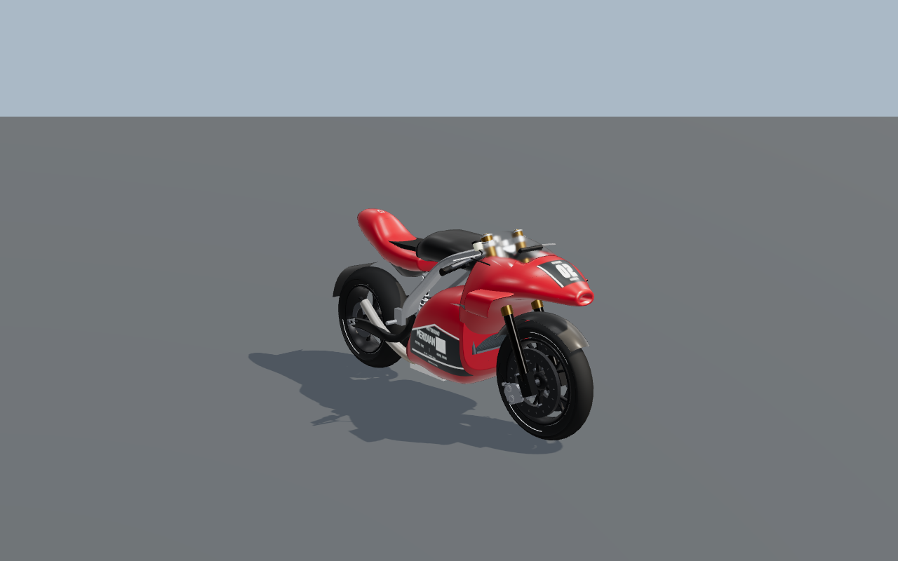
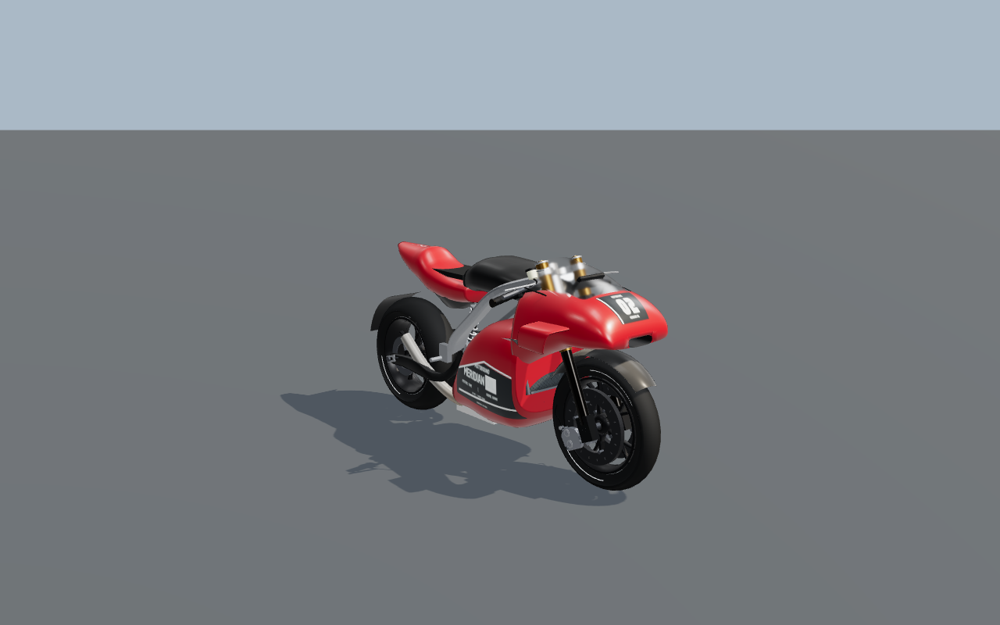
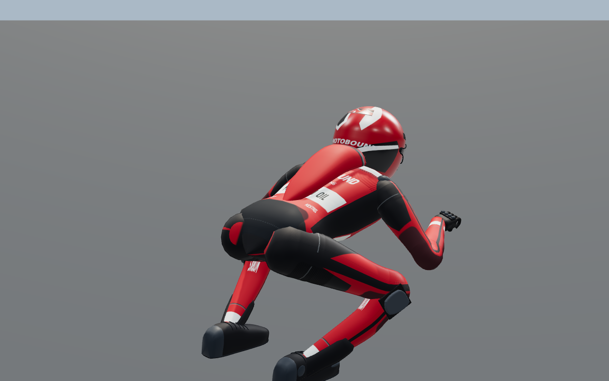
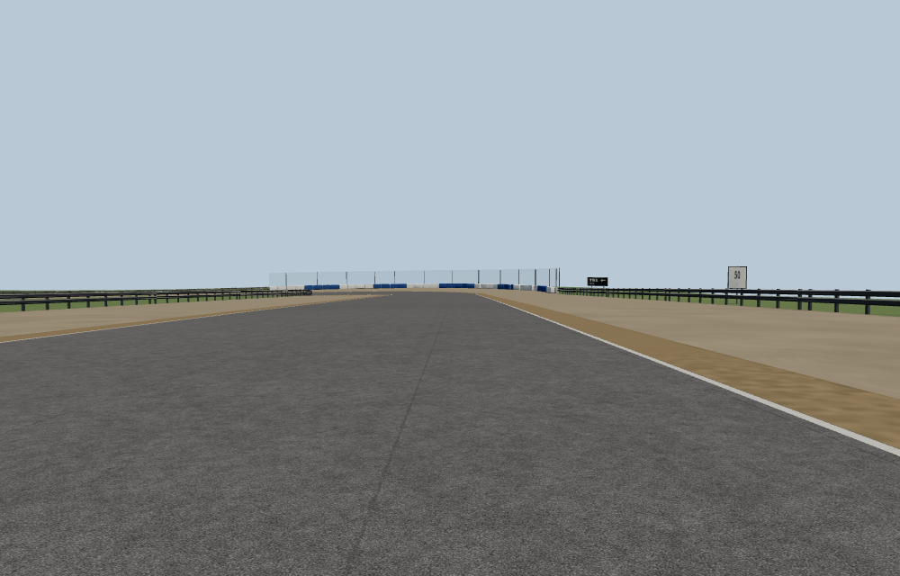
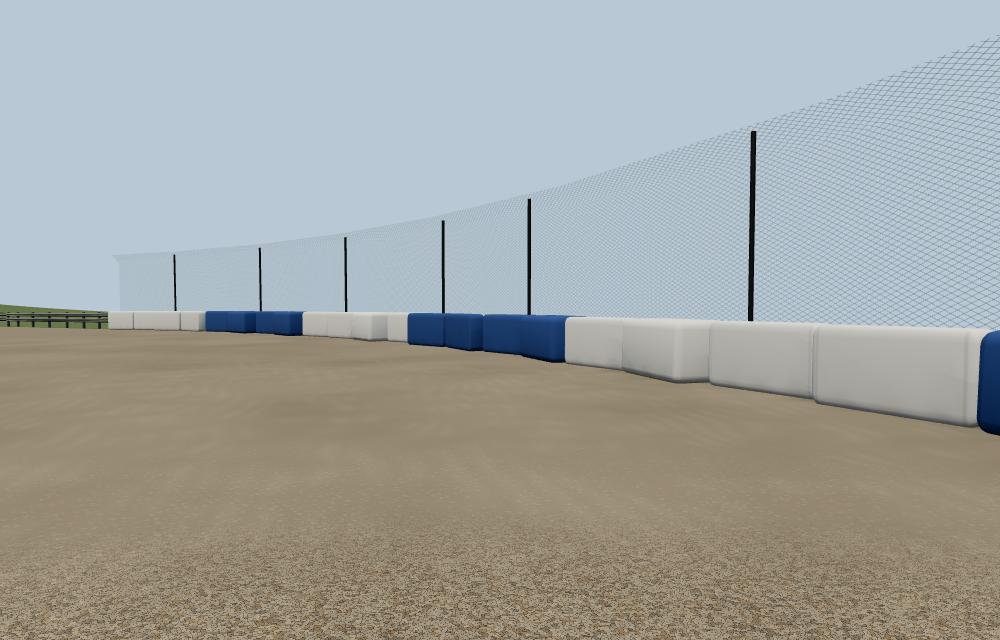

# MotoGP: formed aero, tailored leathers and readable courses

This pass improves GP-R2 bodywork, the GP riders' material construction, and
trackside presentation on the four dedicated GP circuits. The implementation
uses procedural Three.js geometry, material shaders, generated atlases and
selected surfaces from the repository's existing GP mesh data. It adds no
externally loaded image assets or dependencies.

## Reference grounding

The existing `reference/MotoGP26/MotoGP26_PS5_100_Reference_Images.zip` was checked
against its manifest: all 100 numbered images and their hashes match. All ten
contact sheets were inspected, with selected images also reviewed at native
resolution. The retained classification is 65 direct GP references and 35
contextual references. The archive SHA-256 is
`478517180397aa7022b508264e2e6383f721ea930a4035ef314e2e8fb421e7c6`.

| Reference observations | Implementation |
| --- | --- |
| REF018/049/056/060: swept aero, formed roots and visible carbon cavities | Continuous GP-R2 loop wings and conformal paint |
| REF018/065/071/098: smooth broad leather, ribbed shoulder/hip areas and matte inner joints | Separate torso and limb tailoring recipes on the existing rider skin |
| REF018/071: reinforced toes, thin soles and continuous instep/cuff shapes | GP-only boot profile and closer-fitting protective pieces |
| REF082/094: rounded blue/off-white segmented barriers | Original instanced protective covers on existing tyre-wall spans |
| Visible course landmarks and approach context throughout the archive | Authored distance/identity boards tied to the actual road geometry |

The images are visual references, not calibrated measurements. Cover dimensions,
seams, webbing and the numerical distance-board scheme are authored decisions.
The pass does not reproduce every reference scene or claim complete hyperrealism.

## GP-R2 bodywork

The front aero now forms continuous swept loops, with rounded leading edges,
thinner trailing sections and carbon inner faces. Lower roots sit inside the
existing fairing, replacing the former intersecting box sections.

The pointed catalogue nose is replaced with a shorter, broader cowl and a real
recessed intake. Its forward surfaces are selected from the repository's
existing GP mesh data. A GP-R2-specific rounded channel opens the rear of that
shell for the steering and fork assembly, with a thin dark edge return and
local clearance relief below the intake. Triangle clipping interpolates the
surface attributes; it does not discard whole intersected faces. The original
GP-R1 source arrays and bodywork path are retained.

The tail crown now settles into a shallower profile behind the seat. Its
underside, lateral envelope and attachment region remain fixed. High and mid
cowl clearance checks include both painted surfaces and the dark return across
nine travel/steering poses for each detail level (18 checks) on a 6 mm grid;
each sampled column stays within the original
2 mm no-regression gate. This is sampled evidence, not continuous collision
proof. The new cowl stays below the previous cowl triangle
budget at every detail level. Far detail adds one dark-material draw for the
retained intake and edge return.

Both lower flanks use the entrant paint and a conformal identity atlas; the
nose, tank and tail use the same projection path. Floating circular number
plates and the separate lower stripe are removed.

The same original team typography is retained. GP-R1 keeps its existing bodywork
path. The bike's contact anchors, steering/suspension kinematics and recorded pose are unchanged.

These paired 1280 × 800 images use the actual production BikeModel/materials,
with the rider hidden to inspect bodywork. The controlled before phase restores
only the catalogue cowl and unflattened tail in otherwise-current source. The
obsolete 16-triangle black circle intake remains absent; this is neither the
original repository state nor an exact earlier code revision. Exact
substitutions and source hashes are retained in the comparison receipt.

The controlled pair changes complete-model inventory from 95,852 to 93,813
triangles and submitted triangles from 124,884 to 121,587. Submitted calls rise
from 115 to 117 for the real duct/return batch. The final view holds 71 geometries,
18 textures and 49 programs; resources remain constant through its sequence.
Inventory includes the hidden rider, while submitted counts include render
passes, so those two triangle measures are intentionally distinct. These are
isolated construction statistics, not complete-game FPS.

## GP rider materials

The existing continuous skinned sleeves and trouser legs now distinguish smooth
abrasion leather from matte inner-elbow/knee panels. The torso adds a ribbed
shoulder saddle beside the airbag housing and a reinforced seat panel. Filtered
seam channels, paired stitches, restrained wear and fine fabric relief support
those larger material areas.

Two constant tailoring coordinates add eight bytes per existing continuous
sleeve/trouser vertex.
The material follows bind-space coordinates through the existing skinning,
without new mesh parts, material slots, textures or animation history. Narrow
seams preserve their coverage at distance; wetness continues to own the final
surface roughness.

The GP boots now have a blunt closed toe, flatter footbed and raised instep
continuous with the cuff. Heel, ankle and toe protection sit closer to the
upper, and the upper/cuff share a finish. The existing sole contact height,
peg/ankle transforms, total triangles and draw count are preserved at every
detail level. The other motorcycle families retain their original boot path.

## Track presentation and riding references

Poggio Alto, Cape Wrenna, Haarveld and Montejaral now share a road-derived board
plan. Distance markers measure 200/150/100/50 metres before the sampled beginning
of a bend, where there is a sufficiently straight preceding section. Linked
corners retain their identity panels without borrowing the previous bend's
braking zone. Each identifier names the turn and shows its direction.

The previous fixed apex-minus-40-metre datum put some markers inside longer
turns. At Cape Wrenna's Southern Sweep, the 50 m board moves 100 m earlier, onto
the straight. The UI guide and physical markers use the same extracted corner
shape calculation. These are distance references, not guaranteed braking points
or recommended speeds. This is the gameplay contribution of this pass: stronger
physical landmarks support learning the circuits and using the existing corner
guide. Vehicle physics, assistance settings and race rules are unchanged.

Boards have grounded supports, a bounded shared atlas, approaching-eye face
orientation, stable printed-face depth and a separate distance-culling group for
each corner. This makes visibility depend on the local approach rather than the
whole circuit's centre. Unit checks cover the local culling behavior; the
isolated pixel review covers Poggio's Prima approach. Placement excludes other
track sections, spectator structures and occupied kit footprints.

Rounded protective covers replace only existing GP tyre-stack/belt frontage.
The backing follows the existing boundary in short segments so it stays behind
the covers around a bend. Its concrete cross-section, fencing, riding surface and
physical collision boundaries are retained. A shared 300-triangle shell and one
material feed an instanced draw per populated chunk. The cover fit accounts for stepped runoff boundaries,
keeps frames orthogonal and separates adjoining ends.

| Course | Cover modules | Populated chunks | Cover triangles | Previous tyre/belt triangles |
| --- | ---: | ---: | ---: | ---: |
| Poggio Alto | 45 | 2 | 13,500 | 17,296 |
| Cape Wrenna | 0 | 0 | 0 | 0 |
| Haarveld | 67 | 3 | 20,100 | 28,944 |
| Montejaral | 108 | 3 | 32,400 | 40,010 |

Cape Wrenna has no existing tyre-type spans, so it receives the new markers while
retaining its existing barrier types. Full-course unique-vertex measurements
place the covers between -1.27631 m and -0.10076 m relative to the boundary,
inside the former tyre footprint of [-1.31 m, -0.07 m]. Module ends have at least
a 3.6 cm separating band; lower edges remain embedded in the banked ground.
These are presentation covers, not a new deformable barrier simulation.

These local course captures use application-source fingerprint
`23222e0cd8518eb89f1923c02710f9160353590fd445678704266e9ad6e38cd0`.
They predate the final nose/tail/boot and graphics-preparation changes; the course
files are unchanged since that capture. They show the printed faces without
backing-depth interference and the covers exposed in front of the corrected
curved backing.
The approach submits 42 draws / 30,486 triangles; the padding view submits
17 / 14,740. Both keep 40 geometries, 11 textures and 17 programs resident across
the dry/wet/held/rewind sequence. The fixture has 44 covers because its review
window uses a different chunk alignment from the complete venue's 45-cover
production assembly. These are bounded fixture statistics, not full-game FPS.

## GP graphics preparation

For an entirely GP grid, material preparation now skips only the explicitly
hidden Formula placeholder roots. Three's compiler otherwise traverses hidden
objects as well as visible ones. A fresh traversal view borrows the actual
renderables while the live scene supplies lighting, fog and environment; it
retains all GP detail levels, circuit, pit and service objects. Nothing is
reparented, and render-target state is restored immediately before awaiting the
asynchronous result. The same scope is rebuilt after each original warmup.

Non-GP preparation and quality-change preparation retain their original paths.
This removes unnecessary compilation; it does not remove Formula construction
or resident geometry. Its effect on full-game entry remains unverified locally:
the final production builds were terminated before a final full-game browser run
could start. The earlier entry failures below predate this optimization.

## Validation

The published revision on `main` is
`aad08a3a5449181d6812973c1e6db29d3f621586`, with tree
`1911ffe5b76ab4ca99241e06ffbd5bdc2abdf0e1`. A clean equivalent rebase preserved
the concurrent motocross commit `468749b`; the MotoGP patch is unchanged, and
the shared rider changes were reviewed. The local tests and captures below
precede that upstream rebase and do not establish validation of the published
tree.

The published application-source fingerprint is
`6c5655ef7c5639bb12ecd5ce707dbd57529a34b8038408f8d23102d7456d7ae9`,
computed using the Vite input ordering. This identifies source, not a completed
build. Per-file and evidence hashes are recorded in `evidence/review-identity.json`.

At **2026-10-20 04:19:01 UTC**, the
[MotoGP focused review](https://github.com/cheshmakzanoon-ops/Experiment-3/actions/runs/39368241259)
unit job had passed **514 tests across 45 files in 83.64 seconds**, with the
source-stability guard enabled. Its downloaded JSON report is retained as
`evidence/ci-unit-tests.json`; the downloaded archive matched GitHub's published
SHA-256 digest. These tests ran on the combined published commit after the MX
rebase, and overlap the local tests rather than adding 514 distinct new cases.

The same commit also completed **TypeScript checking and the production build**
(`tsc --noEmit && vite build`) in the
[garage validation job](https://github.com/cheshmakzanoon-ops/Experiment-3/actions/runs/39368241201/job/118449894878).
That job's browser scenes were still running. The focused MotoGP build remained
queued, so its six browser jobs had not started. The broader
[Build and validation](https://github.com/cheshmakzanoon-ops/Experiment-3/actions/runs/39368241205)
jobs were also queued. **No final full-riding or full-CI pass is claimed.** The
exact observation and completed build step are retained in
`evidence/ci-status.json`; these links provide subsequent live results.

- **150 local tests passed across 19 distinct files before the upstream MX
  rebase** (112 in the source-guarded combined run, plus 38 adjacent
  geometry/appearance tests on the frozen pre-rebase candidate), including both GP bike
  models, rider skinning/contact, bodywork, corner guidance, board placement,
  material/resource bounds and barrier visibility/clearance.
- **Changed-source/test ESLint and content validation passed locally before
  the rebase.** Those checks and the 112-test combined run used the
  source-stability guard. The separate 38-test receipt records its unchanged
  source and test hashes.
- **Both final local production-build attempts exited 137 during TypeScript
  checking.** Neither reached application bundling, so there is no completed
  final local typecheck or production-build pass. **No final local full-game
  browser run was started.**
- **Local isolated course WebGL review passed in 22.5 seconds** on verified Mesa
  llvmpipe/ANGLE, at the fixture's unchanged 1000 × 640 resolution. The fixture
  uses production road ribbons, materials, boards and barrier constructors in
  the Poggio Prima region. Its source is the earlier `23222e0c…` fingerprint
  identified with the course images above; the course files remain unchanged.
  Dry/wet, held and rewind states are checked; it is not a full-course or
  complete-game performance test and does not validate the final machine or
  preparation changes.
- **Local GP-R2 bodywork diagnostic passed** at 1280 × 800 for three views, each with
  dry, wet, held and restored states. GL errors remained zero; held/restored
  pixels and resource counts were deterministic.
- **Final local paired rider/boot GLSL review passed** at 1280 × 800 using the
  production Rider and original articulation with non-rider meshes detached.
  Only the boot source differs between its before and after phases; common
  imported source is cached once. Both phases keep 32,344 rider triangles,
  48 geometries, 12 textures and 17 programs. The candidate's dry/wet-pose/held/
  rewind hashes are `3895477953 / 755058639 / 755058639 / 3895477953`, with zero
  GL/browser errors. The two sequences took 22.934 and 38.561 seconds; these are
  diagnostic wall times under shared-host load, not a performance comparison.
  One boot is partly cropped by the unchanged rear framing. The wet view also
  changes pose, so it is not a controlled same-pose wet/dry comparison. The
  earlier 15.275-second isolated shader check and the earlier baseline
  full-model timeout remain separate evidence; the isolated result does not
  establish full-game performance.

The previous warm-cache attempt, after the final course corrections but before
the last nose/tail/boot and compilation refinements, used fingerprint
`23222e0cd8518eb89f1923c02710f9160353590fd445678704266e9ad6e38cd0`.
Both dry and wet journeys finished circuit construction and received the
four-rider GP physics snapshot. Both then failed the unchanged **180-second
entry poll** while the application remained in loading. The dry trace's last
pixels show graphics preparation; the wet trace proves material compilation
returned and the first chase warmup began. A later wet diagnostic reports
**Target crashed**; its relationship to the earlier timeout is not established.
Neither case reached driving, cockpit, pause or replay assertions. The retained
diagnosis distinguishes these boundaries from the earlier cold timeout.

The earlier cold GP-R1/Poggio/four-rider/low-preset journey expired at its
unchanged 300-second deadline during circuit construction. Initial menu,
settings application and GP preview used most of the deadline; race entry began
with about 61.5 seconds remaining. No page, shader or network error was recorded,
but no live riding, cockpit, pause or replay assertion was reached. The wet case
was skipped after that failure. This cold run preceded the final sign-depth and
concrete-backing corrections. Its trace does not identify a cause or attribute
the timeout to the new detail. The retained cold-entry diagnosis remains a
separate result from the later warm-cache attempt described above.

An initial combined unit invocation could not start assertions because the
shared temporary disk was full. Subsequent focused runs used task-specific
memory-backed temporary storage and passed. The first final parallel build then
exited 137 during TypeScript checking with `Killed` in its log; host memory
counters showed OOM kills and usage near the 8 GiB cap. The subsequent isolated
build also exited 137 during TypeScript checking. These are two failed local
build attempts, retained separately from the successful unit and isolated
render receipts. Browser diagnostics and attempted build output also used
memory-backed storage; no workloads, assertions or deadlines were reduced to
work around the resource limits.

The focused GitHub workflow includes the new unit files and an independent
course-construction browser job. Existing full-game, graphics and publication
gates remain required and unchanged.

## Try the changes

Run `npm ci`, then `npm run dev`. Select **GP-R2**, **Poggio Alto** and
**Practice** to inspect the machine and the new Prima corner treatment. Also try
**Cape Wrenna** for the long-corner distance boards, or **Haarveld** and
**Montejaral** for the other GP venue treatments. GP-R1 shares the rider finish.

Default controls are W/S for throttle/front brake, A/D to steer, Left Shift for
the motorcycle rear pedal, C for camera, and Escape for the session menu. The
existing Sport assistance, named-corner guide, independent brake control and
replay remain available.

## Scope and remaining limits

The new detail improves material construction, bodywork continuity and course
readability. Further work on procedural anatomy, tank/frame integration,
small mechanical details and scene lighting could bring the result closer to
photographic realism. Controlled software-renderer captures establish pixels,
shader compatibility and state restoration; they do not certify high-quality
full-grid performance on a physical GPU. The original broad performance and
publication gates remain intact.
