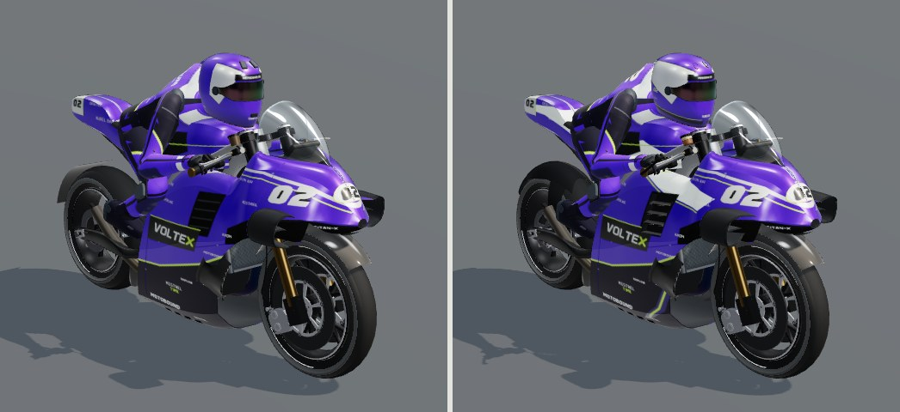
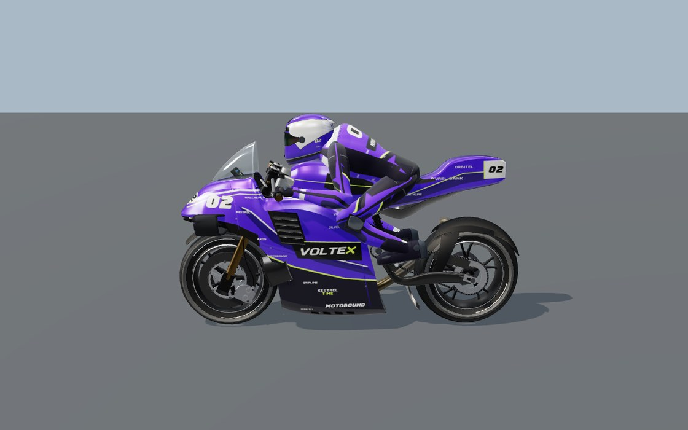
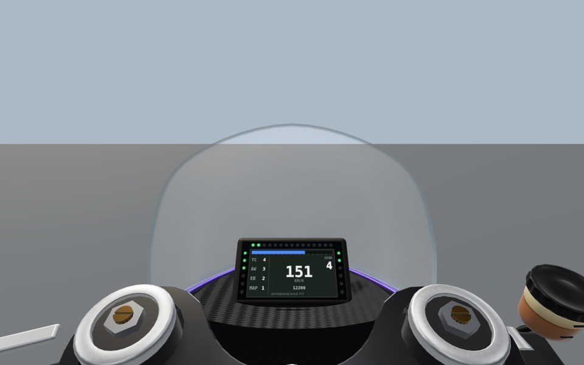
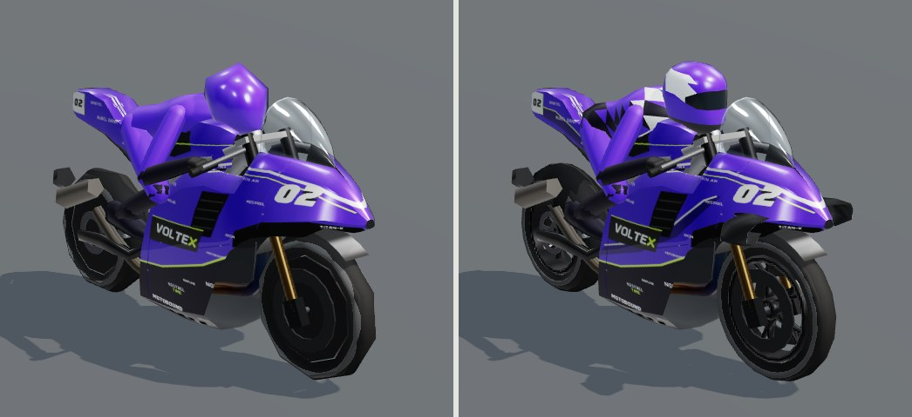
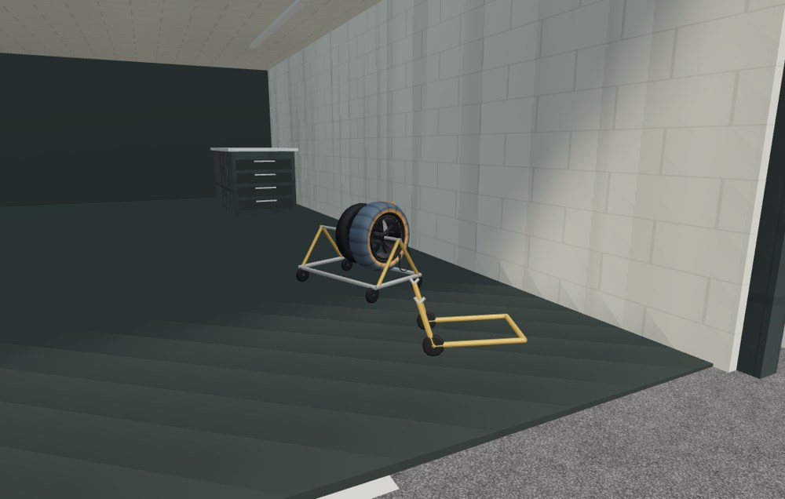
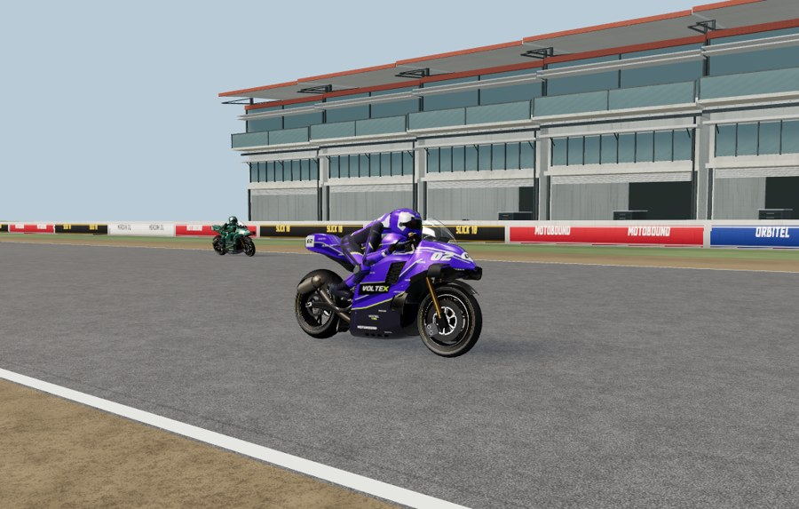
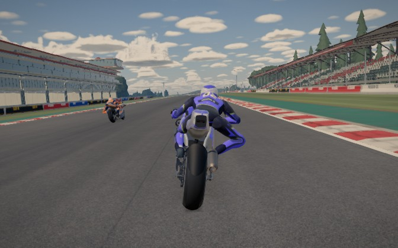

# MotoGP field presentation

The GP-R1 and GP-R2 use the same articulated models in race, replay and photo mode. The comparison frames below use the same camera, light, rider state and model distance. The earlier frame is on the left, from `c59c80b`.

## Motorcycles and riders

The prototypes have open fairing outlets, finished wing roots, distinct paint layouts and a rear hugger attached to the swingarm. The rear axle and sprocket travel together on the arm's real arc. The rotor turns with the wheel and the caliper stays on its carrier. The distant rider retains distinct leathers, helmet and visor colours. The field shares rigid geometry while keeping each entrant's controls, animations, team paint and weather state independent.

The dashboard view shows the formed brake reservoir, clip-ons and lever guard. Front brake squeeze and throttle roll affect the hands independently. The rain light uses the recorded weather state. The helmet has recessed vents and a spoiler whose paint lines join the shell. A rider changing line can move across the saddle before the inside knee opens. At full bank the slider reaches the road with the boot on its peg.

The middle and distant GP-R2 retain its fork, fairing and wheel silhouette at 39,130 and 8,380 triangles.

In Photo Studio, select a GP entrant and choose the helmet, dashboard, front wheel, fairing or tail. The focus point follows the rider, steering or suspension for that detail. The bike's paint and carbon take the local reflection. Switching subjects in a mixed field changes the camera labels and mirror feeds.

## Circuit and field

Poggio Alto, Cape Wrenna, Haarveld and Montejaral use instanced tyre carts and rear paddock stands on GP grids. Each equipped garage has a quilted tyre warmer with a closure tab and a hanging power lead. Six instanced draws cover the equipment for a venue. The garage photograph includes the building and floor.

## Handling

Wheel slip and tyre work use the steered contact at the tyre crown. The suspension samples the next front and rear contact positions using their different velocities as the motorcycle yaws. The GP AI projects sideways momentum toward the edge and looks for narrow-radius turns between its braking samples on steep descents. The rider's lane change and edge correction share a lateral acceleration allowance. Surface grip, braking loads and the crash model continue to determine the result.

Physics version 29 gives the revised simulation its own leaderboard and ghost category. The network handshake checks the same version. Wet-line planning reuses the road curvature already sampled for braking. Across the first 40 seconds of an eight-rider wet race this removed 707,440 calls to the track ribbon. A 95-second run produced identical reported rider states and incident data before and after this optimisation.

## In-game chase camera

The frame below comes from the production racing renderer on the Poggio Alto pit straight at 144.6 km/h with a GP-R2 ahead. This Low preset capture used Chromium with SwiftShader at 672 × 420. The shot exposed premature knee deployment under a small amount of bank and prompted the rider animation correction described above. The frame completed with zero WebGL errors.

## Measurements

| Controlled comparison | Earlier | Revised |
| --- | ---: | ---: |
| Unique rigid and dynamic geometries across eight equipped motorcycles | 1,888 | 646 |
| Unique CPU vertex and index array bytes across those motorcycles | 53,755,584 | 13,910,736 |
| Meshes attached to the active field scene | 2,000 | 996 |

The allocation comparison turns sharing and inactive-detail removal off and on for the same revised art. It measures typed arrays and scene ownership, excluding textures, GPU driver memory and the rest of the circuit. Close, middle and distant GP-R1 review poses contained 107,763, 39,520 and 8,408 triangles. The close GP-R2 contained 106,726. The reference fixture rendered the instrument view in 33 calls on the software WebGL backend.

All eight riders classified on each of the 16 GP clearance circuits, over three laps per circuit. There were five falls across the 128 entries. The eight-rider Arroyo Oro seed improved from 26 falls to one. The separate two-lap wet Poggio Alto race classified eight riders with zero falls, recorded impacts or penalties. The machine-readable results include every circuit, seed, per-rider fall count, best lap and longest stop. [Validation data](validation.json)

The circuit panel and model comparisons can be captured with `e2e/fixtures/gp-paddock-review.ts` and `e2e/fixtures/motogp-reference-review.ts`. The paddock fixture accepts `equipmentOnly` and the `trackside` or `trailing` race view. The race views use two adjacent 120 Hz simulation snapshots, the production motorcycle models and road ribbon, and controlled lighting. Camera and replay checks use `e2e/gp-brake-lever.spec.ts`, `e2e/gp-rear-chassis.spec.ts` and `e2e/gp-rider-motion.spec.ts`. The circuit qualification uses the GP workers in `scripts/bike-clearance.ts`.

## Validation scope

The focused regression run passed 242 checks across 29 files. Eleven seeded handling checks covered the Ardennes hairpins, GP-only dry and wet races, and mixed GP/superbike passing. The contact, grip, pedal, held-frame and rewind browser cases exercised both prototypes. The competitive identity, ghost, network, leaderboard and paddock suite passed 134 checks.

The production TypeScript and Vite build, lint and 4 MB gzip bundle gate passed. The photographs and draw counts come from the local software renderer. Physical PS5 or desktop GPU frame times, input-to-photon latency and human competitive playtesting remain unmeasured. The full automated menu-to-replay test reached its menu deadline after the browser target crashed during startup in this environment. A separate run reached the menu, selected GP-R1 practice with four riders, and entered circuit loading through the normal controls. That browser target closed during venue preparation.
