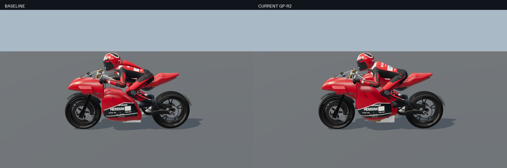
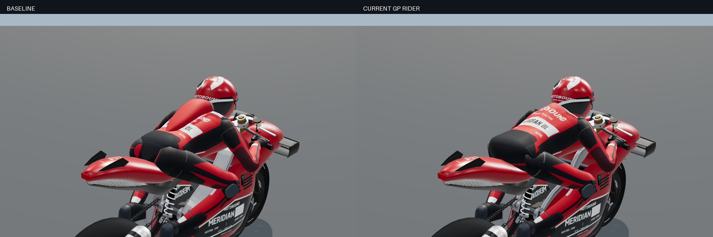
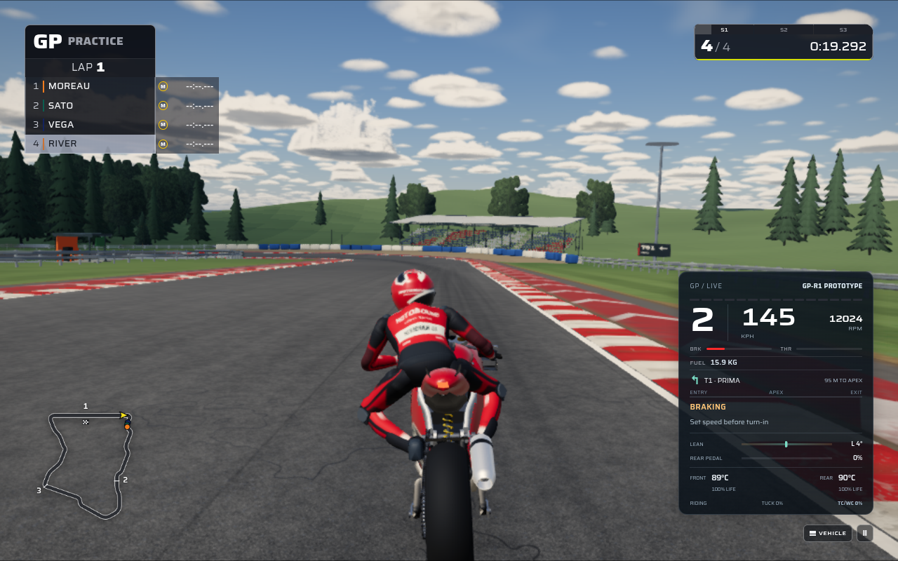

# MotoGP: formed machines, connected riders and corner practice

This pass improves GP motorcycle construction, rider silhouettes and pit buildings on the four dedicated GP circuits. Human riders receive a repeatable practice goal: complete a clean corner, compare its time and exit speed, then improve. New geometry is original procedural Three.js/TypeScript, using the existing material and rendering systems.

## Try it

Choose **GP-R1** or **GP-R2**, select **Free Practice** (the `practice` session), and load **Poggio Alto**, **Cape Wrenna**, **Haarveld** or **Montejaral**. Take human control and ride a complete corner from before its entry to beyond its exit. The corner guide displays a live timer, the current session’s best, and a completion readout with the time difference, exit speed and surface condition. A faster repeat highlights **NEW BEST**.

Practice targets are personal and session-local. Tyre compounds and dry/damp/wet categories have separate comparisons. A different machine, assistance setting or new session clears the targets, including restarting on the same loaded circuit. Pausing preserves an attempt without adding paused wall time; stopping on the circuit keeps the simulation-time clock running.

## Machines and riders

The GP main frame uses shaped aluminium spars whose depth and lateral flare follow the steering-head and pivot locations, with inset pivot collars and captive hardware. GP-R2 receives a fuller tank shoulder, knee scallops, a rounded saddle tongue and recessed fuel-cap hardware, improving the connection between tank, seat and rider.

GP-R2’s lower fairing is authored as a U-section shell around the engine, with an inner skin and closed cut edges. Its shoulder returns meet the nose, while the radiator mouth, steering channel and wheel opening remain actual geometric openings. Detail levels use bounded sampling. The final fairing revision’s acceptance is recorded separately in the validation table below.

For GP riders at high and medium detail, one closed torso mesh now spans the pelvis, waist, shoulders and broad aerodynamic back housing. It replaces the visibly separate hump and gives the seated pose a connected lower back. Sleeve and trouser roots remain embedded in the torso while following the existing limb rig; the root orientation retains limb roll while keeping each opening aligned with its attachment. The hand, boot and knee-slider contact targets continue to use the existing IK solution. Torso topology stays within the previous combined torso/hump triangle budget, with no additional suit textures or animation bones.

Implementation: [main frame and tank](../../../src/rendering/gp-main-frame.ts), [GP-R2 fairing](../../../src/rendering/gp-r2-fairing.ts), [torso](../../../src/rendering/gp-rider-suit.ts), [garment deformation](../../../src/rendering/gp-rider-garment.ts), and [rider assembly](../../../src/rendering/rider.ts).

## Four pit-building identities

Each circuit receives twelve upper-level modules with recessed glazing, projecting terraces, handrails, roof undersides and exposed support framing. Each module follows its own garage foundation, including elevation, banking and the mirrored pit-side orientation. The pit-lane access corridor remains open.

| Circuit     | Architectural identity                                                                      |
| ----------- | ------------------------------------------------------------------------------------------- |
| Poggio Alto | Warm red fascia, shallow folded canopy and two horizontal shade bands.                      |
| Cape Wrenna | Blue-grey fascia and a roof profile that dips through its centre before rising at the rear. |
| Haarveld    | Blue fascia and a repeating sawtooth roof silhouette along the garage row.                  |
| Montejaral  | Ochre fascia, a deeper front overhang and four closely spaced sun screens.                  |

The [architecture builder](../../../src/rendering/venue-kit/gp-paddock-architecture.ts) merges the repeated geometry into six material batches. It adds no textures, lights or per-frame animation. Existing weather-surface and circuit-finish hooks provide the material response. The circuit layout and driving geometry retain their existing definitions.

## Timing and control boundaries

[Corner practice](../../../src/ui/gp-corner-practice.ts) uses the existing curvature-derived entry/apex/exit windows. A complete forward crossing is required, and gate times interpolate coherent simulation samples. `main.accept()` observes every received original worker snapshot before presentation interpolation; the HUD reads the resulting cached state. This keeps graphics cadence from changing a recorded corner time.

AI-driver and replay transitions immediately cancel partial attempts, including transitions between snapshots. A pending pit request also disqualifies timing because pit assistance takes control before lane entry. Observed off-track contacts, invalid track position, impacts, crashes, punctures, cautions, changed warning/penalty counts, falling lap-validity, reversed travel and discontinuous samples cancel the attempt. Previously earned records survive suspension and replay; a new session resets them. This is local practice feedback: it does not grant rewards or alter controls, physics, stored replay frames or persistent records.

## Reference coverage and limits

The supplied [100-image archive](../../../reference/MotoGP26/MotoGP26_PS5_100_Reference_Images.zip) contains a mixed set of GP imagery, other motorcycle modes and interface views. [Integrity metadata](reference/integrity.json) records 100 matching, unique original-image hashes. [Review metadata](reference/review.json) distinguishes the contact-sheet review of all 100 images from additional full-resolution inspection of the listed originals.

| Work                                         | Relevant references                    |
| -------------------------------------------- | -------------------------------------- |
| Frame, tank, saddle and fairing construction | REF004, REF018, REF060, REF076         |
| Rider silhouette and suit attachments        | REF018, REF065, REF071, REF098         |
| Pit architecture                             | REF032, REF034, REF062, REF063, REF077 |
| Compact practice-feedback presentation       | REF015, REF027, REF035, REF083         |

These images inform visible proportions, construction and presentation. Geometry dimensions, circuit architecture and gameplay thresholds are authored choices. No source-game pixels, branded models or reference textures are copied into runtime assets. This pass does not claim to reproduce every reference or achieve photographic realism. The reviewed rear rider view still shows a sharp inner-thigh/pelvis fold that merits further close-up refinement.

## Validation and visual evidence

| Area              | Coverage                                                                                                                            | Final result / evidence                                                                                                                                                                                  |
| ----------------- | ----------------------------------------------------------------------------------------------------------------------------------- | -------------------------------------------------------------------------------------------------------------------------------------------------------------------------------------------------------- |
| Rider             | Connected manifold shell, valid UVs/normals, bounded topology, embedded roots through riding and recovery poses, retained contacts. | Passed: suit, garment, silhouette, glove and contact tests; rear and leaned WebGL views inspected.                                                                                                       |
| Machines          | Frame/tank/seat geometry, steering and contact clearances, final GP-R2 fairing revision and rendered comparison.                    | Passed: 32 frame/tank/family checks; final fairing 6/6 and existing identity/LOD 15/15. Final two WebGL views inspected; 189 calls, 100,640 triangles, no GL errors.                                     |
| Architecture      | Four roof silhouettes, foundation alignment, open access, material/resource bounds and dry/wet views.                               | Passed: 13 GP architecture tests and 5 paddock-detail tests; four-venue WebGL checks and corrected Cape Wrenna rerender. Held and dry/wet/dry restoration matched; disposal returned geometries to zero. |
| Practice          | Clean positive controls, invalidation, lap seam, stationary waits, session reset and control handoffs.                              | Passed: 26 model tests in the 104-test regression run.                                                                                                                                                   |
| HUD/integration   | Real `PresentedFrame` at 30/48/60/90/120/144 Hz; responsive layouts; same-track restart and between-snapshot handoffs.              | Passed: dedicated browser case; six cadences, six viewport/scale combinations, restart, pause, AI and replay handoffs.                                                                                   |
| Runtime journey   | GP-R1, four-rider Poggio Alto practice at Low quality; real menu, physics worker, Three.js scene and recorded replay.               | Passed 1/1 on Mesa/llvmpipe: manual throttle and independent rear pedal, AI handoffs, chase/cockpit views, pause, replay seek/restore and resume. No captured browser, recording or replay errors.       |
| Repository checks | TypeScript, lint, formatting and relevant regression suites.                                                                        | Passed: final TypeScript check, full lint plus changed-file lint, content validation and production Vite bundle. Built source fingerprint matches the current source.                                    |

### Reproduction and scope

Run `npx vitest run tests/gp-corner-practice.test.ts tests/gp-main-frame.test.ts tests/gp-r2-fairing.test.ts tests/gp-rider-silhouette.test.ts tests/gp-paddock-architecture.test.ts` for the new numerical and geometry checks. Run `npx playwright test e2e/motorcycle-presentation.spec.ts --grep "GP personal corner timing"` for the new browser case, using the repository’s existing Playwright server setup. The GP paddock case is `e2e/gp-paddock-architecture.spec.ts`.

The local production bundle used the normal Vite configuration with `build.copyPublicDir=false`; unchanged public assets were then linked into the local output because the shared filesystem was full. Source identity was checked against `BUILD_IDENTITY.json`. The runtime journey used fingerprint `5133ea456f4aee85d4cc59649af02c1998a87fb99598fc33332c0dfa157facf4`. A subsequent whitespace-only formatting cleanup in `bike.ts` produced identical canonical emitted JavaScript; the final rebuilt source has fingerprint `cbf7bed66af2433f8655b1589426f50ea5c69e4ef108a6f41c4edda8264ff6f8`. Both identities and the equivalence check are recorded in the evidence. No runtime asset, package dependency or build configuration was changed.

The existing broader motorcycle HUD regression timed out at its 300-second limit during screenshot capture; its remaining checks are unverified. The dedicated corner-practice browser case and real application journey passed. The journey covers GP-R1 on Poggio Alto at Low quality, including human controls and AI demonstration. A complete human-earned corner record, full human laps and equivalent runtime journeys across the other circuits remain outside that journey’s coverage.

The [journey report](evidence/journey-summary.json), [original run log](evidence/journey-mesa.log), [complete compressed diagnostics](evidence/journey-diagnostics.json.gz), and [legacy HUD result](evidence/legacy-hud-result.json) preserve the successful and incomplete checks. The [validation manifest](validation.json) provides a machine-readable inventory.

Visual checks use software WebGL backends. Draw/triangle and resource counts describe the captured fixtures, not measured frame rates on physical gaming hardware. The pit images deliberately isolate the real garage/roof/pit-wall builders so their construction is visible; they are not full-scene circuit screenshots.

