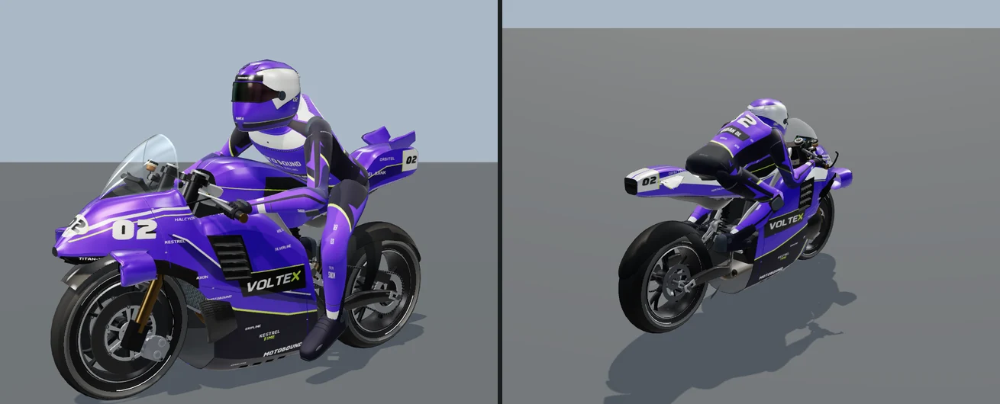
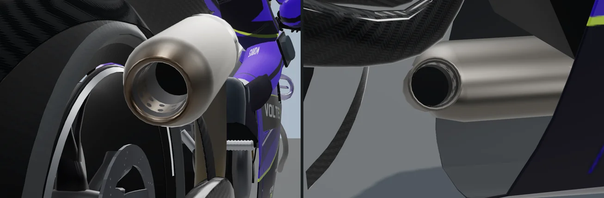
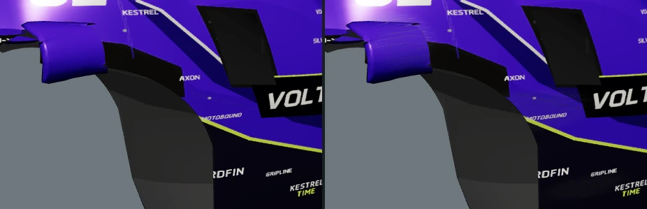
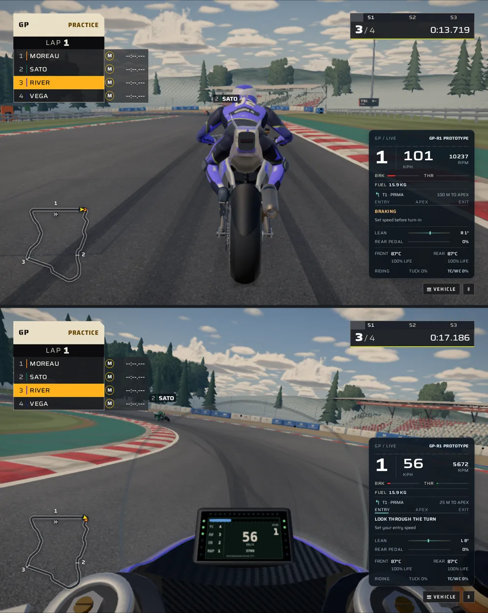
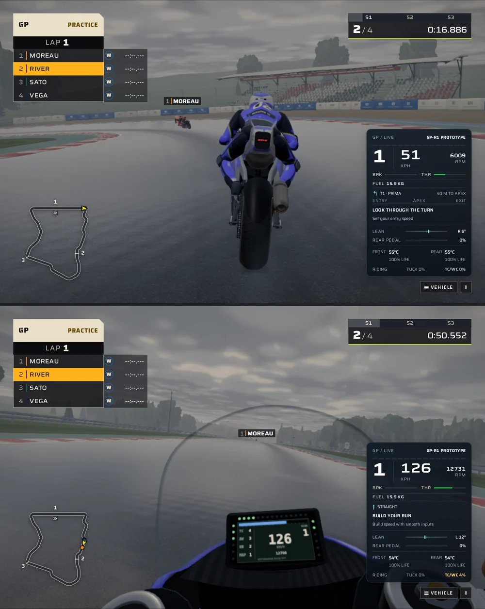
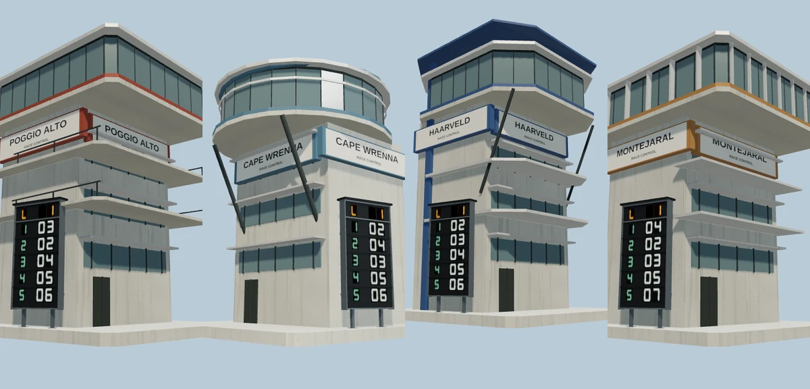
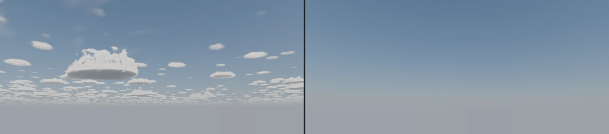

# MotoGP race surfaces and rider sightlines

The supplied 100-image reference pack informed the shape of the front and tail wings, the materials visible around the rider, wet optics, and the relationship between circuit furniture and the landscape. The game uses its original GP-R1 and GP-R2 designs, entrant liveries and venues. Every image here comes from the game's Three.js geometry.

## Prototypes and rider

GP-R1 under braking is on the left. GP-R2 in a tuck is on the right. Both prototypes have a rounded leading edge and a thin trailing edge on the forward wings. Their tail elements have different sections and mountings. The GP helmet's five vents now face away from the shell. A ray from outside each opening reaches its recessed liner, while a ray along its lip hits the moulding.

GP-R1 has a high side-mounted silencer. GP-R2 has a lower belly-side outlet. Each liner has 24 geometric perforations with a recessed backing. The rear-view fixture includes the full bike and seated rider at the High model detail.

| Rear view at 1280 × 800 | Model triangles | Submitted triangles including the test scene | Draw calls |
| --- | ---: | ---: | ---: |
| GP-R1 | 109,459 | 110,425 | 105 |
| GP-R2 | 108,834 | 109,800 | 104 |

The two rear views used Chromium and SwiftShader. Both completed with zero WebGL errors. Model counts exclude the studio floor and additional submitted geometry. Draw counts depend on the camera and scene.

The scuffs follow the cheek and foil surfaces through model-detail changes. The clear coat loses gloss and exposes the dark composite below. The same recorded condition reduces front and rear aerodynamic support, changes suspension compression, and informs the AI braking plan. Pit repairs and replay seeks restore the recorded finish. In a 768 × 448 check of the production fairing, the damaged GP-R1 changed 16,008 pixels by more than two colour levels. GP-R2 changed 18,420. Holding the damaged frame or restoring the intact frame reproduced the corresponding original pixels exactly.

The onboard camera uses the posed helmet's counter-roll and exit glance. Braking, lean and wheel contact also drive the visible rider. Camera cuts and backward seeks reset the motion history. Cockpit tests project the dashboard and ray-check nine sightlines at four aspect ratios. During flight the last wheel’s clearance and the chassis velocity determine the pose on a seek. Liquid precipitation advances on the presented clock, allowing wet pavement after rain stops and frozen droplets when the replay pauses.

The studio views use the production bike and rider in controlled lighting. The two practice sessions below use the normal game menu, simulation worker and interactive renderer on the Low preset at Poggio Alto. The dry session exercises the rear brake, cockpit, pause, backward replay seek and return to driving.

Four GP-R1 riders run on wet tyres in the second session. The chase camera records a rider ahead in spray at 51 km/h. The cockpit view shows the real instrument display and race HUD at 126 km/h. Both tyres reported water contact and all four bikes were upright in the chase sample.

## Circuits

From left to right, the towers belong to Poggio Alto, Cape Wrenna, Haarveld and Montejaral. The displays read the race lap, rank and entrant number from the presented frame. These building views use a six-rider simulation snapshot. The display adds three draws per tower.

The GP tree roots and outer verge now follow the triangles of the displayed landscape. A detailed height function can put a tree metres above a cliff after that cliff has been triangulated. The Cape Wrenna survey found an outer verge 16.83 m above the mesh. The new outer edge overlaps it by 8 cm at the sampled cross-sections. The four venues also use their own woodland, meadow and exposed-rock colours, with distance filtering on narrow rock bands. The catch fence has formed posts, angled returns and tension cables.

Poggio Alto’s asphalt, kerbs, run-off and edge markings now sample each cross-section once for its racing line and paint scheme. A before-and-after comparison covered 530,046 vertices in 396 meshes at Poggio Alto and 300,352 vertices in 228 meshes at Aurel. All vertex attributes, indices and reflection-strip measurements matched byte for byte.

The left panel shows the earlier Low clear preset. The right panel shows the same weather after matching the open daylight in the references. Cloud cover now builds gradually from a trace of cumulus when the GP sky uses the procedural renderer. The same cover drives the daylight, cloud shadows and sky reflections. All seven 720 × 320 sky captures rendered without WebGL errors. The intermediate and overcast skies each produced identical pixels before and after the change. Returning to clear conditions reproduced the right-hand frame exactly.

## Race verification

Sixteen three-lap races ran across the four circuits, with eight entrants alternating between the prototypes. The physics step was 1/120 second. Clear races used medium tyres and rain races used wet tyres. All 128 race entries finished, giving 384 classified rider-laps and zero falls. The longest stationary spell before finishing was 0.79 s. The table gives matched dry and wet times on the same seed at each circuit. [Results for all 16 races](race-results.json)

| Circuit | Seed | Best dry lap | Best wet lap |
| --- | ---: | ---: | ---: |
| Poggio Alto | 32220 | 2:04.884 | 2:49.707 |
| Cape Wrenna | 32230 | 1:43.581 | 2:17.484 |
| Haarveld | 32240 | 1:54.123 | 2:29.620 |
| Montejaral | 32250 | 1:55.163 | 2:40.188 |

Run `node --experimental-transform-types scripts/bike-race.ts --gp-weather-grid` to reproduce the eight independently seeded races in the results file. The numerical and geometry gates are in `tests/road-bike-suspension.test.ts`, `tests/road-bike-presentation.test.ts`, `tests/gp-rider-posture.test.ts`, `tests/bike-cockpit-view.test.ts`, `tests/gp-terrain-surface.test.ts` and `tests/gp-pit-boards.test.ts`.

PlayStation 5 frame pacing, controller latency and competitive human playtesting require hardware measurements.
