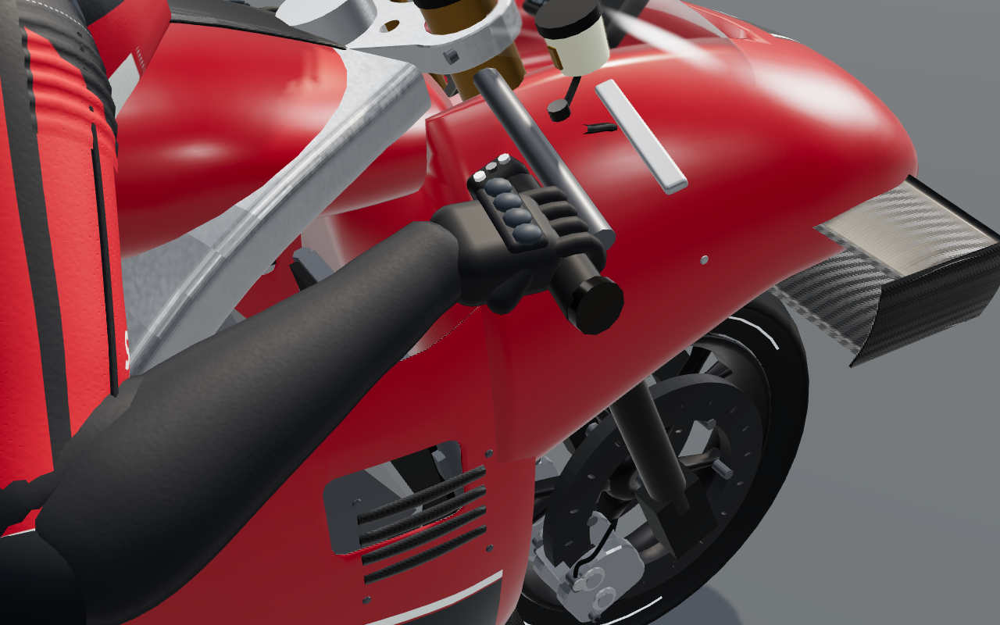
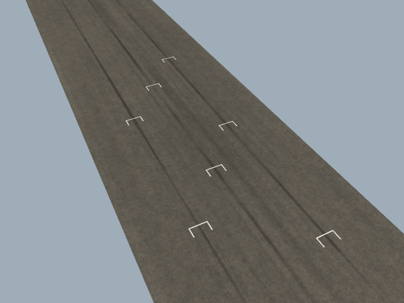
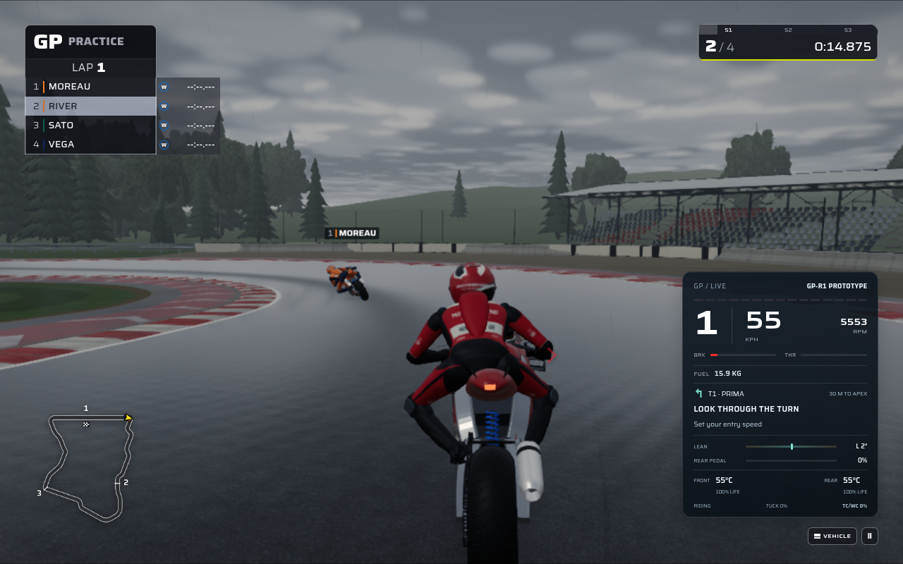

# MotoGP riding and contact refinement

19 October 2026 · GP verification base `08be765` · publication integrated with `main` at `2dc5a0a`

This pass improves the GP prototypes' physical presentation, secondary braking control and race starts using the existing TypeScript/Three.js renderer and simulation. The [reference audit](REFERENCE_AUDIT.md) records a fresh review of all 100 original images, with complete numbered coverage and matching archive-manifest hashes.

## Rider contact and animation

The procedural gloves now follow the actual steering grips, including clip-on cant and steering-axis rake. The solver distinguishes the wrist joint from the point held inside the glove, so changing the rider's tuck or braking posture keeps the hand attached to both the arm and the handlebar. At the extreme braking/hang-off pose, a small shoulder movement within the suit preserves elbow flex and the original arm lengths.

The GP boots now point forward, with the forefoot resting on top of each physical rearset. The previous tucked GP-R1 pose pointed the toe backward: its forward-axis component was approximately -0.787. The planted frame's component is approximately +0.987. The boot cuff articulates at its existing opening and follows the shin while the foot remains planted.

The production geometry, grip/peg anchors and limb lengths remain the basis of the solve. The new contact helper reuses vectors and quaternions. Riding, recovery and replay restoration explicitly set their transforms, avoiding dependence on the previously displayed pose.

A final recovery inspection caught the old reset rotating the newly articulated cuff away from the calf. The GP recovery pose now uses the anatomical ankle attachment and a forward-facing boot frame relative to the torso. The original sliding, jogging and standing limb trajectories remain unchanged; the cuff follows the shin throughout.

The numeric sweep checks **72 complete bike poses**: two GP prototypes, three detail levels, three lean values, two tuck values and two brake values. Every pose checks both hands and both feet. It intersects the actual sole mesh at the physical peg top, verifies all four anatomical segment lengths, and checks cuff alignment, forward-facing toes and resource stability.



The [peg closeup](evidence/peg-after.png) shows the corrected forward-facing forefoot on its rearset. The [recovery inspection](evidence/recovery-after.png) checks ankle and cuff orientation in an isolated model fixture; that fixture retains the bike parent and does not represent the separated rider's in-game world placement.

## More controllable GP braking

With Sport assistance, the rear pedal previously also requested front braking. A rear-only correction could therefore load the fork while the displayed front lever remained released. GP-R1 and GP-R2 now treat that pedal independently. A front-lever input retains Sport's existing front/rear assistance and ABS behavior.

In the controlled GP-R1 check at 35 m/s with a half rear pedal, the old behavior produced approximately **2,368 N of front braking and 163 N of rear braking**. The revised behavior produces **0 N at the front and 950 N at the rear**. The front disc cools and the rear disc heats. These are outputs of the game's solver, not measurements of a real motorcycle.

The rider guide recognizes rear-only braking as **REAR BRAKE**, keeps the current corner context and avoids encouraging a slipstream pass while the pedal is held. Existing grip warnings and marshal instructions retain priority. The guide reads the recorded pedal channel during replay.

The compatibility comparison checks 72 controlled trajectories: 68 remain bit-identical; the four intended differences are GP Sport cases where rear-pedal demand exceeds front-lever demand. Raw and the other motorcycle families retain their existing brake behavior.

## GP starts and road presentation

An entirely GP field now uses three staggered columns. The simulation, short U-shaped front-wheel markings and rear-tyre launch rubber share the same slot calculation. Lateral placement respects track width. Selection comes from the complete presented field, including recorded replay, so changing the followed rider cannot independently select a different grid.

The longitudinal arrangement follows the [FIM's 22 June 2026 decision](https://www.fim-moto.com/en/news/news-detail/article/fim-grand-prix-world-championship-decisions-of-the-grand-prix-commission): a 4 m stagger and 12 m repeat between three-rider rows. The paint dimensions and lateral spread are documented design choices guided by the references and existing bike dimensions.

The marks follow track elevation and bank, receive shadows and use the existing worn-paint material. The shader places one narrow rear-contact launch path at each GP slot. Both paint families are retained and reused through session switches. In the controlled road/paint view, paint triangles fall from **432 to 72**, with **4 scene draw calls for either layout**. The additional retained GP paint geometry occupies **5,040 bytes**.



## Reliable wet pit departures

The full wet race exposed a service-bay departure failure. A rider leaving its stop received an immediate lateral target change while queuing behind another occupied bay, crossed onto grass and fell. The first recorded impact was the lowside itself.

GP riders now join the fast lane along a smooth path anchored to their actual stopped position. The merge progresses over distance, so time spent waiting does not advance it. A minimum 20 m transition extends when needed to bound the added lateral slope at 0.2. The existing traffic priority, queue checks, steering conversion, grip and crash limits remain authoritative.

The focused wet queue test exercises both GP-R1/GP-R2 bay orders. The retained assertions require the following rider to wait **more than 3 s** and minimum separation to stay **above 6.9 m**. Both complete service and exit, and neither reaches grass or gravel on the pit straight.

## Verification

The final production build passes TypeScript and Vite. Lint and content validation pass. The combined publication build's source fingerprint is:

```text
7aa51db816f304ac5cf8f5e25dcebafaf2df49e022f7c22257a2158617d29776
```

After the GP verification, `main` advanced to the Horizon update `2dc5a0ae6d7076e633ac87cf0a4ae4f067fa97d4`. Publication preserves that update. Its 29 changed files have no overlap with this MotoGP pass, and all 28 GP implementation and test files remain byte-identical to the verified versions. An independent review confirmed that the incoming production changes stay inside the Festival/open-world components. Build, lint and content validation were rerun on the combined source. The focused test and browser receipts below retain their original source identities; the final GP-only build fingerprint was `0aae609e1ff1db8adb7fc587578cd74559bb5e39d9f6a6b682869d1002dd70d5`.

| Focused group | Result |
| --- | --- |
| Integrated handling, braking, GP/mixed races and pit release | 81 tests across 7 files passed |
| Grid placement, control feedback and riding cues | 22 tests across 3 files passed |
| Grid paint and existing road-detail behavior | 24 tests across 2 files passed |
| Rider contact, suit, cockpit and model compatibility | 44 tests across 7 files passed |

The race checks include three complete **8-rider, two-lap races**: Aurel clear, Poggio Alto clear and Poggio Alto rain. Every rider finishes with zero impact, crashes, penalties and retirements. The 12-rider clear/rain start checks cover countdown plus 15 seconds after green; every rider advances more than 505 m without impact or a crash. Those start checks are distinct from the complete 8-rider races.

The isolated GP grid WebGL test verifies dry/wet held frames, exact rewind restoration and 90 layout changes without resource growth. Its observed backend is SwiftShader WebGL2, with zero browser or GL errors.

The rider WebGL checks cover both prototypes' grip, peg and extreme-corner views, with held dry/wet frames and exact restoration after rewinding. The GP-R1 grip sequence completed on SwiftShader; the other five riding views and recovery completed on observed Mesa llvmpipe. After the recovery correction, the complete affected 44-test source suite and the recovery browser case passed again. The final recovery case took 5.104 s. These checks use production model geometry, with no added rider meshes, materials or textures.

### Actual application journeys

The real four-rider wet practice journey passed on SwiftShader in **277.027 s**, through the normal menu, production circuit renderer and simulation worker. It verified both wet tyre channels, live spray, chase/cockpit views, worker pause, held particles and resume. The held worker tick was 6,442; presentation time and the complete particle state remained identical while rendered frames advanced from 15 to 19. Browser error count was zero.

That wet capture uses source fingerprint `29b08a1cb5021868b60679bbd26cb603328430b805d18189bd1355d42312faa9`, before the final GP recovery-only correction. The correction did not alter normal riding, road rendering, simulation or effects. Its affected source and recovery WebGL checks were rerun on the final source.

**The complete actual clear-session replay journey remains unaccepted in this environment.** Its SwiftShader run passed manual throttle, the independent rear pedal while moving, named-corner guidance, chase/cockpit views and worker pause, then reached recorded replay and timed out at the first seek. A Mesa attempt with two llvmpipe threads did not reveal the initial menu within the existing 180-second startup deadline. The final-source Mesa attempt with four threads reached the GP menu but lost its graphics context; the application's error dialog then blocked entry until the 300-second test deadline. Neither Mesa attempt entered a GP session.

The [application receipt](evidence/application-verification.json) retains those outcomes and their scope, along with the [final error context](evidence/clear-mesa-error-context.md). Graphics presets, viewport, existing deadlines and assertions were kept intact. The isolated model and grid rewind checks passed, but they do not replace acceptance of the full recorded-session journey. No physical-device frame-rate result is claimed.



### Receipts

- [All 100 reference images: coverage and decisions](REFERENCE_AUDIT.md)
- [Integrated handling and race verification](evidence/riding-verification.json)
- [Grid placement, control feedback and cue tests](evidence/grid-and-cues-test-results.json)
- [Controlled brake comparison](evidence/pedal-comparison.json)
- [12-rider clear/rain starts](evidence/twelve-rider-starts.json)
- [Grid rendering and resource metrics](evidence/grid-metrics.json)
- [Rider contact and recovery verification](evidence/model-contact-summary.json)
- [Actual application journey measurements and attempt history](evidence/application-verification.json)
- [Previous starting-grid presentation](evidence/grid-before.png)

## Trying the changes

Select **GP-R1** or **GP-R2**, **Poggio Alto**, and **Practice**. The **ABS + TC** assist option selects Sport assistance. Default keyboard controls are **W** for throttle, **S/Space** for the front lever, **Left Shift** for the rear pedal, **C** for camera changes and **G** for the existing AI demonstration/takeover toggle. The rear-only cue appears while moving; use the front lever for strong braking. A wet session with wet tyres also exercises the existing two-tyre spray and the revised pit-departure behavior.

The source measurements and software-renderer checks establish specific behavior and resource use. Physical-device frame rates and a human assessment of handling enjoyment remain separate measurements.
