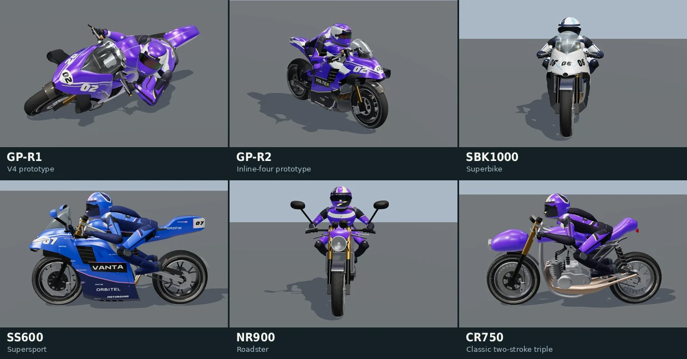
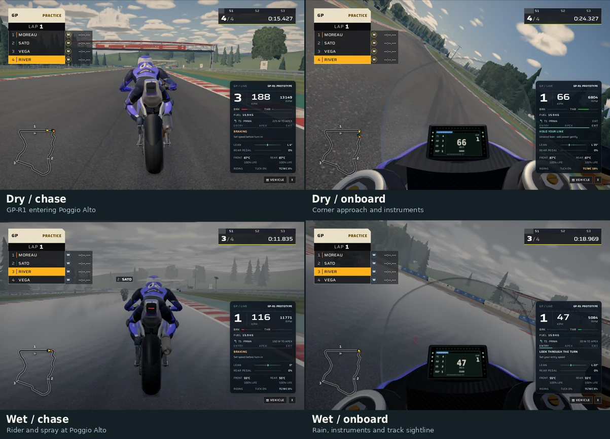
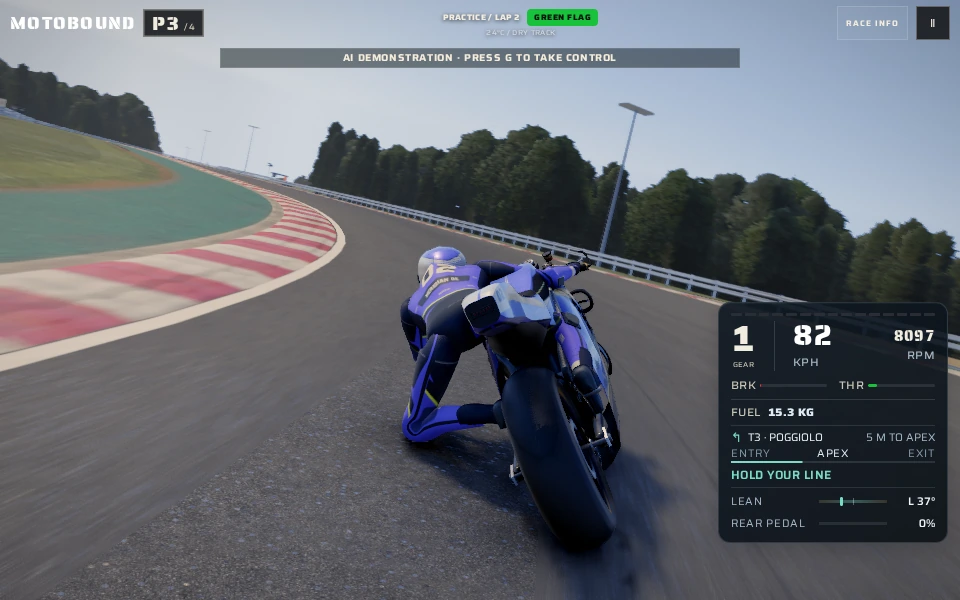

# MotoGP road grid



The studio photographs use the high-detail models from the game. The GP-R1 carries a V4 and the GP-R2 an inline four. The CR750 has three hollow carburettor bellmouths, ribbed spark plugs, a bolted split crankcase and three expansion chambers. A mechanical linkage operates its rear drum. Its oil reservoir sits between the twin shock braces and clears the tyre by at least 74 mm at 91 sampled positions across 90 mm of travel.

[Compare the classic and roadster bodywork](evidence/roadster-and-classic.webp) · [Inspect the CR750 engine bay](evidence/classic-engine.webp)

The four support-class cockpit cameras sit at the rider's eye line, with their view checked against the instruments. The NR900 has a round headlamp and handlebar-mounted mirrors. Its view of the track behind sweeps with its bars. The SS600 mounts its mirrors on the fairing. Both bikes reflect the sightline from the rider's eye through each mirror and keep the mirror centres in frame through the tested steering and banking angles at 4:3, 16:10 and 16:9.

[Compare the NR900 cockpit before and after](evidence/roadster-cockpit.webp) · [Ride onboard the SS600](evidence/supersport-cockpit.webp)

## On the circuit

Tyre width, crown and rolling radius follow the machine. The fixed-step simulation resolves braking and lateral force against each wheel's rolling direction on the road. That keeps tyre slip, heat and steering consistent over banking and changes in grade. When the rear wheel starts to slide, the lean assist progressively damps yaw through the handlebars while the two tyres continue to supply the forces. Under heavy braking the rider can take the inside boot off the peg. The right foot returns to the rear brake when the pedal is in use. Wheel spray, contact shadows and the rider pose follow the recorded contacts through replay. The game uses physics version 32 for lap records, ghosts and network sessions so that competitors compare runs made with the same contact model.



[Watch a GP-R2 turn in at Poggio Alto](evidence/poggio-corner.mp4) · [See the live race number, position and lap on the pit wall](evidence/pit-wall.webp)

The 2.5-second film follows one motorcycle in an eight-rider simulation using a controlled trailing camera and lighting. Each of its 60 frames advances the production simulation by five ticks at 120 Hz. The dry and wet chase and cockpit stills above come from four-rider practice in the production application at 1280 × 800 on commit `4b24ff0`. Both runs started from the Low preset. The wet run set particle density to 100% in the garage to exercise spray from both tyres.

### High-preset practice



The production application entered Poggio Alto practice with the GP-R2 and three rivals at 960 × 600 on Chromium SwiftShader. The AI rider reached Poggiolo on lap two with the HUD showing 82 km/h. Immediately before the screenshot, the live renderer recorded 81.7 km/h and 33.1° of lean. This run used local reflections, 2,048-pixel shadows, 1,024-pixel textures and 4× MSAA. At that sample the complete scene submitted 3,737 draw calls and 3,091,658 triangles across its rendering passes. [See the same bike at the green flag](evidence/high-grid.webp).

## Wheel motion and field cost


At 112 radians per second and a 1/180-second exposure, the real-time spokes reduced mean absolute RGB error from **21.37 to 8.77** on a 0–255 scale. The comparison used 58,081 changing wheel pixels and a reference made from 16 sharp rotations averaged in linear light. The brake caliper and the stationary parts remain sharp.

A distant prototype now keeps its helmet on the same physical path as the closer rider. Across five poses the old model switch displaced the helmet by up to 58.7 mm. The two levels now agree within 0.1 mm. The change keeps the same 18 mesh batches and 2,268 triangles on each distant prototype rider. The distant support-class suits retain the outline of the back protector with 60 additional triangles apiece in their existing batches.

Seven rival motorcycles now require seven empty transform nodes to host their animated models. In the same browser the previous hosts constructed 959 unused meshes and allocated 40.45 MiB of geometry arrays before drawing the motorcycles. These measurements cover CPU geometry arrays.

During startup, the discarded shadow pass submits one triangle from each eligible material group and waits for the GPU before drawing the chase camera. At Poggio Alto, the four-bike High-preset warmup submitted 2,281 triangles across 2,281 eligible material groups. Their original draw ranges contained 1,653,547 triangles. The race uses the complete caster geometry.

## Verification

Eight seeded three-lap races covered Poggio Alto, Montejaral, Cape Wrenna and Haarveld in clear weather and rain. **All 64 entrants finished.** One rider fell at Haarveld in the dry and recovered to finish. The other seven races recorded zero falls. Run `npm run test:bikes -- --gp-weather-grid` to repeat these eight races, or `npm run test:bikes` for the career event suite. The separate 19-scenario race suite classified **158 of 158 entrants** across the two prototypes, superbike, supersport and classic. It recorded seven falls. The roadster was checked in live practice. The complete results and geometry counts are available in the [validation record](validation.json) and the [reviewed source](https://github.com/cheshmakzanoon-ops/Experiment-3/tree/3963037a674b356eecb2ff45e4ff3fa32449431b).

A separate two-lap Aurel regression previously lost a prototype under braking at tick 2,365. After the yaw correction, all eight riders finished that race without a fall, collision or penalty. Two further Poggio Alto runs met the same checks in dry and wet conditions. One 24-second sequence of recorded steering, braking and throttle produced byte-identical wheel, rider and race snapshots at all 2,880 physics ticks when driven by 30 Hz, 60 Hz, 144 Hz and irregular frame clocks.

Two independent production builds produced the same SHA-256 source fingerprint, recorded in the validation file. All 838 tests in the 66-file MotoGP review passed on that source. Four-rider dry and wet browser journeys passed against the build from the reviewed commit. The dry journey exercised manual control, cockpit, pause and recorded replay. The wet journey verified live tyre spray, moving chase and cockpit views, and a stationary simulation clock during pause.

The studio images and circuit film used Chromium and Mesa software rendering. A separate four-bike High-preset run at 1120 × 700 reached the cockpit warmup and then lost its WebGL context on Mesa llvmpipe. Native console frame pacing, controller-to-display latency and sustained performance on physical target GPUs still need [hardware measurements](../../PERFORMANCE_VALIDATION.md).

## Full wet-race replay

The eight prototypes completed two wet laps of Poggio Alto in 70,198 physics ticks. Replaying the same inputs against the earlier and updated contact code produced the same bytes for every race snapshot, the same sampled track state and the same eight finishing times. The comparison included each wheel and rider at 120 Hz and six surface-state arrays every three simulated seconds. CPU time for the simulation, recording and hashing fell from 139.8 to 93.6 seconds (33.1%) in one interleaved comparison on this machine. The wet race also passed its original two-minute unit-test deadline in 104.5 seconds.

Run the reference race from the repository root. Supplying the recorded digest checks the full race against this physics version.

```sh
node --experimental-transform-types scripts/gp-contact-replay.ts 24626b4f4884e574295e9a203af9a2dd1f273d55d9be1b270deba713fd47c2dd
```

The contact update passed 967 tests across 78 files. The production build, content validation and both dry and wet browser drives passed again on that revision. The validation record includes the source fingerprint, replay digest, individual finishes and timings. [Contact update](https://github.com/cheshmakzanoon-ops/Experiment-3/commit/4b24ff0c7ee9aeda7306f2cc0a48b775b758efd5) · [Validation record](validation.json).
