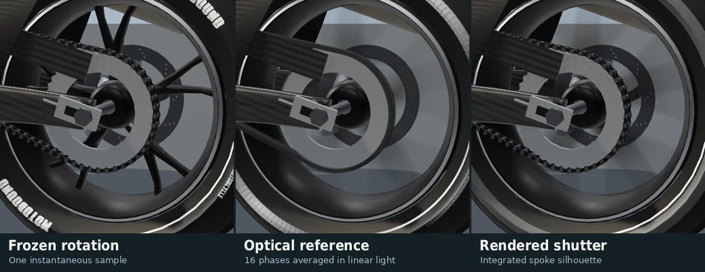

# MotoGP road grid

The studio photographs use each motorcycle's high-detail geometry. The two prototypes carry distinct V4 and inline-four engines. The classic has three hollow carburettor bellmouths, ribbed spark plugs, a bolted split crankcase and three expansion chambers. Its oil reservoir sits between the twin shock braces. Across 91 positions covering 90 mm of rear travel, the reservoir cleared the tyre by at least 74 mm at every detail level. A mechanical linkage operates the rear drum. The roadster has a round lamp and handlebar-mounted mirrors. The supersport carries its mirrors on the fairing. The street-equipped bikes reflect the helmet camera's sightline from the mounted glass. The roadster's rearward view sweeps with the bars. The four support-class cockpit cameras use eye positions measured against the rider and instruments. Both equipped bikes keep the mirror centres in view at 4:3, 16:10 and 16:9 through the tested steering and banking angles.

[Compare the classic and roadster bodywork](evidence/roadster-and-classic.webp) · [Inspect the CR750 engine bay](evidence/classic-engine.webp) · [Compare the roadster cockpit before and after](evidence/roadster-cockpit.webp) · [Ride onboard the SS600](evidence/supersport-cockpit.webp)

## On the circuit

Tyre width, crown and rolling radius follow the machine. The fixed-step simulation resolves braking and lateral force against each wheel's rolling direction on the road. That keeps tyre slip, heat and steering consistent over banking and changes in grade. When the rear wheel starts to slide, the lean assist progressively damps yaw through the handlebars while the two tyres continue to supply the forces. Under heavy braking the rider can take the inside boot off the peg. The right foot returns to the rear brake when the pedal is in use. Wheel spray, contact shadows and the rider pose follow the recorded contacts through replay. The game uses physics version 32 for lap records, ghosts and network sessions so that competitors compare runs made with the same contact model.

[Watch a GP-R2 turn in at Poggio Alto](evidence/poggio-corner.mp4) · [See the live race number, position and lap on the pit wall](evidence/pit-wall.webp)

The 2.5-second film follows one motorcycle in an eight-rider simulation using a controlled trailing camera and lighting. Each of its 60 frames advances the production simulation by five ticks at 120 Hz. The dry and wet chase and cockpit stills above were captured in the production application at 1280 × 800 using its Low preset.

## Wheel motion and field cost

At 112 radians per second and a 1/180-second exposure, the real-time spokes reduced mean absolute RGB error from **21.37 to 8.77** on a 0–255 scale. The comparison used 58,081 changing wheel pixels and a reference made from 16 sharp rotations averaged in linear light. The brake caliper and the stationary parts remain sharp.

A distant prototype now keeps its helmet on the same physical path as the closer rider. Across five poses the old model switch displaced the helmet by up to 58.7 mm. The two levels now agree within 0.1 mm. The change keeps the same 18 mesh batches and 2,268 triangles on each distant prototype rider. The distant support-class suits retain the outline of the back protector with 60 additional triangles apiece in their existing batches.

Seven rival motorcycles now require seven empty transform nodes to host their animated models. In the same browser the previous hosts constructed 959 unused meshes and allocated 40.45 MiB of geometry arrays before drawing the motorcycles. The counted bytes exclude GPU allocations. During startup, the discarded shadow pass submits one triangle from each eligible material group and waits for the GPU before drawing the chase camera. The actual race uses the complete caster geometry.

## Verification

Eight seeded three-lap races covered Poggio Alto, Montejaral, Cape Wrenna and Haarveld in clear weather and rain. **All 64 entrants finished.** One rider fell at Haarveld in the dry and recovered to finish. The other seven races recorded zero falls. Run `npm run test:bikes -- --gp-weather-grid` to repeat these eight races, or `npm run test:bikes` for the career event suite. The separate 19-scenario race suite classified **158 of 158 entrants** across the two prototypes, superbike, supersport and classic. It recorded seven falls. The roadster was checked in live practice. The complete results and geometry counts are available in the [validation record](validation.json) and the [reviewed source](https://github.com/cheshmakzanoon-ops/Experiment-3/tree/3963037a674b356eecb2ff45e4ff3fa32449431b).

A separate two-lap Aurel regression previously lost a prototype under braking at tick 2,365. After the yaw correction, all eight riders finished that race without a fall, collision or penalty. Two further Poggio Alto runs met the same checks in dry and wet conditions. One 24-second sequence of recorded steering, braking and throttle produced byte-identical wheel, rider and race snapshots at all 2,880 physics ticks when driven by 30 Hz, 60 Hz, 144 Hz and irregular frame clocks.

The render captures used Chromium and Mesa software rendering. Native console frame pacing, controller-to-display latency and sustained performance on physical target GPUs still need hardware measurements.
