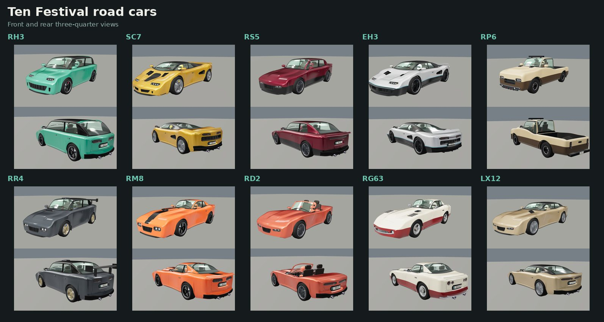
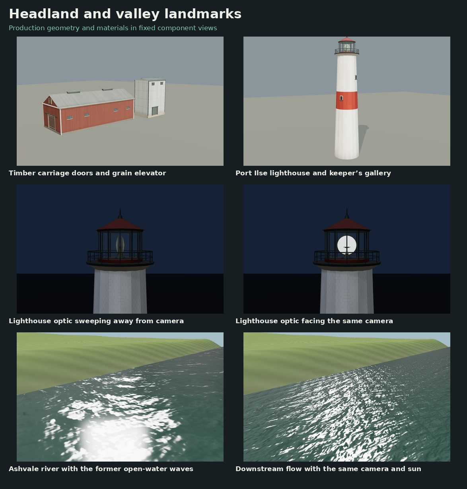

# Solvane Coast Festival field review

The starting build for these comparisons was `6a37db8950ea1f20d7a90ff4915cb79f4629c510`. The 100 supplied reference images guided the proportions of the road cars, the visibility of the route at speed, the harbour streets and the layering of the landscape. All the geometry, liveries and scenery shown here belong to the original Solvane setting.

## Through the harbour

The two columns use the same cameras. Street trees have matching trunk collision, gratings follow the banked footways, and shops have double-sided projecting signs. At an event the driver can see through the start area. The timing board stands off the road.

## The wet mountain approach

The builds are `6a37db8` and `a2cab68`. Both frames use the SC-7 chase camera on arrival at the Varda Pass speed zone, 800 × 450 in Low, with the same rain and sunset presets. The replacement for the bright start ring is visible on the right shoulder. Distant tree crowns now follow the near forest. The improved slope lighting keeps the road and hillside distinguishable.

## The ten road cars

The RH-3 hatch gained recessed rear glass, an overhanging visor and a roof brake lamp. Raised lower bumpers and reshaped rockers carry the side contour around the rear of each car. The modern noses have recessed intake liners, cooling fins and brake ducts. The SC-7 now has a painted join between its bonnet insert and windscreen. The classic cars retain their distinct chrome bumpers.

The sum of triangles submitted in **ten individual garage captures** fell from **1,327,825 to 1,242,463**, a 6.43% reduction. The RH-3 fell from 143,821 triangles and 71 draws to 128,263 and 69. The RG-63 fell from 120,005 to 102,381 with the same 66 draws. The RP-6 gained 92 triangles. At racing distance a separate caliper mesh keeps the cast silhouette with at most 500 triangles per wheel, down from 1,104. The per-car counts are in the measurements file.

## Headland and valley

Port Ilse has a stone lighthouse shaft, keeper’s gallery and rotating, paired Fresnel lights. The gallery stills show the same camera at two points in the 16-second revolution. The four valley farms have sliding carriage doors, high working windows and ridge vents. Two farms also have grain elevators.

The Ashvale river now carries ripples in the direction of the channel. Its surface normal follows the downhill grade, its flow slows near the banks and the current eases into the flat tidal reach. The river comparison uses the same valley segment, lighting and camera. Replaying the same time produced the same image bytes.

[Watch the harbour pennant and rotating lighthouse optic in motion (8 seconds)](harbour-motion.mp4)

The landmark images use production meshes in an isolated daylight or night setup. The river uses the production terrain height field and water mesh with a neutral bank material. The Port Ilse streets and the session images below are full gameplay captures.

Terrain material buffers now use 62.5% fewer bytes for the rock, soil, sand, snow and land-cover weights. The Low terrain streamer used 27,697,056 bytes for these attributes at Varda Pass before the change and 10,386,396 after. Ashvale went from 27,984,096 to 10,494,036 bytes. Both locations produced identical vertex positions and triangle indices. In matched, 800 × 450 terrain-only frames, 8 of 360,000 Varda pixels differed by more than one 8-bit colour step. The largest difference was two steps. Every Ashvale pixel stayed within one step. These figures measure the terrain attributes and their image effect. Total GPU memory and frame times require a separate measurement.

The road network now shares vertices at consecutive cross-sections, with a separate strip for each paint dash and culling boundary. Its 443 road batches retain all 551,764 triangles. The mesh buffers fell from 51,932,456 bytes to 27,991,960 bytes. Comparing every indexed triangle in order gave identical positions, normals, both texture coordinate sets and surface parameters. The count covers the carriageways, markings, verges and other geometry in those batches.

## Driving

| Assisted run | Cars and conditions | Outcome |
| --- | --- | --- |
| Ashvale Sprint | All ten road cars, clear and rain, four entrants | All 20 finished |
| Port Ilse Street Loop and Coast to Summit | RH-3, SC-7 and RP-6, rain, six entrants | All six finished |
| Coast Highway Speed Trap and Varda Pass Speed Zone | RH-3 and SC-7, clear and rain, with traffic | All eight produced valid scores |

The 26 races recorded zero player or rival resets and zero seconds off course. Ashvale Sprint used seed 41271, the six-entrant races used seed 73021 and the speed and drift diagnostics used seed 713225. Some six-car runs recorded light contact. In separate drift diagnostics, the RM-8 scored 26 points on the dry hairpin. Some assisted attempts returned zero points and the SC-7 left the hairpin zone under aggressive slide control. The quarry results below use the later road material.

Tyre response at the edge of rural asphalt uses the share of the steered tread on pavement, paint and gravel. This affects wet grip, rolling resistance and the tyre’s response to loose ground. Each wheel leaves a continuous skid ribbon at its own tread width and contact height, including on banked roads and elevated decks.

The SC-7 recording follows two four-second sections of a wet, six-entrant Port Ilse Street Loop race. The braking and cornering views use the player’s recorded wheel, steering, suspension and body transforms from the 120 Hz simulation. The review renders the player car, its local road and nearby buildings under fixed light. The speed readout comes from the same snapshots. The video plays at 24 frames per second.

[Watch the SC-7 brake and corner in Port Ilse (8 seconds)](port-ilse-sc7.mp4)

A wet four-car Ashvale Sprint replay fed the same recorded SC-7 controls to the production 120 Hz stepper, with clock updates arriving at 30, 60 and 144 Hz. Each run finished in 82.10 seconds. All 110 once-per-second snapshots matched byte for byte across the three runs, including the rivals. Render throughput was outside the scope of this clock test.

### Quarry Track Drift Zone

The original wet RM-8 missed the gate on its uphill run-up. Moving the approach to a gentler section got it through the gate in 27.50 seconds, then it stalled on the climb and needed 15 resets. The quarry carriageway now uses compacted gravel with crown drainage. Its granular surface, wheel paths and wet sheen distinguish it from the surrounding softer soil.

| Vehicle | Dry finish | Wet finish | Off-route time | Resets |
| --- | ---: | ---: | ---: | ---: |
| RM-8 | 41.97 s | 73.33 s | 0 s | 0 |
| RH-3 | 41.97 s | 62.70 s | 0 s | 0 |
| SC-7 | 40.57 s | 52.40 s | 0 s | 0 |

These six assisted runs used seed 713225 and active traffic. The wet RM-8 crossed the entry gate in 22.29 seconds. Each run finished the zone with zero points under the standard slide controller. In a separate dry RM-8 run, a steering flick and countersteer held a credited slide for 1.175 seconds. The game awarded 28 points and recorded a 43.40-second finish with zero off-route time and zero resets. The steering sequence is exercised in the Festival QA regressions.

The full chase capture uses the shipping road renderer. The three material close-ups below it use the same crowned road section, camera and lighting.

A published Chromium run at `2782f81f` completed all 12 driving-session checks. Keyboard input moved the car 57.38 m and slowed it from 65.63 to 0.54 km/h. The same run exercised map travel, photo orbit, garage changes, live rivals, an assisted race finish, retry and exit. Its water, dust, smoke and night-light reviews all passed. The run used Mesa software rendering at 960 × 540 in Low. Console and competition frame times still require measurements on the target hardware.

[First full browser run](https://github.com/cheshmakzanoon-ops/Experiment-3/actions/runs/44851763841) · [Second full browser run with weather-driven scenery](https://github.com/cheshmakzanoon-ops/Experiment-3/actions/runs/44854448764) · [Per-car, per-event and mesh measurements](measurements.json)
