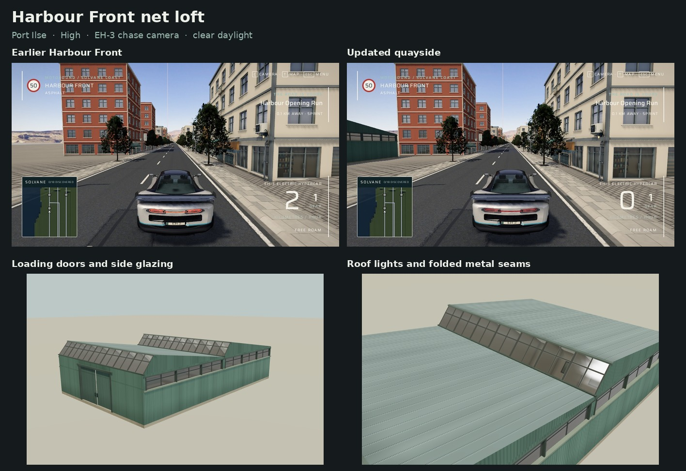
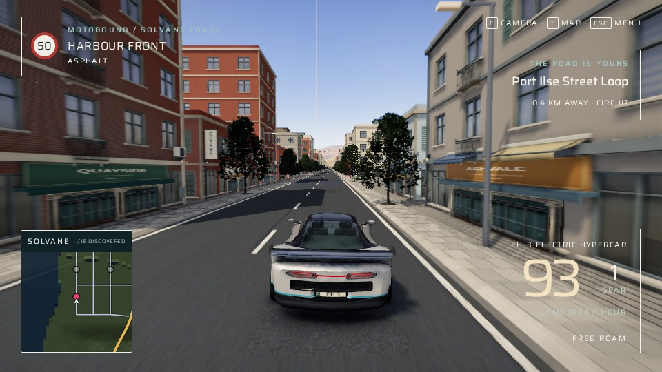
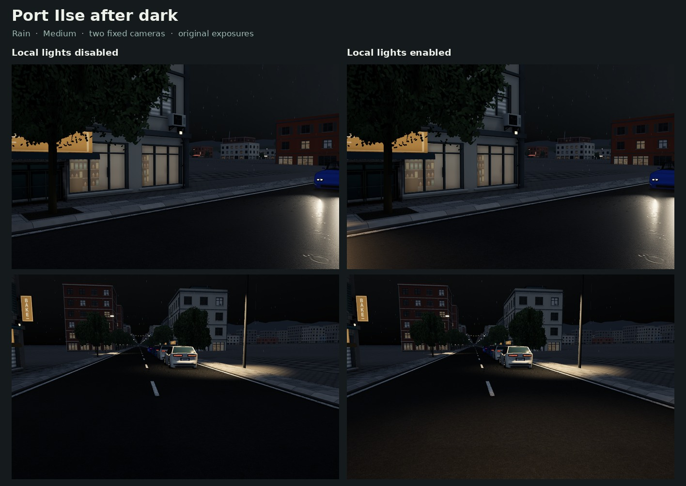
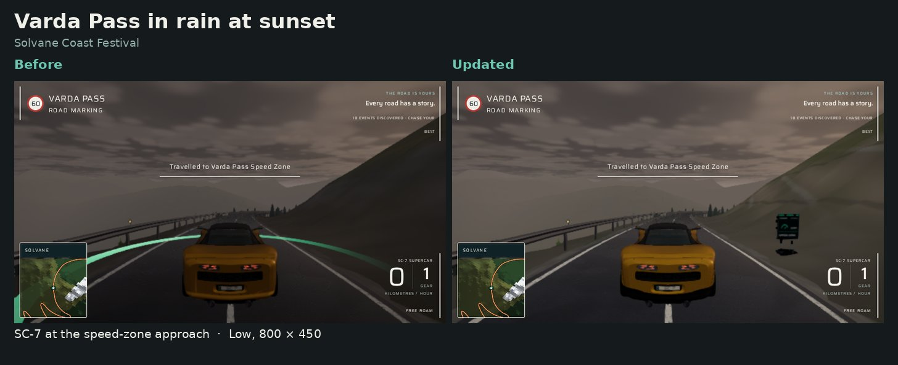
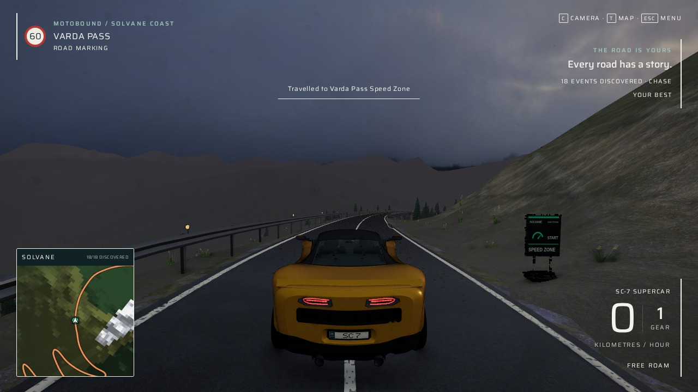
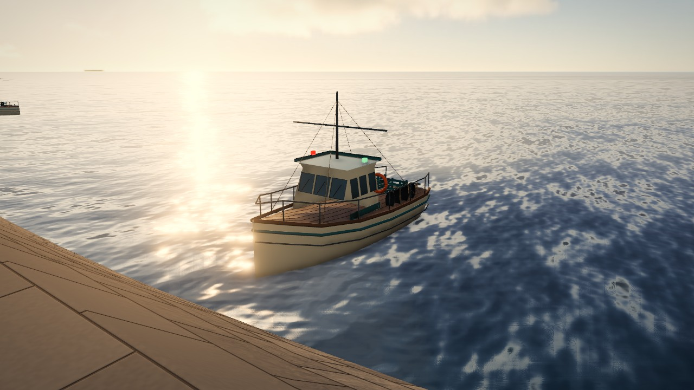
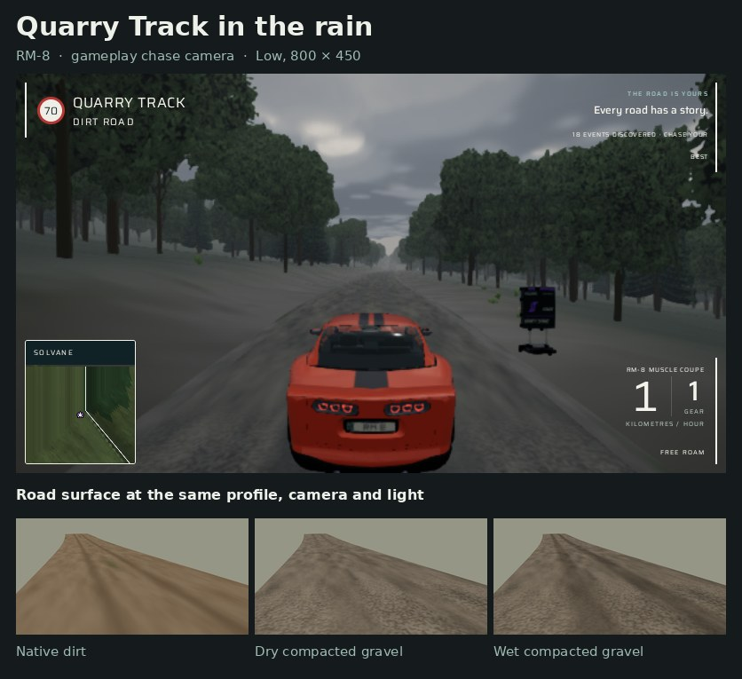

# Solvane Coast Festival field review

The starting build for these comparisons was `6a37db8950ea1f20d7a90ff4915cb79f4629c510`. The 100 supplied reference images guided the proportions of the road cars, the visibility of the route at speed, the harbour streets and the layering of the landscape. All the geometry, liveries and scenery shown here belong to the original Solvane setting.

## Through the harbour

The two columns use the same cameras. Street trees have matching trunk collision, gratings follow the banked footways, and shops have double-sided projecting signs. At an event the driver can see through the start area. The timing board stands off the road.


A net loft now occupies the open quay yard beside the default Harbour Front start. Its two-bay sawtooth roof has sloped glass and standing-seam metal panels. Recessed sliding doors and high side windows share the same district mesh. The two larger waterfront warehouses use seven roof bays each. The net loft has 580 triangles, a 24 × 15 m collision footprint and at least 13.5 m clearance from the usable road edge at the measured corners and side midpoints. All 650 earlier structures kept their positions and dimensions. Together the three warehouse changes added 3,456 near-view triangles and 355,908 bytes to the regional building meshes. The three affected districts still use one building mesh each.

The chase views use the EH-3, High preset, 960 × 540 viewport, default spawn and clear daylight on the same Mesa renderer. Camera positions differed by 0.25 mm. The lower two panels show the production net-loft mesh under fixed studio lighting.



[Full-size original High capture](harbour-high.jpg) · [Full-size updated High capture](harbour-quay-high.jpg) · [70-metre waterfront warehouse](east-quay-warehouse.jpg)

The EH-3 accelerated from the default start under keyboard control. The chase view below shows 93 km/h on the HUD. At the corresponding speed sample the car had travelled 30.24 m. The final presented view was 138.21 m from the start.



On a second run the same car arrived in High at 1280 × 720. Applying the brake at 94.88 km/h produced consecutive samples of 62.09, 25.61 and 0.43 km/h over 2.41 simulated seconds. The two endpoint positions were 30.20 m apart. The live worker and keyboard remained active between samples.

[Full-size 1280 × 720 quay arrival](harbour-quay-720.jpg) · [Chase view after braking](harbour-eh3-braking-720.jpg)

The Medium-preset night captures show a harbour storefront and the overhead festival lights in rain. In each pair the camera, exposure, geometry and physics state stay fixed while two nearby lights switch on. The quay build changed 51,786 pixels by at least two colour levels at the storefront and 230,214 under the festoon. Repeating each lights-off frame gave identical pixels. The full-size frames are in the quay-build workflow.



## The wet mountain approach

The builds are `6a37db8` and `a2cab68`. Both frames use the SC-7 chase camera on arrival at the Varda Pass speed zone, 800 × 450 in Low, with the same rain and sunset presets. The replacement for the bright start ring is visible on the right shoulder. Distant tree crowns now follow the near forest. The improved slope lighting keeps the road and hillside distinguishable.



On the final quay build the SC-7 arrived at the same speed zone in rain. This full 1280 × 720 Medium chase view includes the HUD, right-hand timing board, guardrail reflectors and the descent into the lower forest. The production renderer submitted 426 draw calls and 2,309,812 triangles. The session recorded zero page errors and failed asset requests.



## The ten road cars

The RH-3 hatch gained recessed rear glass, an overhanging visor and a roof brake lamp. Raised lower bumpers and reshaped rockers carry the side contour around the rear of each car. The modern noses have recessed intake liners, cooling fins and brake ducts. The SC-7 now has a painted join between its bonnet insert and windscreen. The classic cars retain their distinct chrome bumpers.


The sum of triangles submitted in **ten individual garage captures** fell from **1,327,825 to 1,242,463**, a 6.43% reduction. The RH-3 fell from 143,821 triangles and 71 draws to 128,263 and 69. The RG-63 fell from 120,005 to 102,381 with the same 66 draws. The RP-6 gained 92 triangles. At racing distance a separate caliper mesh keeps the cast silhouette with at most 500 triangles per wheel, down from 1,104. The per-car counts are in the measurements file.

## Headland and valley

Port Ilse has a stone lighthouse shaft, keeper’s gallery and rotating, paired Fresnel lights. The gallery stills show the same camera at two points in the 16-second revolution. The four valley farms have sliding carriage doors, high working windows and ridge vents. Two farms also have grain elevators.

The Ashvale river now carries ripples in the direction of the channel. Its surface normal follows the downhill grade, its flow slows near the banks and the current eases into the flat tidal reach. The river comparison uses the same valley segment, lighting and camera. Replaying the same time produced the same image bytes.


The fixed sunset camera looks across the Port Ilse quay at the harbour launch and open coastal water. This 1280 × 720 Medium capture is from the hosted review on `47a15eca`.



[Watch the harbour pennant and rotating lighthouse optic in motion (8 seconds)](harbour-motion.mp4)

The landmark images use production meshes in an isolated daylight or night setup. The river uses the production terrain height field and water mesh with a neutral bank material. The Port Ilse streets and the session images below are full gameplay captures.

Terrain material buffers now use 62.5% fewer bytes for the rock, soil, sand, snow and land-cover weights. The Low terrain streamer used 27,697,056 bytes for these attributes at Varda Pass before the change and 10,386,396 after. Ashvale went from 27,984,096 to 10,494,036 bytes. Both locations produced identical vertex positions and triangle indices. In matched, 800 × 450 terrain-only frames, 8 of 360,000 Varda pixels differed by more than one 8-bit colour step. The largest difference was two steps. Every Ashvale pixel stayed within one step. These figures measure the terrain attributes and their image effect. Total GPU memory and frame times require a separate measurement.

The road network now shares vertices at consecutive cross-sections, with a separate strip for each paint dash and culling boundary. Its 443 road batches retain all 551,764 triangles. The mesh buffers fell from 51,932,456 bytes to 27,991,960 bytes. Comparing every indexed triangle in order gave identical positions, normals, both texture coordinate sets and surface parameters. The count covers the carriageways, markings, verges and other geometry in those batches.

## Driving

| Assisted run | Cars and conditions | Outcome |
| --- | --- | --- |
| Ashvale Sprint | All ten road cars, clear and rain, four entrants | All 20 finished |
| Port Ilse Street Loop and Coast to Summit | RH-3, SC-7 and RP-6, rain, six entrants | All six finished |
| Coast Highway Speed Trap and Varda Pass Speed Zone | RH-3 and SC-7, clear and rain, with traffic | All eight produced valid scores |

The 26 races recorded zero player or rival resets and zero seconds off course. Ashvale Sprint used seed 41271, the six-entrant races used seed 73021 and the speed and drift diagnostics used seed 713225. Some six-car runs recorded light contact. In separate drift diagnostics, the RM-8 scored 26 points on the dry hairpin. Some assisted attempts returned zero points and the SC-7 left the hairpin zone under aggressive slide control. The quarry results below use the later road material.

Tyre response at the edge of rural asphalt uses the share of the steered tread on pavement, paint and gravel. This affects wet grip, rolling resistance and the tyre’s response to loose ground. Each wheel leaves a continuous skid ribbon at its own tread width and contact height, including on banked roads and elevated decks.

On High, the car paint and wet road use local reflections. After a delayed driving frame they keep the last complete map while the next one updates. Six delayed frames, each three seconds apart and 28 m farther down the road, previously submitted 36 cubemap faces. They now submit six. The updated map becomes visible when its sixth face is ready. Fast travel and photo seeks still refresh the whole map immediately. The test counts draw submissions from the production reflection code and Three.js cube cameras.

The SC-7 recording follows two four-second sections of a wet, six-entrant Port Ilse Street Loop race. The braking and cornering views use the player’s recorded wheel, steering, suspension and body transforms from the 120 Hz simulation. The review renders the player car, its local road and nearby buildings under fixed light. The speed readout comes from the same snapshots. The video plays at 24 frames per second. The front wheels reached 29.83° and 23.03° of steering lock. Vertical hub travel across the four wheels ranged from 31.6 to 56.4 mm within the two shots.

[Watch the SC-7 brake and corner in Port Ilse (8 seconds)](port-ilse-sc7.mp4)

All ten Festival road cars also completed a wet, six-car Port Ilse Street Loop with zero pilot resets and zero time off course. The production wheel presentation functions returned finite hub, steering, angular-speed and rotation values in 2,354,584 wheel evaluations. Each evaluation sampled the midpoint between adjacent 120 Hz racing snapshots. Hub travel across the 40 wheels ranged from 38.3 to 83.5 mm over a complete race. The maximum inside/outside steering difference ranged from 6.17° to 8.15° across the ten cars. Per-wheel results and race times are in the measurements file.

Run the fleet measurement from the repository root after installing dependencies. Appending a vehicle ID such as `eh3` restricts it to that car.

```sh
node --experimental-transform-types docs/production/solvane-coast-field-review/wheel-motion.mjs
```

A wet four-car Ashvale Sprint replay fed identical recorded SC-7 commands to the production 120 Hz stepper. The visual clock ran at 30, 60 and 144 Hz, then alternated between 6.94 and 37.50 ms per update. Each run finished in 82.10 seconds. All 13,200 player-and-rival snapshots matched at every physics tick, covering 71,174,400 bytes per run. These measurements concern simulation timing and state. Display frame times require a hardware capture.

To repeat the replay from the repository root, install the project dependencies and run the included check.

```sh
node --experimental-transform-types docs/production/solvane-coast-field-review/replay-cadence.mjs
```

### Quarry Track Drift Zone

The original wet RM-8 missed the gate on its uphill run-up. Moving the approach to a gentler section got it through the gate in 27.50 seconds, then it stalled on the climb and needed 15 resets. The quarry carriageway now uses compacted gravel with crown drainage. Its granular surface, wheel paths and wet sheen distinguish it from the surrounding softer soil.

| Vehicle | Dry finish | Wet finish | Off-route time | Resets |
| --- | ---: | ---: | ---: | ---: |
| RM-8 | 41.97 s | 73.33 s | 0 s | 0 |
| RH-3 | 41.97 s | 62.70 s | 0 s | 0 |
| SC-7 | 40.57 s | 52.40 s | 0 s | 0 |

These six assisted runs used seed 713225 and active traffic. The wet RM-8 crossed the entry gate in 22.29 seconds. Each run finished the zone with zero points under the standard slide controller. In a separate dry RM-8 run, a steering flick and countersteer held a credited slide for 1.175 seconds. The game awarded 28 points and recorded a 43.40-second finish with zero off-route time and zero resets. The steering sequence is exercised in the Festival QA regressions.

The full chase capture uses the shipping road renderer. The three material close-ups below it use the same crowned road section, camera and lighting.




### Paddock and controls

From the paddock, choose **Festival** and **Enter Festival**. The packaged game opened Harbour Front in the EH-3 with a saved Low preset. Keyboard throttle took the car to 40 km/h and Escape opened the Festival pause menu. A fresh launch at 960 × 600 also entered Harbour Front, accelerated to 30 km/h and returned to the public paddock through Exit Festival. Both runs reported zero failed requests and zero page errors. An earlier local attempt with a constrained Chromium heap closed during the transition. Fifteen separate browser checks covered keyboard and controller navigation, retry, map and photo modes, and the rival display on desktop and phone layouts.

## Verification

| Build on `main` | Local regression results | Browser coverage |
| --- | --- | --- |
| `89fe9739` · quay buildings | 680 passed across 84 files | High chase, throttle and brakes at Harbour Front. All 12 Low driving checks passed on SwiftShader and hosted Mesa. Both Medium night scenes passed on hosted Mesa. |
| `726babfc` · reflection continuity | 678 passed across 83 files | High harbour chase and HUD on Mesa. All 12 Low driving checks on SwiftShader. |
| `336fb587` · wet quarry and scoring | 637 passed across 81 files | All 12 Low driving checks on SwiftShader and hosted Mesa. Smoke, dust, water and both Medium night scenes passed on hosted Mesa. |

The quay build passed TypeScript, Vite, lint, content validation and the bundle check. Its initial JavaScript was 3.67 MB gzipped against a 4 MB budget. The High harbour frame submitted 677 draw calls and 1,676,329 triangles at 960 × 540. The image and full driving checks both recorded zero page errors and zero failed asset requests. The assisted Harbour Opening Run finished in 105.37 seconds with zero off-route time. Retry started a distinct run, and exit released the Festival scene.

Tyre smoke, quarry dust and water spray each passed three measured image comparisons on the quay build. The effect pools reached 85 smoke particles, 210 dust particles and 397 spray particles. Repeating each control frame produced identical pixels.

On the same quay build all 26 assisted races and six quarry-zone runs completed without resets or off-route time. All eight speed challenges scored. The wet four-car replay also matched all 13,200 physics snapshots from the earlier builds at each of the four presentation cadences.

The four-panel gameplay plate comes from `336fb587`. On that build, keyboard input moved the car 32.49 m on SwiftShader and 57.44 m on hosted Mesa. Its hosted run passed an additional 153 focused tests. A separate local SwiftShader night run timed out on the storefront capture. The paired Medium night plate above comes from the later quay build, `89fe9739`.

The quay build passed 188 focused checks across 23 files on the hosted runner. The hosted keyboard drive covered 57.06 m, with braking from 65.07 to 0.93 km/h. The 12-step journey, tyre smoke, dust, spray and both rainy-night lighting comparisons all passed. One local Mesa attempt on the same build lost its renderer during storefront readback.

The keyboard journey also passed all 12 checks using the browser matrix's corrected identity manifest. It carried the production fingerprint and 1,848 individual source and asset hashes. Keyboard input moved the car 66.74 m and braking reduced speed from 66.26 to below 0.01 km/h. The three-car race finished in 105.37 seconds with zero off-route time, page errors or missing assets.

A hosted run of the earlier reflection build finished the driving checks but exceeded the night-load deadline while identifying its software renderer. The review now reads the WebGL renderer name from the Festival's own context before the first draw. The night checks still require the requested backend and both full lighting comparisons.

Blender 5.2.2 LTS reopened the coastal detail, street and façade-joinery sources. All eight outputs matched the files shipped to the game byte for byte, including the three GLBs.

An earlier local Mesa race closed at 62% progress. Two early High attempts closed during loading, and an additional High capture after fast travel exceeded its compositor deadline. The matched default-arrival High captures completed. The hosted High-preset matrix also produced a 1280 × 720 chase view on `47a15eca` with zero page or asset errors. Native PS5 image quality and sustained competitive frame times require target-hardware measurements.

[Hosted 720p camera and coastal captures](https://github.com/cheshmakzanoon-ops/Experiment-3/actions/runs/44867008037) · [Quay-build driving and optics workflow](https://github.com/cheshmakzanoon-ops/Experiment-3/actions/runs/44872329454) · [Hosted optics and driving at 336fb587](https://github.com/cheshmakzanoon-ops/Experiment-3/actions/runs/44863196760) · [Per-car, per-event, mesh and validation measurements](measurements.json)
