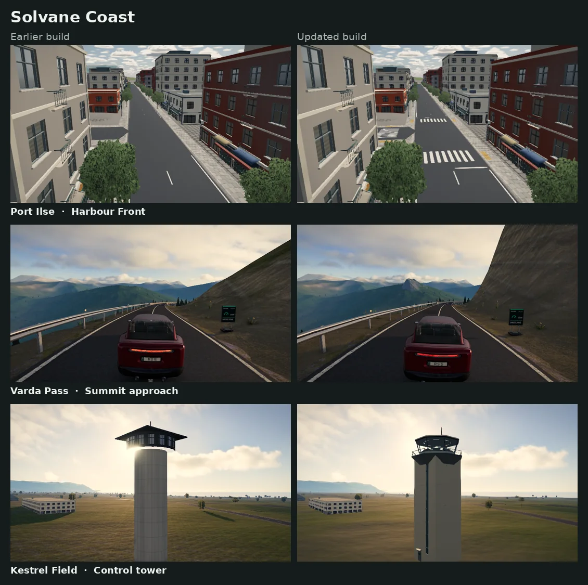

# Driving Solvane Coast

The photographs in the supplied 100-image reference pack guided three decisions visible from the driver’s seat. The instruments and mirrors have to be readable at speed, roadside objects need to meet the road at the right height, and the distant skyline needs a recognisable shape. The captures below show the original Solvane cars and landscape in the running Three.js game.

On Harbour Front, the zebra bars lead into dropped kerbs with tactile paving. Stop lines, wet cast iron and the crossing paint each share their footprint with the tyre-contact sampler. At Varda, nine bedded rock spurs change the skyline, the road cuts and the ground the car can actually drive on. At Kestrel, the control tower has a glazed, raked cab with eight panes, a wraparound gallery and a recessed ground entrance. Runway 09/27 has a marking at each end, directional threshold lights and touchdown rubber that changes grip with the weather.

## From the cockpit

Each of the ten road cars carries two convex wing mirrors and a flat interior mirror. Their views are rendered from the seated eye through the individual glass planes. The centre display follows the car along the road network and shows the current street and speed limit. The reversing lights follow the selected gear, including when the car is rolling in the opposite direction. The camera follows the sprung car and respects the reduced-motion setting.

At Saltmarsh, planted rows, cut stubble, headlands and tractor wheelways sit on the same terrain sampled by the wheels. The distant rows follow the same bearings as the individual plants. At Port Ilse, three working launches follow the harbour swell. Each boat swings from its bow eye to a moving buoy on a 3.87 m line. A three-minute test checks both ends, rope length and the pose after seeking backward in time.

## Driving and rendering checks

| Check | Measurement |
| --- | --- |
| Junctions | Drove all 76 directed junction turns, including left and right turns. Each run stayed on the carriageway and cleared its indicator. |
| Traffic cruise | Six minutes per car, repeated with the same seed and 24 ambient vehicles at peak. The RH3 covered 7.23 km in clear weather, the RP6 covered 2.97 km in rain and the SC7 covered 1.74 km in clear weather. Each pair reproduced its movement digest with zero recoveries. |
| Road markings | White and yellow road paint fell from 212,270 to 77,694 triangles. Across six paved road classes, more than 200,000 independent probes put the horizontal edge error below 9.5 mm and vertical error below 2.6 mm. |
| Port Ilse lighting | From the Harbour Front starting street on Low, five luminaires keep their full castings and 235 retain their distant silhouette. Across the network this takes 25,600 triangles, down from 123,360 with all castings at full detail. All 240 light sources retain their position. Counts are before camera culling and exclude other lighting. |
| Street ironwork | The town contains 82 access covers and 322 kerb drains. Each uses two surface triangles with engraved relief and a wet response. Placement and tyre overlaps are checked against the actual street geometry. |
| Mirrors | Captured each of the three live reflection textures on Low. The two wing images were 128 × 73 and the interior image was 128 × 28. They contained different, non-blank scene images. |

The before-and-after plate uses matching camera views and daylight settings. The Varda chase views are both 800 × 450. The crossing and tower pairs have different native render sizes and are resized for comparison. Scenery details use the inspection camera inside the live session. The cockpit and chase captures use the driving cameras. The rigs ran Chromium with ANGLE SwiftShader. Console-equivalent image quality, sustained hardware frame times and competitive input latency still require a physical target run.
