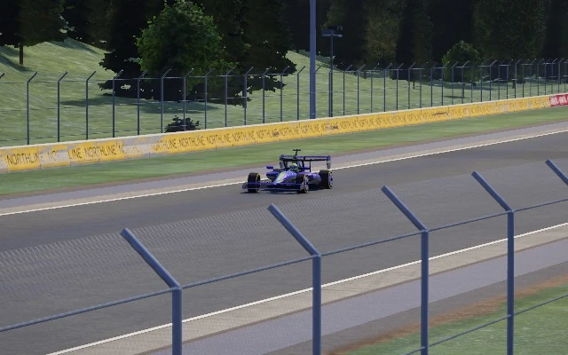
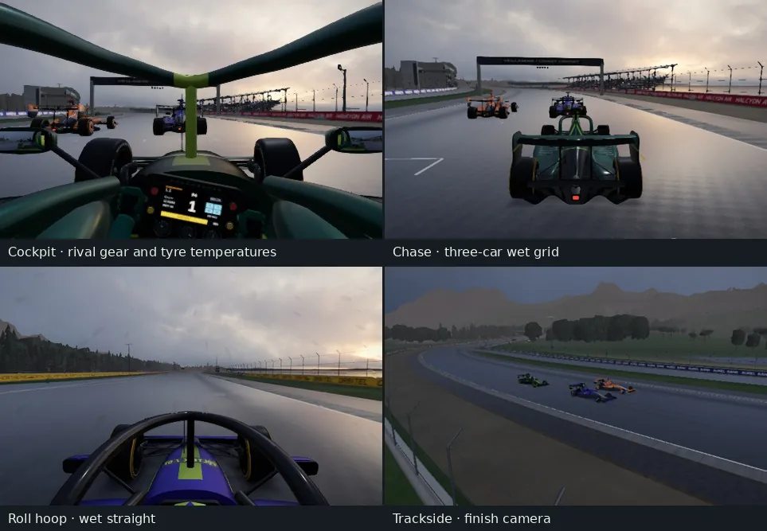
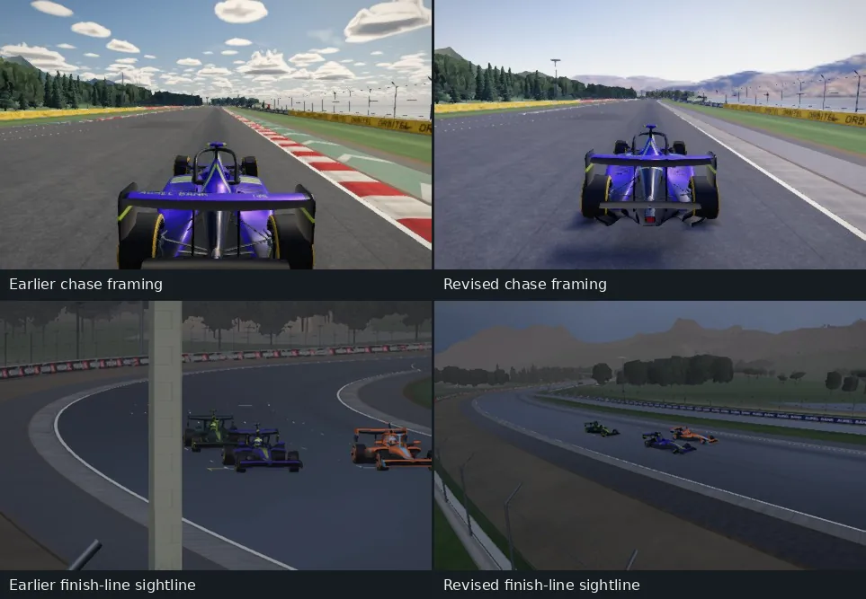
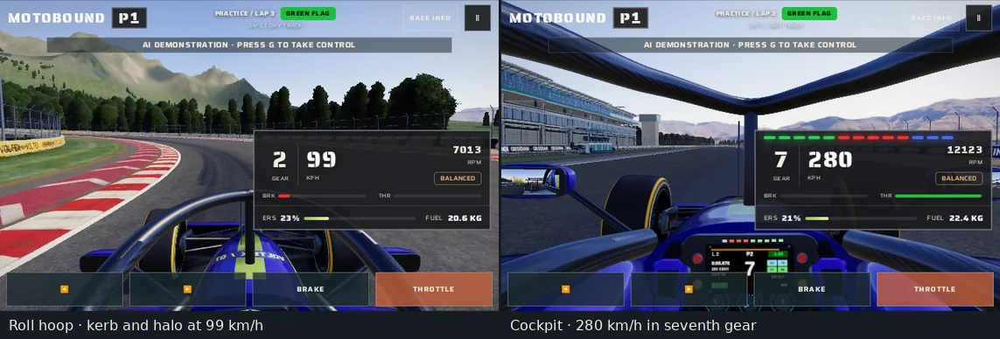
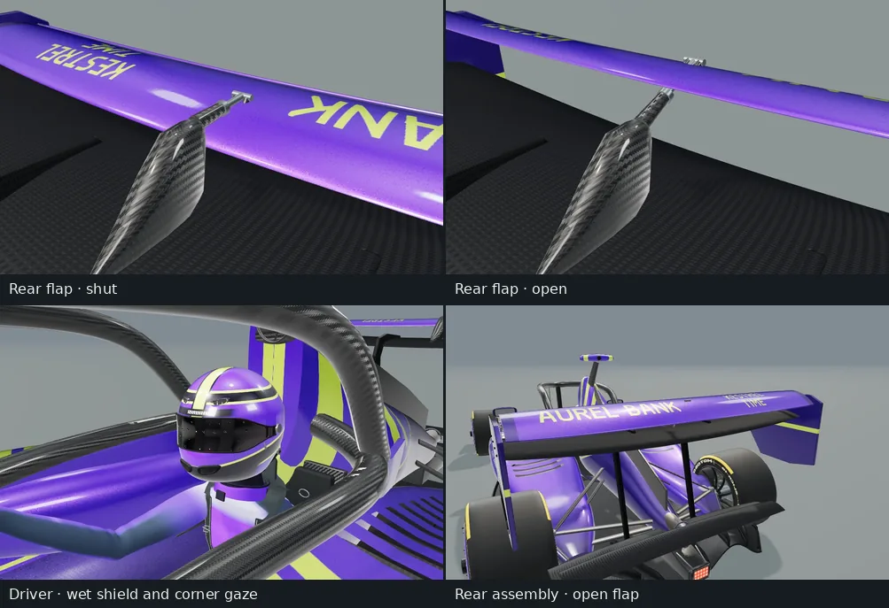
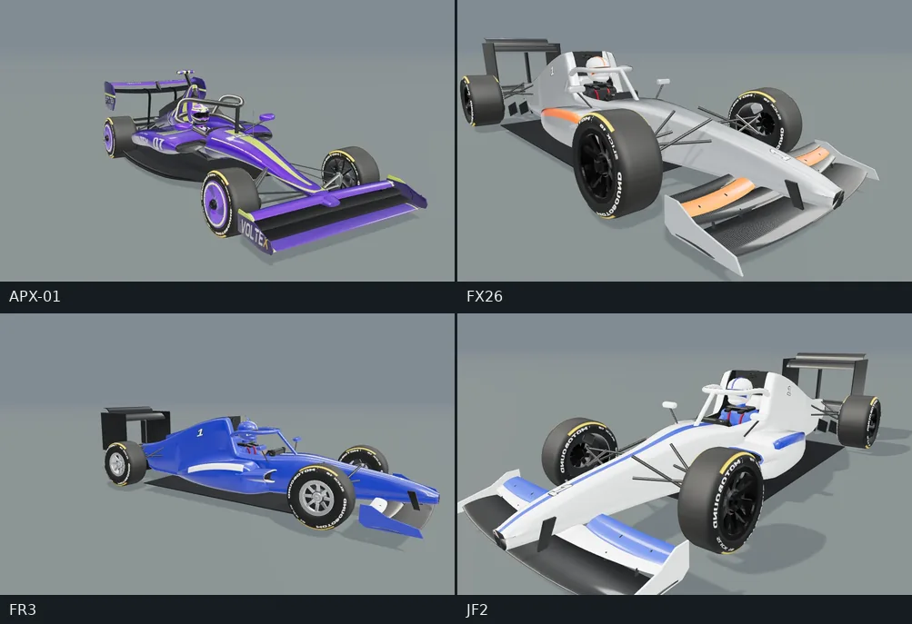
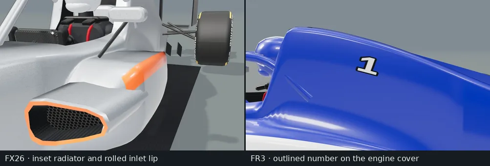
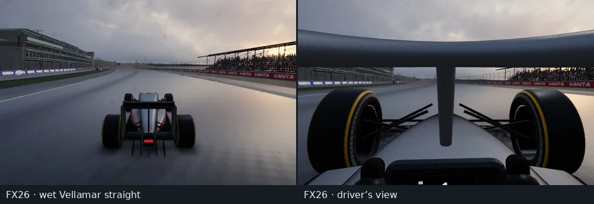

# Formula race photography

These stills come from the game's Three.js models and race renderer. The 100 supplied reference photographs informed the work on wing construction, helmet finish, lens height, wet-pavement contrast and trackside sightlines. The images below show the game itself.

This 640 × 400 High-preset frame came from a live practice session with the HUD hidden. The accompanying telemetry recorded 105 km/h, 987 metres into the lap. The local cubemap for the paint had two completed captures and was refreshing another face as the car moved.

## From the driver's seat to the finish-line camera

The Vellamar cockpit follows a rival at the start. Its steering wheel shows the selected car's gear, shift lights and tyre state on the first frame after a camera cut. In the cockpit, water on the visor responds to speed, wind and lateral load. The roll-hoop view looks over the helmet and halo. The trackside camera holds the three cars in frame and clears the head and yoke of its own physical camera mount.

The chase comparison shows the distance from the lens to the tyres and the visible road ahead. The lower pair shows the finish-line change in a wet three-car start. The car silhouettes can be compared against the grass, fence and track edge.

These two 640 × 400 frames were captured from the High preset through the normal practice menus, with the HUD visible. The roll-hoop view shows a left-hand kerb at 99 km/h. In the cockpit the steering-wheel LCD and HUD both show seventh gear as the car passes the pits. The High preset uses local scene reflections, a photographed sky and dynamic sun shadows.

## Car hardware

The APX-01 flap pivots about its trailing journals. The barrel follows the pickup and the polished piston changes exposed length. The mainplane and endplates stay fixed as the flap moves. Tyre shoulders, brake heat, driver head movement and the rear light take their state from the same simulation snapshot used for replay.

The three other Formula cars have their own front-wing spans, sweep, element profiles and endplates. Each has an articulated driver and a functioning rear flap across race, mirror and distant views. The studio stills use a neutral environment and the production geometry and materials.

The sidepod lips turn into recessed carbon ducts with honeycomb radiator faces. Both openings are visible head-on at all three levels of detail. The entrant’s number follows the curved nose and both sides of the engine cover. A dark outline keeps the same number design legible across light and dark paint. The FR3 close-up shows a number-only change to 27 on its original blue paint.

These shots follow the silver FX26 on Medium in the rain. Its visible paint and accent are the reflection surfaces for this car. The lower presets use the sky environment. High can also capture the local circuit around the followed car, including the pit building and stands.

## Geometry submitted by two Vellamar cameras

Both runs in each row use the same car count, weather, race position, camera and viewport. The counts come from the race renderer's WebGL diagnostics on the low preset. The finish-line camera uses a 55° vertical field of view and all nine sampled points covering the subject and its neighbours fit the frame in both runs.

| View | Rendered pixels | Earlier triangles | Revised triangles | Change | Earlier draw calls | Revised draw calls |
| --- | --- | ---: | ---: | ---: | ---: | ---: |
| Dry, one car, roll-hoop camera | 480 × 300 | 999,286 | 810,142 | −18.9% | 563 | 563 |
| Wet grid, three cars, finish-line camera | 624 × 390 | 1,457,101 | 1,090,553 | −25.2% | 931 | 797 |

The surface detail budget accounts for the first reduction. In the second view the followed car retains its nearest detail level while the two rivals use the middle level. Resolution and focal length determine when a rival changes level. These readings measure geometry and draw submissions. Console frame time and input latency require a hardware capture.

## Race verification

A full field of twelve cars ran a two-minute wet Vellamar start twice with the same seed and three entrants in each of the four Formula models. All 120 one-second snapshots matched byte for byte across the two runs, including the wheel and aero telemetry. Every entrant reached at least 228 km/h. Both runs used the production 120 Hz simulation.

A separate six-car, eight-lap changing-weather race finished and passed four replay seeks. The ten-car wet-pit scenarios and the dry, changeable and rain driving checks also passed.
